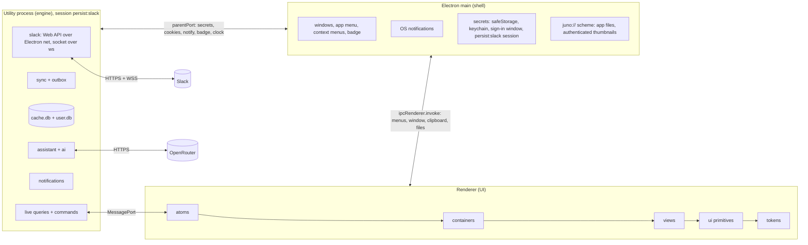
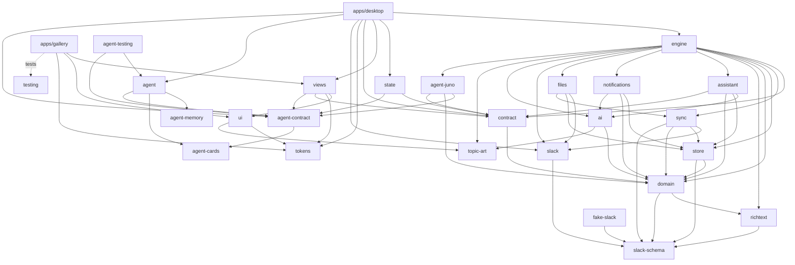

# Juno architecture

Version 2, October 2026. Revised after `docs/reviews/architecture-review-1.md` and the owner's decisions. Decisions with lasting consequences have an ADR in `docs/decisions/`; ADRs 0007 to 0011 are new in this version. The product spec (`docs/design/handoff/SPEC.md`) decides behaviour; this document decides structure.

Inputs: the spec, `docs/research/slack-data-access.md`, `docs/research/slack-desktop-shell.md`, `docs/research/tech-stack.md`, `docs/design/inventory.md`, `docs/design/primitives.md`, the review, and the installed `effect@4.0.3`, `@effect/atom-react@4.0.3` and `electron@44.7.0` sources (API names below were checked there).

Owner decisions folded in: the sidebar shows every thread with recent activity in member channels plus each channel's Main; Resolve is local plus mark-read, never unfollow; sends have no undo, but own messages can be edited and deleted (M6); full file upload, thumbnails and download in v1; a pinned resolved row stays in Pinned, dimmed with a check; new DMs open with `conversations.open`; v1 ships the default design with dark mode and accent as the only appearance settings; the keychain prompt during import is acceptable; the quiet window defaults to 7 days and is capped at 14; one workspace in the v1 UI on a multi-team-ready data layout; digests that fall due while the app is quit are delivered at the next launch.

## 1. Overview



- The **shell** (main) owns what needs Electron APIs: windows, the application menu and context menus, notifications, the dock badge, `safeStorage`, the `persist:slack` session that holds the Slack cookie, the sign-in window, the import from the installed Slack app, the `juno://` scheme, file dialogs and downloads. No business logic.
- The **engine** (a `utilityProcess` forked with `partition: 'persist:slack'`) owns all business logic and I/O. It is a plain Node program built from Effect services, so it also runs outside Electron for tests.
- The **renderer** is UI only. It subscribes to live queries and sends commands over one MessagePort. It never sees a token, a cookie or an API key.

Three rules:

1. **SQLite is the source of truth for the UI.** Every screen reads from the store through a live query. The UI never waits for Slack.
2. **Writes are local first.** A command updates the store in one transaction and queues the Slack call in a persisted outbox. The engine owns optimism, revert and undo.
3. **Views are dumb.** Props in, callbacks out. No atoms, no Effect, no IPC. Containers wire atoms to views.

## 2. Processes, network and the contract

### 2.1 Why a utility process (ADR 0001)

`node:sqlite` is synchronous and `client.userBoot` is megabytes of JSON. In main, those stalls freeze native menus, window dragging and every IPC call. In a utility process they stall nothing the user sees, a crash does not take the window down, and the engine stays a Node program that tests can run against `fake-slack` without Electron. The engine only depends on a MessagePort-shaped `Transport`, so it could be hosted in main with no package changes if ever needed.

### 2.2 Network: Electron `net` inside the engine (ADR 0007)

The review was right that the engine should not hand-hold the cookie. Electron 44 exposes `net` in utility processes, and `utilityProcess.fork` takes `session` or `partition` (checked in `electron.d.ts`). The engine is forked with `partition: 'persist:slack'`, and `SlackApi` calls `net.fetch` on that session: the `d` cookie is attached and any `Set-Cookie` that Slack sends to rotate the session is stored back. System proxy, PAC and keychain CAs come for free, and the TLS fingerprint is Chromium's. Chromium encrypts the cookie store with the same OS keychain backend `safeStorage` uses.

`HttpTransport` is an Effect service with two layers: `ElectronNet` (production) and `NodeFetch` (engine tests under Node, pointed at `fake-slack`). `SlackApi` depends only on `HttpTransport`.

The socket is the one place the cookie is handled by hand, because `net` has no WebSocket. Before each connect the engine asks main for `session.cookieHeader` (main serialises `session.fromPartition('persist:slack').cookies.get({ domain: 'slack.com' })`, HttpOnly cookies included) and opens the socket with `ws` and headers `Cookie`, `Origin: https://app.slack.com` and the Slack desktop `User-Agent`. The header string is used for the upgrade only and dropped afterwards. `Set-Cookie` headers on the upgrade response (`ws` emits `upgrade` with the response) are forwarded to main, which writes them into the session. Proxies: `ws` does not read the system proxy, so main also answers `session.resolveProxy(wsUrl)` and the engine passes an agent when a proxy is configured. This is the socket cookie story; it is small and testable (the fake rejects an upgrade without the cookie).

Custom protocols are not supported in utility processes (checked), so `juno://files/...` thumbnails are served by main with `net.fetch` on the same session.

### 2.3 Secrets and sessions

- The `d` cookie lives only in the `persist:slack` Chromium session. The sign-in window uses that partition, so the cookie lands in place. The import path writes the decrypted cookie into the session with `cookies.set`.
- The `xoxc` token and the OpenRouter key are encrypted with `safeStorage` into `userData/secrets.bin`, read by main, sent to the engine over `parentPort` at start, and kept in memory there. Under `JUNO_E2E` main uses a plaintext secrets file so the keychain never prompts.
- Sign-out deletes `secrets.bin`, clears the `persist:slack` session, and deletes the workspace's `cache.db`.

### 2.4 The three channels

| Channel | Transport | Content |
| --- | --- | --- |
| renderer ↔ engine | `MessageChannelMain`; main gives one port to the engine (`utilityProcess.postMessage({ _tag: 'port' }, [port])`) and the other to the renderer (`webContents.postMessage('engine.port', null, [port])`; the preload forwards it with `window.postMessage({ _tag: 'juno.enginePort' }, '*', ports)`, the page checks `event.source === window` and the tag) | live queries, commands, engine events, as `effect/rpc` (2.6) |
| renderer ↔ main | `contextBridge` + `ipcRenderer.invoke` | `engine.requestPort`, `launch.setTheme`, `launch.setAccent`, context menu popup, app-menu commands, title-bar double click, clipboard, open external, file dialogs, `webUtils.getPathForFile` for dropped files |
| engine ↔ main | `process.parentPort` | main→engine (`MainToEngine`): `config` (userData, e2e), `port`, later secrets, cookie header, proxy, `clock.advance` (e2e), sign-in completed; engine→main (`EngineToMain`): `ready`, later `notify`, `setBadge`, `authRequired`, `setCookies`, `openExternal` |
| agent ↔ engine | `MessageChannelMain`; on every engine `ready`, main sends one end to the engine (`agentPort`) and the other to the agent (`hostPort`) | the AgentHost group (`@juno/agent-contract`), as `effect/rpc`; the agent is the client (ADR 0012) |
| agent ↔ main | `process.parentPort` | main→agent (`MainToAgent`): `config`, `hostPort`; agent→main (`AgentToMain`): `ready` with the host's hello. Keychain and OAuth requests come in WP13 |

Every payload is an Effect `Schema` in `@juno/contract` (`protocol.ts` for the parentPort messages and the handoff, `shell.ts` for the invoke routes (`ShellRoutes`), `channels.ts` for their names), decoded on receipt. The preload imports only `@juno/contract/channels` (names and types, no runtime imports). Main checks `event.senderFrame.url` against `juno://app/` (or the Vite dev URL in dev).

### 2.5 Engine lifecycle

`apps/desktop/src/main/engine.ts` (`EngineSupervisor`) forks `out/main/engine.js` with `serviceName: 'juno-engine'` and `partition: 'persist:slack'`, sends `config` on `spawn`, and restarts it on exit with exponential backoff (1 s base, 30 s cap, give up after 5 exits in 2 minutes and report the "engine failed" state). It forks the engine and opens the window in the same tick. A port requested while the engine is down is held (one per renderer) and sent once it reports `ready`; after the supervisor gives up, `engine.requestPort` answers `failed`, the sidebar shows "Sync stopped" under its filters with a Restart button, and the account menu's diagnostics say "Engine failed". Restart calls `engine.restart`, which starts the engine again with a fresh crash count; the transport, which keeps asking for a port every second, connects as soon as main hands one out. The same line shows "You're offline" and "Slack asked us to slow down" for those engine phases. The renderer's `MessagePort` fires `close` when the engine dies (verified in the e2e `recovers after the engine process is killed`); the state client then marks the connection `reconnecting`, the worker pool re-spawns by asking main for a new port, and every live query re-subscribes and receives a fresh snapshot. The engine accepts several ports at once (renderer reload, a second window later); each port is one RPC client, and a port's close interrupts every fiber that belongs to it.

`engine.status` is a live query carrying `{ phase, startedAt }`, re-run only on phase changes; the phase is `first-run | booting | catching-up { done, total } | live | offline | rate-limited { until } | session-expired`. "Restarting" is not a phase the engine can report; the renderer derives it from the connection state. The engine (`startEngine(transport, config)`) brings its services and the RPC server up before any boot work, so the first live query is answered from local state before Slack is contacted.

### 2.6 Protocol: `effect/rpc` over the port (ADR 0009)

ADR 0002 chose a hand-written protocol because `effect/rpc` was believed to have no Electron transport. The M1 spike (evidence in ADR 0009) ran both over the same ports and route declarations: `effect/rpc` passed every criterion (live query, unsubscribe and port-close interruption under 2 ms, typed errors and defects as values, several ports at once, reconnect) and tied the custom protocol on payload cost, with 74 owned lines against 173. So the port protocol is `effect/rpc`:

- **Routes** live in `@juno/contract/src/routes/<feature>.ts`, one `RpcGroup` per feature made with `Rpc.make(tag, { payload, success, error })`. Live queries are stream routes (`stream: true`) declared through `liveValueRoute(tag, { payload, value })` for a single value or `liveListRoute(tag, { payload, row })` for a windowed list (which adds `range: ListRange` to the payload itself); commands are plain routes whose success schema includes `undo?: Command` where the spec needs it. `routes/index.ts` merges the groups into `AllRoutes`, which the engine serves and the state client calls.
- **Engine** (`@juno/engine/src/protocol`): `RpcServer.layer(AllRoutes, { disableFatalDefects: true })` over `RpcServer.layerProtocolWorkerRunner`, backed by a `WorkerRunnerPlatform` that accepts every port a `Transport` hands it and reports closes through the disconnect queue, which interrupts that client's fibers. Feature folders register handlers with `<Feature>Routes.toLayer({...})`; `layer.ts` merges them.
- **State** (`@juno/state`): `RpcClient.layerProtocolWorker({ size: 1 })` over a `Worker.makePlatform` adapter whose single worker is the renderer's current `MessagePort`. The port's `close` event fails the worker run, and the pool re-spawns by asking main for a new port. The client lives in an `Atom.runtime`, so its scope outlives any one atom. Nothing outside `@juno/state` imports `effect/rpc`, `effect/workers` or `effect/reactivity/Atom`.
- **Wire**: structured clone over `postMessage`, framed by `effect/workers` as `[0, message]` from the client and `[0]` (ready) or `[1, message]` from the engine. Payloads are the routes' JSON codecs (`Schema.toCodecJson`), so a message is readable in devtools.

The shape of the API:

- **Live query** (stream): a `liveValueRoute` emits `{ value, meta }`: the current value, then every new value. A `liveListRoute` emits `ListDelta`: a first message with `reset: true` carrying the whole window, then `{ order: Id[], upsert: Row[], remove: Id[], refs?, meta }` where `upsert` holds only rows whose `rev` changed and `refs` the people and channels the rows name that the subscription has not been sent or that changed (section 7); the engine helper `serveLiveList` in `engine/src/protocol/live.ts` takes the handler's stream of runs (the store's `liveQuery(keys, timed(query))`), keeps the last `{ order, revById }` per subscription and does the diff, so handlers only write the query; `serveLiveValue` does the same for a value. Every message's `meta` is `{ seq, queryMs, encodeMs, at, total?, error? }` (performance.md 6) so the renderer can attribute the write-to-pixels budget. The renderer keeps a `Map` by id (`applyListDelta` in `@juno/state`), so rows with an unchanged `rev` keep object identity, `order` keeps its array when unchanged, and only `upsert` rows are decoded. List subscriptions take a `ListRange { anchor?, limit }`, never a full history. Size budgets: snapshot ≤ 200 KB, delta ≤ 32 KB, codec ≤ 5 ms per side; the engine logs a warning when a message exceeds them. Debounce is leading-edge (a user command is not delayed), 30 ms trailing, and lives in the store's `liveQuery`, not the engine. A run that changes nothing sends nothing: an equal value, or a list run with no changed row, no removed id and the same order. A failed query run is emitted as the last value with `meta.error` and the subscription continues; a failure before any value fails the subscription with the route's error, or, for a route with no error of its own (the sidebar routes), starts the subscription again with backoff (`retryFirstRun`), so a busy reader at boot never ends it for good. `meta.encodeMs` is measured only in dev and e2e builds.
- **Command** (request): returns `{ undo?: Command, result }` after the local transaction.
- **Event**: `command.failed`, `navigate`, `toast`, `clock.tick`, `typing`, as stream routes with no payload.

Errors are `Schema.TaggedError` classes in `contract/src/errors.ts`: `NotSignedIn`, `Offline`, `Rejected { code }`, `RateLimited { retryAfterMillis }`, `NotFound`, `AiUnavailable`, `Invalid { issues }`, `ProtocolError`. A handler defect reaches the renderer as the `Die` cause of that one request's `Exit`; the port stays open.

**Error mapping.** Three layers have their own errors and none passes through unchanged. `@juno/slack` fails with `SlackAuthRequired`, `SlackRateLimited`, `SlackRejected`, `SlackTransportError` and `SlackDecodeError`; `@juno/store` fails with `StoreError` (`SqlError`, `MigrationError`, `StoreIoError`); routes declare only the `@juno/contract` errors, and a route's schema cannot encode anything else (it would die as a defect). So engine handlers map at the edge: `SlackAuthRequired` to `NotSignedIn` (and the `session-expired` phase), `SlackRateLimited` to `RateLimited` (both carry `retryAfterMillis`), `SlackRejected` to `Rejected { code }`, `SlackTransportError` to `Offline`. A `SlackDecodeError` means our schema disagrees with Slack, which is a bug. A `StoreError` is also a bug, because a broken database is not a state the user can act on: a command turns it into a defect with `Effect.orDie`. A live query does not: its failed run is a value (`meta.error`, above), so one bad run never ends a subscription. The mapping lives in the feature handlers, not in `@juno/slack` or `@juno/store`, so neither package imports `@juno/contract`.

## 3. Packages

pnpm workspaces, every package shipped as TypeScript source. The owner wants each smaller thing to be a package; the split below keeps that and makes each package name the rule it protects. The dependency graph is enforced by pnpm's strict layout (a package can only import what it declares) plus `scripts/check-deps.mjs`, which fails on any edge not in this table. `pnpm lint` runs the script, so the rules below fail the lint step.



The bottom block is Juno Agent (section 10, ADR 0012). Some of its edges are allowed but not used yet: `agent` declares only `agent-contract` today, `state` and `views` take `agent-contract` in M2.

| Package | Rule it protects | Owns | Must not |
| --- | --- | --- | --- |
| `@juno/slack-schema` | one Slack vocabulary | Effect Schemas for every payload read or sent (blocks, messages, methods, socket frames), the branded `Ts` with `compareTs`, `maxTs`, `minTs`, `tsToMillis`, `millisToTs` | import anything but `effect` |
| `@juno/richtext` | pure text handling | Slack `blocks`/`rich_text`/mrkdwn → `MessageBody` view model (sections, quotes, code, lists, mentions, links, emoji, files); composer text with `@`/`#` → `rich_text` blocks; emoji shortcode table; preview text (quotes stripped) | import anything but `slack-schema` types |
| `@juno/domain` | pure rules | ids, `Topic`, status and visibility, title resolution, sorting, topic index computation (`reindexTopics` inputs → row), read-state merge rule, notification decision order, clarity and audience checks, ⌘K grammar, relative time, mention detection, context-menu item lists; re-exports `Ts` and its helpers | I/O, Effect services, React |
| `@juno/contract` | the wire | route groups per feature, view models (`TopicRow`, `TopicDetail`, `MessageView`, `ForYouCard`, `JunoMessage`, `NotificationRule`, `Prefs`, `EngineStatus`), events, errors, `channels.ts` for the preload | logic |
| `@juno/slack` | the client, shared with the fake | `SlackSession`, `HttpTransport`, `SlackApi`, `RequestQueue`, `SlackEdge`, `SlackSocket`, Grid routing | know about topics, the store, the UI |
| `@juno/fake-slack` | tests cannot leak into the engine | HTTP + WS fake with fixtures, control API (inject, reply, mark from another client, drop socket, 429, expire session, Grid mode), sign-in page, file upload endpoints | import the engine or the client |
| `@juno/store` | the schema | `cache.db` and `user.db` schemas, timestamped migrations, writer and reader clients, `Invalidation` (wraps `Reactivity`), FTS5 table | call Slack or AI, shape data for the UI |
| `@juno/sync` | Slack ↔ store | boot, discovery, backfill, merge rules, event application, read-state mirroring, outbox and its worker, reconnect reconciliation, `reindexTopics` calls | render, call AI |
| `@juno/files` | authenticated bytes | upload staging and the upload flow, file metadata rows, thumbnail URL resolution, download requests to main | touch the renderer |
| `@juno/topic-art` | no model text reaches a page | the topic art vocabulary: the whitelist parser for the model's recipe, the renderer that rebuilds SVG from the checked recipe with the `art` tokens' CSS variables, the Tide pebble placeholder | import anything |
| `@juno/ai` | provider isolation | `AiProvider` with `PiAiProvider` and `FakeAiProvider`, task table (prompts, output schemas, tier) | touch the store |
| `@juno/assistant` | AI policy | when tasks run, `ai_cache`, budget, concurrency, the off switch, For you generation, the Juno chat with tools and cards | call OpenRouter directly |
| `@juno/notifications` | one decision path | pipeline, Today log, digest scheduler, `Notifier` interface | show anything itself |
| `@juno/engine` | composition | the app `Layer`, feature folders (`topics/`, `messages/`, `reads/`, `search/`, `notifications/`, `assistant/`, `files/`, `session/`) each with its route handlers and live queries, the shared `workspace.ts` (the open store), the port transport, config from env, `startEngine()` | hold domain rules (it applies them from `@juno/domain` when shaping view models) |
| `@juno/tokens` | design values | `defineVars` with `--` keys, `createTheme` for dark and accents | |
| `@juno/ui` | primitives | the 18 primitives from `primitives.md` plus `Icon` | import contract, state, data |
| `@juno/views` | dumb UI | feature components, each with `*.fixtures.tsx`; the `applyTheme` entry point for apps | import `@juno/state`, `effect`, `window.juno` |
| `@juno/state` | the bridge | engine client, `liveQuery`/`command` helpers, atoms, undo stack, toasts, tabs, drafts, clock; `@juno/state/react` re-exports the atom hooks | JSX |
| `apps/desktop` | wiring | `src/main`, `src/preload`, `src/engine` and `src/agent` (utility entries), `src/renderer` with containers, `e2e/` | |
| `@juno/testing` | one set of test helpers | Playwright helpers shared by the gallery and the desktop e2e, starting with `expectNoLayoutShift` | be imported by any `src` |
| `@juno/agent-memory` | pure agent memory | node keys, due order, batches, view rendering, the local window, the dependency closure, the request partition and budget, pin spans | I/O, Effect services, pi |
| `@juno/agent-cards` | one card catalogue | card kinds and schemas, canonical payloads and digests, child-action expansion, card status machines | UI, I/O |
| `@juno/agent-contract` | the agent's wire | the AgentHost port (`AgentHostRpcs`) and the main↔agent messages, the agent's RPC groups for the renderer, chat view models | logic |
| `@juno/agent` | a portable agent | the agent core (plan v3): runtime on pi-durable, store, inbox, requests and the provider guard, jobs, actions, MCP, scheduling, ownership and backup; `startAgent()` | import Electron, Slack, `store`, `sync`, `engine` or UI |
| `@juno/agent-juno` | Juno as the agent's host | the AgentHost handlers the engine serves | call a model |
| `@juno/agent-testing` | agent test doubles | the scripted model and compactor, the fake Codex binary, the fake Notion, Littlebird and T3 MCP servers, hostile Slack fixtures and the crash harness (`agent-memory` is a test-only dependency); later the memory simulator | be imported by any `src` |
| `apps/gallery` | review | browser-only fixture gallery (one state at a time), its screenshot project and its behaviour project, including the layout-shift guard (`pnpm test:gallery`) | Electron |

`testDeps` in a package.json names a devDependency that tests may import and src may not: `engine` uses `state` (the real client against the real server) and `slack` uses `fake-slack`.

What `check-deps` fails on, beyond the graph (all of it runs in `pnpm lint`):

- **Undeclared imports** of a `@juno/*` package in `src`, `test` or `e2e`.
- **Package rules.** `ui`, `tokens`, `domain` and `richtext` import no `effect` (`domain` and `richtext` may import `{ Schema }`); `ui` does not import `state`; only `apps/desktop` imports `electron`.
- **Directory rules.** `apps/desktop/src/renderer` imports no `engine`, `store`, `slack`, `electron` or Node built-in. `src/main` imports no `state`, `views`, `ui`, `engine`, `store`, `slack` or React. `src/engine` imports no UI. `src/preload` imports only `electron` and `@juno/contract/channels`. Any `views/` directory (including `packages/views`) imports no `state`, `engine`, `store`, `electron`, Node built-in or `effect`, and neither it nor `ui` mentions `window.juno`.
- **Unstable Effect modules** (list in the effect skill) only from the files that wrap them: `effect/reactivity` Atom, AtomRegistry, AtomRpc and AsyncResult in `state/src` (and one engine test); `Reactivity` in `store/src/invalidation.ts`; `@effect/atom-react` in `state/src/react.ts`; `effect/rpc` in `contract/src`, `engine/src/protocol`, `state/src`, `agent-contract/src` and `agent/src/host`; `effect/workers` in `state/src/transport.ts`, `engine/src/protocol/runner.ts` and `agent/src/host/port.ts`; `effect/sql` and `@effect/sql-sqlite-node` in `store`. Every other unstable module is allowed nowhere until someone adds a wrapper and an entry in the script.
- **Juno Agent.** No `agent-*` package imports or declares `electron` or a Slack package; `@juno/agent` also stays away from `store`, `sync`, `engine`, `state` and the UI packages. `@earendil-works/pi-durable` and `chord` are imported only in `agent/src/runtime/`, `pi-mcp` only in `agent/src/mcp/`, `pi-ai` and `@openai/codex-sdk` only in `agent/src/providers/` (and `pi-ai` in `@juno/ai`); `agent-testing` may import all of them. `agent-memory` and `agent-cards` import only `{ Schema }` from `effect`. `src/agent` in the desktop app imports no engine, store, sync, Slack or UI code, and `src/main` and `src/engine` do not import `@juno/agent`.
- **Engine feature folders.** A folder in `engine/src` other than `protocol` may not import another feature folder or `layer`, `startEngine` or `index`.
- **`sendSync`** anywhere in `src`.

Compared with v1, `richtext` and `files` are new and `ai` stays separate from `assistant` because "the provider never touches the store" is a rule worth a package. No packages were merged; `engine` gets feature folders so one feature such as resolve lives in `engine/topics/` plus its `contract` route group, `domain` rule and `views` component, not spread across six packages.

What Slack's shell taught us: one shared contract package with names, types and validators, validated in the receiving process; one window factory that force-merges secure `webPreferences` plus a `browser-window-created` watchdog; notifications and the badge computed from app state and shown from main; a persisted retry list for marks, thread subscriptions and reactions (our outbox); one send in flight and `client_msg_id` echo matching; `desktop_notification` as the server's "this matters" signal; cookies kept in a Chromium session, never in app files.

## 4. Data model

### 4.1 Two databases per workspace (ADR 0008)

`<userData>/workspaces/<team_id>/` (on Grid `<enterprise_id>-<team_id>/`) holds:

- `cache.db`: the Slack mirror, `topic_index`, `messages_fts`, `emoji`, `files`, `ai_cache`. Disposable. `CACHE_SCHEMA_VERSION` in `store/src/migrations/cache/index.ts` is written to `PRAGMA user_version`; when the store opens a file with another version it deletes it and recreates it, and the engine re-syncs. "Reset local cache" in Preferences (`Store.resetCache`) does the same at runtime: detach from both connections, delete, recreate, attach, re-run every live query. `cache.db` is never `VACUUM`ed, so the rowids `messages_fts` points at stay stable.
- `user.db`: overlay, reads, groups, ignored channels, notification rules and settings and log, For you cards, Juno chat, drafts, outbox, prefs. Durable.
- `uploads/`: staged files waiting in the outbox.

Migrations: both databases use the Effect `Migrator` with timestamp ids, one file per change (`store/src/migrations/<db>/202610121430_add_x.ts`, listed in that folder's `index.ts`), recorded in a `juno_migrations` table in each file. `user.db` migrations are real, incremental and never edited once shipped. A `cache.db` change is a new migration file plus a bump of `CACHE_SCHEMA_VERSION`, so cache migrations only ever run on an empty file and never transform data. `cache.db` is migrated on a short-lived connection of its own before the writer attaches it, so its migration table lands in the right file.

The writer connection `ATTACH`es `cache.db` to `user.db` as `cache` so one transaction can span both. Table names are unique across the two files, so queries use plain table names. There is one workspace directory per signed-in team (`<userData>/workspaces/<team_id>/`, on Grid `<enterprise_id>-<team_id>/`, `workspacePaths()` in `store`); the v1 UI shows one at a time.

Connections: `@effect/sql-sqlite-node` gives one serialised connection per client, so the store builds two with one shared `Invalidation`: `StoreWriter` (all writes and transactions; `BEGIN IMMEDIATE`) and `StoreReader` (opened read-only, the same attachment, used by live queries). Both are `SqlClient`s; the service type says which connection a query runs on. `effect/sql` is an unstable module, but the store exports `SqlClient` (as a type) from its index as the type of its connections, so engine features write their queries against it through `@juno/store` and import `effect/sql` nowhere else (decision, M1 code review). If `effect/sql` changes, the change stays inside `store` and the query code that uses `SqlClient`. WAL mode lets the reader run while the writer commits, and a reader query during an open writer transaction sees the last committed state. Busy timeout is 250 ms (the default 5 s blocks the event loop); `transaction()` retries a lock timeout a few times with backoff in Effect. Backfill writes are split with `inBatches(rows, write)` into transactions of `BATCH_ROWS` (200) so a live query or a Resolve never waits more than a few milliseconds.

Invalidation and live queries (`store/src/invalidation.ts`, the only module that imports `effect/reactivity/Reactivity`): keys are table names, optionally with row ids. A subscription on `['messages']` re-runs for any write to that table; one on `{ messages: ['C1'] }` re-runs for `{ messages: ['C1'] }` and for `['messages']`, not for another channel. `transaction(effect)` wraps the writer transaction in a batch: keys invalidated inside fire once after the commit and not at all on rollback; nested calls become savepoints in the outer batch. `liveQuery(keys, query)` is a `Stream` of `Result`s: it runs `query` now, then again whenever its keys are invalidated, with a leading-edge debounce (the first change after an idle period runs at once; further changes inside the 30 ms window collapse into one trailing run). A failed run is emitted as `Result.fail(e)` and the subscription stays alive; only a defect fails the stream. The engine's route layer turns these streams into the snapshot-plus-deltas wire format of section 2.6; the store itself does not shape rows for the UI.

### 4.2 Mirror tables (`cache.db`)

```sql
team            (id PK, name, domain, self_user_id, enterprise_id, prefs_json, booted_at)
users           (id PK, name, display_name, real_name, avatar_url, tz, is_bot, deleted, updated)
conversations   (id PK, kind 'public'|'private'|'im'|'mpim', name, user_id, member_ids_json,
                 is_member, is_archived, topic, purpose, created, updated)
messages        (channel, ts, PK(channel, ts), thread_ts, user_id, subtype, text, blocks_json,
                 files_json, attachments_json, edited_ts, deleted, client_msg_id,
                 reply_count, latest_reply, reply_users_json, last_event_ts, version)
messages_fts    (fts5: text, content=messages)        -- external content; triggers on messages keep it in step in the same transaction
reactions       (channel, ts, name, PK(channel, ts, name), count, user_ids_json, me)
files           (id PK, name, mimetype, size, url_private, thumb_json, permalink, user_id, created)
emoji           (name PK, url, alias_for)
thread_subs     (channel, thread_ts, PK, subscribed, slack_last_read, updated_event_ts, observed_at, commanded)
channel_reads   (channel PK, slack_last_read, latest, has_unreads, mention_count, counts_updated)
synced_ranges   (channel, from_ts, to_ts, PK(channel, from_ts))   -- explicit, never moved by socket events
thread_cursors  (channel, thread_ts, PK, replies_complete, synced_at, complete_from)
topic_index     (topic_id PK, channel, kind, last_activity_ts, message_count, participants_json,
                 root_ts, unread_count, unread_exact, mentions_me, preview_json, rev)
sync_state      (key PK, value_json)
ai_cache        (task, key, PK, input_hash, output_json, model, cost_usd, created_at)
```

### 4.3 Durable tables (`user.db`)

```sql
topic_overlay   (topic_id PK, manual_title, ai_title, ai_title_source_hash, ai_title_at,
                 resolved_at, resolved_activity_ts, reopened_at, pinned_at, unsubscribed_at,
                 tracked, settled_dismissed_ts, grouping_dismissed_ts)
topic_reads     (topic_id PK, last_read_ts, marked_unread, local_write_ack_ts, last_server_event_ts,
                 observed_at, slack_read_ts, commanded)
main_groups     (id PK, channel, title, created_at)
main_group_msgs (group_id, ts, PK)
ignored_channels(channel PK, ignored_at)
pending_messages(client_msg_id PK, channel, thread_ts, text, blocks_json, file_ids_json, created_at, ts /*once known*/)
notification_rules   (id PK, position, kind, value, action)
notification_settings(id=1, ai_gate, threshold, digest_times_json, quiet_from, quiet_to)
notification_log     (id PK, at, channel, ts, UNIQUE(channel, ts), topic_id, preview, outcome, reason,
                      rule_id, ai_score, digest_slot, delivered_at)
for_you_cards   (id PK, kind, topic_id, payload_json, input_hash, created_at, dismissed_at, done_at)
juno_chat       (id PK, role, content_json, created_at)
drafts          (topic_id PK, text, updated_at)
outbox          (id PK, kind, target_key, payload_json, depends_on, created_at, attempts, next_at, last_error)
prefs           (key PK, value_json)
topic_art       (topic_id PK, recipe, recipe_hash, input_hash, model, status 'ok'|'unsure'|'failed', hue,
                 title_source, source 'ai'|'redraw', created_at)
```

### 4.4 Topics are derived (ADR 0004)

| Kind | Id | Exists when |
| --- | --- | --- |
| Thread | `t:<channel>:<thread_ts>` | a root with `reply_count ≥ 1`, or a Slack subscription, or a `tracked` overlay row, or a stub root created from a reply whose root is not stored yet |
| Main | `m:<channel>` | the user is a member |
| Group | `g:<channel>:<group_id>` | a `main_groups` row exists |

`topic_index` has exactly one writer: `reindexTopics(ids)` in `sync`, which recomputes rows from source tables and is called at the end of every transaction for the topics it touched. No arithmetic on counters anywhere. An engine test compares the incremental index with a full rebuild after random event sequences. Changes that depend only on time come from timers, not from writes: each `topics.list` subscription also runs once a minute by itself, so a topic turns quiet on time (a global invalidation would re-run every subscription for every other one's tick). Digest slots will get their own timer.

Status (`domain/status.ts`): ignored channel → `ignored`; `unsubscribed_at`, or for a thread Slack's follow flag set to false → `unsubscribed`; `resolved_at` and no later activity → `resolved`; no activity within `quietDays` (default 7, max 14) and not pinned and no unread → `quiet`; else `open`. For Main, activity is anything in the channel, replies in its threads included (`topic_index.last_activity_ts` of every topic in the channel), so a channel whose only recent traffic is in threads keeps its Main row. The sidebar shows `open` topics that pass the thread rule of spec section 5 ("What shows up"): Main always, a thread only when the user follows it in Slack (`thread_subs.subscribed`) or it has an unread mention of the user (`isSidebarCandidate`). Other threads stay topics (All topics, the channel's Main) without a row. Every pinned topic is in the sidebar; a pinned resolved topic stays in Pinned, quieter (a faded tile and the subtle title colour, text never below 4.5:1), with a check and no hover Resolve. Pinned beats unsubscribed too (a pinned unsubscribed topic stays in Pinned); only an ignored channel hides a pinned topic. All topics shows everything except ignored. A message after `resolved_activity_ts` clears `resolved_at` and sets `reopened_at`; the tag shows until mark-read or the next resolve. The pure function also treats activity after `resolved_activity_ts` as reopened before the engine has cleared `resolved_at`, so the row never flickers through "resolved".

Title: `manual_title ?? ai_title ?? firstWords(root, 6)`. Blank titles count as missing; a thread whose root has no text (a file, say) falls back to the channel label. Saving a rename that is empty or equal to the AI title clears `manual_title`.

Relative time (`domain/time.ts`) follows the prototype's formula: "now" under a minute, then `Nm`, `Nh`, "Yesterday" from 24 to 48 hours, `Nd` under 14 days, then `Nw`. It is elapsed time, not calendar days, so it needs no time zone. Message timestamps ("9:12", "Yesterday", "Sat", "Oct 3") are calendar-based and take one.

Subscriptions: for a thread, Slack's follow flag ("Get notified about new replies", `thread_subs.subscribed`) is the state. It is written by `getView` at boot, by `thread_subscribed`, `thread_unsubscribed` and `thread_marked` events, by a reply from the user (Slack follows for you; `followOnReply` in `sync/events.ts` does the same for a reply to the user's own root when Slack has said nothing), and by the commands. `topics.subscribe` and `topics.unsubscribe` (`engine/topics/commands.ts`) write the flag in one transaction, so the row appears or leaves at once, then mirror with `subscriptions.thread.add/remove { channel, thread_ts, last_read }`; a failed mirror call asks Slack for the thread's root and keeps what Slack says, or, while Slack cannot be asked, keeps the command's state and asks again (5.7); the command fails with the contract's error. Each returns the opposite command as its undo (ADR 0010). Main has no Slack subscription: its state is the client-only `topic_overlay.unsubscribed_at`, and the same commands toggle it without a Slack call. The row's `subscribed` is what the menu toggles: the follow flag for a thread, the client-only flag for Main. Resolve never unfollows. Stealth is a tab attribute.

### 4.5 Indexes and invalidation

Every live query has a supporting index. A test runs `EXPLAIN QUERY PLAN` against the large fixture and fails on any `SCAN` of `messages`, `topic_index`, `reactions` or `topic_overlay`. The minimum index set is in `docs/performance.md` section 6. Invalidation keys are specific (`['messages', topicId]`, `['topics']`), never one global key, so a socket event re-runs only the queries that read the rows it changed.

## 5. Sync

### 5.1 Request budget and rate limits

The official client allows 10 concurrent requests per team and the user will often run it at the same time, against the same limits. `RequestQueue` keeps three lanes with separate permits, so one lane cannot starve another: `interactive` (concurrency 3), `background` (concurrency 2, starts spaced 1.5 s apart, about 40 calls per minute) and `send` (one in flight). Limits are tracked per method: a 429 pauses that method's bucket until `Retry-After` (default 60 s, capped at 180 s), other methods continue. Retries: 3 attempts; a 429 waits on the bucket, 5xx, timeouts and connection failures back off exponentially (1 s base, 15 s cap, jittered); the fatal auth list fails with `SlackAuthRequired` at once and the engine raises `authRequired`. The interactive lane never blocks the UI: if the method is paused for longer than 5 s, `SlackApi.call` fails at once with `SlackRateLimited`, the route returns (the live query already shows cached data), the engine schedules the fetch on the background lane, and `engine.status` shows `rate-limited`. The numbers live in `SlackConfig` (`packages/slack/src/client/config.ts`); the query string and form fields sent with every call are listed in `packages/slack/src/client/api.ts`. Boot progress is reported as `catching-up { done, total }` so the sidebar can show a quiet "Catching up" line.

Cost estimate for a manager in 150 active channels: cold boot is about 150 history calls plus 50 reply calls, 4 to 5 minutes on the background lane. The sidebar is usable after `getView` (a few seconds); the rest fills in. Warm boot is 5 to 10 calls plus the `getView` pages back to the window (about 32 on the measured account). A pass over the followed threads of the window, with a root lookup for each stored follow in that range it left out, also runs on the background lane at most hourly with a catch-up or sweep (`specs/follow.qnt`). No pass reads the whole followed list: measured live, an account follows over 9,000 threads, more than 900 calls. Measured on the `large` fake seed (300 channels, 5 k threads, 100 k messages): 379 calls and about 5 s with the background spacing off, which is what the engine does when it is pointed at the fake (`EngineConfig.fakeSlackUrl`); the default fixture's cold boot is 11 history calls, one per conversation with a Main message in the window, 2 `getView` pages and 2 search pages, and its warm boot is 8 calls; both budgets are asserted exactly (`packages/engine/test/sync.test.ts`, and `reconnect.test.ts` for the reconnect). Measured live with the default lanes (`JUNO_LIVE=1 pnpm sync:live`, research section 10): 147 active conversations, 298 calls, 424 s to `live`, the sidebar data complete after 29 s, 910 topics in the sidebar.

Where it runs: `@juno/sync`'s `runSync` is started by the engine's `SyncRunner` (`engine/src/session/SyncRunner.ts`) for every ready session, forked into the session's scope with the session's Slack client and the open workspace's store, so sign-out, a new sign-in and `authRequired` end it. `userBoot`, `prefs`, `counts` and `getView` use the interactive lane; history, replies, search and users use the background lane. The engine phase while the sync runs is the sync's phase (`booting`, `catching-up`, `live`, `offline`); a ready session with no sync yet is `offline`.

### 5.2 Cold boot

1. `client.userBoot` → team (with `enterprise_id`), self, and the metadata of every conversation of the workspace. Live it lists every channel, member or not, with no `is_member`, `last_read` or `latest` (research section 2), so it decides nothing about membership. `users.prefs.get`.
2. `client.counts` (`thread_counts_by_channel=true`) → `channel_reads`, and `conversations.is_member`: the user is in exactly the conversations the full list names. After boot the membership events (`channel_joined`/`channel_left`, `member_joined_channel`/`member_left_channel` for self, `im_open`/`im_created`/`mpim_joined`, `channel_deleted`) keep the flag current. The sidebar query and every history, search and discovery step filter on it.
3. `client.getWebSocketURL` → connect the socket first, so nothing during backfill is lost.
4. `subscriptions.thread.getView`, paged by `current_ts` until the roots are older than the quiet window → the followed threads active in the window, with previews and unread counts. Live a page holds 10 threads whatever `limit` says (research section 10). A followed thread older than the window is learnt when it gets a reply: its root is fetched and carries `subscribed`.
5. For every conversation with `counts.latest` inside the quiet window, newest first: `conversations.history` (`ignore_replies=true`, `limit=100`). Roots carry `reply_count`, `latest_reply`, `reply_users`, `subscribed` and, when followed, `last_read`, so threads are discovered without fetching replies. Each page records a `synced_ranges` row. A cold boot that failed half way and starts again skips conversations whose ranges already cover the window.
6. Unknown users → edge `users/info` in chunks of 100; the topics whose preview waited for a name are re-indexed when the users land. After boot reaches live, edge `emojis/list` → `emoji` on the background lane, following markers and invalidating the table after a complete refresh.
7. Previews for unfollowed threads: for the top 50 by activity, `conversations.replies` (`oldest=latest_reply`, `inclusive=true`, `limit=2`), background lane.
8. The discovery sweep of 5.3 over the window, so a channel whose only recent activity is a reply under an older root has its Main.

Read pointers at boot: Main takes `counts.last_read`, a followed thread its root's `last_read`, and a thread the user does not follow starts read at its latest reply before the boot started (a first boot does not light up every old thread, and a reply during the boot stays unread; a thread discovered later starts unread). `sync_state.boot` records the completed boot, `counts_last_fetched` and the moment the store was last in step (`lastSyncAt`), which decides cold against warm next time.

### 5.3 Discovery of thread activity after boot

The gap: a reply inside the window to a root outside it, in a thread we do not follow, is invisible to windowed history, to "history since cursor" at warm boot, and to reconnect reconciliation. It probably does not move `counts.latest` either (unverified; the live smoke measures it).

Plan, in order of preference:

1. **Search as the discovery source.** `search.modules.messages` with `query: "is:thread after:<date>"`, `count: 50`, paged, for the gap since the last successful sync (warm boot, reconnect, and a periodic sweep every 10 minutes while live). One to three calls replace 30 to 150 history calls and cover old roots. Unknowns to verify in the live smoke before M3: whether `is:thread` is honoured for an `xoxc` session, whether matches carry `channel.id` and `thread_ts`, whether paging is by `page` or `cursor`, and the rate tier. Results from channels the user is not a member of must be dropped (search also covers public channels you are not in).
2. **Fallback if search fails the spike.** History since cursor for conversations whose `latest` moved, plus incremental `conversations.replies` for every stored root whose `latest_reply` is newer than stored (`getView` gives this for followed threads; for others, `message_replied` events while live). The gap then remains for unfollowed old roots during downtime, and All topics shows a quiet "Tracking threads since <date>" note.

A reply for a root not in the store creates the thread topic with a stub root and queues a fetch of the root (`conversations.replies` with `limit=1`). The same fetch runs when a reply arrives from a page and the root's counters never saw it (a `message_replied` lost during a drop), so `reply_count` is Slack's and not a lower bound.

Status: both paths are built in `@juno/sync` (`discovery.ts`, `SyncConfig.discovery`); search is the default and works against the fake, which honours `is:thread`, `after:`, `page` and `sort`. Search asks for `sort=timestamp`, `sort_dir=desc`: without it Slack orders by relevance, so the page cap and the stop at the gap's start would act on an arbitrary sample. A match without `thread_ts` takes it from the permalink's `thread_ts` parameter; a match that says nothing about a thread is dropped. Matches carry no files or reactions and often no blocks, so they merge as partial messages (5.4). Live, an `xoxc` session gets an answer, in a shape the public API does not use: each item holds its messages in `messages[]` and carries no `thread_ts` (research section 10, "Search, observed live"). Whether `is:thread` and `sort` are honoured exactly is still open (17.2). A failed sweep never fails a boot or a catch-up: it is logged, and the next sweep searches the same gap again.

### 5.4 Merge rules (ADR 0011)

Writes merge field by field with guards, so pages, events and echoes can arrive in any order:

- A tombstone (`deleted=1`) always wins.
- `reply_count` and `latest_reply` take the maximum.
- An edit applies only if its `edited_ts` is newer than the stored one.
- Reactions from a page apply only if `messages.last_event_ts` is older than the page's request start; otherwise the page's reaction state is ignored for that message.
- Socket events never move `synced_ranges`.
- Warm boot and reconnect pass `cached_latest_updates` to `conversations.history` and `conversations.replies` for the visible window and apply `latest_updates`, `unchanged_messages` and `deleted` from the response. The value format of `latest_updates` is Unknown (research section 3); until the live smoke confirms it, the fallback is to re-fetch the visible window and merge with the rules above.
- Frames of a known type with an unexpected shape are logged with a redacted copy in a 50-entry ring buffer and skipped; they never fail the stream.
- A root's `reply_count` never goes below the live replies the store holds. A deleted reply recounts the root from the store when the thread is complete, else drops the count by one.
- A search match is partial: it creates a message the store lacks and fills a stub root, but for a stored message it only moves the counters and fills a missing `thread_ts`. It never replaces content, files or reactions.
- A reaction event for a message the store does not have yet is remembered; when a page requested before that event stores the message, the message is fetched again.
- Follow state (`thread_subs`) has its own ordering, written down in the sync README ("Follow state") and specified in `specs/follow.qnt`: events apply in `event_ts` order, a page applies only when requested after the row was last observed (`observed_at`, Juno's clock, which a command stamps when it starts and when it ends), nothing changes the flag while a command on the thread is pending, an event that contradicts a row a command wrote is checked against the root instead of applied (its `event_ts` cannot be ordered against the command), and a thread's absence never means "unfollowed" by itself: a pass over the window looks up the stored follows in that range it left out, and a follow last seen before the window is looked up when its thread gets a reply.

The rules are one module, `packages/sync/src/merge.ts`, with a table test. A seeded randomised engine test (`packages/engine/test/convergence.test.ts`) interleaves fake socket events, page responses and drops (outbox sends come with M6), follows and unfollows from another client and from Juno's commands, while the socket stays down for whole stretches, then asserts that the store equals the fake's state, that follow state equals Slack's, and that a full `reindexAll` changes no index row. It runs in seconds and replaces most of the soak test. Known gap: edits, deletes and reactions during a disconnect are recovered for threads by the search sweep (text only) and otherwise when the topic is opened; the `cached_latest_updates` path above waits on the live smoke.

### 5.5 Opening a topic

- Live queries never call Slack; only the `topics.open` and `messages.loadOlder` commands do, on the interactive lane, through the running sync's fetcher (`sync/src/open.ts`). A rate-limited open is queued again on the background lane. After a reconnect the topics on screen are fetched again (5.8).
- Thread: `conversations.replies` (`limit=100`) from the root, at most 500 messages, the first time; a longer thread starts at the read pointer. Once every reply the root counts is stored, only the replies after the newest one. Older pages on scroll up. Unless the tab is stealth, `reads.markRead` (5.6).
- Main: `conversations.history` (`ignore_replies=true`) since the newest synced range, or one page of 50 when there is none; then older pages until the range reaches the read pointer, at most 500 messages, so the "N new" count is exact. An older page on scroll up is fetched only when the store holds fewer than 100 Main messages before the first row inside its synced range. Grouped messages are excluded by the query.
- Opening an uncached topic offline shows its header (from the conversation) and an empty list; the command answers `offline`.
- The container snapshots the read pointer at open time as view state for the "N new" divider, so the divider does not vanish when `markRead` lands.
- Two or more unread and AI on → `catchUp` runs; the summary arrives through `topic.get`.

### 5.6 Read state

`topic_reads.last_read_ts` is Juno's state and updates immediately. `reads.markRead { id, upTo? }` and `reads.markUnread { id, from? }` change it in one transaction with the topic's index row and return their undo. Nothing else marks: opening a topic, live queries and the sync never do, and the renderer calls `reads.markRead` by the read rule (`shouldMarkRead` in `@juno/state`): opening marks read; after that, messages are marked only while the tab is active, the window focused and the list at the bottom; a stealth tab marks only from its Mark read button.

Conflict rule against the official client (specs/readstate.qnt; the rule table is in the sync README). Slack's `event_ts` orders only events (`last_server_event_ts`); Juno's clock orders only fetches (`observed_at`). A pending local mark wins: events and pages do not change the pointer, and one that disagrees is noted so Slack is asked after the mark ends. Juno never learns when Slack accepted its mark, so after Juno has sent one (`commanded`) an event that contradicts the pointer is checked with Slack (`conversations.info`, or the thread's root) instead of applied. A page applies only when requested after `observed_at` and only when Slack's pointer differs from the one Juno last saw (`slack_read_ts`); a page too old to apply that disagrees asks Slack. The end of a mark stamps `observed_at`, so a page requested while it was pending cannot apply.

Mirroring goes through one `mark` outbox row per topic, sent by `MarkWorker` (`engine/reads`): a new row waits 400 ms and later marks replace its intent, transient errors retry with backoff (also after a restart), a refusal asks Slack. It is gated by the workspace preference `reads.mirror`: unset, on against the fake Slack and off against a real workspace (owner decision 10-13). Turn it on with `prefs.set { key: 'reads.mirror', value: true }`; Preferences will carry the switch.

| Topic | Mark read | Mark unread |
| --- | --- | --- |
| Main | `conversations.mark { ts }` where `ts` is the latest message such that everything at or before it is read across Main and all of that channel's groups (until groups land: the latest Main message) | `conversations.mark { ts: the ts before the first unread }` |
| Thread, subscribed in Slack | `subscriptions.thread.mark { read: 1, ts: latest reply }` | `read: 0, ts: the first unread reply` (the fake's reading; live is unverified) |
| Thread, not subscribed | local only | local only |
| Group | local only; it moves the channel watermark through the Main rule above | local only |

Counts: Main uses `client.counts` (`has_unreads`, `mention_count`) and shows an exact number only when local history covers everything since `last_read` (`unread_exact`); otherwise the row shows a dot. The boot's history page reaches back to Main's pointer when it is older than the window. Threads count from stored replies and are exact when coverage reaches back to the read pointer: `thread_cursors.complete_from` records where complete coverage starts (a thread view stores every unread reply, so it is Slack's pointer), `replies_complete` says the whole thread is stored, and a pointer at or past `latest_reply` is exact by itself. `replies_complete` is not trusted for the count (`reply_count` can grow during a drop without the replies); complete means the stored replies reach `reply_count`. A socket drop clears `complete_from` for threads the user does not follow, because replies during the gap may never arrive; followed threads keep it, since the reconnect reads every followed thread with activity since the store was last in step. A pointer seen in `counts` or `getView` is a page under the conflict rule above.

### 5.7 Outbox and echo reconciliation (ADR 0011)

Kinds: `mark`, `threadSubscribe`, `threadUnsubscribe`, `postMessage`, `updateMessage`, `deleteMessage`, `addReaction`, `removeReaction`, `openConversation`, `uploadFiles`. The worker drains per `target_key` in order (a `PartitionedSemaphore` keyed by channel), retries with backoff, and on final failure reverts the local change where one exists and emits `command.failed`.

Coalescing: several `mark` rows for one target collapse to the last (read marks do this today, 5.6); an add/remove reaction pair cancels; an edit of a pending message rewrites the pending row instead of queuing `updateMessage`.

Until the outbox lands, the `Outbox` service in the engine (`engine/outbox.ts`) is the seam. It reaches Slack through the top-level `SessionClient` (provided by the session feature), so the topic commands import no other feature. `send` runs the Slack call at once on the `send` lane of the ready session and maps the client's errors to the contract's (2.6); `lookup` does the same on the interactive lane; `exclusive(key)` runs commands on one target one at a time. A follow command writes its change and a pending `outbox` row (kind `follow`) in one transaction; while the row exists, events and pages about the thread do not change the flag but are noted. After success, a noted observation makes the command look the root up and apply its `subscribed`. The end of the call stamps the row's `observed_at` again, so a page requested while the command was pending cannot apply. After a final failure the root is always looked up, since the answer may have been lost after Slack accepted; if that fails too, the row keeps the command's state and the lookup is retried with backoff in the background (`Outbox.background`) until Slack answers or something newer is observed. The state from before the command is never put back unasked. The sync deletes leftover `follow` rows when it starts. The persisted worker replaces the seam without changing the commands' shape.

Sends: `postMessage` inserts a `pending_messages` row keyed by `client_msg_id` and a `pending` row in the message list. Reconciliation happens on whichever arrives first: the `chat.postMessage` response (`ts`, `message`), the socket echo, or a history or replies page containing the same `client_msg_id`. After an ambiguous failure (timeout, 5xx) the worker checks recent history for the `client_msg_id` before retrying, so a message is never posted twice. Outbox items that need a real `ts` (`updateMessage`, `deleteMessage`, `addReaction` on a just-sent message) carry `depends_on = client_msg_id` and resolve the `ts` when they run.

### 5.8 Reconnect

After `hello`: `client.counts(counts_last_fetched)`, whose entries add members and refresh read state (what an incremental answer leaves out is Unknown, so it never removes a member; it is stamped with the time before the call, so a `*_marked` event that lands meanwhile wins (5.6); an entry for a conversation the store has never seen is fetched with `conversations.info` first); history since `synced_ranges` for conversations whose `latest` moved; `getView` back to `lastSyncAt`; when the last pass over the window is more than an hour old, that pass and a root lookup for every stored follow active in the window it left out; the discovery sweep of 5.3 for the outage; replies refresh for open and visible topics (M4); flush the outbox (M6). The same `catchUp` is the warm boot with a `userBoot` refresh in front and a full `client.counts` (no `counts_last_fetched`) so the membership set is exact after every start, and the periodic sweep while live. `force_reload` boots again over the existing store; a schema version change empties the cache and the next boot is cold. A fatal auth error in any of these steps (or in the sweep, or a root fetch) ends the sync with `SlackAuthRequired`, which the `SyncRunner` turns into the session's `authRequired`; any other failure is logged and the phase settles.

## 6. Realtime

`SlackSocket.events: Effect<Stream<SocketEvent, SlackAuthRequired>, never, Scope>`, where `SocketEvent` is `Frame { frame: RtmFrame }`, `Connected { fast }` (after `hello`) or `Disconnected { reason, retryInMillis }`. Calling `events` starts the connection in the scope; closing the scope closes the socket. Each connect: a `reconnect_url` received within 285 s, else `client.getWebSocketURL` on the interactive lane; the host is checked against an allow-list (`slack.com` and subdomains; the fake's host in tests); headers (cookie, origin, user agent) and a proxy agent come from the `SocketHandshake` seam, which main implements in the app (ADR 0007) and `SocketHandshake.fixed` implements in tests; `ws` connects; `hello` must arrive within 15 s; then `ping` every 10 s and close with 4998 after 30 s without a `pong` (three missed pings; the official client waits 90 s, which is slower than we want to notice a dead link). `Set-Cookie` headers on the upgrade response go back through `SocketHandshake.setCookies`. Frames are decoded with `RtmFrame`; unknown types pass through as `{ type: 'unknown', raw }`, a known type with an unexpected shape is logged by type and skipped.

Reconnects happen inside the stream: a close, a transport error, `goodbye`, a missed pong or an `error` frame end the connection, a `Disconnected` event is emitted, and the next attempt follows exponential backoff (1 s base, 60 s cap, jittered; `error.retry_after` overrides it). The backoff resets after a session that received `hello` and lasted at least 10 s. Fatal conditions (`client.getWebSocketURL` answering with a fatal auth error, or a `user_session_expiration` frame) end the stream with `SlackAuthRequired` after the frame itself has been emitted.

Each event is one writer transaction wrapped in `Reactivity.withBatch` so queries re-run once per transaction:

| Event | Effect |
| --- | --- |
| `message` (no subtype, `thread_broadcast`, `bot_message`, `me_message`, `file_share`) | merge message and files; roots: counters; `reindexTopics`; reopen if resolved; notification input unless from self; stub root if needed |
| `message_changed`, `message_deleted` | merge with guards; tombstone |
| `message_replied` | root counters (max) |
| `channel_marked` family, `thread_marked`, `thread_subscribed/unsubscribed` | read-state conflict rule |
| `reaction_added/removed` | `reactions`, bump `last_event_ts` |
| `channel_*`, `im_*`, `mpim_*`, `member_*` | `conversations`; new Main topics |
| `user_change`, `pref_change`, `emoji_changed` | `users`, prefs, `emoji` |
| `desktop_notification` | notification input (server candidate) |
| `update_thread_state`, `update_global_thread_state` (Grid) | threads counts |
| `force_reload`, `user_session_expiration` | resync / `authRequired` |

`presence_change` is not stored; `user_typing` is forwarded as an event for the open topic only.

## 7. Renderer state

`@juno/state` creates every atom through two helpers, `liveQuery(route)` and `command(route)` (`packages/state/src/atoms.ts`), so the unstable `effect/reactivity/Atom`, `effect/rpc` and `effect/workers` APIs are referenced only inside that package. Both are memoized per route. `liveQuery(route)` returns `(payload) => atom`, memoized by a stable key of the payload; the atom's value is an `AsyncResult` of the latest value (a `liveValueRoute`) or of a `ListWindow { order, rows: Map, meta }` (a `liveListRoute`), failing only with the route's declared errors (transport loss is retried, never shown). `command(route)` returns a writable result atom: writing the payload runs the command, reading gives its `AsyncResult`; `runCommand(registry, route, payload)` runs one for code with no component to mount an atom in. Containers use `useAtomValue`, `useAtomSet` and `useAtomRefresh` from `@juno/state/react`; the one registry lives in `@juno/state` (`makeRegistry()` gives tests their own) and the renderer root provides it through `RegistryContext`.

Granularity (performance.md 5.1): a list container subscribes to the order only; each row subscribes to its own `Atom.family` member derived from the window's row cache (`rowAtom(listAtom)(id)`), so a delta that touches one row re-renders one row. The sidebar reads its window through `sidebarListAtom`, which holds the window shown until a new filter's first snapshot arrives and then swaps in one update, keeping the objects of rows whose `rev` is unchanged; the container reads `sidebarSectionsAtom` (the ids split into Pinned and Recent) and each row reads `sidebarRowAtom(id)`, keyed by id alone so a row survives a filter change (performance 5.3). The container is memoized with no props, mounts a new window's first 24 rows and then the rest in a transition after that frame paints, and keeps the other quick filters' lists subscribed once the first rows are on screen, so a filter change is a cache hit (performance 3.2). The roving tabindex follows focus: `focusedTopicAtom` holds the row focused last, and `currentRowAtom(id)` answers whether a row is the tabbable one (that row, else the selection, else the first row). The Channels and DMs dots are `sidebarDotAtom(group)` booleans, so a count that changes without a dot changing re-renders nothing. Live query atoms carry a 30 s idle TTL, and `prefetch(registry, atom)` keeps the subscription under an atom running (hover, focus, keyboard selection), at most three per registry; an evicted prefetch that was never opened ends at once, so a topic open after a prefetch is a cache hit and ten hovers do not keep ten queries alive. Search atoms have no debounce; containers feed them through `useDeferredValue`. `@juno/state/perf` holds the fixed performance marks (`juno.start`, `juno.shell-paint`, `juno.live-update`, …) with `detail.devtools`, and `observeFrames()` counts long animation frames and slow input events for the harness (`window.__juno.perf`). The connection to the engine is `connectionStateAtom` (`connecting | connected | reconnecting | failed`), set by the port transport.

**People and channels in the same update (M4).** Rows and messages name people and channels by id, and `ListDelta` carries side tables, `refs: { people?: Person[], channels?: ChannelRef[] }`, in the same message as the rows that name them, so a row never arrives before its people and no second live value has to be joined. The engine's `serveLiveList` remembers what each subscription was sent and sends a person or channel only when it is new to the subscription or changed. `@juno/state` keeps the two maps per window (`window.refs`), applied before the rows of the same delta; an entry that arrives equal keeps its object. A person's new photo is then one side-table upsert instead of a new `rev` on every row they appear on. Topic art travels the same way: `refs.art` carries `{ id, recipe }` per topic, once per subscription and again on a redraw, and `topicListAtom` joins it into `TopicRow.art`; an entry with an empty recipe means "not shown" (AI assist off), so a renderer that holds the recipe drops it. `topics.list` sends `TopicListRow`s (with `channelId` and `participantIds`) and `topicListAtom` joins them back into the `TopicRow` the views take, keeping a joined row's object while its wire row and the refs it names keep theirs; messages carry `senderId` and `messageItem(id, ts)` joins the sender. Measured on the large seed (October 2026, load 4 to 8), the 300-row sidebar snapshot fell from 321 KB to 175 KB of rows, plus 92 KB of refs sent once per subscription; a 300-message window is 167 KB of rows and under 1 KB of refs. The size budget reads: rows ≤ 200 KB, side tables counted separately, encode and decode ≤ 5 ms each.

Atoms: `engineStatusAtom`, `connectionStateAtom`, `appInfoAtom`, `themeAtom`, `sessionAtom`, `nowAtom` (engine `clock.tick` plus local elapsed time, so renderer and engine share one clock), `topicListAtom(filter)` (family by `{ kind, unreadOnly, scope }`), `topicAtom(id)`, `messagesAtom(id, window)` (with `messageWindowSpecAtom`, `messageListAtom`, `messageOrderAtom` and `messageItem` for a tab), `channelThreadsAtom(channel)`, `allTopicsAtom(filters)`, `forYouAtom`, `junoChatAtom`, `notificationSettingsAtom`, `notificationTodayAtom`, `prefsAtom`, `browseAtom`, `peopleAtom`, `ignoredAtom`, `searchAtom(query)` and `commandParseAtom(query)` (one-shot, debounced 150 ms), `undoStackAtom`, `toastAtom`, `tabsAtom`, `sendingAtom(topicId)`, `attachmentsAtom(topicId)`.

No optimistic copies in the renderer. The two exceptions the review called out:

- **Composer text is local.** The textarea is uncontrolled or local React state; it reads the draft once on mount and saves with a 500 ms debounce, fire and forget, never reading back while focused. Attachments in progress are local too.
- **Undo comes from the engine (ADR 0010).** A command returns `{ undo?: Command }` computed inside its transaction from the prior state, so `resolve` returns an undo that restores `resolved_at`, the read pointer and `reopened_at` together. The renderer only stores up to 20 of them and replays on ⌘Z or the toast. Sends, edits and deletes return no undo; delete asks for an inline confirmation instead.

Tabs: `{ tabs: Tab[], activeId }`, `Tab = { id, kind, topicId?, stealth? }`, pages are singletons, persisted through `prefs.set('tabs')` and restored at launch. The active tab and the 4 most recently active topic tabs stay mounted inside React `<Activity mode="hidden">` under `<main>` in the app shell (nothing above `<main>` may change on a tick), so a switch is one frame. Hidden tabs keep their DOM, scroll position and composer text; React destroys their effects, so their live subscriptions end. `messagesAtom` has a 30 s idle TTL so a quick switch away and back does not rebuild the query. Tabs beyond the 5 unmount and keep a `ScrollSnapshot { anchorKey, offset }` in `tabsAtom`; the container restores it in `useLayoutEffect` before the first paint. Every component under a tab must clean up its effects, because hidden means unmounted. Hovering or focusing a row prefetches (warms) its topic query, with up to 3 warm queries and a 30 s TTL.

Lists: the sidebar and the message list are in-flow rows with `content-visibility: auto` and `contain-intrinsic-size: auto` (`docs/performance.md` section 3). The live query window is the virtualizer: the sidebar holds 300 topic rows and the message list holds 100 to 500 message rows, so the DOM holds only that window and no JavaScript runs on scroll. Rows keep the `rev` identity cache. When the message window passes 500 rows, rows are dropped from the far end. Dropping rows at the bottom clears `isAtBottom`; "Jump to bottom" re-anchors the window at the end and scrolls there. "Stick to bottom" and prepending older pages are handled by the message container with scroll anchoring. `@tanstack/react-virtual` is the only virtualization library allowed. It is used for unbounded flat lists (All topics, Browse) and as the measured escalation for the message list if the M4 gate fails. A live query update must reach pixels within 50 ms.

Appearance in v1 is the default design: `prefs` keeps `theme` (`system | light | dark`) and `accent`. The other tweak keys from the prototype (`rowStyle`, `density`, `previewLines`, `showAvatars`, `grouping`, `messageStyle`) stay out of the UI; views still take them as optional props with defaults, so adding a variant later is a prefs key and a fixture, not a refactor.

Shortcuts and the app menu: main builds the application menu (Juno, File, Edit, View, Go, Window, Help) and menu items send `menu.command { id }` to the focused window. ⌘K, ⌘J, ⌘N, ⌘W, ⌘, and ⌘⇧[ / ⌘⇧] live there. ⌘Z is an Edit › Undo item without the `undo` role: the renderer receives `menu.undo` and, if focus is in an editable element with text, calls `shell.editUndo()` (`webContents.undo()`); otherwise it pops the Juno undo stack. Tests click menu items by id through `app.evaluate`.

The local `search.query` live value reads FTS indexes for root and overlay titles, messages, channels and people. It returns at most 50 results, navigation matches before messages, with FTS rank within each group and a prefix on the last word. The query stops when earlier groups fill the result window. Message matches use FTS rank order without a second sort key. Empty text returns recent topics. Every channel-scoped branch filters membership and ignored channels before limiting. `prefs.get { key }` streams one JSON value (null when absent), and `prefs.set { key, value }` writes it to user.db in one invalidated transaction.

## 8. UI layering and review (ADR 0005)

`tokens → ui → views → containers → app shell`. Views take contract view models and callbacks; a view that needs time takes `now`. Containers read atoms, map to props, bind callbacks to commands and the undo stack, and request native context menus through `shell.contextMenu.popup(items)` with item lists from `domain`.

The theme is applied in one place: `applyTheme(theme, accent)` in `packages/ui/src/theme.ts`. It puts the dark and accent classes on `<html>` and pauses transitions for two frames. `@juno/views` re-exports it, so the desktop app (which does not depend on `ui`) reaches it as `import { applyTheme } from '@juno/views'`; the gallery imports it from `@juno/ui`. The theme and accent values (`Theme`, `Accent`) are owned by `@juno/contract`; both are saved in `launch.json` and passed to the page as `?theme=&accent=` so the first render is right.

`apps/gallery` renders every view one state at a time at `/#/<View>?__state=<group>/<state>&theme=dark`, with the states grouped under headings in product words; a Playwright project screenshots each state into `apps/gallery/shots/`. Baselines are generated and compared on one CI image because font rendering differs across macOS versions; locally the shots are review aids. A second Playwright project, `behaviour`, checks what a screenshot cannot show in a real browser (mouse-down activation, the cursor rule, the state switcher, and no layout shift on hover, press or focus through `@juno/testing`); run it with `pnpm test:gallery`. `pnpm test:e2e` runs it after the desktop tests. View fixtures and `fake-slack` seeds are separate files: view models on one side, Slack payloads on the other.

## 9. Message rendering, emoji and files

`@juno/richtext` is the owner the review found missing. It converts incoming `blocks` (preferring `rich_text`) and mrkdwn `text` as fallback into `MessageBody` (blocks: paragraph, quote, code, list, heading, divider, file; inlines: text with styles, `link`, `user`, `channel`, `usergroup`, `broadcast`, `emoji`, `date`, `break`), resolves mention ids to names through a lookup the caller passes, strips quotes for previews, and converts composer text with `@Name` and `#channel` tokens plus `> ` lines into outgoing `rich_text` blocks. It ships a shortcode-to-unicode table for `:thumbsup:` in text and for reaction names; custom emoji come from the `emoji` table. The picker in v1 is the fixed set of 12. All of this has table-driven tests with real redacted payloads from the live smoke. Its input types come from `@juno/slack-schema`, so a decoded `Message` renders with no cast; element kinds the schema does not model (`file`, `canvas`, `message_mention`, future ones) decode to `{ type: 'unknown', raw }` and richtext keeps their `text` or `fallback`. A preview with nothing left after stripping quotes shows the sender alone, never a dangling colon. Dates carry the Slack timestamp, format, readable fallback and optional URL. Message `files` become file blocks with id, name, mimetype and optional positive width and height (original dimensions first, thumbnail dimensions second). Legacy attachments append their fallback text, or title, text and fields when no fallback is present. `customEmojiLookup` resolves URLs and alias chains from the emoji table; cycles and missing aliases keep the shortcode.

Files (owner decision 4, `@juno/files`):

- **Upload.** Three sources: the `+` button (main `dialog.showOpenDialog` → paths), drag-in (preload `webUtils.getPathForFile(file)` → paths), paste (bytes transferred over the port as `ArrayBuffer`; the engine writes them under `uploads/`). The composer shows attachment chips with local previews. On send, one `uploadFiles` outbox item per message runs the public flow: `files.getUploadURLExternal { filename, length }` → `POST` bytes to `upload_url` (through `HttpTransport`) → `files.completeUploadExternal { files: [{ id, title }], channel_id, thread_ts?, initial_comment }`, which posts the message with the files attached; the echo carries `files`. Unknown: the web client's own fetchers are named `files.getUploadURL` / `files.completeUpload` (research section 3, "not read in detail"); whether their arguments differ and whether an `xoxc` session is accepted on the public `*External` pair is verified in the live smoke in the private test channel before M6. `fake-slack` implements the public flow.
- **Thumbnails** (M4). An image's `FileView.thumb` is `{ src, width, height }`: `src` is `juno://files/<file_id>/<variant>?url=<the Slack thumb url, encoded>` (the 720 variant when Slack made one, else 480 or 360) and the box is the image scaled to at most 360 px on its long side, so the view reserves it before the bytes arrive. Main serves `src` with `net.fetch(url, { session })` on `persist:slack` after checking that the url's host is a Slack file host (or the fake's in tests); Chromium's HTTP cache for that session caches them. An image without dimensions, and any other file, is a card of fixed height.
- **Download.** `shell.downloadFile(fileId)` → main `session.downloadURL(url_private_download)` on the same session into `~/Downloads`, with `will-download` setting a unique path.
- **Edit and delete own messages** (M6): hover toolbar items on own messages; inline edit; `chat.update` and `chat.delete` through the outbox with `depends_on` for still-pending messages; delete confirms inline.

New DMs: "Message Maya Chen" and the New message page accept any user; if no `im` exists, `openConversation` (`conversations.open { users }`) runs first and the send depends on it.

## 10. AI (ADR 0006)

Two tiers, one interface, deterministic checks first.

| Feature | Kind | Where |
| --- | --- | --- |
| Clarity check | deterministic | `domain/clarity.ts` |
| Audience check | deterministic | `domain/audience.ts` |
| ⌘K routing | grammar first, model fallback | `domain/commands.ts`, `ai` task `parseCommand` |
| Wrong-place check | decision | `routeCheck(draft, last 4 topics)` on Enter |
| Grouping, settled | decision | run once a topic has been idle for 2 minutes, not per message |
| Notification gate | decision | `urgencyGate` per candidate |
| Titles | generation | new thread; re-run when `reply_count` crosses 5 and 20 |
| Topic art | generation (its own `art` model slot) | background, when a topic first enters the sidebar, and again when a thread drawn from its first words gets an AI title; Redraw on request |
| Catch-up | generation | on open with 2+ unread |
| For you | both | background, every 15 minutes and after idle topics change |
| Juno chat | generation + tools | streamed into `juno.chat` snapshots at ~50 ms |

`AiProvider.decide` runs a decision model (TypeSafe's System One API, through pi-ai's `classify`) for the tasks that map to typed questions (`routeCheck`, `settledScore`, `urgencyGate`), and a tool call whose parameters are the output schema (TypeBox, `validateToolCall`) for the rest; one retry, else "no decision". `PiAiProvider` uses `@earendil-works/pi-ai` with only the OpenRouter provider and the key from memory. Model slugs (classifier, chat decision, generation) are prefs. `assistant` caches by `(task, key, input_hash)`, concurrency 2, and a daily USD budget from OpenRouter's usage field; `aiAssist=false` swaps in a no-op layer (no jobs, no sparkles, gate sends everything to digest, For you empty, Juno says assist is off). `FakeAiProvider` is deterministic and selected with `JUNO_AI=fake`. Juno chat tools: `list_topics`, `read_topic`, `list_channels`, `show_topics`, `propose_message`, `propose_resolve`; cards carry a status and nothing is sent without a click.

What `@juno/ai` settled (its README has the detail):

- A task row has a tier (decision or generation: which model) and a shape (structured, with a TypeBox output schema and an `accept` rule for what the schema cannot say, such as "this id is one of the input's"; or text, with `maxChars`). A structured decision task may also carry `classify`, the mapping to a decision model's JSON state and typed questions, and the answers back to the output. `forYou` is structured on the generation tier. `decide` takes any structured task, `generate` any text task, `chat` one Juno turn.
- Three model slots, all prefs with defaults in `defaultModelPrefs`: `classifier` (`typesafe/jev-1.13`) for the mapped decisions, `decision` (`openai/gpt-6-luna`) for the decisions that name messages or extract text (`groupRun`, `parseCommand`), `generation` (`anthropic/claude-sonnet-5.5`). An empty classifier slug sends every decision to the chat model. Measured on 2026-10-13 (the package README has the table): Jev answers the mapped tasks right every time at about 0.5 s (p95 0.9 s), twice the network round trip; the best small chat model needs 1.5 s because a tool call is 50 to 150 output tokens, and routing hints, prompt trimming and streaming do not change that.
- Each task carries its own timeout, set from those measurements and from who is waiting: `routeCheck` 1.5 s (on Enter), `urgencyGate` 2 s, `settledScore` 3 s, `parseCommand` 4 s, `groupRun` 5 s, `forYou` 30 s, text generation 20 s, chat 60 s. The provider enforces it, tied to the request's abort signal, with one retry inside it; the assistant still decides when a task runs and caches the answer. `cacheKeyOf(task, input)` gives `(task, key, input_hash)`, the hash covering the task `version` and the canonical input.
- Tool choice is forced on the decision tier and `auto` on the generation tier, because Sonnet 5.5 on OpenRouter rejects a forced choice; a model that rejects it gets the retry with `auto`. Reasoning is off, or at the lowest level a model allows.
- Nothing fails: `Decision<A>` is `Decided` or `NoDecision` with a reason (`missing-key`, `timeout`, `invalid-output`, `provider-error`) and a meta (model, latency, attempts, cost when known); a chat stream ends with `done` or `failed`. The missing key is a reason, not an error, so the app runs before the owner adds one. The config is an `Effect<AiConfig>` read per call, so a key or slug set in preferences applies at once.
- `pnpm ai:eval` runs every task on invented examples with the fake, and with `JUNO_AI=live` plus `OPENROUTER_API_KEY` against OpenRouter, printing outputs, latency, cost and how many judgements matched the examples' expectations. `pnpm --filter @juno/ai bench` compares models and request shapes on the same examples. Prompt quality is judged there, not in tests; tests never depend on prompt wording.

**Topic art** (SPEC section 5, "Row anatomy"; the study in `docs/design/topic-art/v2`; decision log 10-13 23:38 and 23:40). Every topic's tile is a small drawing of what it is about, with no container; a DM's Main keeps the person's photo (a group DM's Main its initials), and until a topic has art, or while AI assist is off, it shows the Tide pebble, a free-form shape seeded by the topic id.

- **The vocabulary** is `@juno/topic-art`: the model sends a recipe in a tiny SVG dialect (seven shapes and `g` on a 40 by 40 grid, colours as roles, at most 40 elements), `parseRecipe` checks every tag, attribute and number against a whitelist and fails the whole drawing on anything else, and `renderArt` rebuilds the SVG from the checked recipe with `var(--art-<hue>-<role>)` colours from `@juno/tokens`, so one stored string serves light and dark. There is no HTML sanitiser and there must not be one. The same parse runs in `@juno/ai` on the reply and in `@juno/ui` on the stored text.
- **The task** is `topicArt` in `@juno/ai`: a text task on its own `art` tier (`defaultModelPrefs.art`, `google/gemini-3.8-flash`, the `aiModels` pref overrides it), 15 s timeout, whose `check` is the parse and whose `retry` sends the failed drawing and the checker's reason back once. Its output is the canonical recipe; `data-confident="false"` in it means the model had nothing to draw.
- **The job** is `engine/src/art/`: for each open workspace a live query on topics, the overlay, prefs and `topic_art` lists the sidebar candidates with no finished attempt (or drawn from their first words and now titled by AI), debounced 1.5 s, and draws them newest first, 4 at a time, inside a budget of 500 calls per workspace per day counted from `topic_art` rows plus this process's unfinished calls. A finished attempt is stored once (`ok` shown; `unsure` and `failed` keep the placeholder and are not asked again); a call that did not finish defers the topic with backoff in memory, a missing key defers the pass for ten minutes. Nothing runs while `aiAssist` is false. `art.redraw { id }` draws again with the previous hue named as the thing to avoid and replaces the row.
- **The wire**: `topics.list` sends recipes as `refs.art` (architecture 7), so a drawing's arrival changes no row's `rev`; `topics.get` carries `TopicDetail.art`. AI assist off sends an empty recipe for every stored drawing in the window, so the renderer drops them without a reset.
- **The tile** is `TopicArt` in `@juno/ui` (`topicId`, `recipe?`, `size` 40, 20 or 16): the pebble under the art in a fixed box, a 240 ms opacity cross-fade when art arrives on screen, no fade for art present at the first paint, and nothing moves. `TopicRow` uses it for every topic but a DM's Main; the header and tab containers take it from `@juno/views` with `TopicDetail.art` or `topicArtAtom(id)`.
- **Which provider runs** is `EngineConfig.ai`: `fake` under tests, e2e and `JUNO_AI=fake`, `live` otherwise with `openRouterApiKey` from main's environment for now (the key stays in memory, never in a file). Measured live on 2026-10-14 (`JUNO_AI=live pnpm ai:eval topicArt`, two runs of the five study topics, 10 calls): 9 of 10 valid drawings on the first attempt and one timeout at the former 10 s cap; 4.2 to 14.0 s per call, median 4.5 s; $0.0018 to $0.0066 per icon, $0.0029 on average, so about $0.90 per 300 topics. Slower than the study's 2.3 s median under the same model and reasoning level, which is why the timeout is 15 s.

### Juno Agent (ADR 0012)

Juno Agent is the assistant of the brief in `docs/juno-agent/BRIEF.md`, designed in `docs/juno-agent/plan-v3.md`, with the library findings in `docs/juno-agent/spikes.md`. It replaces the Juno chat row above from M2 on; the other AI features stay in `@juno/ai`.

- **Portable core.** `@juno/agent` is a plain Node program with no Electron, Slack or Juno store code (section 3 lists the packages and the `check-deps` rules). It keeps its own state in a per-user `agent/` directory under userData: `agent.sqlite`, the pi-durable journals and `owner.lock`.
- **Its own process.** Main forks `out/main/agent.js` as a second utility process, without the Slack partition. Until the chat ships it starts only with `JUNO_AGENT=1`.
- **The AgentHost port.** The agent reaches Juno only through `AgentHostRpcs`, which the engine serves with `@juno/agent-juno`'s handlers on ports main brokers (section 2.4). Today the group has `host.hello`; Slack reads, outbox sends, resolve, presence and the notification gate follow in WP13. The renderer gets its own port to the agent for the chat.
- **Durability.** pi-durable runs over Juno's SQLite facade at `synchronous = FULL` with `fullfsync`, because macOS `fsync` alone does not survive power loss. Owner input enters an inbox in `agent.sqlite` before it is acknowledged (plan v3 §3).
- **Tests.** `@juno/agent-testing` has the fakes of plan v3 §16; its README says which to use when. `apps/desktop/e2e/juno-agent/` holds the agent's e2e flows, starting with the hello round trip.

## 11. Notifications

Inputs: `desktop_notification` events, plus local mention detection on `message` events when the official client has the channel muted. `notification_log` has a unique `(channel, ts)` key so the two inputs never produce two rows. The pure decision in `domain/notifications.ts` runs in the spec's order (ignored → rules → quiet hours → AI off → score vs threshold → chatter → digest); when a score is needed the pipeline calls `urgencyGate` and re-enters. The score is `{ urgent, chatter }` in 0..1; "chatter" wins when it is above 0.5. Quiet hours with equal start and end mean no quiet hours. Keyword rules match case-insensitively anywhere in the text; a mention rule needs a direct mention (or a usergroup the user is in) in that channel. `now` shows an OS notification through `Notifier` unless the topic is on screen in a focused window (`presence.viewing`); `digest` is assigned the next slot. The digest fiber sleeps until the next slot in local time, bundles undelivered rows into one notification, and marks them delivered; slots missed while the app was quit are delivered at the next launch. Rule changes re-run the pure decision over today's rows with stored scores. The dock badge is `•` when any topic has unread mentions.

Double notifications: while the official app runs, both clients notify. Onboarding says so and links to Slack's own "pause notifications" preference; Juno cannot suppress the other client.

States the UI designs for (`engine.status`): first run (sign-in), booting, catching up (sidebar usable, quiet progress line), live, offline (banner, actions still work), rate-limited (quiet line), session expired (sign-in sheet over the app, data stays), engine restarting.

## 12. Enterprise Grid

Detection at sign-in: `localConfig_v2.teams[id].enterprise_id` and `enterprise_api_token` (import path) or `userBoot.team.enterprise_id` (both paths). When present: `slack_route=<enterprise>:<team>`, the enterprise token for org-scoped methods (which methods need it is Unknown; start with none, and switch a method to the enterprise token when it returns `not_allowed_token_type`), handle `update_global_thread_state`, key the workspace directory by `enterprise_id` and team id (two teams of one org never share a `cache.db`), and use the team domain for permalinks. `fake-slack` has a `grid: true` fixture mode. The owner should check whether their own `localConfig_v2` has an `enterprise_id` now; if it does, Grid moves into M2 and M3.

## 13. Testing

End-to-end and perf tests use a typed user-language driver, so they read as spec sentences: `juno.sidebar.resolve('Title')`, `slack.as('Dev Patel').replyIn('Title', 'text')`. A test that needs raw DOM selectors means the driver is missing a verb.

- **End to end** (`apps/desktop/e2e`, Playwright, built app, `show: false`, temp data dir and own fake port per test, one worker because the tests share the built app in `out/`, `JUNO_AI=fake`, plaintext secrets, `ELECTRON_RUN_AS_NODE` stripped). One file per spec flow: sign-in via the fake's sign-in page, boot and sidebar, open at the divider, stealth, resolve with undo, reopen tag, pin, rename, Use AI title, subscribe, ignore, tabs, send with echo, edit and delete own message, reactions, quote, suggestions, attachments (paste, drop, button) with thumbnails, New message with tracking and to a user with no DM, send checks, ⌘K, All topics, For you, Juno chat, notifications (recording `Notifier` in main read through `app.evaluate`; clicks simulated the same way), digest with `clock.advance` sent through main to the engine, reconnect and 429, dark mode. Menus are clicked by id in main. `location.protocol` is asserted to be `juno:`.
- **Perf** (`apps/desktop/e2e/perf.spec.ts` until it moves to `apps/desktop/perf`, `pnpm perf`; not part of `test:e2e`). Scenarios run against the `large` fake-slack seed (300 channels, about 5 k topics, 100 k messages) with prebuilt `cache.db` and `user.db` per seed hash, and use the same user-language driver as e2e. Each scenario reports the median and p95 of 7 measured runs. The build fails when a p95 exceeds the host's budget, when a median regresses more than 15 % against the stored baseline for that host (`dev-apple-silicon` or `ci-macos-26`), or when a memory soak grows more than 5 %. `scripts/check-bundle-size.mjs` checks the renderer bundle budget in the same run. Scenarios, budgets and stability rules are in `docs/performance.md` section 7.3.
- **Engine tests** (`packages/engine/test`, Node, in-process `fake-slack`, the harness in `test/harness.ts`): boot call budget, warm boot, the randomised convergence test (`JUNO_CONVERGENCE_SEED` and `_ROUNDS` to vary it), `topic_index` incremental versus rebuild, the `EXPLAIN QUERY PLAN` test, echo reconciliation in all three orders, outbox retry and revert, read-state conflicts, replay of redacted real payloads recorded by the live smoke. `JUNO_BENCH=1` runs the large-seed benchmark in `test/bench` (report only; `JUNO_BENCH_STRICT=1` fails it on the budgets).
- **Domain and richtext tests** (vitest): rules, formatters, grammar, rendering tables.
- **Import seam**: a fixture leveldb directory, a fixture `Cookies` file and an injected keychain password make the Slack-app import testable.
- **Live smoke** (`pnpm smoke:live`, manual, `JUNO_LIVE=1`): read-only calls decoded through our schemas, 30 s of socket events, the search discovery spike, the `counts.latest` measurement, the upload flow check, and writes only in a private channel the script creates or the self-DM. It saves redacted payloads as engine test fixtures.

## 14. Security

- Secrets as in 2.3. `secrets.bin` (`apps/desktop/src/main/secrets.ts`) holds the token and the team record (and later the AI key) encrypted with `safeStorage`; the cookie stays in the Chromium session. It is written only after the engine has verified the session with `auth.test` (the engine sends `storeSecrets`), so it never holds a session Slack has not accepted. Under `JUNO_E2E` it is plain JSON.
- Session flow (M2, `packages/engine/src/session/Session.ts` and `apps/desktop/src/main/session.ts`): the engine owns the state (`signedOut | signingIn | ready | authRequired`, the `session.status` live value) and asks main over parentPort for what needs Electron: `requestSecrets` at start, `signIn` (the window), `importFromSlackApp`, `signOut`, `handshake` (socket cookie header, origin, user agent, proxy) and `setCookies`. Main answers with `secrets`, `sessionFailed`, `signedOut` or `handshake`. `auth.test` runs on every start and sign-in; `enterprise_id` from its answer (or from `localConfig_v2`) is recorded as `ready.enterprise` and keys the workspace directory. The Slack client for a session lives in its own scope with the socket running; a fatal auth error or `user_session_expiration` ends the scope, moves the status to `authRequired` and sends `authRequired` to main. Local data stays. Sign-out closes the scope, has main delete `secrets.bin` and clear the `persist:slack` storage, and deletes the workspace's `cache.db`.
- Sign-in window (`apps/desktop/src/main/signInWindow.ts`): `persist:slack` partition, navigation allow-listed to Slack domains (plus the fake's host under `JUNO_E2E`), no preload, `window.open` denied (https links go to the system browser). When the page reaches `/client/<team>`, main reads `localStorage.localConfig_v2` with `executeJavaScript` and takes that team's record; the fallback is a `webRequest.onBeforeRequest` body sniff on the first `/api/` call, unregistered after capture (the user id is then filled in from `auth.test`). The window closes on capture; closing it earlier is a cancellation. Open question: identity providers (Google, Okta) navigate off slack.com and are blocked by the allow-list; the import path covers those users until the list is widened on purpose.
- Import (`apps/desktop/src/main/slackImport.ts`, parsing in `packages/slack/src/import/`): copies of `Local Storage/leveldb` and `Cookies` in a temp dir, `localConfig_v2` found by scanning the leveldb log and table files for the key and taking the record with the highest sequence number, the `d` cookie decrypted with the "Slack Safe Storage" keychain password (`security find-generic-password`, which makes macOS ask; the password is held in memory only), written into the session with `cookies.set`, copies deleted. The leveldb reader is our own (about two hundred lines, snappy included): the maintained libraries build a native binding and would take the database lock. Test seam: `JUNO_SLACK_APP_DIR` and `JUNO_SLACK_SAFE_STORAGE_PASSWORD`, read only under `JUNO_E2E`, with fixture files written by `writeSlackAppFixture` in `fake-slack`.
- Renderer: `sandbox`, `contextIsolation`, no `nodeIntegration`, `webviewTag: false`, loaded from `juno://app/index.html` (`apps/desktop/src/main/scheme.ts`: registered `standard`, `secure`, `supportFetchAPI` and `codeCache` before ready; `protocol.handle` resolves the path inside `out/renderer` and answers 403 outside it, 404 for a missing file). `v8CacheOptions: 'bypassHeatCheck'` on the window. CSP `default-src 'self'; script-src 'self'; style-src 'self'; font-src 'self'; img-src 'self' juno: https://*.slack-edge.com https://secure.gravatar.com data:; connect-src 'self'`; `'unsafe-inline'` for scripts and styles and `ws://localhost:*` only in dev. Main reads `launch.json` (theme, bounds) before ready so the window's `backgroundColor` matches the theme and the first frame does not flash.
- Window factory with forced secure `webPreferences` and a `browser-window-created` watchdog. Fuses in packaged builds.
- Every IPC payload decoded; sender frame checked; `ipcRenderer` never exposed; `openExternal` accepts `http(s)` only; socket host validated.

## 15. Conventions for parallel agents

`CLAUDE.md` at the repo root holds the working rules for agents; `AGENTS.md` is a symlink to it so other agent tools read the same file. Effect's own docs for the pinned version are in `node_modules/effect/ai-docs` and `node_modules/effect/AGENTS.md`, and the effect skill points to them.

**File ownership.** Each milestone task names the files it owns; two agents never own the same file. Hotspots are split by feature so they rarely collide: one route file per feature area in `contract/src/routes/<feature>.ts`, one handler folder per feature in `engine/src/<feature>/`, one fixture file per view, migrations with timestamp ids, and `check-deps` edges declared in each package's `package.json` (the script reads them; there is no central table to edit). The app layer file in `engine/src/layer.ts`, `contract/src/routes/index.ts` and the `index.ts` barrels are edited only by the milestone's integration task, last.

**Adding a feature.** The step-by-step recipe is in `docs/development.md` ("Adding a feature"). The names: in `contract/src/routes/<feature>.ts`, `liveValueRoute(tag, { value, payload? })`, `liveListRoute(tag, { row, payload? })` (adds `range: ListRange` to the payload itself) or `Rpc.make(tag, { payload, success, error })` for a command, and the group `<Feature>Routes = RpcGroup.make(...)`; tags are `<feature>.<verb>` and errors come from `contract/src/errors.ts`. In `engine/src/<feature>/handlers.ts`, `<Feature>Routes.toLayer(...)` with `serveLiveValue` / `serveLiveList` over the store's `liveQuery(keys, timed(query))`. In `@juno/state`, `liveQuery(route)(payload)` and `command(route)` give the atoms; nothing else imports Atom. The integration task adds the group to `AllRoutes` and the handler layer to `Handlers` in `engine/src/layer.ts`. `engine/src/status/` and `contract/src/routes/engine.ts` are the worked example.

**Effect 4.0.3 names** (checked in the installed source; v3 habits on the left do not exist):

| Do not write | Write |
| --- | --- |
| `Context.Tag`, `Context.GenericTag`, `Effect.Service` | `class Foo extends Context.Service<Foo, Shape>()('juno/Foo') {}` |
| `Effect.catchAll` | `Effect.catch`; also `catchTag`, `catchTags`, `catchCause`, `catchDefect`, `catchIf`, `catchReason` |
| `Effect.orElse` | `Effect.orElseSucceed` or `Effect.catch` |
| `Effect.forkDaemon` | `Effect.forkIn(scope)`, `Effect.forkScoped`, `Effect.forkChild` |
| `Effect.makeSemaphore` | `Semaphore.make`; per-key: `PartitionedSemaphore.make` |
| `Stream.async` | `Stream.callback` |
| `Schema.Literal('a', 'b')` for unions | `Schema.Literals(['a', 'b'])` |
| `@effect/schema`, `@effect/platform`, `@effect/rpc` imports | `effect` (`Schema`), `effect/http`, `effect/rpc` |
| `@effect-atom/atom-react` | `@effect/atom-react` with `effect/reactivity/Atom` |
| `Data.TaggedError` for wire errors | `Schema.TaggedError<E>()('Tag', fields)` (`Data.TaggedError` still exists for internal errors) |

Other verified names used in this document: `Effect.fn`, `Effect.fnUntraced`, `Effect.gen`, `Effect.retry`, `Effect.timeout`, `Effect.tryPromise`, `Effect.acquireRelease`, `Effect.scoped`, `Layer.effect`, `Layer.succeed`, `Layer.provide`, `Layer.provideMerge`, `Layer.mock`, `ManagedRuntime.make`, `Stream.retry`, `Stream.debounce`, `Stream.throttle`, `Stream.changes`, `Stream.fromQueue`, `Stream.fromAsyncIterable`, `Schedule.exponential`, `Schedule.jittered`, `Schedule.upTo`, `Schedule.recurs`, `Schedule.cron`, `Reactivity` service methods `query`, `stream`, `mutation`, `invalidate`, `withBatch`, `SqlClient.withTransaction`, `SqlClient.reactive`, `Migrator.make`, `Migrator.fromRecord`, `SqlSchema.findAll`, `Atom.make`, `Atom.family`, `Atom.fn`, `Atom.pull`, `Atom.runtime`, `Atom.withReactivity`, `Atom.debounce`, `AtomRpc.Service`, `TestClock.adjust`, hooks `useAtomValue`, `useAtom`, `useAtomSet`, `useAtomRefresh`, `useAtomMount`, `RegistryProvider`. Prefer `Effect.gen` inline and `Effect.fn('name')` for service methods, as the Effect `AGENTS.md` says.

**Where tests live.** `packages/<name>/test/` next to the source for domain, richtext, slack and engine tests (vitest); `apps/desktop/e2e/` for Playwright; `apps/gallery/` for screenshots; `scripts/smoke-live.ts` for the manual live check. A task is done when `pnpm typecheck`, `pnpm lint`, `pnpm check-deps`, the package's tests and the named e2e file pass.

## 16. Milestones

Each milestone lists parallel tracks; each track owns disjoint files. Done always includes typecheck, lint, `check-deps` and the named tests.

**M0 Walking skeleton** (done). Electron + electron-vite + React + StyleX + tokens, typed IPC, one e2e.

**M1 Foundations.** (a) Protocol spike per 2.6, then the chosen client and server, port handoff, engine supervisor, `juno://` scheme, CSP alignment; (b) `store` with the two databases, writer/reader, migrations, `Invalidation`, FTS5; (c) `fake-slack` skeleton, fixtures, control API, sign-in page; (d) `domain` and `richtext` with tests; (e) `ui` primitives, `apps/gallery`, screenshot project; (f) `check-deps` script. Done: a live query reaches the renderer; engine test boots against the fake and stores `userBoot`; gallery renders fixtures.

**M2 Sign-in and session.** Sign-in window with token capture, Slack-app import with the test seam, `secrets.bin`, `persist:slack` session and `HttpTransport.ElectronNet`, cookie header for the socket, Grid detection, `authRequired` loop, sign-out, live smoke (read-only). Done: e2e signs in through the fake; smoke runs against the real workspace and records fixtures.

**M3 Boot and sidebar.** Cold and warm boot, discovery including the search spike result, merge rules, `reindexTopics`, convergence test, `topics.list` with deltas, Sidebar, TopicRow, filters, scope, Browse, status phases. Done: e2e sidebar order, tags and counts; engine call budget test. Engine side done: `@juno/sync`, the `Workspace` store holder and `SyncRunner`, `topics.list` and `topics.counts` with the sidebar indexes and the plan test, the `large` fake seed and the benchmark in `packages/engine/test/bench`, the convergence test. Measured on the large seed: the sidebar query runs in about 5 ms in isolation and 5 to 9 ms p95 inside the engine while events are applied (budget 5 ms); the 300-row snapshot is 346 KB on the fake's short avatar URLs, 280 KB without any avatar URL (budget 200 KB); a one-row delta is 1 KB; an injected message reaches the row in about 15 ms. Open for the UI track: whether participants keep names and avatar URLs in the row (the view model the sidebar asked for) or the rows carry ids and a `people` live value supplies names and photos, which is what the snapshot budget needs.

**M4 Topic view and tabs.** Open thread and Main, message rendering through `richtext`, divider snapshot, read-state rule and mirroring, stealth, tabs, realtime messages, list performance budget, local FTS search. Done: e2e divider, stealth, live message; the performance gate in `docs/performance.md` section 3.4 passes: topic open with 300 cached messages in 50 ms or less, scroll within the frame budget, and prepending a 100-row page with zero visible shift.

**M5 Actions and overlay.** Resolve/reopen, pin, rename, Use AI title, subscribe, ignore, mark read/unread, context menus (with Copy Slack link and Open in Slack), app menu, engine-computed undo, toasts, All topics, peek (hold ⌥ or Space over a sidebar row). Done: e2e every action with undo.

**M6 Composer, send and files.** Post with reconciliation in all orders, edit and delete own messages (also from the keyboard: ↑ from an empty composer selects, E edits, Delete deletes), reactions, quote, suggestions, drafts, attachments (paste, drop, button), thumbnails and download through main, New message with tracking and new DMs. Done: e2e send flows; engine reconciliation tests; upload verified in the live smoke.

**M7 Realtime hardening.** Reconnect, discovery sweep, outbox coalescing and revert, per-method rate buckets, offline, engine restart and port reconnect, states UI. Done: e2e socket drop and 429; convergence test with drops.

**M8 AI.** Providers, assistant cache and budget, titles, catch-up, send checks, settled, grouping, off switch. **M9 Search and ⌘K.** **M10 Notifications** (pipeline, rules, digest, Today, OS notifications, badge, dedupe). **M11 For you and Juno chat.** **M12 Polish and ship** (Preferences with theme and accent, dark mode, accessibility, packaging, fuses, auto-update, live write smoke, signed DMG passing CI on `macos-26`).

## 17. Remaining open questions

1. Does the owner's `localConfig_v2` contain an `enterprise_id`? If yes, Grid moves into M2 and M3.
2. Search discovery depends on the spike (5.3). If `is:thread after:` is not usable with an `xoxc` session, the fallback leaves a gap for unfollowed old roots during downtime, shown as "Tracking threads since <date>". Is that acceptable?
3. The upload flow (9) assumes the public `files.getUploadURLExternal` pair works with an `xoxc` session. If only the internal `files.getUploadURL` pair works, M6 absorbs a reverse-engineering task; is a one-milestone slip acceptable in that case?
