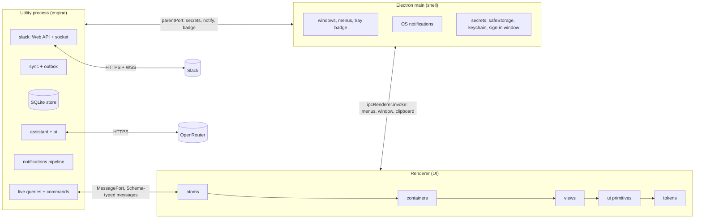
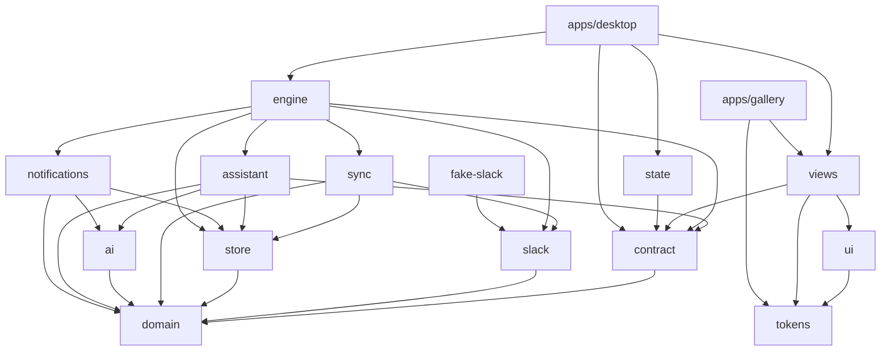

# Juno architecture

Status: proposed, October 2026. Decisions with lasting consequences have an ADR in `docs/decisions/`. The product spec (`docs/design/handoff/SPEC.md`) decides behaviour; this document decides structure.

Inputs: the spec, `docs/research/slack-data-access.md` (API, boot, socket, limits), `docs/research/slack-desktop-shell.md` (what to copy from Slack's shell), `docs/research/tech-stack.md` (versions, pitfalls), `docs/design/inventory.md` and `primitives.md`.

## 1. Overview

Juno is three processes and one data store.



- The **shell** (main) owns everything that needs Electron APIs: windows, native menus, notifications, dock badge, `safeStorage`, the embedded sign-in window and the import from the installed Slack app. It holds no business logic.
- The **engine** (a `utilityProcess`) owns all business logic and I/O: the Slack session, the Web API client, the realtime socket, the sync engine, SQLite, AI calls and the notification pipeline. It is a plain Node program built from Effect services, so it also runs outside Electron for engine-level tests.
- The **renderer** is UI only. It subscribes to live queries and sends commands over one MessagePort. It never sees a token, a cookie or an API key.

Three rules hold everything together:

1. **SQLite is the source of truth for the UI.** Every screen reads from the store through a live query. Slack is a remote the engine syncs with; the UI never waits for Slack.
2. **Writes are local first.** A command updates the store in one transaction, which updates the UI through the live query, and queues the Slack call in a persisted outbox. Optimism lives in the engine, not in React.
3. **Views are dumb.** They take props and call callbacks. No atoms, no Effect, no IPC. Containers wire atoms to views.

## 2. Process model and the contract

### 2.1 Why a utility process

The draft put the engine in main. The engine should run in a `utilityProcess` instead (ADR 0001):

- `node:sqlite` is synchronous. Writing a few thousand messages at boot, or re-running a big query, blocks the thread it runs on. In main that stalls native menus, window dragging and every IPC round trip. In a utility process it stalls nothing the user can see.
- Parsing `client.userBoot` (megabytes of JSON for a large workspace) has the same problem.
- A crash or runaway loop in the engine does not take the window down; main restarts the process and the renderer reconnects.
- The engine becomes a Node program with a `start(transport, config)` entry. Engine tests run it under plain Node against `fake-slack` without launching Electron.
- Electron APIs are not available in a utility process. That is a feature: the engine cannot grow shell concerns.

Cost: secrets must be handed from main to the engine in memory, notifications and the badge go through a small engine→main channel, and HTTP/WebSocket use Node (`fetch`, `ws`) instead of Chromium's session. The engine attaches the `d` cookie itself; it never needs Chromium's cookie jar.

The engine only depends on a MessagePort-shaped `Transport`. If the utility process ever causes trouble, main can host the engine with no code change in any package.

### 2.2 The three channels

| Channel | Transport | Direction | Content |
| --- | --- | --- | --- |
| renderer ↔ engine | `MessageChannelMain`; main hands one port to the utility process and the other to the renderer (`webContents.postMessage`, preload forwards it with `window.postMessage`) | both | queries, live subscriptions, commands, engine events |
| renderer ↔ main | `contextBridge` + `ipcRenderer.invoke` on named channels | both | native context menu popup, title-bar double click, clipboard, open external, request engine port; main→renderer: notification click, system theme change, deep link |
| engine ↔ main | `process.parentPort` | both | main→engine: session secrets, config, `sign-in completed`; engine→main: `notify`, `setBadge`, `authRequired`, `openExternal` |

All three are defined in `@juno/contract` with Effect `Schema` for every payload, decoded on receipt on both sides. The preload imports only `@juno/contract/channels` (names and TypeScript types, no runtime dependencies) so it stays tiny and ESM-free. This mirrors Slack's shell, which keeps channel names, payload types and joi validators in one `src/common` package and validates every IPC payload in main.

### 2.3 Protocol over the port

`effect/rpc` is marked unstable in Effect 4 and has no Electron transport. The contract is the longest-lived interface in the app, so it does not sit on an unstable module (ADR 0002). Instead, `@juno/contract` defines a small message protocol and `@juno/engine` / `@juno/state` implement a server and client for it (about 150 lines each). The route definitions mirror the shape of `RpcGroup` so a later move is mechanical.

Wire messages (all `Schema` structs, JSON over `postMessage`):

```
req  { id, route, input }          -> ok { id, output } | err { id, error }
sub  { id, route, input }          -> next { id, value }* then end { id } | err { id, error }
unsub { id }                        (client cancels; server interrupts the fiber)
evt  { name, value }               (engine → renderer, unsolicited)
```

Route kinds:

- **Query** (`req`): one-shot reads such as `search.run`, `command.parse`. Rarely used; most reads are live.
- **Live query** (`sub`): the normal way to read. The server emits the current snapshot at once, then a new snapshot whenever a store write invalidates one of the query's keys (debounced about 30 ms, structurally de-duplicated). Examples: `topics.list(filter)`, `topic.get(id)`, `messages.list(topicId, page)`, `allTopics.list(filters)`, `forYou.list`, `juno.chat`, `notifications.settings`, `notifications.today`, `prefs.get`, `engine.status`.
- **Command** (`req`): a write. Returns quickly after the local transaction. Declares its error union and, where reversible, its inverse command name (`topic.resolve` ↔ `topic.reopen`), which the renderer uses for the undo stack.
- **Event** (`evt`): things that are not a query result: `command.failed` (an outbox item gave up), `navigate` (a notification was clicked), `toast`.

Errors are `Schema.TaggedError` classes in `contract/errors.ts`: `NotSignedIn`, `Offline`, `SlackRejected { code }`, `RateLimited { retryAfter }`, `NotFound`, `AiUnavailable`, `Invalid { issues }`. Each route lists the subset it can return; a decode failure on either side becomes `ProtocolError` and is logged with the route name. Cancellation: streams are cancelled with `unsub`; commands are short and are not cancellable except AI generation, which is a stream.

The renderer obtains the port once at startup (`window.juno.engine.requestPort()`), and reconnects with a fresh port if main restarts the engine (`engine.status` reports `restarting`).

## 3. Packages

Monorepo, pnpm workspaces, every package shipped as TypeScript source. Dependency direction is enforced by two mechanisms: pnpm's strict `node_modules` (a package can only import what it declares) and `scripts/check-deps.mjs`, which fails if a package declares an edge outside the table below.



Each package in one paragraph, with what it must not do.

- **`@juno/domain`** (pure). Types and rules with no I/O and no Effect services: ids (`TopicId`, `ChannelId`, `Ts`), `Topic`, `Visibility`, title resolution, sorting and filtering, quiet/resolved/reopened logic, notification rule matching and decision order, deterministic clarity fixes, audience keyword check, relative-time formatting, mention detection in Slack mrkdwn. Everything here has behaviour tests. Must not import Node, Electron, React, `effect/sql` or any other package.
- **`@juno/contract`**. The wire: route tables with input/output/error schemas, view models (`TopicRow`, `TopicDetail`, `MessageView`, `ForYouCard`, `JunoMessage`, `NotificationRule`, `Prefs`), events, errors, the protocol message schemas, and the dependency-free `channels.ts` for the preload. View models are shaped for screens, not for storage, and they are also the prop types of views. Must not contain logic beyond schemas and a few pure constructors.
- **`@juno/slack`**. The Slack client as Effect services: `SlackSession` (token, cookie, team), `SlackApi` (multipart POST with `token` first, `_x_*` params, retry on 429/5xx with `Retry-After`, the fatal-error list), `RequestQueue` (lanes, concurrency), `SlackEdge` (JSON POST to the flannel URL), `SlackSocket` (socket lifecycle as a scoped `Stream<RtmEvent>`), and `schemas/` for every payload we read or send (messages, blocks, channels, counts, threads view, RTM events). Exposes `@juno/slack/schemas` so `fake-slack` encodes the same shapes. Must not know about topics, the store or the UI.
- **`@juno/store`**. SQLite via `@effect/sql-sqlite-node` on `node:sqlite`: migrations, typed queries, the `Store` service, transaction helper, and `Invalidation` (a thin wrapper over Effect's `Reactivity`, which is unstable, so the wrapper keeps the swap local). Owns the schema in section 4. Must not call Slack or the AI and must not shape data for the UI.
- **`@juno/sync`**. Boot, discovery, backfill, realtime event application, read-state mirroring, reconnect reconciliation and the outbox. Translates Slack entities into store rows and topic activity. Must not render, must not call the AI.
- **`@juno/ai`**. `AiProvider` interface with two implementations: `PiAiProvider` (pi-ai + OpenRouter, in-memory key) and `FakeAiProvider` (deterministic). Task definitions (`titleTopic`, `routeCheck`, `settledScore`, `groupRun`, `urgencyGate`, `parseCommand`, `catchUp`, `forYou`, `chat`) with their tool-shaped output schemas, prompts and model tier (`decision` or `generation`). Must not touch the store; tasks take plain data and return plain data.
- **`@juno/assistant`**. Policy: when tasks run, caching in `ai_cache`, budget and concurrency, the global off switch, the For you generator, and the Juno chat session with its tools and confirm cards. Must not call OpenRouter directly (only through `AiProvider`).
- **`@juno/notifications`**. The pipeline from incoming message to outcome: ignored → rules → quiet hours → AI gate → outcome; the Today log; the digest scheduler; the `Notifier` interface implemented by the engine→main channel. Rule matching itself is in `domain`. Must not show anything itself.
- **`@juno/engine`**. Composition: the app `Layer`, the contract server (route → service), live query implementations (store → view models), the port `Transport` adapter, config from environment (`JUNO_SLACK_API_URL`, `JUNO_SLACK_WS_URL`, `JUNO_OPENROUTER_URL`, `JUNO_AI=fake`, `JUNO_DATA_DIR`), and `startEngine()`. Must not contain domain rules; if a route handler grows past wiring, the logic belongs in a service package.
- **`@juno/fake-slack`**. A Node HTTP + WebSocket server that speaks the subset of Slack Juno uses, seeded from fixtures (the prototype's workspace), with a control API for tests: inject message, reply, mark from another client, drop the socket, return 429, expire the session. Encodes responses with `@juno/slack/schemas` so the fake and the client cannot drift. Also serves a minimal sign-in page that sets a `d` cookie and makes one API call with a fake `xoxc` token, so the capture flow is tested end to end. Must not import the engine.
- **`@juno/tokens`**. StyleX `defineVars` with `--` keys and `createTheme` for dark and accents. The only place a colour, size, radius, shadow or duration is written down.
- **`@juno/ui`**. The 18 primitives from `primitives.md` (Button, IconButton, Chip, ContextPill, Surface, Popover, OptionList, Tabs, fields, Toast, EmptyState, PageHeader, …) plus `Icon` over `lucide-react`. StyleX only, tokens only. Must not import contract, state or anything with data.
- **`@juno/views`**. Dumb feature components: `Sidebar`, `TopicRow`, `TopicHeader`, `MessageList`, `Composer` (+ `SendCheckBar`, `AudienceWarning`, `MentionSuggest`), `CommandPalette`, `AllTopicsTable`, `ForYouPage`, `JunoThread`, `NotificationsPage`, `PreferencesPage`, `NewMessageForm`, `TabStrip`. Props in (contract view models), callbacks out. Every view ships `*.fixtures.ts`. Must not import `@juno/state`, `effect`, `window.juno`, or React context other than its own layout helpers.
- **`@juno/state`**. The atom bridge: `EngineClient` (protocol client over a `MessagePort`), subscription atoms and families, command functions, undo stack, toasts, tabs, drafts, focus/viewing state. Must not contain JSX.
- **`apps/desktop`**. `src/main` (window factory, menus, notifications, badge, secrets, sign-in window, Slack-app import, utility process supervisor), `src/preload` (bridge), `src/engine` (utility entry: `startEngine`), `src/renderer` (app shell and **containers** that map atoms to views), `e2e/` (Playwright). Wiring only.
- **`apps/gallery`**. A browser-only Vite app that renders every view with every fixture for screenshots (section 8). No Electron.

What Slack's shell taught us, and where it shows: one shared contract package with names, types and validators; validate every payload in the receiving process; one window factory that force-merges secure `webPreferences` plus a `browser-window-created` watchdog; notifications and the dock badge computed from app state and shown from main; a persisted retry list for `conversations.mark`, `subscriptions.thread.*` and `reactions.*` (our outbox); one message in flight for sends and `client_msg_id` echo matching; `desktop_notification` as the server's "this matters" signal. What we deliberately do not copy: the 30-namespace bridge, the delegate object pattern, cookie header surgery, hidden windows for downloads.

## 4. Data model

### 4.1 Slack entities (mirror tables)

Keyed by `team_id` from day one so multi-workspace is a UI change later. Timestamps are Slack `ts` strings; they sort lexicographically within a channel.

```sql
team            (id PK, name, domain, self_user_id, prefs_json, booted_at)
users           (id PK, name, display_name, real_name, avatar_url, tz, is_bot, deleted, updated)
conversations   (id PK, kind 'public'|'private'|'im'|'mpim', name, user_id /*im*/, member_ids_json /*mpim*/,
                 is_member, is_archived, topic, purpose, created, updated)
messages        (channel, ts, PK(channel, ts), thread_ts, user_id, subtype, text, blocks_json,
                 files_json, attachments_json, edited_ts, deleted, client_msg_id,
                 reply_count, latest_reply, reply_users_json, pending /*our unsent*/)
reactions       (channel, ts, name, PK(channel, ts, name), count, user_ids_json, me)
thread_subs     (channel, thread_ts, PK, subscribed, slack_last_read)        -- from Slack
channel_reads   (channel PK, slack_last_read, latest, has_unreads, mention_count, counts_updated)
sync_cursors    (channel PK, newest_synced_ts, oldest_synced_ts, has_older, synced_at)
thread_cursors  (channel, thread_ts, PK, replies_complete, synced_at)
sync_state      (key PK, value_json)   -- counts_last_fetched, ws reconnect url, boot version
```

### 4.2 Topics are derived, not stored

A topic is a view over the tables above plus the overlay. Ids are strings so the UI never cares which kind it is:

| Kind | Id | Exists when |
| --- | --- | --- |
| Thread | `t:<channel>:<thread_ts>` | a root message with `reply_count ≥ 1`, or a Slack subscription, or a `tracked` overlay row (New message with "Track replies") |
| Main | `m:<channel>` | the user is a member of the conversation |
| Group | `g:<channel>:<group_id>` | a client-only grouping of Main messages exists |

Per topic the derivation computes: `lastActivityTs` (latest reply, or latest top-level message for Main, excluding grouped messages), `messageCount`, participants (`reply_users` or distinct senders), `unreadCount` and `mentionsMe` (from `topic_reads.last_read_ts` against message timestamps), `kind` and tint of its conversation. This is one SQL query per list plus a small pure function in `domain` for status. It is materialised into a `topic_index` table that sync updates inside the same transaction as the message write, so sidebar queries are a single indexed read.

```sql
topic_index     (topic_id PK, team_id, channel, kind, last_activity_ts, message_count,
                 participants_json, root_ts, unread_count, mentions_me, preview_json)
```

### 4.3 Client-only overlay

Never written to Slack. One row per topic, nullable columns, so "no overlay" is simply no row.

```sql
topic_overlay   (topic_id PK,
                 manual_title, ai_title, ai_title_source_hash, ai_title_at,
                 resolved_at, resolved_activity_ts,   -- Reopened = new activity after resolved_activity_ts
                 reopened_at,                         -- set by sync on new activity; cleared on mark read or resolve
                 pinned_at,
                 unsubscribed_at,                     -- Juno's own flag; for threads also mirrored to Slack
                 tracked,                             -- thread topic created by "Track replies"
                 settled_dismissed_ts, grouping_dismissed_ts)
topic_reads     (topic_id PK, last_read_ts, marked_unread)   -- Juno's read state, mirrored to Slack when possible
main_groups     (id PK, channel, title, created_at)
main_group_msgs (group_id, ts, PK)
ignored_channels(channel PK, ignored_at)
notification_rules   (id PK, position, kind 'person'|'channel'|'mention_in'|'keyword', value, action 'now'|'digest'|'silent')
notification_settings(id=1, ai_gate, threshold, digest_times_json, quiet_from, quiet_to)
notification_log     (id PK, at, channel, ts, topic_id, preview, outcome, reason, rule_id, ai_score, digest_slot, delivered_at)
ai_cache        (task, key, PK, input_hash, output_json, model, cost_usd, created_at)
for_you_cards   (id PK, kind, topic_id, payload_json, input_hash, created_at, dismissed_at, done_at)
juno_chat       (id PK, role, content_json, created_at)      -- one thread, cards included
drafts          (topic_id PK, text, updated_at)
outbox          (id PK, kind, payload_json, created_at, attempts, next_at, last_error)
prefs           (key PK, value_json)   -- tweaks, quiet days, theme, accent, aiAssist, tabs
```

Status rules (in `domain/visibility.ts`, tested): ignored channel → `ignored`; `unsubscribed_at` → `unsubscribed`; `resolved_at` and no later activity → `resolved`; no activity within `quietDays` and not pinned and no unread → `quiet`; else `open`. The sidebar shows `open` topics plus pinned ones; All topics shows everything but ignored. Sync clears `resolved_at` and sets `reopened_at` when a message arrives after `resolved_activity_ts`; the Reopened tag shows while `reopened_at` is set.

Title resolution: `manual_title ?? ai_title ?? firstWords(root.text, 6)`. "Use AI title" clears `manual_title`. Saving an empty manual title, or one equal to the AI title, clears it.

Subscription mapping: for thread topics, Subscribe/Unsubscribe calls `subscriptions.thread.add/remove` through the outbox and sets `unsubscribed_at`; Juno's flag drives visibility, Slack's flag drives the bell icon and the server's notification candidates. Main topics have no Slack equivalent, so only the overlay flag changes. Stealth is a tab attribute in the renderer, not data: a stealth tab never sends `topic.markRead`.

## 5. Sync

### 5.1 Request budget

Slack's own client allows 10 concurrent requests per team. The user will often run the official app at the same time against the same limits, so Juno stays well under that. `RequestQueue` has three lanes: `interactive` (the user opened something; concurrency 3, jumps the queue), `background` (discovery and backfill; concurrency 2, at most ~40 calls per minute), `send` (one in flight, like Slack's `MessageQueue`). Every call honours `Retry-After`, retries 429/5xx up to 3 times with a 60 s base and jitter, pauses the queue while offline, and never retries the fatal auth errors, which instead raise `authRequired`.

### 5.2 Cold boot

1. `client.userBoot` (`return_all_relevant_mpdms`, `version_all_channels`) → `team`, `users` (self), `conversations`. `users.prefs.get` → muted channels, highlight words.
2. `client.counts` (`thread_counts_by_channel=true`) → `channel_reads` for every conversation (`last_read`, `latest`, `mention_count`) and the threads state.
3. `client.getWebSocketURL` → connect the socket now, so events during backfill are not lost (they are applied in order; a message that arrives before its history page is upserted, not duplicated).
4. `subscriptions.thread.getView` (limit 50, paged by `current_ts`) until the roots are older than the quiet window → thread topics for followed threads, with `latest_replies` as previews and `unread_replies` for counts. One call per page.
5. Discovery of other threads and of Main activity: for each conversation with `counts.latest` inside the quiet window, ordered by `latest` descending, `conversations.history` (`ignore_replies=true`, `limit=100`). Top-level messages carry `reply_count`, `latest_reply` and `reply_users`, so thread roots are discovered without fetching replies. Conversations with no activity in the window are not fetched at all. Thirty to fifty calls for a busy workspace, on the background lane.
6. Users referenced by any row and not in `users` → edge `users/info` in chunks of 100 (fallback `users.info`).
7. Previews for discovered but unfollowed threads: the sidebar needs the latest reply, not the root. For the top ~50 topics by activity, `conversations.replies` (`oldest=latest_reply`, `inclusive=true`, `limit=2`) on the background lane; until then the row previews the root. Replies for everything else are fetched when the topic is opened.

Gap accepted: a thread whose root is older than the quiet window but got a reply inside it, in a channel we do not follow it in, is not discovered at cold boot. From then on `message_replied` events keep roots current.

### 5.3 Warm boot

The sidebar renders from SQLite before any network call. Then: `client.userBoot` (membership changes), `client.counts` with `counts_last_fetched` (only changed entries come back), history since `newest_synced_ts` for conversations whose `latest` moved, `subscriptions.thread.getView` first page, and incremental replies only for topics that are visible or open. Typically five to ten calls.

### 5.4 Opening a topic

- Thread: `conversations.replies` (`limit=100`, `oldest=` last synced reply when `replies_complete`), interactive lane, paging older only on scroll. Then, unless the tab is stealth, `topic.markRead`.
- Main: `conversations.history` (`limit=50`, `ignore_replies=true`) incremental from the cursor; older pages on scroll up. Grouped messages are excluded by the query.
- Unknown users in the page → edge lookup.
- If two or more messages are unread and AI is on, `assistant` runs `catchUp` on the unread run; the result arrives through the `topic.get` subscription.

### 5.5 Read state

`topic_reads.last_read_ts` is Juno's truth and updates immediately. It is mirrored to Slack through the outbox when Slack has a matching concept:

| Topic | Mark read | Mark unread |
| --- | --- | --- |
| Main | `conversations.mark { channel, ts: latest }` | `conversations.mark { ts: the ts before the first unread }` |
| Thread, subscribed in Slack | `subscriptions.thread.mark { read: 1, ts: latest reply }` | `subscriptions.thread.mark { read: 0, ts }` |
| Thread, not subscribed | local only | local only |

Incoming `channel_marked`/`im_marked`/`group_marked`/`mpim_marked` and `thread_marked` events (reads done in the official client) update `topic_reads` too, so the two clients agree. Stealth never marks; a message arriving while a non-stealth topic is active and the window is focused is marked read by the renderer (`presence.viewing` tells the engine which topic is on screen, which the notification pipeline also uses). "Mark channel as read" marks Main and every thread topic in that channel. Resolve marks read.

### 5.6 Outbox

Every Slack write goes through `outbox` rows: `mark`, `threadSubscribe`, `threadUnsubscribe`, `postMessage`, `updateMessage`, `deleteMessage`, `addReaction`, `removeReaction`. A worker drains it in order per channel, retries with backoff, and on a final failure reverts the local change where one exists (for example a reaction) and emits `command.failed`. `postMessage` inserts a `pending` message row with a `client_msg_id`; the socket echoes the real message with the same id and the row is replaced. The outbox survives restarts, which is why resolve, mark and send feel instant offline.

### 5.7 Reconnect

After the socket reconnects: `client.counts(counts_last_fetched)`; history since the cursor for every conversation whose `latest` moved; `subscriptions.thread.getView` first page; replies refresh for open and visible topics with a newer `latest_reply`; flush the outbox. A `force_reload` event or a boot-version change triggers a full cold boot over the existing store (upserts, nothing dropped).

## 6. Realtime

`SlackSocket.events: Effect<Stream<RtmEvent>, SocketError, Scope>`. Inside the scope: fetch the socket URL (cached until `ttl_seconds`), open with `ws` (needed for the `Cookie` and `User-Agent` headers, which the browser `WebSocket` cannot set), wait for `hello`, `ping` every 10 s and close with 4998 if no `pong` for 90 s, keep `reconnect_url` for fast reconnect. Frames are decoded with `Schema`; unknown types become `{ type: 'unknown' }` and are counted, never failed on. `error.retry_after`, `goodbye` and close all end the stream with a typed error.

Sync runs the stream with `Stream.retry` on an exponential schedule (1 s base, 60 s cap, jitter), except `invalid_auth` and `user_session_expiration`, which stop the stream and raise `authRequired`. Each event is applied in one store transaction:

| Event | Store effect |
| --- | --- |
| `message` (no subtype, `thread_broadcast`, `bot_message`, `me_message`) | upsert message; update root `reply_count`/`latest_reply`; update `topic_index`; reopen if resolved; notification pipeline input when not from self |
| `message_changed`, `message_deleted` | update or tombstone; recompute preview |
| `message_replied` | root counters only (the reply arrives as its own `message` when we are in the channel) |
| `channel_marked` family, `thread_marked`, `thread_subscribed`, `thread_unsubscribed` | `channel_reads`, `thread_subs`, `topic_reads` |
| `reaction_added/removed` | `reactions` |
| `channel_*`, `im_*`, `mpim_*`, `member_*` | `conversations`; new conversations get a Main topic |
| `user_change`, `pref_change` | `users`, `team.prefs_json` |
| `desktop_notification` | notification pipeline, marked as a server candidate |
| `force_reload`, `user_session_expiration` | resync / authRequired |

The transaction ends by invalidating keys (`topic:<id>`, `topics`, `messages:<topicId>`, `conversation:<id>`, `notifications`). Live queries that depend on those keys re-run, debounced 30 ms, and the renderer gets a new snapshot. `presence_change` and `user_typing` are not stored; typing is forwarded as an event for the open topic only.

## 7. Renderer state

`@juno/state` holds atoms; containers in `apps/desktop/src/renderer` read them. Atom APIs are unstable, so every atom is created through two local helpers, `liveQuery(route)` and `command(route)`, and nothing else in the app imports `effect/reactivity/Atom` directly.

Atoms:

- `engineAtom`: the protocol client bound to the port; `engineStatusAtom` from `engine.status`.
- `sessionAtom` (`signedOut | signingIn | ready { team, self }`).
- `topicListAtom(filter)`: family keyed by `{ kind, unreadOnly, scope }`, subscription to `topics.list`. Row data is final; the sidebar maps rows to `TopicRow` props without further computation.
- `topicAtom(id)`, `messagesAtom(id)`, `allTopicsAtom(filters)`, `forYouAtom`, `junoChatAtom`, `notificationSettingsAtom`, `notificationTodayAtom`, `prefsAtom`, `browseAtom` (channels and people with activity and unread), `ignoredAtom`.
- One-shot: `searchAtom(query)` and `commandParseAtom(query)` (debounced 150 ms; the result carries the confidence badge).
- Commands: `topic.resolve/reopen/pin/unpin/rename/useAiTitle/markRead/markUnread/subscribe/unsubscribe/track`, `channel.ignore/unignore/markRead/markUnread`, `message.send/edit/delete/react/unreact`, `main.group/dismissGroup`, `notifications.*`, `forYou.dismiss/done`, `juno.ask/confirmCard/dismissCard`, `prefs.set`, `drafts.set`, `presence.viewing`, `session.signOut`.

Optimistic updates and rollback: there are none in the renderer. A command's local transaction completes in a few milliseconds and the live query delivers the new snapshot; the round trip over a local MessagePort is cheaper and simpler than keeping a second copy of state in React. The only renderer-side transient is `sendingAtom(topicId)` for the send button. Rollback is the engine's job: if an outbox item finally fails, the engine reverts the local row in the same code path that applied it and emits `command.failed`, which the toast host shows with a Retry action.

Undo: `undoStackAtom` keeps the last 20 reversible actions as `{ label, inverse: Command, at }`. Running a command whose route declares an inverse pushes an entry and shows the toast; ⌘Z (when focus is not in a non-empty input) or the toast's Undo pops it and runs the inverse. Inverses: resolve ↔ reopen, subscribe ↔ unsubscribe, ignore ↔ unignore, pin ↔ unpin, routed post and ⌘K send → `message.delete` of the echoed `ts` (or cancel the outbox item if not yet sent).

Tabs: `tabsAtom` is `{ tabs: Tab[], activeId }` with `Tab = { id, kind: 'topic'|'all'|'forYou'|'juno'|'new'|'notifications'|'prefs', topicId?, stealth? }`. Pages are singletons. Tabs persist across restarts through `prefs.set('tabs')` (debounced), including stealth flags, because closing the app should not lose a working set; the active tab is restored too. Drafts persist per topic in `drafts`. UI tweaks (`rowStyle`, `density`, `previewLines`, `showAvatars`, `grouping`, `quietDays`, `messageStyle`, `aiAssist`, `accent`, `theme`) live in `prefs` and arrive through `prefsAtom`; the root applies the theme classes from `@juno/tokens/themes.stylex` and sets `data-theme-switching` for two frames on change.

## 8. UI layering and review

```
tokens  →  ui primitives  →  views (dumb)  →  containers (apps/desktop)  →  app shell
```

- **tokens**: CSS variables only.
- **ui**: primitives; no product words in them (`Chip`, not `UnreadBadge`).
- **views**: feature components. Props are contract view models plus callbacks (`onResolve(topicId)`). No atoms, no Effect, no `window`. A view that needs the current time takes `now` as a prop; containers tick it.
- **containers**: one per view or page; read atoms, map to props, bind callbacks to commands and to the undo stack. Native context menus are requested here (`window.juno.shell.contextMenu.popup(items)` returns the chosen id) with the item list computed by a pure function in `domain`.

A designer changes the UI by editing `tokens`, `ui` or `views` and checking the gallery. Those packages do not declare `@juno/state`, `effect` or `@juno/engine` as dependencies, so the change cannot reach logic even by accident.

**Gallery over Storybook.** `apps/gallery` is a plain Vite + React app (the same StyleX plugin config as the renderer) with a route per view and fixture: `/#/TopicRow/unread-mention`, `/#/Sidebar/default?theme=dark&density=compact`. Each view exports `fixtures.ts`: a record of named prop sets, which doubles as seed data for `fake-slack` where the shapes overlap. A Playwright project `gallery` opens every route in light and dark and writes `apps/gallery/shots/<view>/<fixture>-<theme>.png`; design-review agents run `pnpm gallery:shots` and read the PNGs, and a diff against the previous run is the visual regression check. The index page lists all views and fixtures with a search box. This is a few hundred lines, uses the real build pipeline, needs no Electron, and keeps fixtures as plain TypeScript. Storybook would add its own builder, its own StyleX integration problems and a second config to maintain for little gain.

## 9. AI

Two kinds of work, two model tiers, one interface (ADR 0006).

| Feature | Kind | Implementation |
| --- | --- | --- |
| Clarity check | deterministic | `domain/clarity.ts`: typo table, doubled words, lowercase "i", missing "?", sentence length. No model |
| Audience check | deterministic | `domain/audience.ts`: keyword list, public channels only |
| Wrong-place check | decision | `routeCheck(draft, last 4 topics in channel)` → `{ topicId?, confidence }` |
| Group Main messages | decision | `groupRun(last N Main messages)` → `{ tsList, title, confidence }` |
| Settled | decision | `settledScore(topic tail)` → `{ score, reason }` |
| Notification gate | decision | `urgencyGate(message, context)` → `{ urgency, chatter }` |
| ⌘K command routing | decision | deterministic grammar first (`tell|message|dm <person> <text>`, `post in #<channel> <text>`, `resolve <query>`, `summarize …`); the model only when the grammar fails |
| Topic titles | generation | `titleTopic(root, first replies)`; re-run on drift when `reply_count` crosses 5, 20 |
| Catch-up summary | generation | `catchUp(unread run)` |
| For you cards | both | `forYou(recent topics)` in the background |
| Juno chat | generation + tools | streamed |

`AiProvider` (in `ai`) has `decide(task, input)`, `generate(task, input)` and `chat(context, tools)`. Decisions force a tool call whose parameters are the output schema (TypeBox, validated with `validateToolCall`; one retry; on failure the answer is "no decision" and the UI stays quiet). `PiAiProvider` uses `@earendil-works/pi-ai` with the OpenRouter provider only, the key passed in memory from main. Model slugs are prefs with defaults: a small fast model for `decision`, a stronger one for `generation`; the catalog changes, so they are not hard-coded in logic.

`assistant` applies policy: cache every result in `ai_cache` by `(task, key, input_hash)` so reopening a topic or re-evaluating a rule never repeats a call; per-task timeouts (decisions 1.5 s, generation 20 s); concurrency 2; a daily budget in USD from OpenRouter's usage field, after which decisions degrade to "none" and generation to the fallback title; debounce on typing (audience 600 ms, route check only on Enter). The global `aiAssist` pref turns the whole `assistant` layer into a no-op layer: no jobs, no sparkles, catch-up absent, send checks skip to the deterministic ones, the notification gate sends everything to digest, For you is empty and Juno answers that assist is off.

Juno chat is one persisted thread. Tools: `list_topics(filter)`, `read_topic(id, limit)`, `list_channels()`, `show_topics(ids)` (renders a topics card), `propose_message(target, text, topicId?)` (renders a send card), `propose_resolve(ids)` (renders a resolve card). "This" is the renderer's last viewed topic, sent with the request. Cards are stored in the chat message's `content_json` with a status (`pending | sent | dismissed | resolved`); Send runs `message.send` and updates the card. The stream of deltas is collapsed server-side into the `juno.chat` live query at ~50 ms. Nothing is sent without a click.

`FakeAiProvider` is deterministic: titles from the first six words in sentence case, route check by word overlap above a threshold, settled when the tail contains "shipped" or "done", urgency from a keyword table, canned chat replies from a fixture file keyed by prompt substring. It is selected with `JUNO_AI=fake`, which e2e always sets.

## 10. Notifications

Inputs are `desktop_notification` events (the server's candidates: mentions, DMs, keywords, followed threads) and, when the server would stay silent because the official client is muted, local mention detection on `message` events (`<@self>`, `<!here>`, `<!channel>`, self subteams). Each input runs the decision in `domain/notifications.ts`, which is pure and ordered as the spec says:

```
ignored channel → silent "Ignored channel"
rules, top to bottom, first match → now | digest | silent "Rule: …"
quiet hours (unless a rule said now) → digest "Quiet hours"
AI off → digest "Juno off, waiting for digest"
need score → (pipeline calls urgencyGate, then re-enters)
score ≥ threshold → now "Juno · 89% urgent"
chatter → silent "Juno · 66% just chatter"
else → digest "Juno · 14% urgent, can wait"
```

The pipeline (in `notifications`) writes a `notification_log` row with inputs and the cached score, and then: `now` → `Notifier.show` (engine→main → `new Notification`, with `topicId` for click handling) unless the topic is on screen in a focused window; `digest` → assigned the next digest slot. The digest scheduler is a fiber that sleeps until the next slot from `digest_times` (local time), bundles undelivered digest rows into one notification ("5 messages in 3 topics"), and marks them delivered. Quiet hours shift the slot to the first one after the window. The Today page subscribes to `notifications.today`; when rules change, the engine re-runs the pure decision over today's rows using the stored score, so the log updates without new AI calls. The dock badge is `•` when any topic has unread mentions, computed by the engine and set by main.

## 11. Testing

**End to end** (`apps/desktop/e2e`, Playwright `_electron.launch` on the built app, `show: false`, temp data dir per test, `JUNO_SLACK_API_URL`/`JUNO_SLACK_WS_URL` pointed at `fake-slack`, `JUNO_AI=fake`, `ELECTRON_RUN_AS_NODE` stripped). Flows from the spec, one file each: sign-in via the fake's sign-in page (capture of token and cookie); cold boot shows topics and Main rows with correct tags; open topic at the "N new" divider and mark read; stealth keeps unread; resolve with undo and ⌘Z; a new message reopens with the Reopened tag; pin, rename, Use AI title; subscribe/unsubscribe; ignore channel from menu and Preferences; tabs (current tab, ⌘-click, focus existing, close); send with echo; reactions; quote; @ and # suggestions; New message with tracking; send checks (route, clarity, audience); ⌘K search and commands; All topics filters; For you cards; Juno chat with a send card; notification rules, Today log, digest (the engine accepts `JUNO_CLOCK` for a controllable clock in test mode); reconnect and reconciliation after the fake drops the socket; a 429 from the fake delays but does not lose a send; dark mode screenshot. Native menus are not in the DOM, so tests assert the menu template through a test-only `window.juno.debug.lastContextMenu` hook and invoke items by id.

**Engine tests** (`packages/engine/test`, plain Node, in-process `fake-slack`): boot call budget (history calls ≤ active conversations), warm boot uses `counts_last_fetched`, read-state mirroring table, outbox retry and final-failure revert, reconnect reconciliation, overlay rules through the public routes. These test behaviour through the contract, never internal functions.

**Domain tests** (vitest): visibility and status, title resolution, sort orders, topic derivation from message sets, notification decision order, clarity fixes, audience keywords, relative time, command grammar, undo inverse table, mention detection. Fast, no mocks.

**Gallery screenshots**: every fixture, both themes, as the visual check.

**Live smoke** (`pnpm smoke:live`, manual, `JUNO_LIVE=1`, never in CI): against the real workspace with the user's imported session. Read-only: `auth.test`, `client.userBoot`, `client.counts`, `subscriptions.thread.getView`, one `conversations.history`, socket `hello` and 30 s of events, all decoded through our schemas to catch drift. Writes only inside a private channel the script creates (`#juno-smoke-<date>`, `conversations.create { is_private }`) or the self-DM: post, edit, react, mark, thread subscribe/unsubscribe, delete. The script prints the exact call list before running and refuses any other channel id.

## 12. Security

- **Secrets.** `{ xoxc token, d cookie, team, OpenRouter key }` are encrypted with `safeStorage` into `userData/secrets.bin`, read only by main, and handed to the engine over `parentPort` at start. The engine keeps them in memory, redacts them in logs and never writes them; SQLite holds no secrets. Sign-out deletes the file and clears the engine.
- **Embedded sign-in.** A `BrowserWindow` on a non-persistent partition `slack-signin`, navigation allow-listed to Slack domains, no preload. Main captures the token from the first `/api/` request body (`webRequest.onBeforeRequest` with `uploadData`, `token` field) and the `d` cookie from `session.cookies.get`, then closes the window and clears the partition. The fake sign-in page in `fake-slack` exercises the same path.
- **Import from the Slack app.** Main copies `~/Library/Application Support/Slack/Local Storage/leveldb` and `Cookies` to a temp dir (read-only on the originals), extracts `localConfig_v2` by scanning for the key and taking the newest record, decrypts the `d` cookie with the "Slack Safe Storage" keychain password (`security find-generic-password`, which prompts the user once), and discards the copies. This path is best-effort; the embedded sign-in is the reliable one.
- **Renderer.** `sandbox`, `contextIsolation`, no `nodeIntegration`, `webviewTag: false`, loaded from a custom `juno://app/` scheme with a path-traversal guard. CSP: `default-src 'self'; img-src 'self' https://*.slack-edge.com https://secure.gravatar.com data:; font-src 'self'; style-src 'self'` (plus `'unsafe-inline'` only in dev for Vite). Slack file thumbnails need the cookie, so they are served through `juno://files/...` handled in main with `net.fetch` and the cookie attached, never by exposing the cookie.
- **Window factory and watchdog** as in Slack's shell. Fuses in packaged builds: `RunAsNode` off, `EnableNodeCliInspectArguments` off (e2e runs the unpackaged build), asar integrity on.
- **IPC.** Every message on all three channels is decoded with its schema; main checks `event.senderFrame.url` against `juno://app`. The preload exposes a fixed object; `ipcRenderer` is never exposed. `openExternal` accepts `http(s)` only.
- **Network.** All Slack calls go to the configured base URL (the workspace host in production, the fake in tests); the socket host is validated against `wss-primary.slack.com` and the configured test host.

## 13. Milestones

Vertical slices in order. Each is sized so two to four agents can work in parallel in different packages. "Done" always includes typecheck, lint, the listed tests passing, and no new dependency edges outside section 3.

**M0 Walking skeleton** (in progress). Electron + electron-vite + React + StyleX + tokens, `app.getInfo` over typed IPC, one Playwright test.

**M1 Foundations.** Parallel: (a) `contract` protocol schemas and route tables, client in `state`, server in `engine`, port adapter, utility process supervisor in main; (b) `store` with migrations and `Invalidation`; (c) `fake-slack` HTTP + WS skeleton with fixtures and control API; (d) `domain` visibility, title, sort, notification decision with tests; (e) `ui` primitives and `apps/gallery` with the first fixtures and the screenshot project. Done: renderer subscribes to `engine.status` through the port; engine test boots against `fake-slack` and stores `userBoot` rows; gallery renders Button and TopicRow fixtures.

**M2 Sign-in.** Embedded sign-in window with capture, Slack-app import, `secrets.bin`, engine receives the session, `auth.test` smoke, sign-out, `authRequired` loop. Done: e2e signs in against the fake sign-in page; the live smoke script runs read-only against the real workspace.

**M3 Boot and sidebar.** Cold and warm boot, discovery, `topic_index`, `topics.list` live query, `Sidebar`, `TopicRow`, quick filters, scope chip, Browse popover, quiet rules. Done: e2e shows the fixture workspace's topics in the right order with tags and counts; engine test asserts the call budget.

**M4 Topic view and tabs.** Open thread and Main, replies/history fetch, `MessageList` with grouping, chips, quotes, reactions display, "N new" divider, mark read/unread, stealth, tabs with persistence, realtime `message` events. Done: e2e opens at the divider, stealth keeps unread, an injected message appears live.

**M5 Actions and overlay.** Resolve/reopen, pin, rename, Use AI title (fallback title for now), subscribe/unsubscribe with Slack mirroring, ignore, mark channel read/unread, native context menus, toasts, undo stack, All topics page. Done: e2e covers every row action with undo.

**M6 Composer and send.** Post with echo reconciliation, edit, delete, reactions, quote and selection quote, @ and # suggestions, drafts, New message page with tracking, routed post undo. Done: e2e send flows; engine test for pending-to-echo.

**M7 Realtime hardening.** Reconnect, reconciliation, outbox with retry and revert, rate-limit behaviour, offline mode, engine restart and port reconnect. Done: e2e socket-drop and 429 scenarios; a 24-hour soak against the fake with injected churn shows no drift between fake and store.

**M8 AI.** `AiProvider`, `PiAiProvider`, `FakeAiProvider`, `assistant` with cache and budget, titles with sparkle, catch-up, route and clarity and audience checks, settled hint, grouping, AI off switch. Done: e2e with the fake provider for every send check and card; a manual run against OpenRouter with the budget visible in Preferences.

**M9 Search and ⌘K.** Local search over the store, `search.modules.messages` for older history, command grammar, model fallback, palette view. Done: e2e for search, the four command kinds and ⌘Enter.

**M10 Notifications.** Pipeline, rules UI, threshold, digest scheduler, quiet hours, Today log with live re-evaluation, OS notifications with click-to-open, dock badge. Done: e2e with the controllable clock.

**M11 For you and Juno chat.** Background card generation, the five card types, the chat with tools and the three card kinds, "this" context, Ask Juno from cards. Done: e2e with scripted fake replies.

**M12 Polish and ship.** Preferences page with tweaks, accents, dark mode, keyboard map, accessibility pass, empty states, packaging with fuses, notarisation, auto-update feed, crash reporting, live smoke with writes to the private channel. Done: a signed DMG that passes the full e2e suite in CI on `macos-26`.

## 14. Open questions for the product owner

1. **Which threads belong in the sidebar?** This document shows every thread with recent activity in channels you are a member of, and "Unsubscribe" is an explicit Juno action that also unfollows in Slack. The alternative is to show only threads Slack says you follow, which is much cheaper to sync but hides most channel threads. Which one?
2. **Resolve and Slack.** Should resolving a thread also unfollow it in Slack so the official app stops notifying, or stay purely local (current plan: local, mark read only)?
3. **Undo of a sent message.** ⌘Z on a routed post or a ⌘K send deletes the message in Slack, which others may have already seen. Acceptable, or should undo only exist until the message is actually sent?
4. **Sync budget while the official Slack app runs.** Both clients share the account's rate limits. Is a cold boot that fetches history only for conversations active in the quiet window acceptable, and should `quietDays` above 14 be allowed given the backfill cost?
5. **Keychain prompt for import.** Importing from the installed Slack app triggers a macOS prompt that names Juno reading "Slack Safe Storage". Is that acceptable in onboarding, or should import be hidden behind an advanced option?
6. **Pinned and resolved.** The prototype keeps a resolved pinned row visible with a check; the spec hides resolved rows. Which wins?
7. **Files and images in v1.** Message attachments need authenticated fetches through main. Thumbnails and download only, or full upload too?
8. **Digests when Juno is closed.** The engine runs only while the app runs, so a digest due while Juno is quit is delivered at next launch. Is a menu-bar/background mode wanted?
9. **Multiple workspaces.** The data model keys by team, but v1 UI assumes one signed-in workspace. Is that enough for the first release?
