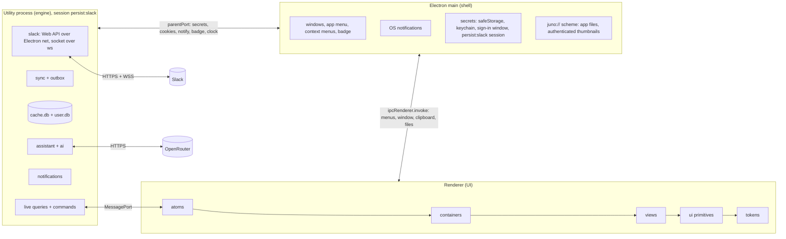
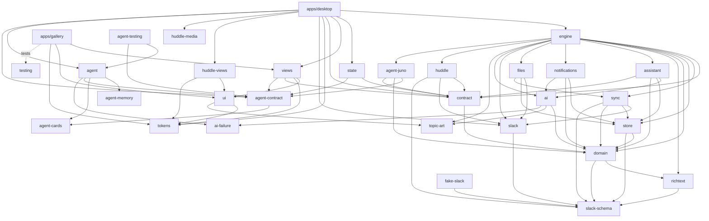

# Juno architecture

Version 2, October 2026. Revised after `docs/reviews/architecture-review-1.md` and the owner's decisions. Decisions with lasting consequences have an ADR in `docs/decisions/`; ADRs 0007 to 0011 are new in this version. The product spec (`docs/design/handoff/SPEC.md`) decides behaviour; this document decides structure.

Inputs: the spec, `docs/research/slack-data-access.md`, `docs/research/slack-desktop-shell.md`, `docs/research/tech-stack.md`, `docs/design/inventory.md`, `docs/design/primitives.md`, the review, and the installed `effect@4.0.3`, `@effect/atom-react@4.0.3` and `electron@44.7.0` sources (API names below were checked there).

Owner decisions folded in: the sidebar shows every thread with recent activity in member channels plus each channel's Main; Resolve is local plus mark-read, never unfollow; sends have no undo, but own messages can be edited and deleted (M6); full file upload, thumbnails and download in v1; a pinned resolved row stays in Pinned, dimmed with a check; new DMs open with `conversations.open`; v1 ships the default design with theme, accent, density (Comfortable or Compact) and topic title lines (One line or Two lines) as appearance settings; the keychain prompt during import is acceptable; the quiet window is a General preference (1, 3, 7 or 14 days, default 7; owner reversal 10-16); one workspace in the v1 UI on a multi-team-ready data layout; notification hours never send an automatic summary, including at next launch (owner reversal of 10-14).

## 1. Overview



- The **shell** (main) owns what needs Electron APIs: windows, the application menu and context menus, notifications, the dock badge, the screen watch that turns privacy mode on while the screen is shared (`main/screenWatch.ts`, ADR 0015), macOS's notification permission (`main/notificationPermission.ts`, through koffi as in ADR 0015), `safeStorage`, the `persist:slack` session that holds the Slack cookie, the sign-in window, the import from the installed Slack app, the `juno://` scheme, file dialogs and downloads. No business logic.
- The **engine** (a `utilityProcess` forked with `partition: 'persist:slack'`) owns all business logic and I/O. It is a plain Node program built from Effect services, so it also runs outside Electron for tests.
- The **renderer** is UI only. It subscribes to live queries and sends commands over one MessagePort. It never sees a token, a cookie or an API key.

Three rules:

1. **SQLite is the source of truth for the UI.** Every screen reads from the store through a live query. The UI never waits for Slack.
2. **Writes are local first.** A command updates the store in one transaction and queues the Slack call in a persisted outbox. The engine owns optimism, revert and undo.
3. **Views are dumb.** Props in, callbacks out. No atoms, no Effect, no IPC. Containers wire atoms to views.

## 2. Processes, network and the contract

### 2.1 Why a utility process (ADR 0001)

`node:sqlite` is synchronous and `client.userBoot` is megabytes of JSON. In main, those stalls freeze native menus, window dragging and every IPC call. In a utility process they stall nothing the user sees, a crash does not take the window down, and the engine stays a Node program that tests can run against `fake-slack` without Electron. The engine only depends on a MessagePort-shaped `Transport`, so it could be hosted in main with no package changes if ever needed.

### 2.2 Network: Electron `net` inside the engine (ADR 0007)

The review was right that the engine should not hand-hold the cookie. Electron 44 exposes `net` in utility processes, and `utilityProcess.fork` takes `session` or `partition` (checked in `electron.d.ts`). The engine is forked with `partition: 'persist:slack'`, and `SlackApi` calls `net.fetch` on that session: the `d` cookie is attached and any `Set-Cookie` that Slack sends to rotate the session is stored back. System proxy, PAC and keychain CAs come for free, and the TLS fingerprint is Chromium's. Chromium encrypts the cookie store with the same OS keychain backend `safeStorage` uses.

`HttpTransport` is an Effect service with two layers: `ElectronNet` (production) and `NodeFetch` (engine tests under Node, pointed at `fake-slack`). `SlackApi` depends only on `HttpTransport`.

The socket is the one place the cookie is handled by hand, because `net` has no WebSocket. Before each connect the engine asks main for `session.cookieHeader` (main serialises `session.fromPartition('persist:slack').cookies.get({ domain: 'slack.com' })`, HttpOnly cookies included) and opens the socket with `ws` and headers `Cookie`, `Origin: https://app.slack.com` and the Slack desktop `User-Agent`. The header string is used for the upgrade only and dropped afterwards. `Set-Cookie` headers on the upgrade response (`ws` emits `upgrade` with the response) are forwarded to main, which writes them into the session. Proxies: `ws` does not read the system proxy, so main also answers `session.resolveProxy(wsUrl)` and the engine passes an HTTP CONNECT agent (`https-proxy-agent`) for the first `PROXY` or `HTTPS` entry of that list (`proxyFor` in `engine/src/session/handshake.ts`); `DIRECT` connects directly, and a list with only SOCKS entries connects directly and logs it. This is the socket cookie story; it is small and testable (the fake rejects an upgrade without the cookie).

Custom protocols are not supported in utility processes (checked), so `juno://files/...` thumbnails are served by main with `net.fetch` on the same session.

### 2.3 Secrets and sessions

- The `d` cookie lives only in the `persist:slack` Chromium session. The sign-in window uses that partition, so the cookie lands in place. The import path writes the decrypted cookie into the session with `cookies.set`.
- The `xoxc` token and the OpenRouter key are encrypted with `safeStorage` into `userData/secrets.bin`, read by main, sent to the engine over `parentPort` at start, and kept in memory there. Under `JUNO_E2E` main uses a plaintext secrets file so the keychain never prompts.
- Juno Agent's provider keys (OpenRouter's, and a custom endpoint's) are generic passwords in the login keychain (`juno-openrouter-key`, `juno-custom-provider-key`), written by main through `/usr/bin/security` with the value on stdin (`apps/desktop/src/main/keychain.ts`). The owner enters them in "Set up Juno" after the first sign-in or in Settings › Juno; the renderer hands them to main (`agent.setProvider`, `agent.setOpenRouterKey`), never to the agent's port. Main keeps which provider is active and the endpoint's base URL in `userData/juno-provider.json` (`providers.ts`), and sends the active provider with its key to the agent over `parentPort`, where it stays in memory. `OPENROUTER_API_KEY` sets OpenRouter up in development. Under `JUNO_E2E` main keeps the keys in memory instead.
- Juno Agent's MCP connections keep their OAuth state (tokens, the client registration) in the login keychain too, under the service `juno-mcp`, one item set per connection (`apps/desktop/src/main/mcpCredentials.ts`). The agent asks main for it over `parentPort` (`credential` and `credentialReply`) and keeps it in memory; it never reaches a file, a log or the renderer. Sign-in opens in the system browser through main and returns to a loopback redirect the agent listens on. Under `JUNO_E2E` the state stays in main's memory.
- Juno Agent's encrypted backup (WP21) keeps its backup key, deletion record and recovery phrase in the login keychain under the service `juno-backup`, one item each, stored base64 (`apps/desktop/src/main/backupSecrets.ts`). The agent asks main over `parentPort` (`secret` and `secretReply`). After Export recovery phrase main hands the phrase to the renderer once (`agent.recoveryPhrase`), for the sheet that shows it; on a new Mac the restore sheet gives main a typed phrase (`agent.typeRecoveryPhrase`) before Restore. The backup folder is under the agent directory by default (`userData/agent/backup`); the owner picks another through main's folder picker. After a restore is staged the agent says `restart`, and main ends and starts it at once so the next open installs the restore. Under `JUNO_E2E` the items stay in main's memory and a test picks the folder.
- Sign-out deletes `secrets.bin`, clears the `persist:slack` session, and deletes the workspace's `cache.db`.

### 2.4 The three channels

| Channel | Transport | Content |
| --- | --- | --- |
| renderer ↔ engine | `MessageChannelMain`; main gives one port to the engine (`utilityProcess.postMessage({ _tag: 'port' }, [port])`) and the other to the renderer (`webContents.postMessage('engine.port', null, [port])`; the preload forwards it with `window.postMessage({ _tag: 'juno.enginePort' }, '*', ports)`, the page checks `event.source === window` and the tag) | live queries, commands, engine events, as `effect/rpc` (2.6) |
| renderer ↔ agent | `MessageChannelMain`; on `agent.requestPort` main gives one end to the agent (`rendererPort`, at once or when it next spawns) and the other to the renderer (`agent.port`, forwarded by the preload as `{ _tag: 'juno.agentPort' }`, checked like the engine's). Main answers `failed` while the agent is off or its supervisor gave up | the agent's renderer groups (`AgentRpcs`), as `effect/rpc`; the agent serves them (`agent/src/serve`), the client is `@juno/state/agent` |
| renderer ↔ main | `contextBridge` + `ipcRenderer.invoke` | `engine.requestPort`, `agent.requestPort`, `agent.provider`, `agent.setProvider`, `agent.setOpenRouterKey` (and the `agent.providerChanged` event), `agent.codex` and `agent.codexSignIn` (local Codex in Juno's own Codex home, `main/codex.ts`), `launch.setTheme`, `launch.setAccent`, `launch.setSidebar`, `launch.setPrivacy` (and the `privacy.changed` event when sharing starts or ends), `sharing.get` and `sharing.set` (Settings › General, Hide message text while sharing the screen), `huddle.register` (gives a page its huddle media generation, `main/huddlePages.ts`, and under JUNO_E2E tells it to run the fake media session), `huddle.microphoneSettings` (Mute while macOS blocks the microphone: System Settings at Privacy & Security, Microphone, `main/media.ts`), `huddle.shareSources`, `huddle.allowScreenRecording` and `huddle.screenRecordingSettings` (the share sheet's screens and windows from `desktopCapturer`, Juno's own left out, and macOS's Screen Recording permission: `main/screenShare.ts`), context menu popup, Open in Slack, app-menu commands, title-bar double click, clipboard, open external, file dialogs, `webUtils.getPathForFile` for dropped files |
| engine ↔ main | `process.parentPort` | main→engine (`MainToEngine`): `config` (userData, e2e), `port`, `aiKey` (the OpenRouter key for the engine's AI, at `ready` and on every change; kept in memory), later secrets, cookie header, proxy, `clock.advance` (e2e), sign-in completed, `huddlePages` (the live huddle media generations and the highest main gave out); engine→main (`EngineToMain`): `ready`, later `notify`, `setBadge`, `authRequired`, `setCookies`, `openExternal`, `huddle` (the huddle the user is in, so a quit asks first, `main/huddleQuit.ts`) |
| agent ↔ engine | `MessageChannelMain`; whenever both are up (an engine `ready`, or an agent spawn while the engine is ready), main sends one end to the engine (`agentPort`) and the other to the agent (`hostPort`) | the AgentHost group (`@juno/agent-contract`), as `effect/rpc`; the agent is the client (ADR 0012). The engine's spend asks go the other way as a stream the agent answers (`host.spend.asks`); the agent sends each of its model requests to the AI activity log with `host.ai.record` |
| agent ↔ main | `process.parentPort` | main→agent (`MainToAgent`): `config`, `provider` (the active model provider with its key, at spawn and on every change; kept in memory), `hostPort`, `rendererPort`; agent→main (`AgentToMain`): `ready` with the host's hello. OAuth requests come with Connections (WP17) |

Every payload is an Effect `Schema` in `@juno/contract` (`protocol.ts` for the parentPort messages and the handoff, `shell.ts` for the invoke routes (`ShellRoutes`), `channels.ts` for their names), decoded on receipt. The preload imports only `@juno/contract/channels` (names and types, no runtime imports). Main checks `event.senderFrame.url` against `juno://app/` (or the Vite dev URL in dev).

### 2.5 Engine lifecycle

`apps/desktop/src/main/engine.ts` (`EngineSupervisor`) forks `out/main/engine.js` with `serviceName: 'juno-engine'` and `partition: 'persist:slack'`, sends `config` on `spawn`, and restarts it on exit with exponential backoff (1 s base, 30 s cap, give up after 5 exits in 2 minutes and report the "engine failed" state). It forks the engine and opens the window in the same tick. A port requested while the engine is down is held (one per renderer) and sent once it reports `ready`; after the supervisor gives up, `engine.requestPort` answers `failed`, the sidebar shows "Sync stopped" under its filters with a Restart button, and the account menu's diagnostics say "Engine failed". Restart calls `engine.restart`, which starts the engine again with a fresh crash count; the transport, which keeps asking for a port every second, connects as soon as main hands one out. The same line shows "You're offline" and "Slack asked us to slow down" for those engine phases. The renderer's `MessagePort` fires `close` when the engine dies (verified in the e2e `recovers after the engine process is killed`); the state client then marks the connection `reconnecting`, the worker pool re-spawns by asking main for a new port, and every live query re-subscribes and receives a fresh snapshot. The engine accepts several ports at once (renderer reload, a second window later); each port is one RPC client, and a port's close interrupts every fiber that belongs to it. `prefs.set` is uninterruptible, so a preference written just before its window closes is still saved. On quit main sends `quit` instead of killing the engine: the engine closes its scope, which waits for such writes, and exits; main kills it after 3 s and waits for it before the app quits.

Each process installs its process log once (`apps/desktop/src/processLog.ts`). An uncaught exception logs and exits any process, since its state may be corrupt. An unhandled rejection does the same in the engine and the agent, which main restarts; in main it is logged with its stack and the app keeps running, because nothing restarts main.

`engine.status` is a live query carrying `{ phase, startedAt, syncing }`, re-run only when the phase or `syncing` changes; the phase is `first-run | booting | catching-up { done, total } | live | offline | rate-limited { until } | session-expired`. `syncing` is true while a sync cycle runs (a boot, catch-up or sweep, with the follow pass that runs on the background lane after the phase is already `live`); the status line exposes it as `aria-busy`, and the e2e driver waits for it to be false before a test looks at rows. "Restarting" is not a phase the engine can report; the renderer derives it from the connection state. The engine (`startEngine(transport, config)`) brings its services and the RPC server up before any boot work, so the first live query is answered from local state before Slack is contacted.

### 2.6 Protocol: `effect/rpc` over the port (ADR 0009)

ADR 0002 chose a hand-written protocol because `effect/rpc` was believed to have no Electron transport. The M1 spike (evidence in ADR 0009) ran both over the same ports and route declarations: `effect/rpc` passed every criterion (live query, unsubscribe and port-close interruption under 2 ms, typed errors and defects as values, several ports at once, reconnect) and tied the custom protocol on payload cost, with 74 owned lines against 173. So the port protocol is `effect/rpc`:

- **Routes** live in `@juno/contract/src/routes/<feature>.ts`, one `RpcGroup` per feature made with `Rpc.make(tag, { payload, success, error })`. Live queries are stream routes (`stream: true`) declared through `liveValueRoute(tag, { payload, value })` for a single value or `liveListRoute(tag, { payload, row })` for a windowed list (which adds `range: ListRange` to the payload itself); commands are plain routes whose success schema includes `undo?: Command` where the spec needs it. `routes/index.ts` merges the groups into `AllRoutes`, which the engine serves and the state client calls.
- **Engine** (`@juno/engine/src/protocol`): `RpcServer.layer(AllRoutes, { disableFatalDefects: true })` over `RpcServer.layerProtocolWorkerRunner`, backed by a `WorkerRunnerPlatform` that accepts every port a `Transport` hands it and reports closes through the disconnect queue, which interrupts that client's fibers. Feature folders register handlers with `<Feature>Routes.toLayer({...})`; `layer.ts` merges them.
- **State** (`@juno/state`): `RpcClient.layerProtocolWorker({ size: 1 })` over a `Worker.makePlatform` adapter whose single worker is the renderer's current `MessagePort`. The port's `close` event fails the worker run, and the pool re-spawns by asking main for a new port. The client lives in an `Atom.runtime`, so its scope outlives any one atom. Nothing outside `@juno/state` imports `effect/rpc`, `effect/workers` or `effect/reactivity/Atom`.
- **Wire**: structured clone over `postMessage`, framed by `effect/workers` as `[0, message]` from the client and `[0]` (ready) or `[1, message]` from the engine. Payloads are the routes' JSON codecs (`Schema.toCodecJson`), so a message is readable in devtools.

The shape of the API:

- **Live query** (stream): a `liveValueRoute` emits `{ value, meta }`: the current value, then every new value. A `liveListRoute` emits `ListDelta`: a first message with `reset: true` carrying the whole window, then `{ order: Id[], upsert: Row[], remove: Id[], refs?, meta }` where `upsert` holds only rows whose `rev` changed and `refs` the people and channels the rows name that the subscription has not been sent or that changed (section 7); the engine helper `serveLiveList` in `engine/src/protocol/live.ts` takes the handler's stream of runs (the store's `liveQuery(keys, timed(query))`), keeps the last `{ order, revById }` per subscription and does the diff, so handlers only write the query; `serveLiveValue` does the same for a value. Every message's `meta` is `{ seq, queryMs, encodeMs, at, total?, error? }` (performance.md 6) so the renderer can attribute the write-to-pixels budget. The renderer keeps a `Map` by id (`applyListDelta` in `@juno/state`), so rows with an unchanged `rev` keep object identity, `order` keeps its array when unchanged, and only `upsert` rows are decoded. List subscriptions take a `ListRange { anchor?, limit }`, never a full history. Size budgets: snapshot ≤ 200 KB, delta ≤ 32 KB, codec ≤ 5 ms per side; the engine logs a warning when a message exceeds them. Debounce is leading-edge (a user command is not delayed), 30 ms trailing, and lives in the store's `liveQuery`, not the engine. A run that changes nothing sends nothing: an equal value, or a list run with no changed row, no removed id and the same order. A failed query run is emitted as the last value with `meta.error` and the subscription continues; a failure before any value fails the subscription with the route's error, or, for a route with no error of its own (the sidebar routes), starts the subscription again with backoff (`retryFirstRun`), so a busy reader at boot never ends it for good. `meta.encodeMs` is measured only in dev and e2e builds.
- **Command** (request): returns `{ undo?: Command }` after the local transaction (`CommandResult` in `@juno/contract`).
- **Event**: `command.failed`, `navigate`, `toast`, `clock.tick`, `typing`, as stream routes with no payload.

Errors are `Schema.TaggedError` classes in `contract/src/errors.ts`: `NotSignedIn`, `Offline`, `Rejected { code }`, `RateLimited { retryAfterMillis }`, `NotFound`, `AiUnavailable`, `Invalid { issues }`, `ProtocolError`. A handler defect reaches the renderer as the `Die` cause of that one request's `Exit`; the port stays open.

**Error mapping.** Three layers have their own errors and none passes through unchanged. `@juno/slack` fails with `SlackAuthRequired`, `SlackRateLimited`, `SlackRejected`, `SlackTransportError` and `SlackDecodeError`; `@juno/store` fails with `StoreError` (`SqlError`, `MigrationError`, `StoreIoError`); routes declare only the `@juno/contract` errors, and a route's schema cannot encode anything else (it would die as a defect). So engine handlers map at the edge: `SlackAuthRequired` to `NotSignedIn` (and the `session-expired` phase), `SlackRateLimited` to `RateLimited` (both carry `retryAfterMillis`), `SlackRejected` to `Rejected { code }`, `SlackTransportError` to `Offline`. A `SlackDecodeError` means our schema disagrees with Slack, which is a bug. A `StoreError` is also a bug, because a broken database is not a state the user can act on: a command turns it into a defect with `Effect.orDie`. A live query does not: its failed run is a value (`meta.error`, above), so one bad run never ends a subscription. The mapping lives in the feature handlers, not in `@juno/slack` or `@juno/store`, so neither package imports `@juno/contract`.

## 3. Packages

pnpm workspaces, every package shipped as TypeScript source. The owner wants each smaller thing to be a package; the split below keeps that and makes each package name the rule it protects. The dependency graph is enforced by pnpm's strict layout (a package can only import what it declares) plus `scripts/check-deps.mjs`, which fails on any edge not in this table. `pnpm lint` runs the script, so the rules below fail the lint step.



The bottom block is Juno Agent (section 10, ADR 0012). Its one edge outside the `agent-*` packages is `ai-failure`, a leaf with no dependencies that the engine's `ai` uses too, so the agent's guard and the engine's provider sort a refusal the same way; the agent does not reach `ai`, `domain` or `topic-art`. `state` reads the agent's renderer groups from `agent-contract` (`@juno/state/agent`); `views` take its chat view models.

| Package | Rule it protects | Owns | Must not |
| --- | --- | --- | --- |
| `@juno/slack-schema` | one Slack vocabulary | Effect Schemas for every payload read or sent (blocks, messages, methods, socket frames), the branded `Ts` with `compareTs`, `maxTs`, `minTs`, `tsToMillis`, `millisToTs` | import anything but `effect` |
| `@juno/richtext` | pure text handling | Slack `blocks`/`rich_text`/mrkdwn → `MessageBody` view model (sections, quotes, code, lists, mentions, links, emoji, files); composer text (picked people and channels as `<@U…\|Maya>` and `<#C…\|eng>`, linked words as `<url\|words>`, URLs and domains as typed, an edit's `@`/`#` names) → `rich_text` blocks with `link` elements; emoji shortcode table; preview text (quotes stripped) | import anything but `slack-schema` types |
| `@juno/domain` | pure rules | ids, `Topic`, status and visibility, title resolution, sorting, topic index computation (`reindexTopics` inputs → row), read-state merge rule, notification decision order, clarity and audience checks, ⌘K grammar, relative time, mention detection, context-menu item lists; re-exports `Ts` and its helpers | I/O, Effect services, React |
| `@juno/contract` | the wire | route groups per feature, view models (`TopicRow`, `TopicDetail`, `MessageView`, `HomeItem`, `JunoMessage`, `NotificationRule`, `Prefs`, `EngineStatus`), events, errors, `channels.ts` for the preload | logic |
| `@juno/slack` | the client, shared with the fake | `SlackSession`, `HttpTransport`, `SlackApi`, `RequestQueue`, `SlackEdge`, `SlackSocket`, Grid routing | know about topics, the store, the UI |
| `@juno/fake-slack` | tests cannot leak into the engine | HTTP + WS fake with fixtures, control API (inject, reply, mark from another client, drop socket, 429, expire session, Grid mode), sign-in page, file upload endpoints | import the engine or the client |
| `@juno/store` | the schema | `cache.db` and `user.db` schemas, timestamped migrations, writer and reader clients, `Invalidation` (wraps `Reactivity`), FTS5 table | call Slack or AI, shape data for the UI |
| `@juno/sync` | Slack ↔ store | boot, discovery, backfill, merge rules, event application, read-state mirroring, outbox and its worker, reconnect reconciliation, `reindexTopics` calls | render, call AI |
| `@juno/files` | authenticated bytes | upload staging and the upload flow, file metadata rows, thumbnail URL resolution, download requests to main | touch the renderer |
| `@juno/topic-art` | no model text reaches a page | the topic art vocabulary: the whitelist parser for the model's recipe, the renderer that rebuilds SVG from the checked recipe with the `art` tokens' CSS variables, the Tide pebble placeholder | import anything |
| `@juno/ai-failure` | one reading of a provider's error | the error kinds (`classifyFailure`), whether a kind is worth a retry or a fallback, and whether a failed request was billed | import anything |
| `@juno/ai` | provider isolation | `AiProvider` with `PiAiProvider` and `FakeAiProvider`, task table (prompts, output schemas, tier) | touch the store |
| `@juno/assistant` | AI policy | when tasks run, `ai_cache`, budget, concurrency, the off switch, Home items, the Juno chat with tools and cards | call OpenRouter directly |
| `@juno/notifications` | one decision path | pipeline, today's log, presence job, `Notifier` interface | show anything itself |
| `@juno/engine` | composition | the app `Layer`, feature folders (`topics/`, `messages/`, `reads/`, `search/`, `notifications/`, `assistant/`, `files/`, `session/`) each with its route handlers and live queries, the shared `workspace.ts` (the open store), the port transport, config from env, `startEngine()` | hold domain rules (it applies them from `@juno/domain` when shaping view models) |
| `@juno/tokens` | design values | `defineVars` with `--` keys, `createTheme` for dark and accents | |
| `@juno/ui` | primitives | the 18 primitives from `primitives.md` plus `Icon` | import contract, state, data |
| `@juno/views` | dumb UI | feature components, each with `*.fixtures.tsx`; the `applyTheme` entry point for apps | import `@juno/state`, `effect`, `window.juno` |
| `@juno/huddle` | one call at a time | the `Huddle` service (specs/huddle.qnt): the call's lifecycle, `rooms.join` and `rooms.leave`, the stored leave that must happen, running huddles from room frames (decoded here) and `huddles/info`; the engine attaches it to each sync and stores its leaves | import `store`, the engine or UI; call Chime |
| `@juno/huddle-views` | dumb UI for huddles | the huddle views (SPEC 20), on `ui` and `tokens` only: the sidebar bar, the huddle tab, the header control, the row glyph, the device menu and the screen share sheet, each with `*.fixtures.tsx`; its view models are its own | import `@juno/views`, `@juno/contract`, `@juno/state`, `effect`, `window.juno` |
| `@juno/huddle-media` | the call's media, in the renderer | the `MediaSession` interface and its snapshot store, the Chime session (`/chime`, a lazy chunk loaded on join, the only importer of `amazon-chime-sdk-js`) and the fake (`/fake`) for e2e tests and the gallery; decision `huddles-media-in-renderer` | import `@juno/state`, React, `effect`, Electron, Node built-ins, `window.juno`; talk to Slack |
| `@juno/state` | the bridge | engine client, `liveQuery`/`command` helpers, atoms, undo stack, toasts, tabs, drafts, clock; `@juno/state/react` re-exports the atom hooks | JSX |
| `apps/desktop` | wiring | `src/main`, `src/preload`, `src/engine` and `src/agent` (utility entries), `src/renderer` with containers, `e2e/` | |
| `@juno/testing` | one set of test helpers | Playwright helpers shared by the gallery and the desktop e2e, starting with `expectNoLayoutShift` | be imported by any `src` |
| `@juno/agent-memory` | pure agent memory | node keys, due order, batches, view rendering, the local window, the dependency closure, the request partition and budget, pin spans | I/O, Effect services, pi |
| `@juno/agent-cards` | one card catalogue | card kinds and schemas, canonical payloads and digests, child-action expansion, card status machines | UI, I/O |
| `@juno/agent-contract` | the agent's wire | the AgentHost port (`AgentHostRpcs`) and the main↔agent messages, the agent's RPC groups for the renderer, chat view models | logic |
| `@juno/agent` | a portable agent | the agent core (plan v3): runtime on pi-durable, store, inbox, requests and the provider guard, jobs, actions, MCP, scheduling, ownership and backup; `startAgent()` | import Electron, Slack, `store`, `sync`, `engine` or UI |
| `@juno/agent-juno` | Juno as the agent's host | the AgentHost handlers the engine serves | call a model |
| `@juno/agent-testing` | agent test doubles | the scripted model and compactor, the fake Codex binary, the fake Notion, Littlebird and T3 MCP servers, hostile Slack fixtures and the crash harness (`agent-memory` is a test-only dependency); later the memory simulator | be imported by any `src` |
| `apps/gallery` | review | browser-only fixture gallery (one state at a time), its screenshot project and its behaviour project, including the layout-shift guard (`pnpm test:gallery`) | Electron |

`testDeps` in a package.json names a devDependency that tests may import and src may not: `engine` uses `state` (the real client against the real server) and `slack` uses `fake-slack`.

What `check-deps` fails on, beyond the graph (all of it runs in `pnpm lint`):

- **Undeclared imports** of a `@juno/*` package in `src`, `test` or `e2e`.
- **Package rules.** `ui`, `tokens`, `domain` and `richtext` import no `effect` (`domain` and `richtext` may import `{ Schema }`); `ui` does not import `state`; only `apps/desktop` imports `electron`.
- **Directory rules.** `apps/desktop/src/renderer` imports no `engine`, `store`, `slack`, `electron` or Node built-in. `src/main` imports no `state`, `views`, `ui`, `engine`, `store`, `slack` or React. `src/engine` imports no UI. `src/preload` imports only `electron` and `@juno/contract/channels`. Any `views/` or `*-views/` directory (including `packages/views` and `packages/huddle-views`) imports no `state`, `engine`, `store`, `electron`, Node built-in or `effect`, and neither it nor `ui` mentions `window.juno`.
- **Unstable Effect modules** (list in the effect skill) only from the files that wrap them: `effect/reactivity` Atom, AtomRegistry, AtomRpc and AsyncResult in `state/src` (and one engine test); `Reactivity` in `store/src/invalidation.ts`; `@effect/atom-react` in `state/src/react.ts`; `effect/rpc` in `contract/src`, `engine/src/protocol`, `state/src`, `agent-contract/src`, `agent/src/host` and `agent/src/serve` (and two tests); `effect/workers` in `state/src/transport.ts`, `engine/src/protocol/runner.ts`, `agent/src/host/port.ts` and `agent/src/serve/runner.ts`; `effect/sql` and `@effect/sql-sqlite-node` in `store`. Every other unstable module is allowed nowhere until someone adds a wrapper and an entry in the script.
- **The media session.** `huddle-media/src` imports no `state`, React, `effect`, Electron or Node built-in and does not mention `window.juno`; only `huddle-media/src/chime/` (and its tests) import `amazon-chime-sdk-js`.
- **Juno Agent.** No `agent-*` package imports or declares `electron` or a Slack package; `@juno/agent` also stays away from `store`, `sync`, `engine`, `state` and the UI packages. `@earendil-works/pi-durable` and `chord` are imported only in `agent/src/runtime/`, `pi-mcp` only in `agent/src/mcp/`, `pi-ai` and `@openai/codex-sdk` only in `agent/src/providers/` (and `pi-ai` in `@juno/ai`); `agent-testing` may import all of them. `agent-memory` and `agent-cards` import only `{ Schema }` from `effect`. `src/agent` in the desktop app imports no engine, store, sync, Slack or UI code, and `src/main` and `src/engine` do not import `@juno/agent`.
- **Engine feature folders.** A folder in `engine/src` other than `protocol` may not import another feature folder or `layer`, `startEngine` or `index`.
- **`sendSync`** anywhere in `src`.

Compared with v1, `richtext` and `files` are new and `ai` stays separate from `assistant` because "the provider never touches the store" is a rule worth a package. No packages were merged; `engine` gets feature folders so one feature such as resolve lives in `engine/topics/` plus its `contract` route group, `domain` rule and `views` component, not spread across six packages.

What Slack's shell taught us: one shared contract package with names, types and validators, validated in the receiving process; one window factory that force-merges secure `webPreferences` plus a `browser-window-created` watchdog; notifications and the badge computed from app state and shown from main; a persisted retry list for marks, thread subscriptions and reactions (our outbox); one send in flight and `client_msg_id` echo matching; `desktop_notification` as the server's "this matters" signal; cookies kept in a Chromium session, never in app files.

## 4. Data model

### 4.1 Two databases per workspace (ADR 0008)

`<userData>/workspaces/<team_id>/` (on Grid `<enterprise_id>-<team_id>/`) holds:

- `cache.db`: the Slack mirror, `topic_index`, `messages_fts`, `emoji`, `files`, `ai_cache`. A copy of Slack that updates keep: new migrations run on the existing file. `CACHE_RESET_EPOCH` in `store/src/migrations/cache/index.ts` is written to `PRAGMA user_version`; when the store opens a file with another epoch, or SQLite cannot open or migrate the existing cache, it deletes it and recreates it, and the engine re-syncs. This recovery keeps `user.db`. "Reset local cache" in Settings (`Store.resetCache`) does the same at runtime: detach from both connections, delete, recreate, attach, re-run every live query. `cache.db` is never `VACUUM`ed, so the rowids `messages_fts` points at stay stable.
- `user.db`: overlay, reads, ignored channels, notification settings and log, Juno chat, drafts, outbox, prefs, Home's visit log (`topic_visits`), found follow-ups (`follow_ups`) and sidebar views. Durable.
- `uploads/`: staged files waiting in the outbox.

Migrations: both databases use the Effect `Migrator` with timestamp ids, one file per change (`store/src/migrations/<db>/202610121430_add_x.ts`, listed in that folder's `index.ts`), recorded in a `juno_migrations` table in each file. `user.db` migrations are real, incremental and never edited once shipped. `cache.db` migrations run on the populated cache too, so an update keeps it and does not sync from Slack again; the rules they follow are in the store README ("Cache migrations"). A change that cannot be migrated changes `CACHE_RESET_EPOCH` instead, with a decision fragment that says why (`scripts/check-cache-epoch.mjs`, run by lint). A new migration id must be later than every shipped one: the Migrator skips ids at or below the newest it has recorded. `cache.db` is migrated on a short-lived connection of its own before the writer attaches it, so its migration table lands in the right file.

The writer connection `ATTACH`es `cache.db` to `user.db` as `cache` so one transaction can span both. Table names are unique across the two files, so queries use plain table names. There is one workspace directory per signed-in team (`<userData>/workspaces/<team_id>/`, on Grid `<enterprise_id>-<team_id>/`, `workspacePaths()` in `store`); the v1 UI shows one at a time.

Connections: `@effect/sql-sqlite-node` gives one serialised connection per client, so the store builds two with one shared `Invalidation`: `StoreWriter` (all writes and transactions; `BEGIN IMMEDIATE`) and `StoreReader` (opened read-only, the same attachment, used by live queries). Both are `SqlClient`s; the service type says which connection a query runs on. `effect/sql` is an unstable module, but the store exports `SqlClient` (as a type) from its index as the type of its connections, so engine features write their queries against it through `@juno/store` and import `effect/sql` nowhere else (decision, M1 code review). If `effect/sql` changes, the change stays inside `store` and the query code that uses `SqlClient`. WAL mode lets the reader run while the writer commits, and a reader query during an open writer transaction sees the last committed state. Busy timeout is 250 ms (the default 5 s blocks the event loop); `transaction()` retries a lock timeout a few times with backoff in Effect. Backfill writes are split with `inBatches(rows, write)` into transactions of `BATCH_ROWS` (200) so a live query or a Resolve never waits more than a few milliseconds.

Invalidation and live queries (`store/src/invalidation.ts`, the only module that imports `effect/reactivity/Reactivity`): keys are table names, optionally with row ids. A subscription on `['messages']` re-runs for any write to that table; one on `{ messages: ['C1'] }` re-runs for `{ messages: ['C1'] }` and for `['messages']`, not for another channel. `transaction(effect)` wraps the writer transaction in a batch: keys invalidated inside fire once after the commit and not at all on rollback; nested calls become savepoints in the outer batch. `liveQuery(keys, query)` is a `Stream` of `Result`s: it runs `query` now, then again whenever its keys are invalidated, with a leading-edge debounce (the first change after an idle period runs at once; further changes inside the 30 ms window collapse into one trailing run). A failed run is emitted as `Result.fail(e)` and the subscription stays alive; only a defect fails the stream. The engine's route layer turns these streams into the snapshot-plus-deltas wire format of section 2.6; the store itself does not shape rows for the UI.

### 4.2 Mirror tables (`cache.db`)

```sql
team            (id PK, name, domain, self_user_id, enterprise_id, prefs_json, booted_at)
users           (id PK, name, display_name, real_name, avatar_url, avatar_small_url, avatar_large_url, tz, is_bot, deleted, updated)
conversations   (id PK, kind 'public'|'private'|'im'|'mpim', name, user_id, member_ids_json,
                 is_member, is_archived, topic, purpose, created, updated)
messages        (channel, ts, PK(channel, ts), thread_ts, user_id, bot_name, bot_icon, subtype, text, blocks_json,
                 files_json, attachments_json, edited_ts, deleted, client_msg_id,
                 reply_count, latest_reply, reply_users_json, last_event_ts, version)
messages_fts    (fts5: text, content=messages)        -- external content; triggers on messages keep it in step in the same transaction
reactions       (channel, ts, name, PK(channel, ts, name), count, user_ids_json, me)
files           (id PK, name, mimetype, size, url_private, thumb_json, permalink, user_id, created)
emoji           (name PK, url, alias_for)
thread_subs     (channel, thread_ts, PK, subscribed, slack_last_read, updated_event_ts, observed_at, commanded)
channel_reads   (channel PK, slack_last_read, latest, has_unreads, mention_count, counts_updated)
synced_ranges   (channel, from_ts, to_ts, PK(channel, from_ts))   -- explicit, never moved by socket events
thread_cursors  (channel, thread_ts, PK, replies_complete, synced_at, complete_from)
topic_index     (topic_id PK, channel, kind, last_activity_ts, message_count, participants_json,
                 root_ts, unread_count, unread_exact, mentions_me, preview_json, rev)
                -- participants_json: distinct senders of the last 15 unread messages, newest first, never you; [] when read
                -- a column that changes meaning bumps @juno/sync INDEX_VERSION: the sync re-indexes stored rows locally on start
sync_state      (key PK, value_json)
rechecked_topics (topic_id PK, requested_at, from_ts, to_ts)   -- the span the last recheck read per topic (ADR 0014)
automated_holds (channel PK)   -- channels the first sync keeps out of All until Automated's rules have read them
ai_cache        (task, key, PK, input_hash, output_json, model, cost_usd, created_at)
```

Bot messages keep their display name and icon in `messages.bot_name` and `bot_icon`. The message window emits a separate sender ref per bot message, so overrides on one message do not rename another. These fields follow message content merge ordering.

### 4.3 Durable tables (`user.db`)

```sql
topic_overlay   (topic_id PK, manual_title, ai_title, ai_title_source_hash, ai_title_at,
                 resolved_at, resolved_activity_ts, reopened_at, pinned_at, unsubscribed_at,
                 tracked, settled_dismissed_ts, grouping_dismissed_ts)
topic_reads     (topic_id PK, last_read_ts, marked_unread, local_write_ack_ts, last_server_event_ts,
                 observed_at, slack_read_ts, commanded)
main_groups     (id PK, channel, title, created_at)
main_group_msgs (group_id, ts, PK)
ignored_channels(channel PK, ignored_at)
pending_messages(client_msg_id PK, channel, thread_ts, text, blocks_json, file_ids_json, created_at, ts /*unused*/,
                 state 'queued'|'sending'|'unknown'|'failed', attempts, next_at, last_error)
sent_posts      (client_msg_id PK, channel, user_id, ts /*first copy stored*/, sent_at)  -- ADR 0014, kept a week
ai_calls        (id PK AUTOINCREMENT, at, last_at, repeats, source 'engine'|'agent', feature, subject_kind, subject_id,
                 provider, model, outcome 'ok'|'error'|'blocked'|'cancelled'|'timeout', kind, message, duration_ms,
                 input_tokens, output_tokens, cost_usd, summary)  -- AI activity log, newest 500, no prompt or answer text
ai_refusals     (task, key, input_hash, kind, at; PK task, key)  -- the last input a model refused for good, not sent again until it changes
kept_copies     (channel, ts, client_msg_id, reason, hidden, kept_at; PK channel, ts)  -- copies not deleted, and why; file copies stay hidden (ADR 0014)
prefs[notifications] (notificationHours, presenceHours, matters, channels, people, threads?)
notification_log     (id PK, at, channel, ts, UNIQUE(channel, ts), topic_id, preview, outcome /*now|hold*/,
                      reason, candidate_json, judgement_json, delivered_at, suppressed_at)
juno_chat       (id PK, role, content_json, created_at)
drafts          (topic_id PK, text, updated_at)
outbox          (id PK AUTOINCREMENT, kind, target_key, payload_json, depends_on, created_at, attempts, next_at, last_error)
prefs           (key PK, value_json)
prefs[huddle.pendingLeaves] ([{ channelId, callId, attendeeId }])  -- leaves that must be sent (specs/huddle.qnt), never credentials
topic_art       (topic_id PK, recipe, recipe_hash, input_hash, model, status 'ok'|'unsure'|'failed', hue,
                 title_source, source 'ai'|'redraw', created_at)
agent_attempts  (authorization_id PK, attempt_id UNIQUE, action_id, channel, thread_ts, text,
                 state 'submitted'|'done'|'failed'|'unknown'|'cancelled', result_json, created_at, settled_at)
sidebar_views   (id PK, name, icon, position, keep_out_of_all, created_at)
sidebar_view_channels (view_id, channel, added_at, PK(view_id, channel)), INDEX (channel, view_id)
automated_channels (channel PK, verdict 'automated'|'kept'|'ask', by 'rules'|'juno'|'you', at, apps, sampled, reason)
builtin_views   (id PK, made_at)
```

Sidebar views (SPEC 5 "Views", `engine/sidebarViews/`) are local: the `views.*` routes write these two tables in one transaction each, invalidate `sidebar_views`, and return their undo (a delete returns the whole view as `views.restore`). `topics.list` takes `view`: the four sidebar statements then keep `i.channel IN (the view's channels)` and ignore the kind; without a view and a scope they drop the conversations of any view with Keep these out of All through a correlated `NOT EXISTS` probe on the views' channel index, so the walk over `topic_index` does not change (the plan test covers both). `topics.counts` groups unread topics by conversation, so one statement gives the Channels and DMs dots (without kept-out conversations) and `viewMentions`, the views with an unread mention. All topics, ⌘K, Home and notifications never read the views. `viewCommands.ts` holds the commands shared by the sheet and AgentHost (`host.views.*`). The `juno_views` tool applies clean owner requests with Undo, or proposes a Change card after reading untrusted content. Its channel-name lookup returns directory metadata only. Undo restores the snapshot only while the view still matches the result of the command.

The built-in **Automated** view (SPEC 5 "Automated") is a `sidebar_views` row with the fixed id `automated`, so a rename, an icon change or Undo of a delete keeps it the built-in one. `builtin_views` records that Juno made it; listed there and missing from `sidebar_views` means the user deleted it, and nothing makes it again. `automated_channels` is where each conversation stands: in Automated, kept where it is, or asked about on Home, and who settled it. The rules (`domain/automated.ts`, `classifyConversation`) read who wrote a conversation's latest 30 top-level messages, never thread replies (an app is a `bot_message`, a bot user or a `B` id), and count them with `postingCounts`. `automatedView.ts` holds the shared writes and the rules' pass, `sortClearCases`, which the sync runs through its `onBooted` hook after each boot and before it reports live, so a clear bot channel is never in All once the first sync is done. During the first sync it never shows in All at all: the `onListed` hook, after the cold boot has listed the conversations and named the people of the DMs and before the quick start lets the sidebar show rows, runs `holdUndecided`, which moves what the rules can already place (a DM with an app) and writes each channel they cannot read yet to `automated_holds` in `cache.db`. The sidebar's All and its dots leave held channels out. `onHistory` sorts each channel as its history is stored and then lets it go (`sortAndRelease`); whatever is still held goes after `HOLD_MILLIS` (5 s) or when the boot ends. The job in `home/automated.ts` runs after that on changes (3 second windows) and every 15 minutes: it looks only at active conversations in no view whose place is not settled by `you`, again only when one has new activity or AI assist changed, moves clear cases, asks `automatedChannel` once per unclear channel with AI assist on (counted in Home's budget), and writes `ask` for what stays unclear, with why: `apps` of the `sampled` latest top-level messages came from apps, and Juno's `reason` when it gave one (a decision model gives none). Home's meta line reads these through `automatedReason`, so it says why the question was asked, not what the channel says now. A channel where the user started a conversation, or where people started at least half of the top-level messages (seven in ten with an integration name), is people and never asked; Juno's answer keeps it in All at 0.4 or below and moves it at 0.9 or above. The same pass reads again, on new activity, each channel the rules or Juno moved in (`movedIn`) and takes it back out (`moveBackOut`) when the rules now say people. Every move by the rules or Juno is written to `automated_moves` with the counts that decided it (moves in only once `sortClearCases` has finished the first boot's pass, `automatedRecordFrom` in `prefs`); Home's record card reads the moves not yet seen; `home.movesSeen` marks them seen when the user opens the record or dismisses the card, and `home.movesShown` keeps the time Home last showed the card in `prefs` (`automatedMovesShownAt`), so the card shows at most once a day while its moves stay until seen. The record's Move back and Keep are `views.sortChannel`, whose undo carries `restore` to give the channel back to the rules or Juno. Every hand change to a view's conversations (the sheet, Add to view, the agent's `juno_views`) and every answer on Home (`views.sortChannel`, whose undo is the place before) is written `by 'you'`, which the rules and Juno never overwrite.

Unused since the 10-14 simplification and kept because migrations are append-only: `topic_overlay.tracked`, `unsubscribed_at` (Main's old client-only Unsubscribe; Main now takes its channel's Notify me level), `grouping_dismissed_ts`, and the `main_groups` and `main_group_msgs` tables. The unused `for_you_cards` table was dropped by migration. `notification_levels` gains the `thread` kind for a thread set to Every message; a thread's Never is its Slack follow flag, not a row.

### 4.4 Topics are derived (ADR 0004)

| Kind | Id | Exists when |
| --- | --- | --- |
| Thread | `t:<channel>:<thread_ts>` | a root with `reply_count ≥ 1`, or a Slack subscription, or a `tracked` overlay row, or a stub root created from a reply whose root is not stored yet |
| Main | `m:<channel>` | the user is a member |

`topic_index` has exactly one writer: `reindexTopics(ids)` in `sync`, which recomputes rows from source tables and is called at the end of every transaction for the topics it touched. No arithmetic on counters anywhere. An engine test compares the incremental index with a full rebuild after random event sequences. Changes that depend only on time come from timers, not from writes: each `topics.list` subscription also runs once a minute by itself, so a topic turns quiet on time (a global invalidation would re-run every subscription for every other one's tick). The switches of notification and active hours get their own timer.

Status (`domain/status.ts`): ignored channel → `ignored`; for a thread, Slack's follow flag set to false (Notify me: Never) → `unfollowed`; `resolved_at` and no later activity → `resolved`; no activity within the selected quiet window and not pinned and no unread → `quiet`; else `open`. For Main, activity is anything in the channel, replies in its threads included (`topic_index.last_activity_ts` of every topic in the channel), so a channel whose only recent traffic is in threads keeps its Main row. The sidebar shows `open` topics that pass the thread rule of spec section 5 ("What shows up"): Main always, a thread only when the user follows it in Slack (`thread_subs.subscribed`) or it has an unread mention of the user (`isSidebarCandidate`). Other threads stay topics (All topics, the channel's Main) without a row. Every pinned topic is in the sidebar; a pinned resolved topic stays in Pinned, quieter (a faded tile and the subtle title colour, text never below 4.5:1), with a check and no hover Resolve. Pinned beats unfollowed too (a pinned unfollowed thread stays in Pinned); only an ignored channel hides a pinned topic. All topics shows everything except ignored. A message after `resolved_activity_ts` clears `resolved_at` and sets `reopened_at`; the tag shows until mark-read or the next resolve. The pure function also treats activity after `resolved_activity_ts` as reopened before the engine has cleared `resolved_at`, so the row never flickers through "resolved".

All topics (`engine/topics/allTopics.ts`, spec section 11) lists every topic of every conversation the user is in, archived ones too, except ignored channels. A run looks at the whole index in two steps. The order statement walks the member conversations and probes each one's topics on `topic_index_channel_activity` (a `CROSS JOIN` keeps that order, so nothing scans `topic_index`), computes each topic's status in SQL (the domain's `topicStatus` written out, with Main's quiet rule reading the latest activity anywhere in its channel), filters by the status chip, kind, place and text, sorts (most recent, oldest, most messages; ties by id as `byLatestActivity` does) and returns only the window's ids with the list's length from `count(*) OVER ()`. The window statement then reads those rows by primary key and shapes them with the sidebar's `shapeRows`, so a row is a `TopicListRow` with the pure rule's status; `section` is `pinned` for a pinned topic and `recent` otherwise. The text filter is FTS, as in ⌘K: the root's text (`topic_titles_fts`), renamed and AI titles (`overlay_titles_fts`) and every message (`messages_fts`, a message counting for its thread, the thread it started, or its channel's Main), each word a prefix. `allTopics.summary` groups the same statement by status for the chips' counts and lists the conversations of the kind that have topics for the place select. `engine/test/all-topics-rule.test.ts` holds the SQL to `allTopicsList` in `@juno/domain` over the status table, reading every list in windows.

Topic actions (`engine/src/topicActions.ts`, M5) write the overlay and `ignored_channels` in one transaction and return their undo. `topics.resolve` sets `resolved_at` (now), `resolved_activity_ts` (the index row's `last_activity_ts`) and clears `reopened_at`, then marks the topic read in the same transaction (`markReadStep` in `engine/marks.ts`, which the reads feature shares), so the mark mirrors like any other. It never touches the follow flag. `topics.reopen` clears the resolve. `topics.pin` and `topics.unpin` set or clear `pinned_at`. `topics.rename` stores `manualTitleAfterRename` (threads only). `channels.ignore` and `channels.unignore` add or remove the row; a DM cannot be ignored. Mark read clears `reopened_at`. A command that changes nothing returns no undo.

The user and agent Resolve commands share `engine/src/topicActions.ts`. Agent batches keep their local effects and Undo receipt in one workspace transaction (`agent_resolves`); Undo retains the receipt to prevent redelivery from resolving again.

Title: `manual_title ?? ai_title ?? firstWords(root, 6)`. Blank titles count as missing; a thread whose root has no text (a file, say) falls back to the channel label. Saving a rename that is empty or equal to the AI title clears `manual_title`.

Relative time (`domain/time.ts`) follows the prototype's formula: "now" under a minute, then `Nm`, `Nh`, "Yesterday" from 24 to 48 hours, `Nd` under 14 days, then `Nw`. It is elapsed time, not calendar days, so it needs no time zone. Message timestamps ("9:12", "Yesterday", "Sat", "Oct 3") are calendar-based and take one.

Subscriptions: for a thread, Slack's follow flag ("Get notified about new replies", `thread_subs.subscribed`) is the state. It is written by `getView` at boot, by `thread_subscribed`, `thread_unsubscribed` and `thread_marked` events, by a reply from the user (Slack follows for you; `followOnReply` in `sync/events.ts` does the same for a reply to the user's own root when Slack has said nothing), and by the commands. `topics.subscribe` and `topics.unsubscribe` (`engine/follow.ts`, shared by the topics and notifications features) write the flag in one transaction, so the row appears or leaves at once, then mirror with `subscriptions.thread.add/remove { channel, thread_ts, last_read }`; a failed mirror call asks Slack for the thread's root and keeps what Slack says, or, while Slack cannot be asked, keeps the command's state and asks again (5.7); the command fails with the contract's error. Each returns the opposite command as its undo (ADR 0010). Notify me on a thread drives these commands (SPEC section 5): Every message and When it matters run `topics.subscribe` when the thread is not followed, Never runs `topics.unsubscribe`, and Every message also writes the thread's `notification_levels` row; a thread's level is read back as Never when not followed, Every message when followed with that row, else When it matters. The follow protocol in `specs/follow.qnt` is unchanged: its Subscribe and Unsubscribe are these commands under a new label. Main has no follow and no Notify me of its own; its menu sets the channel's level. The client-only Main Unsubscribe (`unsubscribed_at`) is removed. Resolve never unfollows.

### 4.5 Indexes and invalidation

Every live query has a supporting index. A test runs `EXPLAIN QUERY PLAN` against the large fixture and fails on any `SCAN` of `messages`, `topic_index`, `reactions` or `topic_overlay`. The minimum index set is in `docs/performance.md` section 6. Invalidation keys are specific (`['messages', topicId]`, `['topics']`), never one global key, so a socket event re-runs only the queries that read the rows it changed.

## 5. Sync

### 5.1 Request budget and rate limits

The official client allows 10 concurrent requests per team and the user will often run it at the same time, against the same limits. `RequestQueue` keeps three lanes with separate permits, so one lane cannot starve another: `interactive` (concurrency 3, token bucket capacity 20 with 2 tokens/second refill), `background` (concurrency 2, each method on its own clock: history and replies 40 a minute, search 10, edge `users/info` and any other method 20, at most 120 starts a minute in total, so independent methods run side by side) and `send` (one in flight). The rates are `SlackConfig.lanes.backgroundPacing`; no method starts more often than it did when one 1.5 s clock was shared by all, and each stays below Slack's published tier for the public method of the same name (research section 6). Limits are tracked per method: a 429 pauses that method's bucket until `Retry-After` (default 60 s, capped at 180 s), other methods continue. A 429 doubles that method's background interval once per active pause window, capped at 60 s. Every five minutes without a 429 halves the interval down to that method's base; dispatch rechecks the pause after waiting for a permit. The budgets are a local policy based on the evidence and limits in research section 6, not a measured internal-client guarantee. Retries: 3 attempts; a 429 waits on the bucket, 5xx, timeouts and connection failures back off exponentially (1 s base, 15 s cap, jittered); the fatal auth list fails with `SlackAuthRequired` at once and the engine raises `authRequired`. The interactive lane never blocks the UI: if the method is paused for longer than 5 s, `SlackApi.call` fails at once with `SlackRateLimited`, the route returns (the live query already shows cached data), the engine schedules the fetch on the background lane, and `engine.status` shows `rate-limited { until }`: `RequestQueue.slowedUntil` reports the end of the latest pause longer than that 5 s, and while one holds, a sync that is not offline reports `rate-limited` (`phaseOf` in `engine/src/layer.ts`). A catch-up that a rate limit stopped runs again once the pause ends. The numbers live in `SlackConfig` (`packages/slack/src/client/config.ts`); the query string and form fields sent with every call are listed in `packages/slack/src/client/api.ts`. Boot progress is reported as `catching-up { done, total }` so the sidebar can show a quiet "Catching up" line.

Cost estimate for a manager in 150 active channels: cold boot is about 150 history calls plus 50 reply calls, about 4 minutes on the background lane. The sidebar is usable after the quick start (5.2: workspace, counts, DM names, the first `getView` page; a few seconds); the rest fills in. Warm boot is 5 to 10 calls plus the `getView` pages back to the window (about 32 on the measured account). A pass over the followed threads of the window, with a root lookup for each stored follow in that range it left out, also runs on the background lane at most hourly with a catch-up or sweep (`specs/follow.qnt`). No pass reads the whole followed list: measured live, an account follows over 9,000 threads, more than 900 calls. Measured on the `large` fake seed (300 channels, 5 k threads, 100 k messages): 379 calls and about 5 s with the background spacing off, which is what the engine does when it is pointed at the fake (`EngineConfig.fakeSlackUrl`); the default fixture's cold boot is 11 history calls, one per conversation with a Main message in the window, 2 `getView` pages and 4 search pages (2 for previews, 2 for discovery), and its warm boot is 8 calls; both budgets are asserted exactly (`packages/engine/test/sync.test.ts`, and `reconnect.test.ts` for the reconnect). Measured live with the default lanes (`JUNO_LIVE=1 pnpm sync:live`, research section 10): 147 active conversations, 298 calls, 424 s to `live`, the sidebar data complete after 29 s, 910 topics in the sidebar.

Where it runs: `@juno/sync`'s `runSync` is started by the engine's `SyncRunner` (`engine/src/session/SyncRunner.ts`) for every ready session, forked into the session's scope with the session's Slack client and the open workspace's store, so sign-out, a new sign-in and `authRequired` end it. `userBoot`, `prefs`, `counts`, `getView` and users use the interactive lane; history, replies and search use the background lane. The engine phase while the sync runs is the sync's phase (`booting`, `catching-up`, `live`, `offline`); a ready session with no sync yet is `offline`. A non-auth boot failure sets `offline` and retries after 30 seconds. A `force_reload` during that wait starts the next attempt at once through the same retry loop. Boots still share one permit; another failure waits again unless another reload arrives.

### 5.2 Cold boot

The `quietDays` workspace preference controls the window (1, 3, 7 or 14 days, default 7). Sync reads it before boot and observes it throughout the session. Catch-up, followed-thread passes and stale-follow lookups use its current value. Lowering it changes visibility only: no deletion and no new Slack calls. Raising it starts a cancellable background pass under the same work permit as boot and catch-up. It refreshes counts on the background lane, skips conversations whose `synced_ranges` cover the new window, and pages missing history backwards. Each page and its coverage commit together. Follow and discovery passes then cover the wider window. All calls use the paced background lane. Failed passes retry; completed pages survive cancellation and restart. The completed window is recorded in `sync_state.boot`, so a restart resumes an unfinished expansion. Already painted rows keep their positions as older rows arrive.

1. `client.userBoot` → team (with `enterprise_id`), self, and the metadata of every conversation of the workspace. Live it lists every channel, member or not, with no `is_member`, `last_read` or `latest` (research section 2), so it decides nothing about membership. `users.prefs.get` runs beside it.
2. `client.counts` (`thread_counts_by_channel=true`) → `channel_reads`, and `conversations.is_member`: the user is in exactly the conversations the full list names. After boot the membership events (`channel_joined`/`channel_left`, `member_joined_channel`/`member_left_channel` for self, `im_open`/`im_created`/`mpim_joined`, `channel_deleted`) keep the flag current. The sidebar query and every history, search and discovery step filter on it. Every conversation with `latest` inside the window gets a provisional Main row from this answer (`reindex.ts`: activity at `latest`, a dot when it has unreads, no preview), so channels and DMs show before their history lands.
3. `client.getWebSocketURL` → connect the socket first, so nothing during backfill is lost.
4. `subscriptions.thread.getView`, paged by `current_ts` until the roots are older than the quiet window → the followed threads active in the window, with previews and unread counts. Live a page holds 10 threads whatever `limit` says (research section 10). A followed thread older than the window is learnt when it gets a reply: its root is fetched and carries `subscribed`. After the first page (and the DM names of step 6) the quick start is done: `sync_state.quickStart` is written, and the sidebar and All topics show rows from then on (`windowCovered`). The other pages run beside step 5 on the interactive lane. Right after the quick start, one or two newest-first searches of the window (`search.modules.messages`, `after:<date>`, 50 a page, `searchPreviews`) store the newest plain messages and roots by people as partial messages, so the busiest channels and DMs show a preview within seconds instead of when their history page lands; the history page then replaces each one. Bot posts and conversations whose history has landed are skipped, and until history lands a Main keeps the activity `client.counts` gave it. The search runs beside the rest of the boot and delays none of it. A failed preview search is logged and changes nothing else.
5. For every conversation with `counts.latest` inside the quiet window, DMs and group DMs first (the unread ones first), then channels with an unread mention, then unread followed threads, then the other unread channels, then the user's own channels, then the rest, newest first within each (`historyOrder`: the owner's order of 10-16 with unread before read inside it, 10-18; a page makes its conversation's count exact, so live the unread DMs were exact at 6 s and every unread count at 112 s): `conversations.history` (`ignore_replies=true`, `limit=100`), beside the remaining `getView` pages. Each conversation is sorted into Automated by the rules as soon as its page lands. Once the DMs, mentions and unread followed threads have history, the `getView` pages are stored and the preview search is done, the boot writes `sync_state.homeReady`: Home is ready (SPEC 12; owner, 10-18) while the rest of history goes on. Live that was 86 s instead of 236 s (10-18). Roots carry `reply_count`, `latest_reply`, `reply_users`, `subscribed` and, when followed, `last_read`, so threads are discovered without fetching replies. Each page records a `synced_ranges` row. A cold boot that failed half way and starts again skips conversations whose ranges already cover the window.
6. Users, so a row never shows an id (`sync/src/users.ts`, research section 10 "Users"). Right after `client.counts`, everyone the store references and lacks (the other side of every DM, the members of every group DM the user is in, senders, repliers, mentions) → edge `users/info` in chunks of 100, on the interactive lane. Before a boot page lands (getView, history, previews), the people on it the store lacks are fetched the same way, so the rows it makes have their names; after the DM members most pages need no call. Anyone else (an event, an opened topic, a preview or a huddle that asked) wakes a small fiber, `nameUsers`, which batches what arrives within 50 ms into one call; when Slack holds the interactive lane back it asks on the background lane. The topics whose preview waited for a name are re-indexed when the users land. A re-index asks only for people the `users` table lacks: it loads every stored person the index rule names (in any unread message, a block or an attachment), since asking for a stored one would re-index the topic and ask again without end (the 10-16 idle spin, performance.md section 1). Every boot and catch-up ends with the same lookup as a sweep. Until a name arrives the views show "Someone", never the id. Beside the boot (after it for a forced reboot), edge `emojis/list` → `emoji` on the background lane, following markers and invalidating the table after a complete refresh. A workspace with many custom emoji has 30 or more pages at 20 a minute, so after the boot it kept the first sync running for 90 s more (live, 10-17); one that fails beside a boot that retried is read again after it.
7. Previews for unfollowed threads: for at most 50, the most recently active first, `conversations.replies` (`oldest=latest_reply`, `inclusive=true`, `limit=2`), background lane. They run beside history, not after it, so they use the replies clock while history uses its own: they start once the `getView` pages are stored, so a followed thread is never taken for an unfollowed one, and each history page wakes them to read the roots it brought (live 10-17 this took 62 s off the boot).
8. The discovery sweep of 5.3 over the window, beside step 7 (another method, so another clock), so a channel whose only recent activity is a reply under an older root has its Main.

Read pointers at boot: Main takes `counts.last_read`, a followed thread its root's `last_read`, and a thread the user does not follow starts read at its latest reply before the boot started (a first boot does not light up every old thread, and a reply during the boot stays unread; a thread discovered later starts unread). `sync_state.boot` records a completed boot or reconnect, `counts_last_fetched` and the durable moment the store was last in step (`lastSyncAt`), which decides cold against warm next time. Successful periodic sweeps advance that cursor in memory without rewriting the boot row; after a restart, replay from the durable cursor is safe.

### 5.3 Discovery of thread activity after boot

The gap: a reply inside the window to a root outside it, in a thread we do not follow, is invisible to windowed history, to "history since cursor" at warm boot, and to reconnect reconciliation. It probably does not move `counts.latest` either (unverified; the live smoke measures it).

Plan, in order of preference:

1. **Search as the discovery source.** `search.modules.messages` with `query: "is:thread after:<date>"`, `count: 50`, paged, for the gap since five minutes before the last successful sync (warm boot, reconnect, and a periodic sweep every 10 minutes while live). The overlap covers normal search-index delay and clock skew: a reply can be indexed after Juno advances its local cursor while carrying a slightly earlier Slack timestamp. Unchanged-row certification makes the replay cheap, and the three-page cap bounds it. One to three calls replace 30 to 150 history calls and cover old roots. Unknowns to verify in the live smoke before M3: whether `is:thread` is honoured for an `xoxc` session, whether matches carry `channel.id` and `thread_ts`, whether paging is by `page` or `cursor`, and the rate tier. Results from channels the user is not a member of must be dropped (search also covers public channels you are not in).
2. **Fallback if search fails the spike.** History since cursor for conversations whose `latest` moved, plus incremental `conversations.replies` for every stored root whose `latest_reply` is newer than stored (`getView` gives this for followed threads; for others, `message_replied` events while live). The gap then remains for unfollowed old roots during downtime, and All topics shows a quiet "Tracking threads since <date>" note.

A reply for a root not in the store creates the thread topic with a stub root and queues a fetch of the root (`conversations.replies` with `limit=1`). The same fetch runs when a reply arrives from a page and the root's counters never saw it (a `message_replied` lost during a drop), so `reply_count` is Slack's and not a lower bound.

Status: both paths are built in `@juno/sync` (`discovery.ts`, `SyncConfig.discovery`); search is the default and works against the fake, which honours `is:thread`, `after:`, `page` and `sort`. Search asks for `sort=timestamp`, `sort_dir=desc`: without it Slack orders by relevance, so the page cap and the stop at the gap's start would act on an arbitrary sample. A match without `thread_ts` takes it from the permalink's `thread_ts` parameter; a match that says nothing about a thread is dropped. Matches with the sweep's arguments carry no files or reactions, so they merge as partial messages (5.4). Live, an `xoxc` session gets an answer, in a shape the public API does not use: each item holds one message in `messages[]` (research section 10, "Search, observed live"). Measured live on 2026-10-15 (research section 10, "Live probe"): `is:thread` filters to thread messages, `after:` excludes the named day, `sort=timestamp` is honoured, paging is by `page` with no cursor, and no call was rate limited. The sweep sends `extra_message_data=1`: matches carry `thread_ts` and roots carry `reply_count` and `latest_reply`. Roots are applied before replies within each page to avoid redundant root lookups. A missing root still needs a lookup. Search remains partial and cannot clear reactions; the permalink remains a fallback for missing thread metadata. A failed sweep never fails a boot or a catch-up: it is logged, and the next sweep searches the same gap again.

### 5.4 Merge rules (ADR 0011)

Writes merge field by field with guards, so pages, events and echoes can arrive in any order:

- A tombstone (`deleted=1`) always wins.
- `reply_count` and `latest_reply` take the maximum.
- An edit applies only if its `edited_ts` is newer than the stored one.
- Reactions from a page apply only if `messages.last_event_ts` is older than the page's request start; otherwise the page's reaction state is ignored for that message.
- Socket events never move `synced_ranges`.
- Warm boot and reconnect compare counts mutation markers with `conversation_repairs`, then pass `cached_latest_updates` to history and replies for dirty cached conversation ranges. `message_updates` holds server versions separately from local message versions. `latest_updates` versions are persisted only with accepted full bodies; `unchanged_messages` count as present, and `deleted` identifies deleted cached messages. The live probe confirmed timestamp versions and unchanged-message suppression (research `slack-catchup.md`).
- Frames of a known type with an unexpected shape are logged with a redacted copy in a 50-entry ring buffer and skipped; they never fail the stream.
- A root's `reply_count` never goes below the live replies the store holds. A deleted reply recounts the root from the store when the thread is complete, else drops the count by one.
- A search match is partial: it creates a message the store lacks and fills a stub root, but for a stored message it only moves the counters and fills a missing `thread_ts`. It never replaces content, files or reactions.
- A reaction event for a message the store does not have yet is remembered; when a page requested before that event stores the message, the message is fetched again.
- Follow state (`thread_subs`) has its own ordering, written down in the sync README ("Follow state") and specified in `specs/follow.qnt`: events apply in `event_ts` order, a page applies only when requested after the row was last observed (`observed_at`, Juno's clock, which a command stamps when it starts and when it ends), nothing changes the flag while a command on the thread is pending, an event that contradicts a row a command wrote is checked against the root instead of applied (its `event_ts` cannot be ordered against the command), and a thread's absence never means "unfollowed" by itself: a pass over the window looks up the stored follows in that range it left out, and a follow last seen before the window is looked up when its thread gets a reply.

The rules are one module, `packages/sync/src/merge.ts`, with a table test. A seeded randomised engine test (`packages/engine/test/convergence.test.ts`) interleaves fake socket events, page responses and drops, Juno's own sends through the outbox (with lost answers and errors Slack may give after posting), follows and unfollows from another client and from Juno's commands, while the socket stays down for whole stretches, then asserts that the store equals the fake's state, that follow state equals Slack's, that every send is in Slack and in the store exactly once with no pending row left, and that a full `reindexAll` changes no index row. Edits, deletes and reactions made while the socket is down are part of it: the recheck of 5.8 brings them. It runs in seconds and replaces most of the soak test. The bounded recheck remains a fallback for marker coverage not established by the live probe.

Mutation repair (`sync/src/mutationRepair.ts`, `specs/mutation-repair.qnt`) compares supplied counts markers by inequality, including backwards moves. Missing baselines seed only. Changed conversations atomically enqueue cached Main/reply ranges starting 24 hours before the gap began and record observed markers. After phase `live`, at most ten background pages run, one per queued range, with conditional versions from `latest_updates`. Durable cursors and failed/rate-limited jobs carry to the next catch-up or sweep, expiring 24 hours after enqueueing. Selection interleaves conversations. Incremental sweeps stage in-memory marker candidates; a later sweep promotes them only after a pong received after the counts response. Disconnect discards candidates, and a failed frame blocks its conversation's promotion for the rest of the session (all conversations if its channel is unknown). Old thread roots do not extend Main; roots without cached recent replies get no reply job. Unchanged ids count as present; absence never deletes outside proven recent page coverage, on limited pages, or a thread root. A `thread_not_found` response drops the job; it tombstones cached replies inside the job bounds only when the root is already deleted in cache. All ten ordinary fallback rechecks remain, including repaired topics, and only that fallback certifies outbox recheck coverage. The controlled self-DM experiment confirmed edit/reaction versions, but does not establish universal coverage (research `slack-catchup.md`).

### 5.5 Opening a topic

- Live queries never call Slack; only the `topics.open` and `messages.loadOlder` commands do, on the interactive lane, through the running sync's fetcher (`sync/src/open.ts`). A rate-limited open is queued again on the background lane. After a reconnect the topics on screen are fetched again (5.8).
- Thread: `conversations.replies` (`limit=100`) from the root, at most 500 messages, the first time; a longer thread starts at the read pointer. Once every reply the root counts is stored in full, only the replies after the newest one. A reply stored from a search match (`messages.partial`) has no reactions, files or blocks and does not count, so the open fetches it in full. Older pages on scroll up. Then `reads.markRead` (5.6).
- Main: `conversations.history` (`ignore_replies=true`) since the newest synced range, or one page of 50 when there is none; then older pages until the range reaches the read pointer, at most 500 messages, so the "N new" count is exact. An older page on scroll up is fetched only when the store holds fewer than 100 Main messages before the first row inside its synced range.
- Opening an uncached topic offline shows its header (from the conversation) and an empty list; the command answers `offline`.
- The container snapshots the read pointer at open time as view state for the "N new" divider, so the divider does not vanish when `markRead` lands.

### 5.6 Read state

`topic_reads.last_read_ts` is Juno's state and updates immediately. `reads.markRead { id, upTo? }` and `reads.markUnread { id, from? }` change it in one transaction with the topic's index row and return their undo. Nothing else marks: opening a topic, live queries and the sync never do, and the renderer calls `reads.markRead` by the read rule (`shouldMarkRead` in `@juno/state`): opening marks read; after that, messages are marked only while the tab is active, the window focused and the list at the bottom, and not while the topic is marked unread (`topic_reads.marked_unread`, `TopicDetail.markedUnread`), so Mark as unread on the open topic holds until the tab shows it again. Peek never marks.

Conflict rule against the official client (specs/readstate.qnt; the rule table is in the sync README). Slack's `event_ts` orders only events (`last_server_event_ts`); Juno's clock orders only fetches (`observed_at`). A pending local mark wins: events and pages do not change the pointer, and one that disagrees is noted so Slack is asked after the mark ends. Juno never learns when Slack accepted its mark, so after Juno has sent one (`commanded`) an event that contradicts the pointer is checked with Slack (`conversations.info`, or the thread's root) instead of applied. A page applies only when requested after `observed_at` and only when Slack's pointer differs from the one Juno last saw (`slack_read_ts`); a page too old to apply that disagrees asks Slack. The end of a mark stamps `observed_at`, so a page requested while it was pending cannot apply.

Mirroring goes through one `mark` outbox row per topic, sent by `MarkWorker` (`engine/markWorker.ts`): a new row waits 400 ms and later marks replace its intent, transient errors retry with backoff (also after a restart), a refusal asks Slack. It is gated by the workspace preference `reads.mirror`: unset, on for every workspace (owner reversal of 10-13 23:38). Settings › General writes it through `prefs.set`; an explicit false keeps both read and unread marks local. The one-time catch-up queues known local pointers ahead of Slack, excluding marked-unread topics, unfollowed threads and pending marks. It uses the same outbox with the background lane, including retries. Existing installs with no explicit preference run it automatically once; the migration and queue commit together. The settings button offers it once when eligible earlier reads exist, and shows pending work in a reserved line. Slack has no conditional mark API: the forward-only comparison is against Slack’s known pointer, not an unseen concurrent write on another device.

| Topic | Mark read | Mark unread |
| --- | --- | --- |
| Main | `conversations.mark { ts }` where `ts` is the latest message such that everything at or before it is read across Main and all of that channel's groups (until groups land: the latest Main message) | `conversations.mark { ts: the ts before the first unread }` |
| Thread, subscribed in Slack | `subscriptions.thread.mark { read: 1, ts: latest reply }` | `read: 0, ts: the first unread reply` (the fake's reading; live is unverified) |
| Thread, not subscribed | local only | local only |

Counts: Main uses `client.counts` (`has_unreads`, `mention_count`) and shows an exact number only when local history covers everything since `last_read` (`unread_exact`); otherwise the row shows a dot. The boot's history page reaches back to Main's pointer when it is older than the window. Threads count from stored replies and are exact when coverage reaches back to the read pointer: `thread_cursors.complete_from` records where complete coverage starts (a thread view stores every unread reply, so it is Slack's pointer), `replies_complete` says the whole thread is stored, and a pointer at or past `latest_reply` is exact by itself. `replies_complete` is not trusted for the count (`reply_count` can grow during a drop without the replies); complete means the stored replies reach `reply_count`. A socket drop clears `complete_from` for threads the user does not follow, because replies during the gap may never arrive; followed threads keep it, since the reconnect reads every followed thread with activity since the store was last in step. A pointer seen in `counts` or `getView` is a page under the conflict rule above.

### 5.7 Outbox and echo reconciliation (ADR 0011)

Kinds: `mark`, `threadSubscribe`, `threadUnsubscribe`, `postMessage` and its forward form `shareMessage` (both kept in `pending_messages`, below), `updateMessage`, `deleteMessage`, `addReaction`, `removeReaction`, `openConversation`, `uploadFiles`. The worker drains per `target_key` in order (a `PartitionedSemaphore` keyed by channel), retries with backoff, and on final failure reverts the local change where one exists and emits `command.failed`.

Coalescing: several `mark` rows for one target collapse to the last (read marks do this today, 5.6); an add/remove reaction pair cancels; an edit of a pending message rewrites the pending row instead of queuing `updateMessage`.

**Juno Agent's sends** (plan v3 §6.3, decision of 10-18). The agent's sends go through the same `pending_messages` queue and `PostWorker` as the composer's (`engine/src/postQueue.ts`), so they are posted at most once, wait out a lost connection and fail as "Not sent." in the topic. The agent has already consumed its authorization, so the host makes one queued post per authorization: it records the attempt in `agent_attempts` with the queued post in one transaction (`engine/agent-host/`, rules in `@juno/agent-juno`), answers a repeat from that row, and follows the post to its end. The same transaction takes the owner's click from `agent_approvals`, which the renderer records (`agentWrites.approve`) before it tells the agent: no click on that action with that digest, no write. `Outbox.sendOnce` (one exchange on the `send` lane, no client retry) is what `PostWorker` posts with.

One attempt from Juno is not one request on the wire. Chromium's network stack, under `net.fetch`, sends a request again by itself when a reused connection (HTTP/1.1 keep-alive or an HTTP/2 session) closes before any response headers, whatever the method, and no request option turns this off (ADR 0014). If Slack ran the first one, it holds two messages with the same `client_msg_id`. So every post Juno sends, from the composer or the agent, is recorded in `sent_posts` before the request leaves, and `writeMessage` reconciles: the first copy Juno stores is the message, and another message by the same user with that id in that channel is hidden in the same transaction and deleted through a `delete` outbox row (`@juno/sync` `sent.ts`). The worker checks again in one transaction just before the delete goes out, holding the `send` lane so no other write comes between the check and the request, and after a socket drop only once the catch-up is done: if the kept message was deleted on another device, or the copy has replies, reactions from others or an edit, the delete is cancelled and the copy shown; a copy whose kept message is gone becomes the message. A kept message the user deleted in Juno is not a reason to keep the copy (`sent_posts.deleted_by_user`). A post sent before a gap needs its copy's topic read by the recheck after it (`rechecked_topics` in `cache.db`), else the copy is kept. A copy of a post with files is hidden but never deleted. Two sends always have two ids, so a message the user sent twice is never touched, nor is another person's message carrying the id. Edits, deletes, reactions and the upload calls are safe to repeat and need nothing more.

For follows, the `Outbox` service in the engine (`engine/outbox.ts`) is still the seam; posts have their own persisted worker (below), and marks theirs (5.6). It reaches Slack through the top-level `SessionClient` (provided by the session feature), so the topic commands import no other feature. `send` runs the Slack call at once on the `send` lane of the ready session and maps the client's errors to the contract's (2.6); `lookup` does the same on the interactive lane; `exclusive(key)` runs commands on one target one at a time. A follow command writes its change and a pending `outbox` row (kind `follow`) in one transaction; while the row exists, events and pages about the thread do not change the flag but are noted. After success, a noted observation makes the command look the root up and apply its `subscribed`. The end of the call stamps the row's `observed_at` again, so a page requested while the command was pending cannot apply. After a final failure the root is always looked up, since the answer may have been lost after Slack accepted; if that fails too, the row keeps the command's state and the lookup is retried with backoff in the background (`Outbox.background`) until Slack answers or something newer is observed. The state from before the command is never put back unasked. The sync deletes leftover `follow` rows when it starts. The persisted worker replaces the seam without changing the commands' shape.

Sends (M6, `specs/outbox.qnt`). A post's queue entry is its `pending_messages` row, keyed by the renderer's `client_msg_id`: the row is both the message the list shows before Slack has it and the post's state, so the two can never disagree. `messages.send` (`engine/src/send/commands.ts`) writes the row as `queued` and clears the topic's draft in one transaction; a person with no DM yet gets `conversations.open` first, which needs Slack. `messages.list` puts a topic's pending rows after its newest stored message, shaped like the message they become (from the signed-in user, the same `rich_text` block), with `id` and `ts` `pending:<client_msg_id>`, `pending: 'sending' | 'failed'` and the `clientMsgId` every row that has one carries. The view keys rows by `clientMsgId`, so the pending row becomes the stored message in place and nothing moves. `PostWorker` (`engine/src/send/worker.ts`) takes rows oldest first; a channel's later rows wait while an earlier one is not settled, so messages reach Slack in order, and a failed row holds nothing up. Nothing is sent while no sync runs or while its socket is down (`SyncLink.online`, checked before each row and again just before the claim, since an earlier post can outlast the socket): a send made offline stays `queued`, never becomes a lookup, and goes as soon as the socket says `hello` (`specs/outbox.qnt`, `sendsWaitOffline`). `ActionWorker` waits the same way.

- `queued`: the row becomes `sending` in its own transaction, then one `chat.postMessage` with its `client_msg_id` goes out through `Outbox.sendOnce`. It never retries: WP13a found that a retry after a lost answer posted twice. The answer is stored as the echo would store it (`TopicFetcher.sent`).
- The answer settles the row: Slack's message ends it; a refusal makes it `failed` (the row shows "Not sent." with Retry and Delete draft); a rate limit or a lost session puts it back to `queued` with backoff; a lost answer, a timeout, an answer that does not decode, or an `ok: false` that Slack may give after running the call (`internal_error`, `fatal_error`, `request_timeout`, `service_unavailable`) makes it `unknown`.
- `unknown`: 2 s later (`SETTLE_MILLIS`) the worker reads the topic's messages from Slack since five minutes before the send, up to five pages, on the interactive lane. The message is there: it is stored. A complete read without it: the row is `queued` again. No answer: it asks again with backoff. This assumes Slack has decided a request by the time Juno sees it fail, which `specs/outbox.qnt` states.
- Reconciliation: every write of a message that carries a `client_msg_id` (`writeMessage` in `@juno/sync`: the answer, the socket echo, a history or replies page, the lookup) deletes the pending row with that id in the same transaction, so whichever comes first ends the row and the list never shows both. A second message with the id, which the network made (above), is hidden and deleted.
- A restart turns `sending` rows into `unknown`; the end of every boot and catch-up makes every queued and unknown row due (5.8).
- `messages.retry` puts a failed row back to `queued`; `messages.discard` (Delete draft) removes it.
- Forwards (`messages.forward`, `engine/src/send/forward.ts`, research `slack-forward.md`) are posts too: a row in the destination's Main whose `share_json` names the message forwarded and holds the shared card the list shows until Slack's copy is stored. The card carries the source's permalink (built from `SessionClient`'s workspace url), so it names the place as Slack's copy will. The note is the row's text. The worker sends it once with `chat.shareMessage` instead of `chat.postMessage`; the answer has no message, so the row becomes `unknown` and waits for the echo or the lookup, which match `client_msg_id` (Slack keeps it on the copy), as for `files.share`. It follows the post rules of `specs/outbox.qnt` unchanged.

Edits, deletes and reactions (M6b, `specs/outbox.qnt`). `messages.edit`, `messages.delete` and `messages.react` (`engine/src/send/actions.ts`) write an `outbox` row of kind `edit`, `delete` or `react` (`@juno/sync` `actions.ts`, `target_key` the channel) and answer at once. `messages.list` shows each row's intent over the stored message until the row ends: the new text with "edited", the message gone (a root with replies stays as deleted), the user's reaction counted in or out. A newer edit replaces the row's text and bumps its `rev`; a reaction row keeps the user's intent (`want`) and Slack's state when last known (`base`), so an add and a remove cancel unsent; a delete drops the message's other rows. On a post Slack has not got (`queued` or `failed`) nothing is sent: an edit rewrites the pending row and a delete removes it. On a post that is `sending` or `unknown` the row carries `depends_on = client_msg_id` and resolves the `ts` when it runs, from `messages.client_msg_id` once the message is stored; a post that then fails takes the edit or the delete itself, and one that is discarded ends the row unsent. `ActionWorker` (`engine/src/send/actionWorker.ts`) sends edits and deletes per channel in order through `Outbox.send`; reactions wait only for earlier changes to their own message. These calls can be repeated safely (`message_not_found` after a delete, `already_reacted` after an add and `no_reaction` after a remove count as done), so a lost answer, Slack's own trouble, a rate limit or no session is tried again with backoff, also after a restart. For a reaction `message_not_found` is a refusal: Slack does not have the message. Success stores the change as the socket event would and ends the row in the same transaction (`TopicFetcher.acted`), unless the user changed it again meanwhile. A refused edit or delete ends the row, so the message shows what Slack has. A refused reaction stays as a `failed` row (`payload.failed`, the code): the chip shows what Slack has, the message shows "Reaction not sent" with Retry and Remove (`MessageView.reactionIssue`), and the worker leaves it alone; both controls use `messages.resolveAction`: Retry resets the budget and Remove ends the row without a call. A reaction still unsent after 3 s (offline, its post is still out, an earlier change to its message holds it, or it keeps failing to reach Slack) is marked `stalled`, and the message says "Reaction not sent yet.". A row whose run fails with a defect stops immediately and releases later rows, as described below. None of them has an undo (ADR 0010).

Action retries are bounded to five single-exchange calls per intent. A defect fails immediately. The worker retires persisted `last_error = defect` and exhausted rows before any call, regardless of their backoff. These failed rows retain their payload but do not project the optimistic edit or delete; the message offers Retry and Dismiss. Failed reactions keep their existing controls. Retry resets the budget. A newer intent is not failed or deferred by an older call's answer. Permanent Slack refusals still end edits and deletes as above. Edits and deletes retain channel order, including duplicate cleanup. Reactions use message order. Every action reserves its message; edits and deletes also reserve their channel. A blocked row reserves its keys too, so a reaction cannot pass a blocked edit to its own message. Failure releases those keys. Reactions expire after five minutes pending, including offline, after any in-flight call settles. New intents and explicit retries reset their age.

Both send workers use `send/nextWake.ts`: only eligible heads contribute a deadline (per channel for posts; per message and edit/delete channel for actions), alongside dependency, catch-up and reaction-stall and expiry timers. A repeated immediate wake for the same head yields for 50 ms and logs once per incident. `chat.update` has a partial nested message: its `ts` is optional and the envelope's timestamp identifies it. Settlement fills omitted content from the submitted edit; the fake returns this partial shape so the engine tests exercise it.


Drafts: one `drafts` row per topic with a draft, read by `drafts.get` and written by `drafts.set` (`engine/src/send/drafts.ts`). The composer reads it once when it mounts and writes it back after a 400 ms pause in typing and when its tab hides, so a draft outlives tab switches and restarts.

### Started roots and acknowledgement

A channel or group DM send from Home creates a `started_threads` row with the outbox's `client_msg_id`. Its local topic is `p:<channel>:<client_msg_id>`; `t:<channel>:<thread_ts>` remains the acknowledged identity. The pending topic is a thread view and a locally followed sidebar row. It is never sent to Slack as a timestamp.

The first stored response, socket echo or page records the root timestamp and rewrites queued dependent replies in the same transaction that removes the pending root. The post worker waits while a reply names a pending root, then uses its ordinary send-once path. A failed root stays in the thread view and keeps replies waiting for Retry.

Topic subscriptions resolve the durable pending identity on each query. Tab history replaces the topic ID in place and retains `viewId` for the mounted window, scroll state and composer. Drafts keep the durable outbox topic key. Main also shows the root's thread link at zero replies; an own newly started topic does not count toward Main's new-thread badge.

### 5.8 Reconnect

After `hello` following a socket gap: one `client.userBoot` refreshes conversation metadata and one full `client.counts` replaces membership, both on the background lane. Each read records the conversation fields changed by socket events after it began; its transaction retains those fields and only replaces untouched fields (`sync/src/metadata.ts`, `specs/metadata.qnt`). This includes membership events for rows not yet stored. The sync work permit serializes workspace and counts reads, so older snapshots finish before later refreshes, as the M7 recheck waits for older pages. Ordinary periodic sweeps use `client.counts(counts_last_fetched)`, whose partial entries update only the fields carried, add members and refresh read state (what an incremental answer leaves out is Unknown, so it never removes a member; it is stamped with the time before the call, so a `*_marked` event that lands meanwhile wins (5.6); an entry for a conversation the store has never seen is fetched with `conversations.info` first); history since `synced_ranges` for conversations whose `latest` moved; `getView` back to `lastSyncAt`; when the last pass over the window is more than an hour old, that pass and a root lookup for every stored follow active in the window it left out; the discovery sweep of 5.3 for the outage; enqueue mutation repair from the counts markers (5.4) for after `live`, and run the bounded fallback recheck (`sync/src/recheck.ts`, `specs/catchup.qnt`): edits, deletes and reaction changes made during the drop move no `latest` and send no event Juno hears, so the topics on screen and then the most recently active member topics, at most 10 (`recheckTopics`), are read again one page each on the background lane, back to 24 hours before the drop (`recheckLookbackMillis`; measured live: 10 calls and about 15 s, set by the lane's 1.5 s spacing, with no edit seen more than 24 hours after its message, research section 10, "Live probe"); the page merges by 5.4, a message on it without `reactions` has none, and a message the store held when the page was requested that is missing inside the page's span is a tombstone (a message stored after the request is never inferred deleted); it first waits for the opened topics' and roots' fetches requested before it, so no older answer lands after its own and brings back a message it found gone; replies refresh for open and visible topics (M4); flush the outbox: when a boot, catch-up or sweep ends, every queued or unknown post is due at once (`PostWorker`, 5.7). The same `catchUp` is the warm boot with a `userBoot` refresh in front, a full `client.counts` (no `counts_last_fetched`) so the membership set is exact after every start, and the recheck back from `lastSyncAt` for the time the app was closed; and the periodic sweep while live, without the recheck. A drop during a catch-up is rechecked by the next one; a catch-up that fails keeps its gap and runs again after the rate limit that stopped it or after 30 s. `force_reload` boots again over the existing store, or wakes the boot-retry loop immediately if it is waiting after a failure; a schema version change empties the cache and the next boot is cold. A fatal auth error in any of these steps (or in the sweep, or a root fetch) ends the sync with `SlackAuthRequired`, which the `SyncRunner` turns into the session's `authRequired`; any other failure is logged and the phase settles.

## 6. Realtime

`SlackSocket.events: Effect<Stream<SocketEvent, SlackAuthRequired>, never, Scope>`, where `SocketEvent` is `Frame { frame: RtmFrame }`, `Connected { fast }` (after `hello`) or `Disconnected { reason, retryInMillis }`. Calling `events` starts the connection in the scope; closing the scope closes the socket. Each connect: a `reconnect_url` received within 285 s, else `client.getWebSocketURL` on the interactive lane; the host is checked against an allow-list (`slack.com` and subdomains; the fake's host in tests); headers (cookie, origin, user agent) and a proxy agent come from the `SocketHandshake` seam, which main implements in the app (ADR 0007) and `SocketHandshake.fixed` implements in tests; `ws` connects; `hello` must arrive within 15 s; then `ping` every 10 s and close with 4998 after 30 s without a `pong` (three missed pings; the official client waits 90 s, which is slower than we want to notice a dead link). `Set-Cookie` headers on the upgrade response go back through `SocketHandshake.setCookies`. Frames are decoded with `RtmFrame`; unknown types pass through as `{ type: 'unknown', raw }`, a known type with an unexpected shape is logged by type and skipped.

Reconnects happen inside the stream: a close, a transport error, `goodbye`, a missed pong or an `error` frame end the connection, a `Disconnected` event is emitted, and the next attempt follows exponential backoff (1 s base, 60 s cap, jittered; `error.retry_after` overrides it). The backoff resets after a session that received `hello` and lasted at least 10 s. Fatal conditions (`client.getWebSocketURL` answering with a fatal auth error, or a `user_session_expiration` frame) end the stream with `SlackAuthRequired` after the frame itself has been emitted.

Each event is one writer transaction wrapped in `Reactivity.withBatch` so queries re-run once per transaction:

| Event | Effect |
| --- | --- |
| `message` (no subtype, `thread_broadcast`, `bot_message`, `me_message`, `file_share`) | merge message and files; roots: counters; `reindexTopics`; reopen if resolved; notification input unless from self; stub root if needed |
| `message_changed`, `message_deleted` | merge with guards; tombstone |
| `message_replied` | root counters (max) |
| `channel_marked` family, `thread_marked`, `thread_subscribed/unsubscribed` | read-state conflict rule |
| `reaction_added/removed` | `reactions`, bump `last_event_ts` |
| `channel_*`, `im_*`, `mpim_*`, `member_*` | `conversations`; new Main topics |
| `user_change`, `pref_change`, `emoji_changed` | `users`, prefs, `emoji` |
| `desktop_notification` | notification input (server candidate) |
| `update_thread_state`, `update_global_thread_state` (Grid) | threads counts |
| `force_reload`, `user_session_expiration` | resync / `authRequired` |

`presence_change` is not stored; `user_typing` is forwarded as an event for the open topic only.

After each event's write attempt (a failed write is logged and the event still follows), the engine's `SocketEvents` hands the event and `me` to every subscriber (notifications, the activity tickle), each through its own queue of 1024 drained by one fiber, so a subscriber sees events in socket order, one at a time. Publishing never waits: when a subscriber's queue is full, its queued events are dropped, it gets one `Overflowed` next and then the new events, and a warning names it. Notifications skip `Overflowed` (those messages go unnotified), activity ignores it, and a subscriber that keeps state from events reads that state again. Subscribers start again for each sync, in its scope, so an ended session's events never reach the next one.

## 7. Renderer state

`@juno/state` creates every atom through two helpers, `liveQuery(route)` and `command(route)` (`packages/state/src/atoms.ts`), so the unstable `effect/reactivity/Atom`, `effect/rpc` and `effect/workers` APIs are referenced only inside that package. Both are memoized per route. `liveQuery(route)` returns `(payload) => atom`, memoized by a stable key of the payload; the atom's value is an `AsyncResult` of the latest value (a `liveValueRoute`) or of a `ListWindow { order, rows: Map, meta }` (a `liveListRoute`), failing only with the route's declared errors (transport loss is retried, never shown). `command(route)` returns a writable result atom: writing the payload runs the command, reading gives its `AsyncResult`; `runCommand(registry, route, payload)` runs one for code with no component to mount an atom in. Containers use `useAtomValue`, `useAtomSet` and `useAtomRefresh` from `@juno/state/react`; the one registry lives in `@juno/state` (`makeRegistry()` gives tests their own) and the renderer root provides it through `RegistryContext`.

Granularity (performance.md 5.1): a list container subscribes to the order only; each row subscribes to its own `Atom.family` member derived from the window's row cache (`rowAtom(listAtom)(id)`), so a delta that touches one row re-renders one row. The sidebar reads its window through `sidebarListAtom`, which holds the window shown until a new filter's first snapshot arrives and then swaps in one update, keeping the objects of rows whose `rev` is unchanged; the container reads `sidebarSectionsAtom` (the ids split into Pinned and Recent) and each row reads `sidebarRowAtom(id)`, keyed by id alone so a row survives a filter change (performance 5.3). The container is memoized with no props, mounts a new window's first 32 rows and then the rest in a transition after that frame paints, and keeps the other quick filters' lists subscribed once the first rows are on screen, so a filter change is a cache hit (performance 3.2). For read-dependent membership, `sidebarListAtom` retains previously shown rows while `tabTopic` identifies them as current in any tab. Retained rows keep their order and read their unread state from `topicAtom`; history entries do not retain rows. A filter change clears retention. The roving tabindex follows focus: `focusedTopicAtom` holds the row focused last, and `currentRowAtom(id)` answers whether a row is the tabbable one (that row, else the selection, else the first row). The Channels and DMs dots are `sidebarDotAtom(group)` booleans, so a count that changes without a dot changing re-renders nothing. Live query atoms carry a 30 s idle TTL, and `prefetch(registry, atom)` keeps the subscription under an atom running (hover, focus, keyboard selection), at most three per registry; an evicted prefetch that was never opened ends at once, so a topic open after a prefetch is a cache hit and ten hovers do not keep ten queries alive. Search atoms have no debounce; containers feed them through `useDeferredValue`. `@juno/state/perf` holds the fixed performance marks (`juno.start`, `juno.shell-paint`, `juno.live-update`, …) with `detail.devtools`, and `observeFrames()` counts long animation frames and slow input events for the harness (`window.__juno.perf`). The connection to the engine is `connectionStateAtom` (`connecting | connected | reconnecting | failed`), set by the port transport.

**People and channels in the same update (M4).** Rows and messages name people and channels by id, and `ListDelta` carries side tables, `refs: { people?: Person[], channels?: ChannelRef[] }`, in the same message as the rows that name them, so a row never arrives before its people and no second live value has to be joined. The engine's `serveLiveList` remembers what each subscription was sent and sends a person or channel only when it is new to the subscription or changed. `@juno/state` keeps the two maps per window (`window.refs`), applied before the rows of the same delta; an entry that arrives equal keeps its object. A person's new photo is then one side-table upsert instead of a new `rev` on every row they appear on. Topic art travels the same way: `refs.art` carries `{ id, recipe }` per topic, once per subscription and again on a redraw, and `topicListAtom` joins it into `TopicRow.art`; an entry with an empty recipe means "not shown" (AI assist off), so a renderer that holds the recipe drops it. `topics.list` sends `TopicListRow`s (with `channelId` and `participantIds`) and `topicListAtom` joins them back into the `TopicRow` the views take, keeping a joined row's object while its wire row and the refs it names keep theirs; messages carry `senderId` and `messageItem(id, ts)` joins the sender. Measured on the large seed (October 2026, load 4 to 8), the 300-row sidebar snapshot fell from 321 KB to 175 KB of rows, plus 92 KB of refs sent once per subscription; a 300-message window is 167 KB of rows and under 1 KB of refs. The size budget reads: rows ≤ 200 KB, side tables counted separately, encode and decode ≤ 5 ms each.

Atoms: `engineStatusAtom`, `connectionStateAtom`, `appInfoAtom`, `themeAtom`, `sessionAtom`, `nowAtom` (engine `clock.tick` plus local elapsed time, so renderer and engine share one clock), `topicListAtom(filter)` (family by `{ kind, unreadOnly, scope, view }`), `viewsAtom`, `viewDotAtom(id)`, `viewSheetAtom`, `topicAtom(id)`, `messagesAtom(id, window)` (with `messageWindowSpecAtom`, `messageListAtom`, `messageOrderAtom` and `messageItem` for a tab), `channelThreadsAtom(channel)`, `channelTopicsAtom(channel)` (`channel.threads` with `all`: every thread the store knows in the channel, open ones first, for the header's topic switcher, kept live while a topic is shown), `allTopicsFilterAtom`, `allTopicsOffsetAtom`, `allTopicsListAtom` (with `allTopicsLayoutAtom`, `allTopicsRowAtom(id)` and `allTopicsSummaryAtom`), `junoChatAtom`, `notificationSettingsAtom`, `notificationTodayAtom`, `prefsAtom`, `browseAtom`, `peopleAtom`, `ignoredAtom`, `paletteOpenAtom`, `searchAtom(query)` (with the one-shot `readCommand` after a 150 ms pause and `searchSlackMessages` after 400 ms), `undoStackAtom`, `toastAtom`, `tabsAtom`, `sendingAtom(topicId)`, `attachmentsAtom(topicId)`.

No optimistic copies in the renderer. The two exceptions the review called out:

- **Composer text is local.** The textarea is uncontrolled or local React state; it reads the draft once on mount and saves with a 500 ms debounce, fire and forget, never reading back while focused. Attachments in progress are local too.
- **Undo comes from the engine (ADR 0010).** A command returns `{ undo?: Command }` computed inside its transaction from the prior state, so `topics.resolve` returns an undo that restores `resolved_at`, the read pointer and `reopened_at` together. The overlay actions (resolve, reopen, pin, unpin, rename, and mark read when it clears the Reopened tag) undo through one route, `topics.restore { id, overlay, unreadFrom? }`, whose `overlay` holds the changed columns' old values; ignore and unignore undo each other. The renderer only stores up to 20 of them (`undoStackAtom`, `runAction` and `undoLast` in `@juno/state`) and replays on ⌘Z or the toast. Sends, edits and deletes return no undo; delete asks for an inline confirmation instead.

Tabs: `{ tabs: Tab[], active, recent, closed }`, `Tab = { id, pinned, history: { entries: Place[], index } }` with `Place` one of `topic` (with its `topicId`), the pages `home` (which keeps a draft and destination per tab), `allTopics`, `juno` and `junoPage` (a Juno menu page), and `settings` with its `section` (General, Appearance, Notifications, Ignored, Tidy up, Juno, AI activity, Connections, Backup & This Mac, About). Settings is one tab whatever its section: `openSettingsSection` focuses it and replaces its current entry with the section, so moving between sections adds nothing to Back. Saved `notifications` and `preferences` tabs, and the old `junoPage` `settings` and `connections`, read back as Settings at the matching section, and only the first such tab is kept. A tab's id (`tab-<n>`) is its own, so one tab can show many topics in turn, and one place can show in several tabs. A plain open of a place a tab shows focuses that tab (`tabShowingPlace`: the one active last); a new tab (⌘-click, ⌘ Enter, Open in new tab) always opens. Settings stays one tab (above). There is always a tab: `updateTabs` and `tabsAtom` apply `ensureTab`, so a change that leaves none (closing the last tab, Close all tabs) and a launch with none saved leave one tab with Home. ⌘T (`tab.new`) and the strip's "+" open a new tab with Home, its field focused; ⌘N (`chat.new`, `newMessage` in `navigation.ts`) uses a Home tab without a draft, or opens one, and opens its destination list (SPEC 12, "Writing"). Saved `newChat` tabs read back as Home with their draft. Opening in the current tab pushes an entry and drops Forward. Pinned tabs sit first in pin order; the bulk closes (other, to the right, all) leave them open. The tabs are persisted through `prefs.set('tabs')` as `{ tabs: [{ id, pinned, place, junoPanel? }], active, recent }` and restored at launch (tabs saved before history, with or without the old `stealth` flag, read back as topic tabs); history is in memory only, at most 50 entries per tab. Closed tabs go onto an in-memory stack of 20 for ⌘⇧T, each with its history, and come back at their old index. The rules are pure functions in `@juno/state` `tabs.ts`; `navigation.ts` in the renderer adds the timing (a topic coming on screen waits for its header and first window). The unread dot reads the topic's unread count from the tab's own header atom (`tabStripAtom`), so it costs nothing extra. The active tab and the 4 most recently active topic tabs stay mounted inside React `<Activity mode="hidden">` under `<main>` in the app shell (nothing above `<main>` may change on a tick), so a switch is one frame. Hidden tabs keep their DOM, scroll position and composer text; React destroys their effects, so their live subscriptions end. Inside a tab's `<Activity>` the topic is keyed by its id, so Back and Forward mount the topic they bring back, at its `ScrollSnapshot` (kept per topic per tab). `messagesAtom` has a 30 s idle TTL so a quick switch away and back does not rebuild the query. Tabs beyond the 5 unmount and keep a `ScrollSnapshot { anchorKey, offset }` in `tabsAtom`; the container restores it in `useLayoutEffect` before the first paint. Every component under a tab must clean up its effects, because hidden means unmounted. Hovering or focusing a row prefetches (warms) its topic query, with up to 3 warm queries and a 30 s TTL. Peek (`containers/Peek.tsx`) reads those warm queries: while the peek key is held over a row, the shell's peek slot shows the topic's title over `TopicPreview`, the topic's list in read-only mode. It touches no tab, moves no focus and runs no read command; it fetches what the store lacks with `topics.open`, as an open does. The key is the workspace preference `peekKey` (`@juno/state` `peek.ts`).

What belongs to a tab and what is shared: a topic's message window and scroll position are keyed by a view, `topicView(topicId, tabId)` (`messageWindowSpecAtom(view)`, `messageListAtom(view)`, `scrollSnapshotAtom(view)`), and the divider, composer focus and selection are the tab's own component state, so two tabs on one topic scroll apart. The messages, read state, the Juno chat and each topic's draft are shared; a composer shown again takes the topic's stored draft when it has no typing of its own. Peek reads the topic id alone as its view. A fresh open waits on the topic's own view (`whenReady`) and, as the change lands, the tab it lands in takes that window and starts at the divider, the bottom or the message a link asked for (`landFresh` in `navigation.ts`). Back, Forward and a switch to an unmounted tab wait on the tab's own view. All topics' filters and window offset are one per app, so its tabs share them and keep their own scroll. The Juno panel's open state is the tab's too (`Tab.junoPanel`, set by `setJunoPanel` and saved with the tabs), so `junoPanelOpenAtom` reads the active tab's and a new tab starts with it closed. The web panel is not saved: `webPanelAtom` in `state/webPanel.ts` holds `{ tabId, url }` in memory, one per window, and the side slot shows it instead of the Juno panel while its tab is active. Main draws its page over the panel's empty box (`containers/WebPanel.tsx` sends the box's bounds on every resize and hides the page while the tab is away or the palette is open).

Lists: the sidebar and the message list are in-flow rows with `content-visibility: auto` and `contain-intrinsic-size: auto` (`docs/performance.md` section 3). The live query window is the virtualizer: the sidebar holds 300 topic rows and the message list holds 100 to 500 message rows, so the DOM holds only that window and no JavaScript runs on scroll. Rows keep the `rev` identity cache. When the message window passes 500 rows, rows are dropped from the far end. Dropping rows at the bottom clears `isAtBottom`; "Jump to bottom" re-anchors the window at the end and scrolls there. "Stick to bottom" and prepending older pages are handled by the message container with scroll anchoring. `@tanstack/react-virtual` is the only virtualization library allowed. It is used for unbounded flat lists (All topics, Browse) and as the measured escalation for the message list if the M4 gate fails. All topics subscribes to one window of 200 rows at an `offset` into the sorted list and draws a virtual list of the whole length (`meta.total`), with placeholder rows outside the window; when the rows on screen come within 40 rows of the window's edge the page moves the window, on 50-row steps, and `allTopicsListAtom` holds the old window until the new one arrives. A live query update must reach pixels within 50 ms.

Appearance: `prefs` keeps `theme` (`system | light | dark`), `accent` and `density` (`comfortable | compact`), all applied before first paint. The prototype's other tweak keys (`rowStyle`, `showAvatars`, `grouping`, `messageStyle`) are removed, not deferred. Layout prefs: `sidebarWidth` (312 to 480) and `sidebarCollapsed`, and `junoPanelOpen`. The two sidebar values are needed before first paint, like the theme, so they live in main's `launch.json` (`launch.setSidebar`) and reach the page as `?sidebar=<width>` or `?sidebar=<width>-hidden`; `sidebarLayoutAtom` starts from it. Sidebar resizing sets an inline `width` on the shell's sidebar box from a pointer-move handler at most once per frame and saves the width on pointer up (a plain width, not a CSS variable: changing an inherited custom property restyles every element below it); no React state changes during the drag, and rows are fluid, so the list does not re-render (performance.md 5). A drag that ends below 200px hides the sidebar and keeps its width.

Shortcuts and the app menu: main builds the application menu (Juno, File, Edit, View, Go, Huddle, Window, Help) and menu items send `menu.command { id }` (a `MenuCommand`) to the focused window. File: New Message ⌘N (`chat.new`, Home's composer) and New Tab ⌘T (`tab.new`, a new Home tab), Reopen Closed Tab ⌘⇧T, Close Tab ⌘W, Close Window ⌘⇧W. View: Hide Sidebar or Show Sidebar ⌃⌘S (main rebuilds the menu when the renderer reports a change, so the label names the next action). Go: Back ⌘[ and Forward ⌘], and Search… ⌘K (`palette.toggle`, which also closes the palette). Huddle: Show Huddle (`huddle.show`), Mute Microphone or Unmute Microphone (`huddle.mute`; it shows ⌘⇧Space but does not register it, since the page takes that key), Share Screen… or Stop Sharing (`huddle.share`) and Leave Huddle (`huddle.leave`), dimmed while the user is in no huddle; the page's media service tells main its call, mute and share through `huddle.menu`, runs these commands, and main rebuilds the menu on a change. Window: Show Previous and Next Tab ⌘⇧[ / ⌘⇧] with hidden ⌃⇧Tab / ⌃Tab twins, and hidden ⌘1 to ⌘8 and ⌘9 (the last tab). ⌘J and ⌘, join when their pages exist. Back and Forward also come from the mouse's buttons 3 and 4 (`mouseup` on the window in the renderer) and from the `BrowserWindow` `swipe` event (three-finger swipe; left is Back) in main. The tab menu is a native context menu built in main from the renderer's items, which can be separators, disabled, or show a shortcut. Copy Slack link writes through main's `clipboard.writeText`; Open in Slack sends the team and channel ids and main builds the `slack://channel` link. ⌘Z is an Edit › Undo item without the `undo` role: it sends `edit.undo` like the other menu commands and, if focus is in an editable element with text, the renderer calls `shell.editUndo()` (`webContents.undo()`); otherwise it pops the Juno undo stack (`undoLast` in `@juno/state`). Tests click menu items by id through `app.evaluate`.

The local `search.query` live value reads FTS indexes for root and overlay titles, messages, channels and people. It returns at most 50 results: channels and people first (at most 3 each, since a typed name is most often a place to go), then titles, then messages, with FTS rank within each group and a prefix on the last word. The query stops when earlier groups fill the result window. Message matches use FTS rank order without a second sort key; each carries its topic's title, its sender and its text as plain text with mentions named. Empty text returns recent topics. Every channel-scoped branch filters membership and ignored channels before limiting.

⌘K (M9, `engine/src/search/`, `containers/Palette.tsx`). The palette asks `search.query` for 8 results (6 recent topics with an empty query) through `useDeferredValue` with no debounce, and holds the last text's rows until the next text's arrive. After a 150 ms pause it asks `search.command`: the grammar (`parseCommand` in `@juno/domain`) first, then the `parseCommand` model task, only for text of three words or more and with a confidence of at least 0.7; nothing while AI assist is off. After a 400 ms pause, for text of three characters or more, it asks `search.slack`, which calls `search.modules.messages` on the interactive lane and stores nothing; the palette adds up to 4 of those matches under the rows on screen and never moves a row already shown. A match the store lacks opens after `messages.loadOlder` fetched the page that ends at it; `openTopicAt` then takes the window around the message when the bottom window does not hold it, and the message flashes. The live probe confirms page-number pagination and one message per item; the palette requests `extra_message_data=1` for thread routing. Ranking without `sort` and the rate tier while someone types remain unknown (research section 10). The palette is its own chunk, loaded on idle after the first paint.

`prefs.get { key }` streams one JSON value (null when absent), and `prefs.set { key, value }` writes it to user.db in one invalidated transaction.

## 8. UI layering and review (ADR 0005)

`tokens → ui → views → containers → app shell`. Views take contract view models and callbacks; a view that needs time takes `now`. Containers read atoms, map to props, bind callbacks to commands and the undo stack, and request native context menus through `shell.contextMenu.popup(items, at?)` with item lists from `domain`, which `@juno/contract` re-exports (`contract/src/menus.ts`) because the renderer does not depend on `domain`. A menu can hold one level of submenu and checked items, and opens at the pointer or at `at` (the header's title opens the topic menu under its island). Main adds one menu of its own, the macOS text menu for fields and selections (`main/textMenu.ts`, inventory 15.9), from Chromium's `context-menu` event. The handler that opens a Juno menu calls `preventDefault` on the DOM event, so Chromium never reports that right-click to main and the text menu does not open beside it.

The theme is applied in one place: `applyTheme(theme, accent, density)` in `packages/ui/src/theme.ts`. It puts the dark, accent and Compact classes on `<html>` and pauses transitions for two frames. `@juno/views` re-exports it, so the desktop app (which does not depend on `ui`) reaches it as `import { applyTheme } from '@juno/views'`; the gallery imports it from `@juno/ui`. The theme, accent and density values (`Theme`, `Accent`, `Density`) are owned by `@juno/contract`; all three are saved in `launch.json` and passed to the page as `?theme=&accent=&density=` so the first render is right. System is the default theme: main paints the window in `nativeTheme`'s colours and `resolvedThemeAtom` follows `prefers-color-scheme`.

`apps/gallery` renders every view one state at a time at `/#/<View>?__state=<group>/<state>&theme=dark`, with the states grouped under headings in product words; a Playwright project screenshots each state into `apps/gallery/shots/`. Baselines are generated and compared on one CI image because font rendering differs across macOS versions; locally the shots are review aids. A second Playwright project, `behaviour`, checks what a screenshot cannot show in a real browser (mouse-down activation, the cursor rule, the state switcher, and no layout shift on hover, press or focus through `@juno/testing`); run it with `pnpm test:gallery`. `pnpm test:e2e` runs it after the desktop tests. View fixtures and `fake-slack` seeds are separate files: view models on one side, Slack payloads on the other.

## 9. Message rendering, emoji and files

`@juno/richtext` is the owner the review found missing. It converts incoming `blocks` (preferring `rich_text`) and mrkdwn `text` as fallback into `MessageBody` (blocks: paragraph, quote, code, list, heading, divider, file; inlines: text with styles, `link`, `user`, `channel`, `usergroup`, `broadcast`, `emoji`, `date`, `break`), resolves mention ids to names through a lookup the caller passes, strips quotes for previews, and converts composer text with `@Name` and `#channel` tokens plus `> ` lines into outgoing `rich_text` blocks. It ships a shortcode-to-unicode table for `:thumbsup:` in text and for reaction names; custom emoji come from the `emoji` table. The picker in v1 is the fixed set of 12. All of this has table-driven tests with real redacted payloads from the live smoke. Its input types come from `@juno/slack-schema`, so a decoded `Message` renders with no cast; element kinds the schema does not model (`file`, `canvas`, `message_mention`, future ones) decode to `{ type: 'unknown', raw }` and richtext keeps their `text` or `fallback`. A preview with nothing left after stripping quotes shows the sender alone, never a dangling colon. Dates carry the Slack timestamp, format, readable fallback and optional URL. Message `files` become file blocks with id, name, mimetype and optional positive width and height (original dimensions first, thumbnail dimensions second). Legacy attachments append their fallback text, or title, text and fields when no fallback is present. `customEmojiLookup` resolves URLs and alias chains from the emoji table; cycles and missing aliases keep the shortcode.

Files (owner decision 4, `@juno/files`):

- **Upload.** Three sources, all read as bytes in the renderer: paste (`clipboardData.files`), drop onto the composer or the topic, and the attach button (a hidden `<input type="file">`, which opens the native open panel). The renderer never hands the engine a path, so it can only send files the user gave it. Each file is staged as soon as it is attached: `files.stage` carries it in chunks of at most 1 MB (performance 2.2) and the engine writes it to `uploads/<id>.<ext>` (`engine/src/staging.ts`). The chips live in `attachmentsAtom(key)` in `@juno/state`, keyed by the topic or the Home tab, memory only. `messages.send` names the staged files; the pending row keeps them in `pending_messages.file_ids_json`. The topic composer's send may name a file still staging (the renderer names each file with an empty first chunk before it reads any bytes, and a send waits only for that answer): the post keeps it marked `staging`, the rest of its chunks still arrive, and the post worker waits for `Staging.settled` before it uploads, then stores the complete file (`fileStaged`). A file whose bytes will not all come (the composer could not read it and says so with `files.unstage`, or a restart lost it) fails the row as a refused upload does (`file_not_staged`, `uploadFail` in `specs/outbox.qnt`). The post worker uploads each file Slack does not have yet as the official composer does (research section 3, "Files"): `files.getUploadURL { filename, length }` → `{ upload_url, file }`, a `multipart/form-data` POST of the bytes as the field `file` to `upload_url` with no token (`SlackApi.upload`), then `files.completeUpload { files: [{ id, title }] }`. Each file's id is written to the row as soon as it is in Slack, so a retry or a restart uploads only what is missing. Then one `files.share { files, channel, thread_ts?, blocks, client_msg_id, resharing_aware }` posts the message, through `Outbox.sendOnce` as `chat.postMessage` is. It answers without the message, so the row becomes `unknown` and the echo, a page or the lookup stores it; a lookup that misses a shared post asks again rather than queueing it. A refused upload (the upload host answers an error) fails the row with Retry and Delete draft; a lost connection or a rate limit makes it wait. Progress per post is in memory (`uploads.progress`), by file. A staged image is served back by main as `juno://uploads/<id>.<ext>` for its chip and the pending row, at the box the stored message will have. Staged bytes no post names are deleted a day after they were written. `@juno/files` was not made a package: staging is a top-level engine service (`engine/src/staging.ts`, with `uploadProgress.ts`), shared by the files, send and messages folders.
- **Avatars.** The users cache retains 48px, 72px and 192px profile photos. People refs carry these once per subscription; small lists use 48px, 32px messages use 72px, and 44px DM tiles use 192px. The Avatar primitive loads remote photos through `juno://files/avatar?url=...` on the Slack session. Its fixed circle reserves the geometry while loading and keeps initials on failure. The cache version changes so existing profiles are fetched again. `session.profile` follows the signed-in person in the users cache for the account button and menu; it updates after boot and profile changes.
- **Unfurls.** Cards retain author name/icon, text, source link and service footer/icon. `juno://images/?url=...` fetches public HTTPS images without credentials, validates and pins public DNS addresses, checks up to three redirects, accepts raster image MIME types, and limits each request to 15 seconds and 8 MiB. Slack file hosts use the authenticated file path. The renderer CSP stays unchanged. Failed images remove their reserved box; their text remains.
- **Thumbnails** (M4). An image's `FileView.thumb` is `{ src, width, height }`: `src` is `juno://files/<file_id>/<variant>?url=<the Slack thumb url, encoded>` (the 720 variant when Slack made one, else 480 or 360) and the box is the image scaled to at most 360 px on its long side, so the view reserves it before the bytes arrive. Main serves `src` with `session.fromPartition('persist:slack').fetch(url, { credentials: 'include' })` after checking that the url's host is a Slack file host (or the fake's in tests); Chromium's HTTP cache for that session caches them. An image without dimensions, and any other file, is a card of fixed height.
- **Late thumbnails.** Slack shares a fresh image before it has made thumbnails: the echo has no `thumb_*` and no size, and only `file_shared`, `file_change`, `file_created` or `file_thumbnail_generated` (an id, or urls without sizes) follows (research section 3, "Files"). A video's poster can come late the same way, and a socket message can carry a partial file (`file_access: "check_file_info"`). A file is ready to show when it is complete and an image has a thumbnail with a size, or a video `thumb_video` with its size (`isReady` in `@juno/sync` `files.ts`); otherwise the list shows a card. When a file finishes uploading, `fileUploaded` records its Slack id, staged name and pixel size in `uploaded_files` (user db), and the sent message shows the staged copy at the box Slack's thumbnail will have, until Slack's thumbnails are stored. The sync tries `files.info` first; if it fails or returns an incomplete file, the same attempt re-reads the exact message with `conversations.history` for Main or `conversations.replies` for a reply (using its stored root ts), with inclusive oldest/latest equal to its ts, on the background lane after 1, 3, 10 and 30 s for a file that is not ready: one on a message written less than a day ago, and any on the newest 200 stored messages of a topic the user opens, however old, so a card stored before Juno asked becomes the picture. A file event asks at once. Opening a topic starts another bounded set of tries for files whose previous tries ran out; ordinary message writes do not. The answer goes into every stored message that carries the file, and the `uploaded_files` row goes. The merge only lets a file get fuller: a partial copy keeps the complete stored one, and a copy without thumbnails, a poster or a playback url keeps the stored ones. The staging sweep keeps a staged copy while `uploaded_files` names it; rows older than a week are dropped. The view keeps the shown image under the new `src` until it loads, so the swap does not flicker.
- **Download.** `FileView.download` is Slack's `url_private_download`. `shell.downloadFile { url, name }` → main checks the host as for thumbnails, `session.downloadURL` on the Slack session, `will-download` saves it into `~/Downloads` under a free name ("plan (1).pdf"), and `shell.showItemInFolder` shows it in Finder. Under `JUNO_E2E` it saves into `<userData>/Downloads` and records the path instead.
- **Viewer.** A message's images and videos (`mediaOf`) are one grid block in the message (SPEC 8, "Images and the media viewer"). Clicking one opens `MediaViewer` over the window at it, with every one in a filmstrip: the thumbnail at once, the original (`FileView.full`, `url_private` through `juno://files`) over it once loaded, in a box fixed from the item's size; the neighbours' originals are fetched ahead. A message's lone video is a player in the message, at its poster's box, showing the poster until Play (`preload="none"`), with a button that opens the viewer. A video (`thumb_video` as its poster) plays from `FileView.video`, `juno://files/<id>/video`, which main streams from Slack with the player's `Range` passed on. Open (`shell.openFile`) saves the file into a temporary folder on the Slack session and opens it with `shell.openPath`; Copy image (`clipboard.writeImage`) reads a `juno://files` or `juno://uploads` url in main and puts it on the clipboard as PNG. Esc, Close or a click outside closes it.
- **Edit and delete own messages** (M6): hover toolbar items on own messages; inline edit; `chat.update` and `chat.delete` through the outbox with `depends_on` for still-pending messages; delete confirms inline.

New DMs: Search accepts any user; if no `im` exists, `openConversation` (`conversations.open { users }`) runs first and the send depends on it.

## 10. AI (ADR 0006)

Two tiers, one interface, deterministic checks first.

| Feature | Kind | Where |
| --- | --- | --- |
| Clarity check | deterministic | `domain/clarity.ts`, four independent check preferences |
| Grammar check | decision chat tier | `grammarCheck(draft)`, minimal span edits, 3 s timeout, background spend; started on typing pauses, cached by text hash |
| Audience check | deterministic | `domain/audience.ts` |
| ⌘K routing | grammar first, model fallback | `domain/commands.ts`, `ai` task `parseCommand` |
| Wrong-place check | decision | `routeCheck(draft, last 4 topics)` while typing pauses in a Main; Enter reads the stored answer |
| Settled | decision | run once a topic has been idle for 2 minutes, not per message |
| Notification gate | decision | `urgencyGate` per candidate |
| Titles | generation | new thread; re-run when `reply_count` crosses 5 and 20 |
| Topic art | generation (its own `art` model slot) | background, when a topic first enters the sidebar, and again when a thread drawn from its first words gets an AI title; Redraw on request |
| Home items | rules first, then a decision and a generation | rules from the cache when Home mounts; follow-ups (`followUps`) and settled topics (`settledScore`) in the background when topics change and every 15 minutes; title rewrites (`homeTitle`) after paint |
| Automated | rules first, then a decision | `domain/automated.ts` at each boot and on changes; `automatedChannel` once per channel the rules cannot place, over its latest 20 messages; what stays unclear is asked on Home |
| Juno chat | generation + tools | streamed into `juno.chat` snapshots at ~50 ms |

`AiProvider.decide` runs a decision model (TypeSafe's System One API, through pi-ai's `classify`) for the tasks that map to typed questions (`routeCheck`, `settledScore`, `urgencyGate`), and a tool call whose parameters are the output schema (TypeBox, `validateToolCall`) for the rest; one retry, else "no decision". `PiAiProvider` uses `@earendil-works/pi-ai` with only the OpenRouter provider and the key from memory. Model slugs (classifier, chat decision, generation) are prefs. `assistant` caches by `(task, key, input_hash)`, concurrency 2, and a daily USD budget from OpenRouter's usage field; `aiAssist=false` swaps in a no-op layer (no jobs, no AI items on Home, no Juno panel, the notification gate falls back to DMs and mentions, Juno says assist is off). `FakeAiProvider` is deterministic and selected with `JUNO_AI=fake`. The Juno chat is not an `AiProvider` task: it is the Juno Agent (section 10).

**Home** (SPEC 12, `docs/design/home/`) is the engine's `home/` feature folder until `@juno/assistant` exists. `home.view` is a live value read from the cache only: the rules' items (Waiting on you, Pick up where you left off, Moved a lot, from `topic_index`, the read pointers, `messages` and `topic_visits`) Automated's question (an `ask` row in `automated_channels`, AI on or off), and, with AI assist on, Follow-up (from `follow_ups`), Tidy up (`settledScore` answers in `ai_cache` scored after the topic's latest activity) and follow-ups that look done (a promise in `follow_ups` with a later message of the user's matched by `followUpDelivery`), and Old drafts (`drafts` rows `isOldDraft` accepts, AI on or off), ranked by the domain's `rankHomeItems`. A background job (`home/job.ts`) asks `settledScore` and `followUps` for followed topics whose stored answer is older than their activity, a few per pass, inside a daily budget of 300 Home calls counted from `ai_cache`; it starts once Home is ready (`home/ready.ts`: `sync_state.homeReady` or a finished boot). While Home is subscribed, an item without a current rewrite asks `homeTitle` once per activity; the answer lands in `ai_cache` and re-runs the query. The renderer keeps the items it showed when Home appeared and takes only their `aiTitle` and topic art from later values (`freezeHome`), and shows the syncing state until the view says Home is ready (`ready`); while the first sync still reads history (`firstSync`), items that land fill the free slots below the rows shown. `home.visit` (sent by `startVisitLog` once a topic has been on screen for a minute, and when it leaves) and `home.markDone` are local writes, as are the reviews' `followUps.markDone`, `followUps.notDone`, `drafts.discard` and `drafts.keep`, each returning a `followUps.restore` or `drafts.restore` undo; Resolve all is `topics.resolve` per topic with one `topics.restoreAll` undo.

On a typing pause in Main the composer calls `messages.precheck`, which warms `routeCheck`; nothing else is asked while typing. Enter reads the ready route answer through `messages.check`; no model holds sending. After `messages.send` succeeds, state calls `messages.postcheck` once with the client message id. The handler accepts a message sent in the last two minutes in the same workspace. The engine reads six `sendCheck.*` preferences and answers at once with the local rules' finding, and with grammar on it starts the grammar request for the exact text sent (`engine/src/send/grammar.ts` keeps one request per text hash, shared by sends of the same text) and says so. State then calls `messages.grammar`, which waits for that request, up to the rest of the two minutes, and answers with its edits merged with the local fixes, or nothing when it found none. Messages above 1,000 Unicode characters are skipped. The AI cache reserves the text hash and daily call budget before the request and stores known spend; a request stopped with the engine keeps its row for the budget under another key. State keeps the fix lines in memory by client message id (`sentSuggestions.ts`), whatever tab or topic is showing, until Review or Dismiss; the topic shows a line on the row with that id while its text is the one sent. Review opens an unsaved inline edit draft. No suggestion is persisted. `ai.available` lets General disable grammar with a reason. The audience line remains a non-blocking typing hint. See SPEC §8 and `docs/performance.md` for the display and send budgets.

What `@juno/ai` settled (its README has the detail):

- A task row has a tier (decision or generation: which model) and a shape (structured, with a TypeBox output schema and an `accept` rule for what the schema cannot say, such as "this id is one of the input's"; or text, with `maxChars`). A structured decision task may also carry `classify`, the mapping to a decision model's JSON state and typed questions, and the answers back to the output. `decide` takes any structured task, `generate` any text task, `chat` one Juno turn.
- Three model slots, all prefs with defaults in `defaultModelPrefs`: `classifier` (`typesafe/jev-1.13`) for the mapped decisions, `decision` (`openai/gpt-6-luna`) for the decisions that extract text (`parseCommand`), `generation` (`anthropic/claude-sonnet-5.5`). An empty classifier slug sends every decision to the chat model. Measured on 2026-10-13 (the package README has the table): Jev answers the mapped tasks right every time at about 0.5 s (p95 0.9 s), twice the network round trip; the best small chat model needs 1.5 s because a tool call is 50 to 150 output tokens, and routing hints, prompt trimming and streaming do not change that.
- Each task carries its own deadline, set from who is waiting (the table below). The provider enforces it, tied to the request's abort signal, with at most one retry inside it; the assistant still decides when a task runs and caches the answer. `cacheKeyOf(task, input)` gives `(task, key, input_hash)`, the hash covering the task `version` and the canonical input.
- Tool choice is forced on the decision tier and `auto` on the generation tier, because Sonnet 5.5 on OpenRouter rejects a forced choice; a model that rejects it gets the retry with `auto`. Reasoning is off, or at the lowest level a model allows.
- Nothing fails: `Decision<A>` is `Decided` or `NoDecision` with a reason (`missing-key`, `timeout`, `invalid-output`, `provider-error`) and a meta (model, latency, attempts, cost when known); a chat stream ends with `done` or `failed`. The missing key is a reason, not an error, so the app runs before the owner adds one. The config is an `Effect<AiConfig>` read per call, so a key or slug set in preferences applies at once.
- `pnpm ai:eval` runs every task on invented examples with the fake, and with `JUNO_AI=live` plus `OPENROUTER_API_KEY` against OpenRouter, printing outputs, latency, cost and how many judgements matched the examples' expectations. `pnpm --filter @juno/ai bench` compares models and request shapes on the same examples. Prompt quality is judged there, not in tests; tests never depend on prompt wording.

**Topic titles** (`engine/src/titleJob.ts`). Once Home is ready in the first sync, recent sidebar threads (followed ones, and unfollowed ones that mention you while unread, inside the quiet window) get an AI title without being opened. The job reads the local cache only, so it makes no Slack call; replies arrive through sync's follow pass on the background lane. Each thread is titled once: one with an AI title, or one you renamed, is not asked again (an empty rename brings the AI title back, and the job titles it then). The prompt keeps sensitive details out of titles; an AI title made before that rule stays as it is, and nothing checks or titles it again. Only a first-words title is `titleSensitive` on the sidebar row, so privacy mode blurs it; AI titles always show. A pass takes at most 12 threads, newest first, 2 calls at a time, after a 1.5 s debounce of store changes or every 30 s, inside 200 calls per workspace per day counted from `ai_cache` plus this process's unfinished calls. A call that did not finish waits a minute; no key or the spend cap stops the pass with no call counted. When the agent's ledger may have room again (the owner raised the cap or allowed another dollar, or a release followed a refusal) the agent calls `host.spend.room`, and the title, art and Home jobs start a new pass at once instead of waiting for their timer (`aiWakes`). AI assist off stops new calls.

**Topic art** (SPEC section 5, "Row anatomy"; the study in `docs/design/topic-art/v2`; decision log 10-13 23:38 and 23:40). Every topic's tile is a small drawing of what it is about, with no container; a DM's Main keeps the person's photo (a group DM's Main its initials), and until a topic has art, or while AI assist is off, it shows the Tide pebble, a free-form shape seeded by the topic id.

- **The vocabulary** is `@juno/topic-art`: the model sends a recipe in a tiny SVG dialect (seven shapes and `g` on a 40 by 40 grid, colours as roles, at most 40 elements), `parseRecipe` checks every tag, attribute and number against a whitelist and fails the whole drawing on anything else, and `renderArt` rebuilds the SVG from the checked recipe with `var(--art-<hue>-<role>)` colours from `@juno/tokens`, so one stored string serves light and dark. The hue it paints with is the topic's pebble hue (`pebbleHue`), not the recipe's, so a list spreads over all eight hues (`docs/design/topic-art/v3`). There is no HTML sanitiser and there must not be one. The same parse runs in `@juno/ai` on the reply and in `@juno/ui` on the stored text.
- **The task** is `topicArt` in `@juno/ai`: a text task on its own `art` tier (`defaultModelPrefs.art`, `google/gemini-3.8-flash`, the `aiModels` pref overrides it), 15 s timeout, whose `check` is the parse and whose `retry` sends the failed drawing and the checker's reason back once. Its output is the canonical recipe; `data-confident="false"` in it means the model had nothing to draw.
- **The job** is `engine/src/art/`: for each open workspace a live query on topics, the overlay, prefs and `topic_art` lists the sidebar candidates with no finished attempt (or drawn from their first words and now titled by AI), debounced 1.5 s, and draws them newest first, 4 at a time, inside a budget of 500 calls per workspace per day counted from `topic_art` rows plus this process's unfinished calls. A finished attempt is stored once (`ok` shown; `unsure` and `failed` keep the placeholder and are not asked again); a call that did not finish defers the topic with backoff in memory, a missing key or the spend cap defers the pass for ten minutes. A credential change or a new link to the agent's ledger cancels the current pass, clears its deferrals and starts a new pass within the debounce window. Nothing runs while `aiAssist` is false. `art.redraw { id }` draws again with the previous recipe's hue and summary named as things to avoid (the drawing changes; the painted hue stays the topic's) and replaces the row; its undo is `art.restore`, which carries the old row (or `null` when there was none) and writes it back. Redraw is in the topic menu (inventory 15.1) while AI assist is on, except on a DM's Main.
- **The wire**: `topics.list` sends recipes as `refs.art` (architecture 7), so a drawing's arrival changes no row's `rev`; `topics.get` carries `TopicDetail.art`. AI assist off sends an empty recipe for every stored drawing in the window, so the renderer drops them without a reset.
- **The tile** is `TopicArt` in `@juno/ui` (`topicId`, `recipe?`, `size` 40, 20 or 16): the pebble under the art in a fixed box, a 240 ms opacity fade of the pebble when art arrives, run as a Web Animation so that a row skipped by `content-visibility` shows the art whole when it scrolls in (performance 8.5, "Art that arrives off screen"), no fade for art present at the first paint, and nothing moves. `TopicRow` uses it for every topic but a DM's Main; the tab and peek containers take it from `@juno/views` with `TopicDetail.art`. The topic header shows no art (decision log 10-14 19:25).
- **Which provider runs** is `EngineConfig.ai`: `fake` under tests, e2e and `JUNO_AI=fake`, `live` otherwise. Tests also set `EngineConfig.aiJobs: false`, which keeps the background jobs (titles, art, Home, Automated's Juno check) from calling the model unless the test opts in; the app leaves it unset. The key is the owner's OpenRouter key from Settings › Juno: main's `ProviderStore` reads the same `juno-openrouter-key` keychain entry as the agent and sends `aiKey` over `parentPort` on startup, after every engine restart and on every change, including when chat uses an OpenAI-compatible endpoint (`@juno/ai` supports only OpenRouter). The key is never in `EngineConfig`, a file or a log. `AiCredentials` holds it in memory; a change or removal cancels provider calls under way and starts a new pass of every job. `OPENROUTER_API_KEY` overrides the initial key only in an unpackaged build; saving or removing a key replaces it. Without a key, Settings › Juno says "Topic art and AI titles need an OpenRouter key." while AI assist is on. Every engine call also spends inside the agent's daily cap (plan v3 §5.4): `@juno/ai` reserves the call's upper cost through `AiConfig.admit` before the request and settles the reported cost after it (a timeout or a lost request in the first attempt settles at that attempt's bound, since the retry was never sent; otherwise unknown keeps the reservation), and `AiSpend` carries the ask to the agent's ledger on the AgentHost port (`host.spend.asks`, `host.spend.answer`) under the `engine` path, which may use half of the day's cap. A call made under `AiBackground` (art for a topic with no activity in the last day, Home's tasks, the automated channel check) asks as `background`, and the ledger stops it once the engine holds three eighths of the cap, so titles and art for new threads and Redraw keep the last quarter of the engine's half (spec `engineBackground`). With no agent to ask, or no answer in 10 s, the call is blocked (`budget`). `fakeAiRequiresKey` puts the e2e fake behind the same key and cap. The fake reserves the upper cost the live provider would at its own prices ($1 in, $4 out per million tokens) and settles the cost its answer reports, so e2e runs exercise the ledger's arithmetic.

**The AI activity log** (Settings › AI activity, SPEC 13.10). Every engine call goes through one wrapper in `engine/src/ai.ts`, which records it after it ends (or after it was refused: no key, the cap, no agent to answer, AI assist off for Redraw) with its task name, or `AiPurpose` where the task name is not enough (`topicArt.redraw`), the topic or channel from `task.key(input)`, the model, the outcome, the duration, the tokens and the estimated cost (`AiCallMeta`). The agent's guard (`agent/src/providers/guard.ts`) tells every request it ends to `onCall` listeners; `providers/audit.ts` sends them over `host.ai.record`, through a queue, so a request never waits on the port. `AiAudit` (`engine/src/aiAudit.ts`) puts records on an in-memory queue, so `record` never waits on the store, and one fiber writes them to the open workspace's `ai_calls` in one transaction that also trims the table to the newest 500. A blocked call that repeats the newest row of its feature adds to its count instead of a row. Records never hold prompt or response text: at most a shape such as "title, 3 words", and for an agent request only the HTTP status of an error; error text is cut to 300 characters with anything shaped like a key removed. `ai.activity` (`engine/src/aiActivity.ts`) serves the rows with each topic's or channel's name looked up on every run, and today's estimated cost from local midnight. Measured live on 2026-10-14 (`JUNO_AI=live pnpm ai:eval topicArt`, two runs of the five study topics, 10 calls): 9 of 10 valid drawings on the first attempt and one timeout at the former 10 s cap; 4.2 to 14.0 s per call, median 4.5 s; $0.0018 to $0.0066 per icon, $0.0029 on average, so about $0.90 per 300 topics. Slower than the study's 2.3 s median under the same model and reasoning level, which is why the timeout is 15 s.

### AI call deadlines

Every model call's deadline is listed here; the code keeps it on the task (`packages/ai/src/tasks/`, tier defaults in `packages/ai/src/task.ts`) or at the call. Background work, where nobody waits, gets a generous deadline so a slow provider still answers; a call the owner is waiting on keeps a short one. A deadline covers the whole call: both attempts and a fallback model's call share it. A call stopped at its deadline settles in the spend ledger like any timeout: at its first attempt's bound if the retry was never sent, otherwise at the whole reservation (`settledUsd` in `packages/ai/src/pi/spend.ts`), so a longer deadline changes how long a reservation is held, not what it settles at. The background jobs try again on a later pass with their own back-off: titles after a minute, art and Home items with growing back-off per topic.

| Call | Who waits | Deadline | Retry | Why |
| --- | --- | --- | --- | --- |
| `grammarCheck` | nobody: after a send | 20 s | none, each text once | Starts once a send is accepted; the fix shows whenever it comes within two minutes (SPEC 8). Luna p50 1.39 s (`docs/research/grammar-post-send.md`). |
| `routeCheck` | nobody: typing pause in Main | 5 s | one | Enter reads only a stored answer and never waits; a late answer helps the next Enter on the same draft. Jev about 0.5 s, a chat model about 1.5 s. |
| `settledScore` | nobody: 2 minutes idle | 30 s | one | Home's settled check and Tidy up. |
| `automatedChannel` | nobody: once per unclear conversation | 30 s | one | Automated's AI part; the answer is kept for good. |
| `followUps` | nobody: Home's Follow-up item | 45 s | one | Extracts text, so a chat model answers. |
| `homeTitle` | nobody: Home's item title | 45 s | one | Home shows the plain title until the answer comes. |
| `titleTopic` | nobody: the title job | 60 s | one | Measured 1.6 to 1.9 s; the first words show until then. |
| `topicArt` from the art job | nobody | 60 s | one | Live check 4.2 to 14.0 s per call (2026-10-14). |
| `topicArt` from Redraw | the owner, on the topic | 15 s | one | Asked for and watched (`ART_REDRAW_TIMEOUT_MILLIS`). |
| `urgencyGate` | a notification | 2 s | one | Past it the message is decided as with AI assist off. A notification should not be late. |
| `parseCommand` | the owner, in ⌘K | 4 s | one | Search results show meanwhile. Luna p50 1.5 s, p95 2.3 s. |
| Agent action review | the Juno chat turn | 3 s | none | `REVIEW_TIMEOUT_MS` in `packages/agent/src/review/review.ts`; past it the action asks instead. |
| Juno chat turn | the owner, in the chat | the agent's own | the agent's own | Set in `packages/agent`, not by `@juno/ai`; a code-mode script stops after 60 s (`SCRIPT_LIMITS`). |

### Juno Agent (ADR 0012)

Juno Agent is the assistant of the brief in `docs/juno-agent/BRIEF.md`, designed in `docs/juno-agent/plan-v3.md`, with the library findings in `docs/juno-agent/spikes.md`. It replaces the Juno chat row above from M2 on; the other AI features stay in `@juno/ai`.

- **Portable core.** `@juno/agent` is a plain Node program with no Electron, Slack or Juno store code (section 3 lists the packages and the `check-deps` rules). It keeps its own state in a per-user `agent/` directory under userData: `agent.sqlite`, the pi-durable journals and `owner.lock`.
- **Its own process.** Main forks `out/main/agent.js` as a second utility process, without the Slack partition, and restarts it like the engine (2.5: backoff from 1 s to 30 s, give up after 5 exits in two minutes). It runs only while a model provider is set up (SPEC 13.10): main starts it when one is, hands it every change, and stops it when none is left. With none, the Juno tab and panel show "Add a provider" (`NoProvider`) from main's provider state, and the renderer's agent client waits for a provider before it asks for a port.
- **The AgentHost port.** The agent reaches Juno only through the AgentHost group (`AgentHostRpcs`, protocol 2), which the engine serves with `@juno/agent-juno`'s handlers on ports main brokers (section 2.4). It holds Slack and topic reads from the local store (search understands `from:` and `in:`), presence (online, AI assist, the notification and active hours from the notifications settings in prefs, the topic last viewed), and sends through the outbox (5.7), each only on the owner's click on that card, which the engine records itself. A host built with writes off (the live scripts) refuses a send with `unsupported` before anything is recorded. Resolve takes the click the same way; notification delivery answers `unsupported` until Juno has a notifier (M10). The agent checks `host.hello` and refuses a host on another protocol. Its Slack read tools read through this port with the account the latest presence names (`agent/src/host/reads.ts`).
- **The chat port.** The renderer gets its own port to the agent (section 2.4) and reads the chat through `AgentRpcs`. The agent serves the chat group over its turn engine (`agent/src/serve`): pages and the summary rebuilt from the inbox, the archive, the runs and the reactions whenever something moves, and send, react and retry answered after the inbox commit. It also serves the pages behind the Juno menu and Settings › Juno (`agent/src/serve/pages.ts`, `agent/src/settings/`): each page streams what exists today and is empty where its records come with a later work package (Scheduled, Connections, Review, and the actions under an Activity run); cards and the commands on records that do not exist yet answer `unavailable`. In the renderer, `@juno/state/agent` holds the client, the page and summary atoms, the sends not stored yet, and the actions the chat views call.
- **The models.** One provider is active: OpenRouter, or one OpenAI-compatible endpoint (a local model server or another service, through pi-ai's `openai-completions` API). On OpenRouter, Settings › Juno saves a family for chat and one for compaction (Claude Sonnet and Claude Haiku by default), and the picker resolves each family to its newest model in OpenRouter's public catalogue, read at start and then once a day and cached for the day in `agent.sqlite`; until the first read it uses pi-ai's own catalogue (plan v3 §7.1). On an endpoint, the picker lists what its `/models` answers, or the owner types a model id; compaction uses the chat model there. A new chat model applies from the next run (pi's root conversation is reconfigured between runs), a new compaction model from the next compaction job. Both providers sit behind the same guard and spend ledger; a model with no prices costs $0 there, so the cap cannot track it and the page says so. The daily cap is saved too and applies at once. Keys come from main.
- **Durability.** pi-durable runs over Juno's SQLite facade at `synchronous = FULL` with `fullfsync`, because macOS `fsync` alone does not survive power loss. Owner input enters an inbox in `agent.sqlite` before it is acknowledged (plan v3 §3).
- **Tests.** `@juno/agent-testing` has the fakes of plan v3 §16; its README says which to use when. `apps/desktop/e2e/juno-agent/` holds the agent's e2e flows, starting with the hello round trip.

## 11. Notifications

Inputs: `desktop_notification` events, plus local mention detection on `message` events when the official client has the channel muted. Local DMs and messages covered by an Every message override also enter the pipeline, even without a server notification. `notification_log` has a unique `(channel, ts)` key so the two inputs never produce two rows. The pure decision in `domain/notifications.ts` (`decideNotification`) runs in the spec's order (ignored → Every message on the thread, channel or person → Never → outside notification hours → AI assist off → Juno); Every message wins over Never. When it needs Juno, the pipeline calls `urgencyGate` with the owner's "What matters" text and re-enters with `{ notify, reason }`; if the gate gives no answer in its budget, the message is decided as with AI assist off (DMs and mentions notify), so a slow model never silences a DM. `now` shows an OS notification through `Notifier` unless the topic is on screen in a focused window (`presence.viewing`). `hold` shows nothing, including at hours start and after relaunch. The removal migration drops the summary due column and index and converts old summary outcomes to hold. The legacy `digest_slot` column and the agent's `chat_summaries` table stay unread and unwritten for migration compatibility. A settings change re-runs the pure decision over today's rows with their stored judgements. The dock badge is `•` when any topic has unread mentions.

The M10 engine exposes host callbacks through `startEngine(transport, config, { notifications: { notifier } })`; tests pass a recording one. Without it, `hostNotificationHost` (`engine/notificationRuntime.ts`) sends `notify` and `badge` to main over the host link and answers `viewing` from main's latest `viewing` message. Main's `Notifier` (`apps/desktop/src/main/notifier.ts`) shows an Electron `Notification` once per id, and a click brings the window forward and sends `notification.open` with the target; the renderer opens the topic with that message near the top (`openTopicAt`). The renderer reports the topic of the active tab while its window has focus (`notifications.viewing`), main forwards it and sends it again after an engine restart, and `powerMonitor` `resume` sends `wake`. The badge query reads `topic_index` through its partial unread index. The shipped `notification_rules` and old `notification_settings` tables remain unused; the current settings live in prefs. A click on a topic that a tab already shows focuses it, moves its window to the message if needed, scrolls to it and flashes it, as a Juno source link does. See `packages/notifications/README.md` for the prefs schema, delivery claims, and settings re-run rules.

The `notifications` route group (`contract/routes/notifications.ts`, `engine/notifications/handlers.ts`) serves the settings, the page's lists and today, the avatar menu's presence line and "Paused until" hint, and the why for one message, which re-runs `decideWithCause` on the stored candidate so the popover knows which level, the hours or Juno decided. `notifications.setLevel` writes a channel, person or thread level and returns its undo; on a thread it also runs the follow command (`engine/follow.ts`, shared with the topics feature). Settings writes are serialized in the handler. **Slack's schedule.** `SlackSchedule` (`engine/src/slackSchedule.ts`) writes the notification hours into Slack's own schedule, the `dnd_*` user prefs (`slackScheduleFor` in `@juno/domain`), with `users.prefs.set` through `Outbox.send`. Its state is the `slackSchedule` pref: the switch (on by default), the schedule Slack had before Juno's first write, and the hours and prefs last applied. It watches the hours itself (a debounced live query on `prefs` and `team`, and each catch-up), so every way of changing them reaches it, and it runs only after the session's first catch-up. It writes nothing until the hours are the owner's own on this install (`hoursChosen`: set through `notifications.setHours`, which calls `SlackSchedule.hoursSet`, or the switch turned on), so default hours on a fresh or dev install never reach Slack; a future setter of the hours must call `hoursSet` too. A pass writes only when the hours differ from those last applied and Slack does not already hold them; before writing over or saving the schedule it reads it with `users.prefs.get`, and after a write it stores the values in the cached prefs. A restart, its own `pref_change` echo and other pref changes never write. A change made in Slack is not written back; the page shows it (`changedInSlack`) with Use Juno's hours, which is the switch turned on again. `notifications.setSlackSchedule` is the switch; `notifications.restoreSlackSchedule` writes the saved schedule back and turns it off. Passes, the switch and Restore take one lock. It is one write keyed by the hours, with no queue or merge, so it has no Quint spec.

**Presence.** A presence job applies `scheduledPresence` for the active hours with `presence.set` (`active` when active, `away` outside, the two values the official client sends; `active` is Slack's automatic mode, so an idle owner still shows away) at each switch, on launch and on wake. The current value starts from `client.userBoot` `self.manual_presence` and follows `manual_presence_change`. Set yourself away or active in the avatar menu calls the same path (`notifications.setPresence`) and holds until the next switch; `notifications.status` streams the presence and its "Away until 9am" line. Juno cannot act while it is not running; Slack's own idle away covers a Mac asleep at the end of the day. **Staying active** follows the official desktop app (`docs/research/slack-data-access.md` section 3, Presence): main's activity watch (`apps/desktop/src/main/activity.ts`) reads `powerMonitor.getSystemIdleTime()` every 10 s and sends `active` to the engine while the idle time is at most 20 s and the screen is not locked. `OwnerActivity` (`engine/src/activity.ts`) keeps when it last came; inside the session, each one, and each socket connect within 20 s of one, sends a socket `tickle` (`reason: polling`) unless the current presence is `away`. `SlackSocket.tickle` paces it to one per `tickleSpacingMillis` (19 s) across reconnects. It is a socket frame, so the HTTP lanes do not apply. An idle Mac or a quit sends nothing; Slack's timeout then shows the owner away. Notification hours are written to Slack's own notification schedule (above, "Slack's schedule"), so the phone pauses too. Slack lets only VIP people through a pause, not channels, so an Every message channel reaches only the Mac outside the hours.

Double notifications: while the official app runs, both clients notify. Onboarding says so and links to Slack's own "pause notifications" preference; Juno cannot suppress the other client.

States the UI designs for (`engine.status`): first run (sign-in), booting, catching up (sidebar usable, quiet progress line), live, offline (banner, actions still work), rate-limited (quiet line), session expired (sign-in sheet over the app, data stays), engine restarting.

## 12. Enterprise Grid

Detection at sign-in: `localConfig_v2.teams[id].enterprise_id` and `enterprise_api_token` (import path) or `userBoot.team.enterprise_id` (both paths). When present: `slack_route=<enterprise>:<team>`, the enterprise token for org-scoped methods (which methods need it is Unknown; start with none, and switch a method to the enterprise token when it returns `not_allowed_token_type`), handle `update_global_thread_state`, key the workspace directory by `enterprise_id` and team id (two teams of one org never share a `cache.db`), and use the team domain for permalinks. `fake-slack` has a `grid: true` fixture mode. The owner should check whether their own `localConfig_v2` has an `enterprise_id` now; if it does, Grid moves into M2 and M3.

## 13. Testing

End-to-end and perf tests use a typed user-language driver, so they read as spec sentences: `juno.sidebar.resolve('Title')`, `slack.as('Dev Patel').replyIn('Title', 'text')`. A test that needs raw DOM selectors means the driver is missing a verb.

- **End to end** (`apps/desktop/e2e`, Playwright, built app, `show: false`, fresh data directory and fake per test, one shared immutable build in `out/`, runner-selected workers with a separate X display per Linux worker, `JUNO_AI=fake`, plaintext secrets, `ELECTRON_RUN_AS_NODE` stripped). Default-seed flows may copy a signed-in, synced workspace into their own data directory; the snapshot key and guards are in `apps/desktop/e2e/README.md`. Sign-in, sync and boot flows still sync for real, and every test launches a fresh Electron process. One file per spec flow: sign-in via the fake's sign-in page, boot and sidebar, open at the divider, peek, resolve with undo, reopen tag, pin, rename, Notify me on a thread (follow and unfollow), ignore, tabs (history, pin, close others, reopen closed), sidebar resize and hide, send with echo, edit and delete own message, reactions, quote, suggestions, attachments (paste, drop, button) with thumbnails, writing from Home (pick a destination, send, and to a user with no DM), send checks, ⌘K, All topics, Home, Juno chat and the Juno panel, notifications (recording `Notifier` in main read through `app.evaluate`; clicks simulated the same way), hours boundaries and presence switches with `clock.advance` sent through main to the engine, staying active while at the Mac (`junoTest.systemIdle` stands in for the idle time), reconnect and 429, dark mode. Menus are clicked by id in main. `location.protocol` is asserted to be `juno:`.
- **Perf** (`apps/desktop/e2e/perf.spec.ts` until it moves to `apps/desktop/perf`, `pnpm perf`; not part of `test:e2e`). Scenarios run against the `large` fake-slack seed (300 channels, about 5 k topics, 100 k messages) with prebuilt `cache.db` and `user.db` per seed hash, and use the same user-language driver as e2e. Each scenario reports the median and p95 of 7 measured runs. The build fails when a p95 exceeds the host's budget, when a median regresses more than 15 % against the stored baseline for that host (`dev-apple-silicon` or `ci-macos-26`), or when a memory soak grows more than 5 %. `scripts/check-bundle-size.mjs` checks the renderer bundle budget in the same run. Scenarios, budgets and stability rules are in `docs/performance.md` section 7.3.
- **Engine tests** (`packages/engine/test`, Node, in-process `fake-slack`, the harness in `test/harness.ts`): boot call budget, warm boot, the randomised convergence test (`JUNO_CONVERGENCE_SEED` and `_ROUNDS` to vary it), `topic_index` incremental versus rebuild, the `EXPLAIN QUERY PLAN` test, echo reconciliation in all three orders, outbox retry and revert, read-state conflicts, replay of redacted real payloads recorded by the live smoke. `JUNO_BENCH=1` runs the large-seed benchmark in `test/bench` (report only; `JUNO_BENCH_STRICT=1` fails it on the budgets).
- **Domain and richtext tests** (vitest): rules, formatters, grammar, rendering tables.
- **Import seam**: a fixture leveldb directory, a fixture `Cookies` file and an injected keychain password make the Slack-app import testable.
- **Live smoke** (`pnpm smoke:live`, manual, `JUNO_LIVE=1`): read-only calls decoded through our schemas, 30 s of socket events, the search discovery spike, the `counts.latest` measurement, the upload flow check, and writes only in a private channel the script creates or the self-DM. It saves redacted payloads as engine test fixtures.

## 14. Security

- Secrets as in 2.3. `secrets.bin` (`apps/desktop/src/main/secrets.ts`) holds the token and the team record (and later the AI key) encrypted with `safeStorage`; the cookie stays in the Chromium session. It is written only after the engine has verified the session with `auth.test` (the engine sends `storeSecrets`), so it never holds a session Slack has not accepted. Under `JUNO_E2E` it is plain JSON.
- Session flow (M2, `packages/engine/src/session/Session.ts` and `apps/desktop/src/main/session.ts`): the engine owns the state (`starting | signedOut | signingIn | ready | authRequired`, the `session.status` live value; every engine starts in `starting` until the stored session is read and checked) and asks main over parentPort for what needs Electron: `requestSecrets` at start, `signIn` (the window), `importFromSlackApp`, `signOut`, `handshake` (socket cookie header, origin, user agent, proxy) and `setCookies`. Main answers with `secrets`, `sessionFailed`, `secretsStored`, `signedOut` or `handshake`. `auth.test` runs on every start and sign-in; `enterprise_id` from its answer (or from `localConfig_v2`) is recorded as `ready.enterprise` and keys the workspace directory. During sign-in, the engine waits for main to durably write `secrets.bin` before publishing `ready`; write failure returns the sign-in error state. The store writes a synced temporary file, renames it atomically, then syncs the containing directory. The Slack client for a session lives in its own scope with the socket running; a fatal auth error or `user_session_expiration` ends the scope, moves the status to `authRequired` and sends `authRequired` to main. Local data stays. Sign-out closes the scope, has main delete `secrets.bin` and clear the `persist:slack` storage, and deletes the workspace's `cache.db`. Each `ready` also goes to main as `sessionReady`; main keeps that session, with no secrets, in `launch.json` and passes it to the page as `?session=`, so a relaunch renders the shell from its first frame while the engine is still `starting` (`signedInAtom` holds it through `starting`). Sign-out and `authRequired` drop it. With no saved session the page renders nothing until the engine answers, so the sign-in page never shows for a session that turns out to exist.
- Sign-in window (`apps/desktop/src/main/signInWindow.ts`): `persist:slack` partition, navigation allow-listed to Slack domains (plus the fake's host under `JUNO_E2E`), no preload, `window.open` denied (https links go to the system browser). When the page reaches `/client/<team>`, main reads `localStorage.localConfig_v2` with `executeJavaScript` and takes that team's record; the fallback is a `webRequest.onBeforeRequest` body sniff on the first `/api/` call, unregistered after capture (the user id is then filled in from `auth.test`). The window closes on capture; closing it earlier is a cancellation. Open question: identity providers (Google, Okta) navigate off slack.com and are blocked by the allow-list; the import path covers those users until the list is widened on purpose.
- Import (`apps/desktop/src/main/slackImport.ts` and `slackAppData.ts`, locating and parsing in `packages/slack/src/import/`): the data directory is the direct download's (`~/Library/Application Support/Slack`) or the Mac App Store build's (its sandbox container), whichever has Local Storage and a cookie store and was written last; the cookie store is `Network/Cookies` or `Cookies`. Every import builds a report (`apps/desktop/src/main/importReport.ts`): Juno and macOS versions, the Slack.app version and whether it is the App Store build, each candidate path checked (exists, Local Storage, which cookie database and its modified time), the install chosen, each keychain item tried (found, access allowed, unlocked the cookie) and the step that failed. Main logs it at info level; a failure carries it as `details` on `sessionFailed` and `SignInFailed`, and the sign-in page's Copy details puts it on the clipboard. It holds names, paths, versions and times, never a value. For the App Store build, when "Slack Safe Storage" is missing or does not unlock the cookie, the items whose account is `Slack` or `com.tinyspeck.slackmacgap` and the name `com.tinyspeck.slackmacgap Safe Storage` are tried; existence is checked from attributes (no prompt), and a refused prompt stops the search. An import reads at most one item: when that password does not unlock the cookie and another item exists, it stops with "Use the Slack app's session again to try the next one", and the next press reads that item. Passwords macOS gave are kept in main's memory until Juno quits or signs out, so a later import in the same run reads none (the report says "allowed earlier in this run"); a refusal is not kept. No data at all is "Slack isn't installed"; a directory without a cookie store, team or `d` cookie is "Slack is installed but not signed in", found before the keychain is asked. Copies of `Local Storage/leveldb` and the cookie store (with its journal) in a temp dir, `localConfig_v2` found by scanning the leveldb log and table files for the key and taking the record with the highest sequence number, the `d` cookie decrypted with the "Slack Safe Storage" keychain password (`security find-generic-password`, which makes macOS ask; the password is held in memory only, until Juno quits or signs out), written into the session with `cookies.set`, copies deleted. The leveldb reader is our own (about two hundred lines, snappy included): the maintained libraries build a native binding and would take the database lock. Test seam: `JUNO_SLACK_APP_DIR` and `JUNO_SLACK_SAFE_STORAGE_PASSWORD`, read only under `JUNO_E2E`, with fixture files written by `writeSlackAppFixture` in `fake-slack`.
- Renderer: `sandbox`, `contextIsolation`, no `nodeIntegration`, `webviewTag: false`, loaded from `juno://app/index.html` (`apps/desktop/src/main/scheme.ts`: registered `standard`, `secure`, `supportFetchAPI` and `codeCache` before ready; `protocol.handle` resolves the path inside `out/renderer` and answers 403 outside it, 404 for a missing file). `v8CacheOptions: 'bypassHeatCheck'` on the window. CSP `default-src 'self'; script-src 'self' 'wasm-unsafe-eval' blob: https://*.sdkassets.chime.aws; worker-src 'self' blob: https://*.sdkassets.chime.aws; style-src 'self'; font-src 'self'; img-src 'self' juno: https://*.slack-edge.com https://secure.gravatar.com data:; connect-src 'self' https://*.chime.aws wss://*.chime.aws`; the Chime hosts are for a huddle's media session, `*.sdkassets.chime.aws`, `blob:` and `'wasm-unsafe-eval'` for Chime's Voice Focus; `'unsafe-inline'` for scripts and styles and `ws://localhost:*` only in dev. The default session's permission handlers (`main/media.ts`) grant the microphone to Juno's own page only, refuse camera and screen capture, and leave other permissions at Electron's default. Main reads `launch.json` (theme, accent, density, sidebar, bounds, the last verified session) before ready so the window's `backgroundColor` matches the theme and the first frame does not flash.
- Window factory with forced secure `webPreferences` and a `browser-window-created` watchdog. Fuses in packaged builds.
- Every IPC payload decoded; sender frame checked; `ipcRenderer` never exposed; `openExternal` accepts `http(s)` only; socket host validated.

## 15. Conventions for parallel agents

`CLAUDE.md` at the repo root holds the working rules for agents; `AGENTS.md` is a symlink to it so other agent tools read the same file. Effect's own docs for the pinned version are in `node_modules/effect/ai-docs` and `node_modules/effect/AGENTS.md`, and the effect skill points to them.

**File ownership.** Each milestone task names the files it owns; two agents never own the same file. Hotspots are split by feature so they rarely collide: one route file per feature area in `contract/src/routes/<feature>.ts`, one handler folder per feature in `engine/src/<feature>/`, one fixture file per view, migrations with timestamp ids, and `check-deps` edges declared in each package's `package.json` (the script reads them; there is no central table to edit). The app layer file in `engine/src/layer.ts`, `contract/src/routes/index.ts` and the `index.ts` barrels are edited only by the milestone's integration task, last.

**Adding a feature.** The step-by-step recipe is in `docs/development.md` ("Adding a feature"). The names: in `contract/src/routes/<feature>.ts`, `liveValueRoute(tag, { value, payload? })`, `liveListRoute(tag, { row, payload? })` (adds `range: ListRange` to the payload itself) or `Rpc.make(tag, { payload, success, error })` for a command, and the group `<Feature>Routes = RpcGroup.make(...)`; tags are `<feature>.<verb>` and errors come from `contract/src/errors.ts`. In `engine/src/<feature>/handlers.ts`, `<Feature>Routes.toLayer(...)` with `serveLiveValue` / `serveLiveList` over the store's `liveQuery(keys, timed(query))`. In `@juno/state`, `liveQuery(route)(payload)` and `command(route)` give the atoms; nothing else imports Atom. The integration task adds the group to `AllRoutes` and the handler layer to `Handlers` in `engine/src/layer.ts`. `engine/src/status/` and `contract/src/routes/engine.ts` are the worked example.

**Seams.** Some features plug into a closed list that the compiler checks, so each has one place to add to.
Fake Slack features provide typed methods and controls in one module, added to `fake-slack/src/features/index.ts`; startup merges the list and rejects duplicate names.
An engine service that reacts to socket events subscribes to `SocketEvents` (`engine/src/socketEvents.ts`) in its own layer, with a start that runs in each sync's scope and returns its listener; sync and `SyncRunner` do not change.
- A kind of tab: a member of the `Place` union in `state/src/tabs.ts` and its `PlaceJson` case (with a `placeOf` case only for an older saved shape, and a `samePlace` case if two places of the kind can differ), then one entry in `tabKinds` in `apps/desktop/src/renderer/containers/tabKinds.tsx`, which gives the tab's look in the strip, its label in the history menu and its page. The table's type lists every kind, so a missing entry does not compile; so does a missing case in `state/src/diagnostics.ts`.

Other features plug into a view's slot, fed from one list in its container. An empty list renders as before, with no element added.
- A bar at the top of the sidebar: a keyed element in `sidebarTop` (`containers/sidebarTop.tsx`), shown in the Sidebar view's `top` slot under the title bar. The bar brings its own insets and renders nothing while idle.
- A control in a Main's header: a component in `topicHeaderActions` (`containers/topic/headerActions.tsx`), given the topic's detail and shown first in the right island (TopicHeader `actions`).
- A mark after a Main row's title: a hook in `rowAccessories` (`containers/rowAccessories.ts`) that returns a node and the words it adds to the row's description (TopicRow `accessory` and `accessoryLabel`). Every row calls it, so it must read one per-channel atom and keep its result's identity while nothing changes.

**Effect 4.0.3 names** (checked in the installed source; v3 habits on the left do not exist):

| Do not write | Write |
| --- | --- |
| `Context.Tag`, `Context.GenericTag`, `Effect.Service` | `class Foo extends Context.Service<Foo, Shape>()('juno/Foo') {}` |
| `Effect.catchAll` | `Effect.catch`; also `catchTag`, `catchTags`, `catchCause`, `catchDefect`, `catchIf`, `catchReason` |
| `Effect.orElse` | `Effect.orElseSucceed` or `Effect.catch` |
| `Effect.forkDaemon` | `Effect.forkIn(scope)`, `Effect.forkScoped`, `Effect.forkChild` |
| `Effect.makeSemaphore` | `Semaphore.make`; per-key: `PartitionedSemaphore.make` |
| `Stream.async` | `Stream.callback` |
| `Schema.Literal('a', 'b')` for unions | `Schema.Literals(['a', 'b'])` |
| `@effect/schema`, `@effect/platform`, `@effect/rpc` imports | `effect` (`Schema`), `effect/http`, `effect/rpc` |
| `@effect-atom/atom-react` | `@effect/atom-react` with `effect/reactivity/Atom` |
| `Data.TaggedError` for wire errors | `Schema.TaggedError<E>()('Tag', fields)` (`Data.TaggedError` still exists for internal errors) |

Other verified names used in this document: `Effect.fn`, `Effect.fnUntraced`, `Effect.gen`, `Effect.retry`, `Effect.timeout`, `Effect.tryPromise`, `Effect.acquireRelease`, `Effect.scoped`, `Layer.effect`, `Layer.succeed`, `Layer.provide`, `Layer.provideMerge`, `Layer.mock`, `ManagedRuntime.make`, `Stream.retry`, `Stream.debounce`, `Stream.throttle`, `Stream.changes`, `Stream.fromQueue`, `Stream.fromAsyncIterable`, `Schedule.exponential`, `Schedule.jittered`, `Schedule.upTo`, `Schedule.recurs`, `Schedule.cron`, `Reactivity` service methods `query`, `stream`, `mutation`, `invalidate`, `withBatch`, `SqlClient.withTransaction`, `SqlClient.reactive`, `Migrator.make`, `Migrator.fromRecord`, `SqlSchema.findAll`, `Atom.make`, `Atom.family`, `Atom.fn`, `Atom.pull`, `Atom.runtime`, `Atom.withReactivity`, `Atom.debounce`, `AtomRpc.Service`, `TestClock.adjust`, hooks `useAtomValue`, `useAtom`, `useAtomSet`, `useAtomRefresh`, `useAtomMount`, `RegistryProvider`. Prefer `Effect.gen` inline and `Effect.fn('name')` for service methods, as the Effect `AGENTS.md` says.

**Where tests live.** `packages/<name>/test/` next to the source for domain, richtext, slack and engine tests (vitest); `apps/desktop/e2e/` for Playwright; `apps/gallery/` for screenshots; `scripts/smoke-live.ts` for the manual live check. A task is done when `pnpm typecheck`, `pnpm lint`, `pnpm check-deps`, the package's tests and the named e2e file pass.

## 16. Milestones

Each milestone lists parallel tracks; each track owns disjoint files. Done always includes typecheck, lint, `check-deps` and the named tests.

**M0 Walking skeleton** (done). Electron + electron-vite + React + StyleX + tokens, typed IPC, one e2e.

**M1 Foundations.** (a) Protocol spike per 2.6, then the chosen client and server, port handoff, engine supervisor, `juno://` scheme, CSP alignment; (b) `store` with the two databases, writer/reader, migrations, `Invalidation`, FTS5; (c) `fake-slack` skeleton, fixtures, control API, sign-in page; (d) `domain` and `richtext` with tests; (e) `ui` primitives, `apps/gallery`, screenshot project; (f) `check-deps` script. Done: a live query reaches the renderer; engine test boots against the fake and stores `userBoot`; gallery renders fixtures.

**M2 Sign-in and session.** Sign-in window with token capture, Slack-app import with the test seam, `secrets.bin`, `persist:slack` session and `HttpTransport.ElectronNet`, cookie header for the socket, Grid detection, `authRequired` loop, sign-out, live smoke (read-only). Done: e2e signs in through the fake; smoke runs against the real workspace and records fixtures.

**M3 Boot and sidebar.** Cold and warm boot, discovery including the search spike result, merge rules, `reindexTopics`, convergence test, `topics.list` with deltas, Sidebar, TopicRow, filters, scope, Browse, status phases. Done: e2e sidebar order, tags and counts; engine call budget test. Engine side done: `@juno/sync`, the `Workspace` store holder and `SyncRunner`, `topics.list` and `topics.counts` with the sidebar indexes and the plan test, the `large` fake seed and the benchmark in `packages/engine/test/bench`, the convergence test. Measured on the large seed: the sidebar query runs in about 5 ms in isolation and 5 to 9 ms p95 inside the engine while events are applied (budget 5 ms); the 300-row snapshot is 346 KB on the fake's short avatar URLs, 280 KB without any avatar URL (budget 200 KB); a one-row delta is 1 KB; an injected message reaches the row in about 15 ms. Open for the UI track: whether participants keep names and avatar URLs in the row (the view model the sidebar asked for) or the rows carry ids and a `people` live value supplies names and photos, which is what the snapshot budget needs.

**M4 Topic view and tabs.** Open thread and Main, message rendering through `richtext`, divider snapshot, read-state rule and mirroring, tabs, realtime messages, list performance budget, local FTS search. Done: e2e divider, live message; the performance gate in `docs/performance.md` section 3.4 passes: topic open with 300 cached messages in 50 ms or less, scroll within the frame budget, and prepending a 100-row page with zero visible shift.

**M5 Actions and overlay.** First the cuts of 10-14 (stealth, the header bell and Subscribe items, the AI title sparkle and Use AI title, the Browse and Theme title bar buttons, the For you nav item, Main's client-only Unsubscribe). Then resolve/reopen, pin, rename, Notify me on threads (the follow commands), ignore, mark read/unread, context menus (with Copy Slack link and Open in Slack), app menu, engine-computed undo, toasts, All topics, Home as a tab with the Home nav item, peek (hold ⌥ or Space over a sidebar row), and the window controls: Back and Forward with per-tab history, the resizable and hideable sidebar, the tab menu with pinned tabs and close others, right and all, reopen closed tab, the browser tab shortcuts and the tab unread dot. Done: e2e every action with undo, and tab history, pin and reopen.

**M6 Composer, send and files.** Post with reconciliation in all orders, edit and delete own messages (also from the keyboard: ↑ from an empty composer selects, E edits, Delete deletes), reactions, quote, suggestions, drafts, attachments (paste, drop, button), thumbnails and download through main, posting in Main, and New chat (the two pickers, the read-only preview, `conversations.open` for a person never messaged, the tab turning into the topic on send). New chat was built ahead of M6 with a plain composer. M6a (built) gives every topic the composer with drafts per topic, and moves `messages.send` onto the outbox with a pending row, reconciliation in all orders and Retry and Delete draft (5.7); M6b (built) adds edit and delete of own messages (inline, with one inline confirm), reactions (the three quick ones, the full emoji picker, toggleable chips), Quote (whole message and selection), Reply in thread from Main, the message menu's Edit and Delete, and the keyboard (↑ from an empty composer selects, ↑ ↓ move, Esc returns, E edits, Delete or Backspace deletes after Enter). @ and # suggestions and attachments follow. Done: e2e send flows; engine reconciliation tests; upload verified in the live smoke.

**M7 Realtime hardening.** Reconnect, discovery sweep, outbox coalescing and revert, per-method rate buckets, offline, engine restart and port reconnect, states UI. Done: e2e socket drop and 429; convergence test with drops. Built: the socket's reconnect with jittered backoff, the discovery sweep, mark coalescing, reaction cancelling, edit rewrites and revert by intent, and the per-method buckets came with M3 to M6; M7 added the recheck after a drop or restart (5.8), the `rate-limited` phase, the retry of a failed catch-up, sends that wait for the socket, the socket proxy agent, and the offline line's 5 s grace (`syncNoticeAtom`). Tests: `apps/desktop/e2e/realtime.spec.ts`, `packages/engine/test/reconnect.test.ts` ("recheck after a gap"), `rate-limit.test.ts`, `proxy.test.ts`, and drops with edits, deletes, reactions and sends in `convergence.test.ts`.

**M8 AI.** Providers, assistant cache and budget, titles (no marker), send checks, settled, off switch. **M9 Search and ⌘K** (built: the palette, local search, Slack's search for what the cache lacks, the commands, the channel menu on channel results; e2e `palette.spec.ts`, perf scenario `palette`). **M10 Notifications** (pipeline, notification and active hours with the presence job, Every message and Never levels, Today and the why popover, OS notifications, badge, dedupe). **M11 Juno chat, the Juno panel and Home's AI items** (follow-ups, tidy up, title rewrites). **M12 Polish and ship** (Preferences with the Appearance group: theme, accent and density, dark mode, accessibility, packaging, fuses, auto-update, live write smoke, signed DMG passing CI on `macos-26`).

### M12 packaging and updates

The Electron shell owns `electron-updater` and the `updates.get`, `updates.set`,
`updates.restart`, `updates.download` and `updates.notes` IPC routes. The
opt-in setting persists in `launch.json`; main broadcasts a schema-checked
update state to a renderer container, which passes props to the dumb
`UpdateSettings` view in Settings › About. Updates come from GitHub Releases of
the private `triptu/juno-releases` repository, read with a fine-grained token
that can only read that repository. `build/package.cjs` writes the repository,
the token and whether the build is Developer ID signed into the app's
`update.json` from `JUNO_UPDATE_TOKEN`; without it, updates are unavailable.
The token stays in main (`releaseFeed.ts`), is sent only to the API's origin,
and is never logged. The updater checks only when enabled, after startup, and
never in development or tests (except against a local fake under
`JUNO_E2E_UPDATE_SERVER`). A signed build downloads through electron-updater,
with the shipped token in a custom provider so a `GH_TOKEN` in the environment
is never used, and installs only after Restart to update. Squirrel.Mac cannot
install into an unsigned build, so an unsigned build offers the DMG instead,
as does a signed build whose in-place download fails. "What's new" fetches
`CHANGELOG.md` from the same repository when asked and keeps it for an hour.
Signing, notarization and publishing are separate from checking for updates;
see development.md, Releasing, and ADR 0016.

The package uses asar integrity validation and asar-only loading, encrypts
cookies, and disables RunAsNode, NODE_OPTIONS and Node CLI inspection. Both
utility processes work without these Node entry points. The packaged smoke
uses renderer CDP because Playwright's Electron launcher requires Node
inspection. It checks the actual DMG's companion `.app`, not a development
Electron with relaxed fuses.

## 17. Remaining open questions

1. Does the owner's `localConfig_v2` contain an `enterprise_id`? If yes, Grid moves into M2 and M3.
2. Search discovery depends on the spike (5.3). If `is:thread after:` is not usable with an `xoxc` session, the fallback leaves a gap for unfollowed old roots during downtime, shown as "Tracking threads since <date>". Is that acceptable? Answered 2026-10-15: it is usable, so the question does not arise. Live, `search.modules.messages` with `is:thread after:<date>` answers an `xoxc` session, returns only thread messages, newest first with `sort=timestamp`, paged by `page` (research section 10, "Live probe"). Search stays the default; `discovery: 'history'` stays as the fallback for a workspace where search fails.
3. Choice recorded 10-15; live verification still open: the upload flow follows the official composer's internal methods (`files.getUploadURL`, `files.completeUpload`, `files.share`), read from the client's bundles. Whether an `xoxc` session's live answers match is still to be checked in the self-DM.

