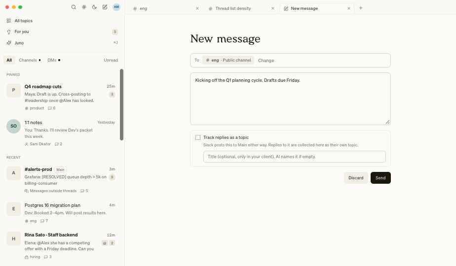
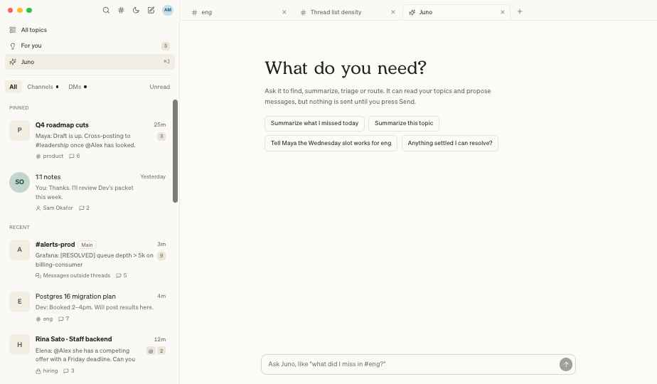

# Juno

A calm, topic-first desktop client for Slack. Product and design spec for the build.

Version 1 · October 2026 · Owner: Tushar · Prototype: Threads v3.dc.html

**How to read this.** This is a product and design doc, not a technical plan. It describes what Juno is, how every surface behaves and how it should look and feel. The build is expected to reverse-engineer the Slack desktop client's data access and run as an Electron, React and TypeScript app, styled with StyleX, using pi-ai with the OpenRouter provider for AI. Implementation choices beyond that are open.

## 1. What Juno is

Juno is a personal Slack client for someone who manages people and gets pulled in many directions. It reads and writes real Slack data, but reorganizes it around **topics** instead of channels. A topic is a Slack thread, or the unthreaded stream of a channel or DM. The sidebar is a single list of topics with recent activity, shown like a WhatsApp chat list: one wide row per topic with its title, the latest message, where it lives and who is in it.

It borrows the thread-first discipline of Zulip, the simplicity of WhatsApp and the polish of Slack. Anything quiet, resolved or irrelevant gets out of the way. AI helps manage and orchestrate. It names topics, catches you up, routes messages to the right thread, decides when to interrupt you and suggests next steps. It never writes on your behalf unless you ask, and it never sends anything without your confirmation.

*Figure 1. The main window. The sidebar holds topics, the right side holds tabs. Here a topic is open at its "new" divider with a catch-up summary.*

## 2. Principles

1. **Calm by default.** Show less. Unread counts are soft grey, not black badges. Nothing shouts. The interface relies on whitespace, not lines.
2. **Topics, not channels.** You think in conversations. Channels and DMs are filters and context, not the primary navigation.
3. **Quiet things disappear.** No activity for 7 days, resolved or unsubscribed means the topic is gone from the sidebar until something new happens. Everything stays reachable from All topics and ⌘K.
4. **Always know where you are posting.** Public, private and DM contexts are visually distinct on every topic, so private things never land in public channels by mistake.
5. **AI manages, you write.** AI organizes, summarizes, routes and gates. It does not ghostwrite. Every outbound action it proposes waits for a click.
6. **Fast to clear.** Resolving is one hover and one click, with an undo toast and ⌘Z.
7. **Feels native.** It should feel like a well-made macOS app, not a web page. See section 15.

## 3. Mapping Slack to Juno

Slack has no concept of a topic. Juno builds one on top of Slack's data. Anything Juno adds that Slack does not have, like titles, resolution and groupings, is stored only on the client and never written back to Slack.

| Slack | Juno |
| --- | --- |
| Public or private channel | A container of topics. Used as a filter and as context, never as the main list. |
| DM and group DM | Treated exactly like a channel. A DM has a Main thread and can have topics too. |
| Thread (a message with replies) | A **topic**. Its first message is the thread root. |
| Top-level channel messages that are not in a thread | That channel's **Main** thread, one per channel or DM. Rows read "#eng" with a small Main tag, never a bare "Main thread". |
| Starting a new message | Always a post in Main. Optionally "Track replies as a topic", which links it to a topic in Juno. |
| Replying in thread | Replying inside a topic. From Main, "Reply in thread" turns that message into a topic. |
| Follow / unfollow thread | Subscribe / unsubscribe. Unsubscribed topics leave the sidebar. |
| Mark unread | Works on a topic or on a whole channel. |
| Quote (the ">" prefix) | Rendered as a soft quote block. Quoting inserts ">" lines. There is no separate reply object. |
| Not in Slack | Client-only: topic titles, resolved state, pins, stealth reads, groupings of Main messages, ignored channels, notification rules, channel icons. |

### Topic titles

Titles resolve in this order. A title you set by renaming (stored in Juno only) comes first. Next is a title generated by AI. Last, as a fallback while AI hasn't run, the first six or so words of the first message. A small sparkle beside the header title marks an AI title. Renaming always wins, and a context menu option brings back the AI title.

## 4. Window and layout

- **Two panes.** A fixed sidebar about 384px wide on the left, and a tabbed workspace on the right.
- **Title bar.** The macOS traffic lights sit in the sidebar's top bar. The workspace's top bar is the tab strip. Both bars are window drag regions.
- **Workspace tabs** work like browser tabs. Every page opens in a tab: a topic, All topics, For you, Juno, a new message, Notifications or Preferences.
- **Reading width.** Message columns are capped around 800px and centered, so long lines stay readable on wide windows.

## 5. Sidebar

### Top to bottom

1. **Title bar icons**: Search (⌘K), Browse channels and people, Theme, New message, and your avatar. The avatar menu holds status, Notifications, Preferences, AI assist, switch workspace and sign out. There is no footer and no name label.
2. **Navigation**: All topics, For you (with a quiet count) and Juno (⌘J). A properly spaced hairline separates these from the list.
3. **Quick filters** on one row: All · Channels · DMs on the left and an Unread toggle on the right. DMs include group DMs. There are no counters or dots on Unread. A small dot appears next to Channels or DMs when that group has unread topics you are not viewing.
4. **Scope chip**, shown only when narrowed to one channel: "#eng ×". Narrowing is rare and happens from Browse channels or ⌘K.
5. **The topic list**: Pinned first, then Recent, sorted by latest activity. A tweak can group the list by channel instead.

### Row anatomy

Each row is a tile followed by three lines. The tile is the topic's art: a small AI-drawn illustration about what the topic discusses, with no container. Every topic gets one, including a channel's Main and threads inside DMs. Until the art exists, or when AI is off, the tile shows a calm free-form placeholder shape picked per topic. A DM's Main shows the person's Slack profile photo instead (coloured initials when there is no photo). Line one is the title and time. Line two is a two-line preview of the latest message as "Sender: text", with any ">" quote lines stripped. Line three is meta: channel icon and name, a small stack of participant avatars, and tags such as Main or Reopened. There is no message count and no "messages outside threads" label. A Main row may also show a thread icon with the number of threads started in that channel since you last read its Main, hidden when zero. Unread topics have a semibold title and a soft grey count tag. Mentions of you get a quiet "@" tag. Row style (chat, list or cards), density and preview lines are tweaks. Chat is the default.

### What shows up

- **Which threads.** The sidebar shows threads you follow, plus any thread with an unread mention of you. Following is Slack's "Get notified about new replies": you follow a thread when you start it, reply, are mentioned, or subscribe. Other threads are not in the sidebar. They are reachable from their channel's Main (as thread links), All topics and ⌘K. Subscribing to one from there adds it to the sidebar.
- **Subscribe works on any thread.** Subscribe and unsubscribe are mirrored to Slack's follow state.
- **First sign-in.** Threads you do not follow start as read, so Juno does not open with hundreds of unread topics. Followed threads and Main keep Slack's unread state.
- **Quiet.** Topics with no activity in the last 7 days are hidden unless pinned or unread. The window can be configured.
- **Resolved.** Resolved topics are hidden until a new message arrives, which brings them back tagged "Reopened".
- **Unsubscribed.** Unsubscribed topics are hidden from the all-topics view.
- **Ignored.** Ignored channels, such as noisy alert or deploy channels, are hidden everywhere in Juno and never notify.
- **Main threads** follow the same rules. A channel's Main appears only when the channel had recent activity of any kind, including replies in its threads. A channel with no recent activity simply does not appear.

*Figure 2. Right-click a row for the full set of actions.*

### Row actions

- **Hover** (or keyboard focus) shows an icon-only **Resolve** button (a check) at the right end of the meta line. The time stays in place, and the button's slot is always reserved, so nothing shifts. Its tooltip and accessible name say "Resolve" (with the topic title for screen readers). Resolving hides the row, marks it read and shows a toast with Undo. ⌘Z also undoes. Main threads resolve the same way.
- **Context menu** (right-click, or the context-menu key):
  - Open in new tab (⌘-click)
  - Open in stealth
  - Rename
  - Use AI title
  - Mark as read or unread
  - Pin
  - Subscribe or unsubscribe
  - Resolve or reopen
  - Copy Slack link
  - Ignore #channel
- **Channel context menu** (from Browse channels): Show its topics, Open Main, Open Main in stealth, Mark channel as read or unread, Change icon and colour, and Ignore channel.
- **Rename** happens inline in the row or the topic header. Enter saves and Esc cancels.
- **Undo toasts** appear bottom-left for reversible actions only. Info-only toasts like "Prompt copied" never show Undo.

## 6. Opening things and tabs

- Everything opens in the **current tab**. A new tab opens only on ⌘-click or "Open in new tab".
- If the topic is already open in another tab, that tab is focused instead of opening a duplicate.
- Tabs carry the channel icon and title, or the channel name for a Main thread. Closing a tab focuses its neighbour.
- **Stealth** opens a topic without marking it read. The tab shows an eye-off icon. The header shows "Stealth. Not marking as read." with a Mark read button. Sending a reply ends stealth.

*Figure 3. A private-channel topic opened in stealth. The amber context pill marks the private channel.*

## 7. Topic view

### Header

- A **context pill** shows the channel and its type:  This is the main defence against posting in the wrong place, so it is always visible. People and message counts are deliberately left out.
  - **Public channel:** neutral.
  - **Private channel:** warm amber.
  - **Direct message or group DM:** soft blue.
- The title, with a sparkle if AI-generated. Double-click to rename.
- Actions on the right: Pin, Subscribe (bell), Resolve or Reopen, and More (the same menu as the row).

### Messages

- **Styles.** Flat Slack-style messages by default. WhatsApp-style bubbles are a tweak. Consecutive messages from the same person group under one header.
- **Where it opens.** A topic opens at a "N new" divider when it has unread messages, otherwise at the bottom.
- **Mentions.** @people and #channels render as soft chips. Mentions of you get the accent colour and a lightly tinted message background. Clicking a #channel filters the sidebar to it.
- **Hover toolbar:**  Reactions are toggleable chips under the message.
  - Three one-click reactions (👍 ✅ 👀).
  - A full emoji picker.
  - Quote.
  - In Main threads, Reply in thread.
- **Quoting** follows Slack. Quoting inserts "> " lines into your reply. Selecting any part of a message shows a floating Quote button that quotes only the selection.
- **Thread links.** In Main, a message that has a thread shows a small "2 replies · Title ›" link under it.

### Main thread

Main is the unthreaded stream of a channel or DM. It reads "#eng · Main" in the header. AI may notice a run of messages that belong together. It then offers "Group into topic" with a suggested title. Grouping is client-only, and Slack still shows the messages in the channel.

*Figure 4. The #eng Main thread. At the top is a grouping suggestion. Lower down is a message that already has a thread, shown with a link.*

## 8. Composer

- **Shape.** A single line with a + attach button on the left and a round send button on the right. It grows with content to about 8 lines, then scrolls inside itself.
- **No helper text.** Shortcuts like @, # and Enter to send are obvious and not spelled out. The channel is not repeated above the composer, because the header pill already shows it.
- **Mentions.** Typing @ suggests people and # suggests channels, with arrow keys and Enter or Tab to pick.
- **Audience check.** When what you type reads like hiring or people details and the channel is public, a quiet amber line warns you as you type.

### Checks on send

Pressing Enter runs fast checks before anything goes out. If they find nothing, the message just sends. If they flag something, a compact bar appears inside the composer. Enter takes the first option and Esc returns to editing.

1. **Wrong place.** In a Main thread, your message is compared against the last 3–4 topics in that channel. If it looks like a reply to one, you get "Looks like a reply to *Staging bill doubled since August*", with Post in thread or Send to Main.
2. **Clarity.** Catches typos, doubled words, a lowercase "i", a missing question mark and very long sentences. Offers Fix and send or Send as is. Fixes are minimal corrections, never rewrites.

*Figure 5. The route check catching a reply typed into Main.*

*Figure 6. The clarity check listing fixes before sending.*

## 9. New message

The New icon opens a New message page. **To** is a searchable picker of channels and people. It is prefilled with the channel you were viewing and shows the same tinted context pill. Every new message posts to Main, as in Slack. An optional **Track replies as a topic** checkbox (off by default) adds an optional, client-only title. With it on, the message posts to Main with a thread link and opens as a topic. With it off, you land in Main.

*Figure 7. New message, with tracking turned on.*

## 10. Search and commands (⌘K)

- **Search.** ⌘K searches topic titles, message text, channels and people. With an empty query it shows recent topics.
- **DMs.** A person's result reads "Message Maya Chen" and opens your Main with them.
- **Commands.** Natural-language input is recognised as a command:  The command appears as the top result with a small confidence badge. Enter runs it.
  - "tell maya …" or "post in #eng …": an instant send card.
  - "summarize …" or "what did I miss": opens Juno with that request.
  - "resolve pricing": resolves the best-matching topic.
- **Keys.** Arrow keys move the selection. ⌘Enter opens a result in a new tab.

*Figure 8. "tell maya the wednesday slot works" becomes a send action.*

## 11. All topics

A full page in a tab, listing everything: quiet, resolved, unsubscribed. Status chips with counts (All, Open, Resolved, Quiet, Unsubscribed). Filters for channels or DMs, a specific channel and sort order (most recent, oldest, most messages), plus a text filter. A table shows the topic and preview, where it lives, status, message count and last update. Rows open topics and carry the usual context menu, so reopening and resubscribing happen here. The topic column keeps a minimum width and the table scrolls sideways on narrow windows.

*Figure 9. All topics.*

## 12. For you

The surface for proactive suggestions. It is separate from the Juno chat, which is a chat only. Each card has a type, a source topic, a title, a short body and actions, and can be dismissed. Card types:

- **Coding agent.** A ready prompt drawn from a discussion, with Copy prompt and Refine with Juno.
- **Waiting on you.** A thread that needs your reply, with short reply starters.
- **Reply ideas.** A few directions to start from. Clicking one opens the topic with it in the composer.
- **Follow-up.** Something you said you would do, with Mark done.
- **Tidy up.** Topics that look settled, with Resolve all.

"Ask Juno" on a card switches to the Juno chat and asks there.

*Figure 10. For you.*

## 13. Juno, the assistant

Juno is also the assistant's name. It is one long, single-threaded chat with no "new chat". You can ask it to summarize, catch you up, find things, tell or message someone, or tidy up. "This" means the topic you were last viewing.

Juno works through tools. It can list and read topics, list channels, show topics as clickable links, and propose messages or resolves. Proposed messages appear as cards showing exactly where they go (with the context pill) and an editable text. They send only on **Send**. Replies are short plain text with no markdown or emoji.

*Figure 11. The Juno chat.*

## 14. Notifications and preferences

Everything is always visible when you open Juno. Notification settings only decide when the operating system interrupts you, which is the main fix for constant pings during a manager's day. Each incoming message gets one of three outcomes:

- **Now:** an OS notification right away.
- **Digest:** bundled into the next digest time.
- **Silent:** no notification.

- **Your rules** come first, checked top to bottom, and the first match wins. A rule matches a person, a channel or DM, mentions of you in a channel, or a keyword. Each rule shows how many messages it caught today.
- **Everything else** is decided by Juno. A threshold slider sets how urgent a message must look before it interrupts you. Turning Juno off sends everything to digest.
- **Digest times** are editable chips. **Quiet hours** hold everything except rules set to Now.
- **Today** is a log of messages so far with the decision and why, for example "Rule: In #incidents" or "Juno · 89% urgent". It updates live as you change rules.

*Figure 12. Notifications.*

**Preferences** holds the **ignore list** for noisy channels such as alerts and deploys. Ignored channels are hidden from topics, search and All topics, and never notify. Nothing changes in Slack. You can also ignore a channel from any context menu, with undo.

*Figure 13. Preferences and the ignore list.*

## 15. AI system

Split the AI work into two kinds. **Decisions** are fast, cheap and structured: a choice, a score or a probability, in well under a second. They can run on every message and every send. **Generation** is a language model producing text, used sparingly. A decision-model approach (such as TypeSafe's Jev) suits the first kind. A general model through OpenRouter suits the second. Show nothing unless a decision is confident, and use calibrated thresholds so the UI stays quiet.

| Feature | Kind | When it runs | Shows when |
| --- | --- | --- | --- |
| Topic titles | Generation | New thread, and on drift | Always, with a sparkle |
| Group Main messages | Decision | Each new Main message | Run of 3 or more, high confidence |
| Wrong-place check | Decision | On send in Main, against the last 3–4 topics | Likely reply to one of them |
| Clarity check | Decision plus minimal fixes | On send | Concrete fixes found |
| Audience check | Decision | Typing pause | Sensitivity does not fit the channel |
| Settled, suggest resolve | Decision | Each new message | High score |
| Notification gate | Decision | Each incoming message, after rules | Never in the UI, only as an outcome |
| Command routing (⌘K) | Decision | As you type in ⌘K | Clear intent and target |
| Catch-up summary | Generation | Opening a topic with 2 or more new | At the "new" divider |
| For you cards | Both | In the background | On the For you page only |
| Juno chat | Generation with tools | On request | In chat, with confirm cards |

Things AI must not do: send anything without a click, rewrite your voice, add "needs you" style labels to the sidebar, or create noise to look helpful. A global AI assist switch turns off every AI surface.

## 16. Visual system

Use the Littlebird design system's tokens.

- **Colour.** Warm paper backgrounds (hsla 48 50% 98%). Warm near-black text. Nearly invisible borders. A single accent, near-black by default. Midnight blue, dark emerald, claret and cyan are optional tweaks.
- **Type.** Söhne for UI and Meraki serif only for page titles such as "All topics", "For you", "Notifications" and "New message".
- **Icons.** Lucide outline icons, tinted with the surrounding text colour.
- **Radii.** 6–10px. Inner and outer radii nest, so the outer radius equals the inner radius plus the padding.
- **Surfaces.** Popovers, menus and toolbars float on a layered shadow ring, not a hard border. Cards use a 1px shadow ring. Inputs keep a soft border.
- **Context tints** for channel types: neutral for public, amber for private, blue for DMs.
- **Dark mode** uses the cool near-black system palette. Switching theme suppresses transitions so colours change in one frame.

*Figure 14. Dark mode.*

### Feels native

- **No pointer cursor.** Use the default arrow cursor everywhere, including buttons, rows, tabs and menu items, as macOS apps do. The text cursor appears only over editable text. Never set `cursor: pointer`.
- **Real menus.** Use native right-click context menus and the context-menu key on every row, tab and channel.
- **Instant feedback.** High-frequency interactions get instant feedback or at most 150ms on background colour. These include row hover, tab switching and typing. Buttons scale to 0.96 when pressed, never when disabled.
- **Hover only with a pointer.** Hover styles apply only on devices with a hover-capable pointer.
- **Contained scrolling.** Scroll stays inside menus, popovers and the palette, and never scrolls the page behind.
- **Text selection.** Text is selectable in messages and not in chrome.
- **Window chrome.** Window controls and drag regions follow macOS: traffic lights in the sidebar bar, and the tab strip as a drag region.

### Accessibility and polish

- **Keyboard.** Every row, tab, menu item and card action is reachable by keyboard. Hover-revealed actions also appear on focus.
- **Focus.** A visible 2px focus ring in the selection blue, shown for keyboard focus only.
- **Names.** Icon-only buttons have accessible names that describe the action.
- **Contrast.** Body and meta text meets 4.5:1. The muted grey is darkened in light mode to get there.
- **Motion.** Motion respects reduced-motion settings.
- **Numbers.** Times, counts and table numbers use tabular figures.
- **Empty states** say why they are empty and offer one next step, such as "Clear filters" or "View all topics".

## 17. Writing

- **Case.** Sentence case everywhere.
- **Buttons** are short and start with a verb: Resolve, Send, Post in thread, Fix and send.
- **Relative time:** 4m, 2h, Yesterday, 3d.
- **Emoji.** None in chrome. Users' messages are their own.
- **Undo over confirm.** Prefer undo to confirmation for reversible actions. Toasts read "Resolved · Postgres 16 migration plan · Undo".
- **Main thread labels** always say whose Main it is: "#eng · Main".
- **The "#" prefix.** Don't repeat the channel # in text when a hash icon is already beside it.

## 18. Keyboard shortcuts

| Keys | Action |
| --- | --- |
| ⌘K | Search and commands |
| ⌘J | Open Juno |
| ⌘Z | Undo the last resolve, unsubscribe, ignore or routed post |
| ⌘ click / ⌘ Enter | Open in a new tab |
| Enter / Shift Enter | Send / new line. During a send check, Enter takes the first option. |
| Esc | Close a menu or palette, or dismiss a send check |

## 19. Not in v1, and open questions

- **Not designed yet:** calls and huddles, canvases, workflows, the app directory and Slack Connect specifics.
- **Starting a new DM.** How do you start a DM with someone you have never messaged?
- **Syncing client-only data.** Should client-only data (titles, resolution, rules) sync across devices?
- **Re-titling.** Should AI re-title a topic when it drifts, or only suggest a branch?
- **Mobile.** Is there a mobile companion?

Prototype files: Threads v3.dc.html (the current design, with tweaks for row style, density, preview lines, avatars, grouping, quiet window, message style, AI assist, accent and dark mode) and Layout Options.dc.html (the exploration history). The AI judgements in the prototype are simulated.
