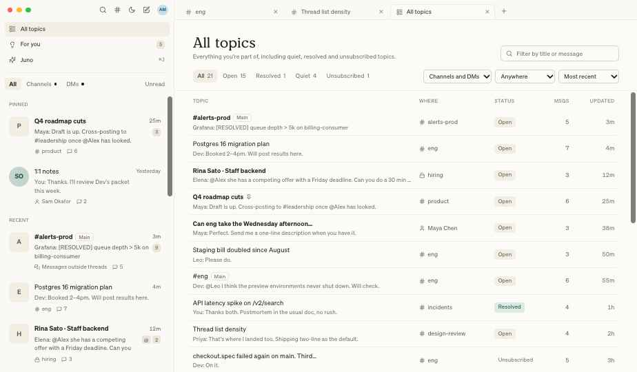
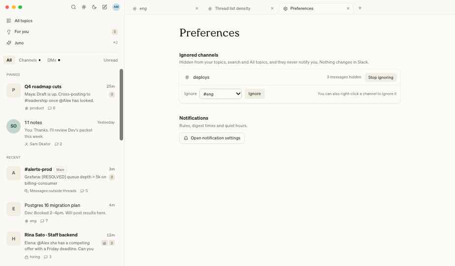

# Juno

A calm, topic-first desktop client for Slack. Product and design spec for the build.

Version 1 · October 2026 · Owner: Tushar · Prototype: Threads v3.dc.html

**How to read this.** This is a product and design doc, not a technical plan. It describes what Juno is, how every surface behaves and how it should look and feel. The build is expected to reverse-engineer the Slack desktop client's data access and run as an Electron, React and TypeScript app, styled with StyleX, using pi-ai with the OpenRouter provider for AI. Implementation choices beyond that are open.

## 1. What Juno is

Juno is a personal Slack client for someone who manages people and gets pulled in many directions. It reads and writes real Slack data, but reorganizes it around **topics** instead of channels. A topic is a Slack thread, or the unthreaded stream of a channel or DM. The sidebar is a single list of topics with recent activity, shown like a WhatsApp chat list: one wide row per topic with its title, the latest message, where it lives and who is in it.

It borrows the thread-first discipline of Zulip, the simplicity of WhatsApp and the polish of Slack. Anything quiet, resolved or irrelevant gets out of the way. AI helps manage and orchestrate. It names topics, catches you up, routes messages to the right thread, decides when to interrupt you and suggests next steps. It never writes on your behalf unless you ask, and it never sends anything without your confirmation.


*Figure 1. The main window. The sidebar holds topics, the right side holds tabs. Here a topic is open at its "new" divider. (The prototype shot still shows the catch-up card, which is removed; section 7.)*

## 2. Principles

1. **Calm by default.** Show less. Unread counts are quiet tags, not black badges: in the sidebar, the accent at reduced brightness. Nothing shouts. The interface relies on whitespace, not lines.
2. **Topics, not channels.** You think in conversations. Channels and DMs are filters and context, not the primary navigation.
3. **Quiet things disappear.** No activity for 7 days, resolved, or a thread set to Never means the topic is gone from the sidebar until something new happens. Everything stays reachable from All topics and ⌘K.
4. **Always know where you are posting.** Public, private and DM contexts are visually distinct on every topic, so private things never land in public channels by mistake.
5. **AI manages, you write.** AI organizes, summarizes, routes and gates. It does not ghostwrite, with one exception you set up yourself: when a reply watch runs out, Juno brings a nudge draft (13.6). Every outbound action it proposes waits for a click.
6. **Fast to clear.** Resolving is one hover and one click, with an undo toast and ⌘Z.
7. **Feels native.** It should feel like a well-made macOS app, not a web page. See section 15.

## 3. Mapping Slack to Juno

Slack has no concept of a topic. Juno builds one on top of Slack's data. Anything Juno adds that Slack does not have, like titles and resolution, is stored only on the client and never written back to Slack.

| Slack | Juno |
| --- | --- |
| Public or private channel | A container of topics. Used as a filter and as context, never as the main list. |
| DM and group DM | Treated exactly like a channel. A DM has a Main thread and can have topics too. |
| Thread (a message with replies) | A **topic**. Its first message is the thread root. |
| Top-level channel messages that are not in a thread | That channel's **Main** thread, one per channel or DM. Rows read "#eng" with a small Main tag, never a bare "Main thread". |
| Replying in thread | Replying inside a topic. From Main, **Start thread** turns that message into a topic; **Open thread** opens an existing topic. |
| Follow / unfollow thread | Notify me on a thread (section 5). Every message and When it matters follow the thread; Never unfollows it, and it leaves the sidebar. |
| Mark unread | Works on a topic or on a whole channel. |
| Quote (the ">" prefix) | Rendered as a soft quote block. Quoting inserts ">" lines. There is no separate reply object. |
| Not in Slack | Client-only: topic titles, resolved state, pins, ignored channels, notification settings. |
| Presence (active or away) | Set by your active hours and the avatar menu, and written to Slack with `presence.set`. |

### Topic titles

Titles resolve in this order. A title you set by renaming (stored in Juno only) comes first. Next is a title generated by AI. Last, as a fallback while AI hasn't run, the first six or so words of the first message. For an integration event summary, use its attachment or header title instead; a pull request title starts with "PR #N:". AI titles just happen: there is no marker and no switch. Rename (double-click the title, or the menu) is the only control, and saving an empty name brings back the AI title.

Titles are on screen all the time, including over a shared screen and in privacy mode, so an AI title never shows a sensitive detail. For pay and offers, firing, layoffs and performance problems tied to a person, health, legal matters, criticism of or venting about a person, secrets (passwords, keys, account numbers), personal contact details, and anything else a person would not want projected in a meeting, the title names the subject neutrally and leaves the detail out: "Comp discussion for Donna", not "Go with 100k for Donna"; "Org restructure discussion", not "Fire Alyssa end of week"; "Feedback on Sam's proposal", not "Sam's proposal is garbage". Every other title stays specific, with its names and numbers ("Staging bill doubled since August"), so it never reads as a puzzle. The model judges this from the title prompt; there is no word filter. There is no separate check step: the title is made once with this rule. A title Juno made before the rule stays as it is and is never blurred. Your own rename is yours and is never changed or blurred.

## 4. Window and layout

- **Two panes.** A sidebar on the left, 384px wide by default, and a tabbed workspace on the right.
- **Resizing the sidebar.** Drag its right edge to make it between 312 and 480px wide; double-click the edge to go back to 384. The width is remembered. The list does not re-render while you drag.
- **Hiding the sidebar.** The sidebar button in its top bar, ⌃⌘S, or View › Hide Sidebar hides it; the same again shows it. ⌃⌘S is the macOS standard for Show and Hide Sidebar (Mail, Notes, Reminders and SwiftUI's default sidebar command use it). Dragging the edge far enough left also hides it. Hidden or shown is remembered. While hidden, the traffic lights, the sidebar button, Back and Forward move to the start of the tab strip, so nothing becomes unreachable.
- **Title bar.** The macOS traffic lights sit in the sidebar's top bar, followed by the sidebar button, Back and Forward. The workspace's top bar is the tab strip. Both bars are window drag regions. In full screen macOS hides the traffic lights, so the sidebar button, Back and Forward move to the bar's left padding, and back when the window leaves full screen.
- **Workspace tabs** work like browser tabs. The "+" button sits right after the last tab, as in Safari and Chrome, and stays at the strip's end when the tabs scroll. It opens a new tab (section 6). Every page opens in a tab: a topic, Home, All topics, Juno, a Juno page or Settings.
- **There is always a tab.** Closing the last tab opens a new one, and a first launch opens one; the workspace is never empty.
- **Reading width.** Message columns are capped around 800px and centered, so long lines stay readable on wide windows.

### Sign-in

- **The sign-in page.** With no session the window is one page: "Hi, I'm Juno", **Sign in to Slack** (Slack's own sign-in, in a window) and **Use the Slack app's session** (reads the signed-in Slack app; macOS asks once for its keychain item, and not again until Juno quits or signs out). One line under them says what is happening or what went wrong. When the import fails, a quiet **Copy details** under that line copies a short report of what Juno checked and where it stopped, with no secrets in it. A session Slack no longer accepts shows "Slack signed you out" with the same two actions. A relaunch with a session opens straight on the app, as it was left: the sign-in page never shows while Juno checks the stored session with Slack, and no loader does either. Only if Slack then refuses the session does "Slack signed you out" replace it.
- **Set up Juno.** After the first sign-in, when no model provider is set up, the same page shows "Set up Juno" before the app. It offers **OpenRouter** (an API key), **OpenAI-compatible** (a base URL and an optional key) and **Codex** when it is installed on this Mac (Sign in to Codex opens the browser and signs in to Juno's own Codex home, not yours). Once one is set up, a Model row offers its chat models, Sonnet by default. **Continue** saves the key, then finishes with the chosen model; **Skip for now** opens the app with nothing set up. Keys go to the keychain, as in Settings › Juno (13.10). After Skip, AI assist stays on, and the Juno tab and panel say "Juno needs a model" with Add a provider (13.7). The step shows once; Settings › Juno is where the model changes later. Slack syncs in the background while it shows. The welcome card (below) follows it, on Home. Juno asks for macOS notification permission on the first Home or topic view after this step (section 14).

### The welcome

A first look at Juno should feel calmer than Slack, not like a diagram to learn. So there is no tour to click through. After the first sync you land on Home, and a small card on it lists three things to try, the ones Slack does not have. Each ticks off when you do it.

**Three things to try** · Hide

- Hold ⌥ over a topic to read it without opening it. With Space chosen as the peek key in Settings › General, it says Space.
- ⌘-click a topic to open it in a new tab.
- Ask Juno below. It sends nothing without your OK.

- **Ticks.** A hint ticks when you do it anywhere in the app, not only from Home: any peek, any topic opened in a new tab from a row (⌘-click, ⌘ Enter or Open in new tab), and any question sent to Juno (from Home, the Juno tab, the panel or ⌘K). The ticks are saved, so they survive a relaunch. When all three are ticked, the heading says "You're all set" and Hide becomes **Done**. The card stays until Done, or until the next launch, which counts it as seen.
- **When.** Once per workspace: whenever the workspace has not seen it and the sidebar has rows. After a first sign-in that is once "Set up Juno" is done or skipped and the first sync has brought rows; until then Home keeps the card's room empty, so nothing moves when it fills. An install from before the card shows it on its first launch after the update. Hide or Done records the workspace preference `tourSeen`, which signing out keeps, so a relaunch or a later sign-in never shows it again.
- **Again.** Help › Show the Tour, "Show the tour" in ⌘K and **Show the tour** in Settings › About bring the card back on Home with nothing ticked, until it is hidden or done again.
- **Look.** A card in Home's column, under its rows and over the field the last hint points at, as wide as the rows. Each hint has a ring that fills with the accent and a check when it is done. Home's composer, Recent and the destination chip never move when the card appears, ticks or goes, and a tick changes no size. After Hide or Done the card's room stays empty until Home appears again, so the rows above do not move. When Home is shorter than 560px, its scene and greeting give the card their room, and on a window shorter than 600px Home shows one row while the card shows, so the card is whole above the field without scrolling, the minimum window included.
- **Accessibility.** The card is a section named by its heading. A done hint reads "(done)" after its text, and a tick is announced as "1 of 3 done".

The rest teaches itself. Tidy up and the Automated question are Home rows that say why they are there (section 12), and every topic is its own conversation, so the sidebar needs no explanation up front.

## 5. Sidebar

### Top to bottom

1. **Title bar**: on the left, after the traffic lights, the sidebar button, Back and Forward (section 6); on the right, Search (⌘K), All topics (section 11), Home (section 12), and your avatar. All topics and Home are icon buttons like Search, with the tooltips "All topics" and "Home"; each opens on mouse down (⌘ for a new tab, right-click for Open in new tab) and takes the navigation's active look, the accent fill and a filled icon, while its page is the current tab. Home carries no count or dot: it shows at most three things, and its rows are the count. The avatar menu holds Set yourself away or active, Hide message text, status, Notifications, Settings (⌘,), AI assist, switch workspace and sign out. Notifications and Settings open Settings (section 14) at those sections. Diagnostics are not in the menu; they are in Settings › About. There is no name label and no status line in the header. The footer holds only the sync status card (item 5) and, while privacy mode is on, the privacy footer (below). While you are in a huddle, the huddle bar sits under the title bar, above Juno: two rows with the huddle's place, people and quick controls (section 20).
2. **Navigation**: Juno (⌘J). It shows a count: its unread messages, in the sidebar's counter colours (the accent at reduced brightness, as on the rows). A properly spaced hairline separates it from the list.
3. **Quick filters** on one row: a horizontally scrollable row of pills on the left and an Unread only toggle on the right, an icon pill like Channels and DMs (a box with a dot on its corner) with that tooltip and accessible name, shown pressed while it is on. The pills are All, Channels (a hash icon), DMs (a person icon), then your views (below). A fixed "+" pill beside Unread only makes a new view. Channels and DMs are icon-only, with a tooltip and an accessible name. DMs include group DMs. The row never grows taller: when the pills overflow, the row scrolls sideways with the trackpad or the mouse wheel and the list does not move. New view and Unread only stay fixed at the right. There are no counters or dots on it. A small dot appears on Channels or DMs when that group has unread topics you are not viewing.
4. **Scope chip**, shown only when narrowed to one channel: "#eng ×". Picking a view clears it. Narrowing is rare. It happens from ⌘K (a channel's "Show its topics" result), by clicking a #channel chip in a message, or by clicking a topic's context pill.
5. **The topic list**: Pinned first, then Recent, sorted by latest activity. While you point at the list or work in it with the keyboard, it holds its order (below, "Holding the order"). On an empty cache, hold the first list until cold sync establishes membership, including Automated exclusions. A channel the Automated rules have not decided yet is not added to All until they have read its history, so a channel they move never shows in All first; people channels and DMs show as soon as they are known, and a channel whose history has not come within about 5 seconds shows in All then. Cached rows paint immediately. During the first sync, the held list says "Getting your topics" and a status card at the foot of the sidebar shows a progress ring, "Syncing with Slack" and "N of M conversations", as Messages does while it downloads from iCloud. Offline, rate-limit and stopped notices use the same card, with Restart when the engine has stopped. Every state of the card is the same height, so one replacing another moves nothing, and the card only takes room from the bottom of the list, so starting or ending sync moves nothing above it. Later catch-ups show no card.

### Views

A view is a set of channels and DMs you pick. Its pill shows the Main and threads of those conversations, by the same rules as All ("What shows up"). Views are Juno's own: nothing is written to Slack.

- **The pill** shows the view's icon when it has one, otherwise its name. An icon pill has the name as its tooltip and accessible name. The icon can have a colour, one of the eight accents; without one it is the pill's neutral grey. A view's pill shows a dot only when one of its topics has an unread mention of you; plain unread does not light it, so a view of bot channels stays quiet.
- **Keep these out of All.** Each view has this one setting. When it is on, the view's conversations show only in that view: never in All, Channels or DMs, and they light none of those dots. ⌘K, All topics, Home and notifications still see everything. Narrowing to one of those channels ("Show its topics") still shows it. A conversation in two views is kept out of All when either view says so.
- **Making and editing.** The "+" pill opens a small sheet with four fields and nothing else: the name, an optional icon from the app's icon set with its colour (each a set of choices that is one Tab stop: the arrows move and choose), the conversations (a searchable picker), and the Keep these out of All setting. Save makes the view and selects it. Right-click a pill for Edit view, Move left, Move right and Delete view; dragging a pill also reorders. Delete has Undo.
- **Adding a conversation.** A channel's or DM's menu (and a Main row's menu) has **Add to view ›**: your views with a check on the ones that hold it (choosing a checked one removes it), then New view…, which opens the sheet with the conversation already in it. Adding and removing show a toast with Undo.
- **Juno can make one.** "Make a Bots view with every alerts channel" is a Juno settings task: the same command the sheet uses. (Not wired to Juno yet; the engine command is the seam.)

### Automated

Juno has one view of its own, **Automated** (the robot icon), for bot and alert channels and DMs with apps. It keeps them out of All. It appears once it holds a conversation, and from then on it is a view like any other: edit it, reorder it, turn off Keep these out of All, or delete it. A deleted Automated view is never made again.

- **Who starts the conversations decides.** The rules read a channel's latest 30 top-level messages and never the replies in its threads: a bot that answers in threads (Cursor, Devin, CI) says nothing about who starts conversations. A person's post that tags or asks a bot counts as the person's.
- **Clear cases move by themselves.** Only a high-confidence case moves without asking: a channel goes in when apps wrote eight in ten of its latest top-level messages, so people started at most one in five (three in ten when its name says integration: alerts, deploys, ci, notifications and the like), and you have not started a conversation there; Juno's own judgement moves one only at 90% or more. Anything less sure is a suggestion on Home. A DM with an app goes in. This happens as conversations sync, and the first sync adds a channel to All only once the rules have read it (5, "The topic list"), so a bot channel never shows in All and then leaves. The view sheet marks these "Added by Juno"; unchecking one takes it out.
- **People's channels stay in All without a question.** A channel where you started a conversation stays. So does one where people started at least half of the latest top-level messages (seven in ten, when its name says integration), however much apps reply in its threads or post now and then.
- **Moves are looked at again.** When a channel the rules or Juno moved has new activity, the rules read it again; once people start most conversations there, it goes back to All. Only that clear case moves one back, so a channel near the line does not go back and forth. Channels you placed yourself are never looked at again.
- **Unclear ones are asked, rarely.** With AI assist on, Juno judges a channel the rules cannot place, once, from its latest top-level messages, and keeps it in All unless it is fairly sure people do not talk there. What stays unclear, and every unclear channel while AI assist is off, becomes a Home item: "Move #releases?" with the reason on the line below and **Move** and **Keep in All** (12). Right-click the item for the channel's menu, which has Ignore channel for a channel you never want to see.
- **What Juno moved stays visible until you have seen it.** Every move in or out that the rules or Juno make after the first sync is kept, and Home's record card lists the ones you have not opened or dismissed yet (12). The first sync's own sorting is setting up, and is not listed.
- **Your choice wins.** A conversation you put in or took out of any view by hand, or answered about on Home, is never moved again. New channels are sorted when they appear; nothing already answered is asked again.
- **Noise you never want** is Ignore channel (below, "What shows up"), as before. Automated is for channels worth a look now and then.

### Privacy mode

For screen sharing. **Hide message text** in the avatar menu (or ⌃⌘H, View › Hide Message Text) blurs message text that shows without you opening anything, so it cannot be read over a shared screen:

- the sidebar row preview ("Sender: text"),
- the All topics preview line,
- a Home row's title when Juno wrote it, a follow-up's "You said you'd…" included (the plain titles, such as "Elena asked you something", stay),
- a topic's title in the sidebar and All topics while it is only the first words of its first message (no AI title yet, or AI assist off), since that is message text. It turns sharp once Juno has titled the topic.
- Juno's person files on What Juno remembers (13.8): a person row's line of what they work on, and every note in an open file. Names and relationship chips stay readable.

What you need to find your way stays readable: AI titles, your renames, channel and people names, times, counts and tags. AI titles stay sharp because they never carry sensitive details (section 2). A blurred title still takes its place in the row, so nothing moves when it turns sharp; the place line under it says where the topic lives. A topic, the Juno chat and a peek are not blurred: you open them on purpose. Hovering or focusing a blurred line does not reveal it (a cut-off blurred title shows no tooltip), and blurred text cannot be selected.

While the mode is on, macOS notifications keep their title (who or where: the channel or the person, never a topic title) and replace the message with "Message hidden", because they show over a shared screen too.

While the mode is on, a small footer at the bottom of the sidebar says "Message text hidden" with a **Show** button, which turns it off in one click. The avatar menu item reads **Show message text**.

The mode you set is remembered across a relaunch, and the first frame after a relaunch is already blurred: a restart in the middle of a call must never show text you hid.

**While sharing.** When another app starts recording or sharing the screen while Juno runs (a Zoom or Meet share, a screen recording), Juno turns the mode on by itself and the footer reads "Message text hidden while sharing". Only a start that Juno sees counts: a capture already running when Juno opens is where it starts from, so Juno never hides text at launch. When the capture stops, Juno turns the mode off again, but only if sharing turned it on and you have not touched it since; a mode you turned on yourself stays on. Show turns it off for the rest of this share; the next share hides the text again. A mode sharing turned on is not remembered: on launch the mode is what you left it as. macOS cannot say who is capturing, so a screenshot tool or a recorder counts too, which is why the footer says why. If something has captured the screen all the time since Juno opened, for more than about 2 minutes, Juno cannot tell when you share, and Settings says so (section 14); once that capture stops, Juno can tell again. Settings › General has the switch, on by default. How Juno tells: `docs/research/screen-share-detection.md`.

### Row anatomy

Each row is a tile followed by three lines, except a Main (a channel's, a DM's or a group DM's), which has two (below). The tile is the topic's art: a small AI-drawn illustration about what the topic discusses, with no container. Every topic gets one, including a channel's Main and threads inside DMs. Until the art exists, or when AI is off, the tile shows a calm free-form placeholder shape picked per topic. A DM's Main shows the person's Slack profile photo instead (coloured initials when there is no photo). A group DM's Main shows two of its members' photos as a small diagonal pair, the back one cut away around the front one; members with a photo are chosen first, and a member without one shows their colour and initial. Line one is the title and time. Line two is a one-line preview of the latest message as "Sender: text", ending with an ellipsis when it does not fit, with any ">" quote lines stripped. The sender is a first name ("Maya: text"), the first word of the name Slack shows; when another person who wrote in the topic, or another member of the group DM, has the same first name, their last initial follows ("Alex K: text"). A bot or an app keeps its whole name, and so does a name whose first word is not a word (an emoji). Your own messages read "You: text". In a one-to-one DM a message from the other person shows without their name ("yep"), since there are only two of you and the row already names them; group DMs and channels keep the sender. A message with no words of its own still has a preview: its files ("Image", "3 images", "Video", "Voice clip", "Snippet: deploy.sh", "Canvas: Launch plan", "File: report.pdf", "2 files"), a shared message ("Shared message: text"), a link alone ("Link: example.com"), a bot attachment's title or text, or "Huddle". A message with words and files shows the words. A message that is only a quote shows what it quotes. The preview is never empty while the message exists. Names inside the text (mentions) are as the message has them. At the end of line two, beside the unread count, a small stack shows the people talking. Line three is meta: the place and its Reopened tag. The sidebar never shows a Main tag: Main is the default. The place is a glyph and the name; the glyph says only what kind of place it is: # for a public channel, a lock for a private one, a person for a DM. A channel's own icon is for its art, not this line. The stack shows who sent the topic's unread messages, looking at the last 15 of them, most recent first: at most four avatars, then "+N" for the rest. It never shows you, a read topic shows no stack, and rows in a DM or a group DM (its Main and its threads) have none, since the row already names the people. The stack sits just before the @ and count tags with the line's usual gap, so who and how many read as one group at the end of the preview line, under the time. It takes only its own width and always shows whole; the preview is cut shorter before it. Nothing is kept for the stack, the @ or the count when they are absent: the preview runs to the line's end. A Main has no line three, whether a channel's, a DM's or a group DM's: its title is the channel or the people, so the place line would only repeat it. Its row is two lines and shorter, with no space kept for the missing line; a Reopened tag or the thread count follows the title. Threads keep line three, in channels and in DMs, since their title does not name the place. With Topic titles set to One line (the default), every row of a kind is the same height. With Two lines, only a title that wraps makes its row taller; the title ends with an ellipsis after its second line. A short title keeps the usual row height. A title shows its full text on hover only while it is still cut off. The preview and meta lines stay as they are. The list keeps the top visible row at its offset when the setting changes, and holding the order still applies. Text has three clear levels in both themes: the title strongest, the preview a step down, the place and time a step below that, each at least 4.5:1 on its row. There is no message count and no "messages outside threads" label. A Main row may also show a thread icon after its title with the number of threads other people started in that channel since you last read its Main, hidden when zero; reading the Main clears it. While a huddle runs in its channel or DM, a Main row also shows small green headphones after its title (section 20). Unread topics have a semibold title and a count tag in the accent at reduced brightness: a pale tint of it with deeper accent text (lighter in dark mode), at least 4.5:1. Mentions of you get a quiet "@" tag. Density and Topic titles (Settings › Appearance, section 14) control the row’s spacing and title line limit.

### What shows up

- **Which threads.** The sidebar shows threads you follow, plus any thread with an unread mention of you. Following is Slack's "Get notified about new replies": you follow a thread when you start it, reply or are mentioned, or by choosing Every message or When it matters in Notify me. A thread started from Home appears immediately as locally followed, even before its first reply (section 12). Other threads are not in the sidebar. They are reachable from their channel's Main (as thread links), All topics and ⌘K. Choosing Every message or When it matters for one from there (Notify me), or Follow in its header (When it matters, section 7), follows it and adds it to the sidebar.
- **Notify me on a thread** is the same three choices as on a channel or person (section 14), and it is how you follow and unfollow. **Every message** and **When it matters** both follow the thread in Slack; Every message also notifies you for every reply. **Never** unfollows the thread in Slack, so it leaves the sidebar and Slack stops notifying you about it on every device. As in Slack, a later mention of you by name follows it again; Juno learns it from Slack and the thread comes back to the sidebar. A thread you do not follow shows Never as its choice, and its header shows Follow instead of Resolve (section 7). Every message on a thread wins over Never on its channel, and a channel's Every message covers its Main and the threads you follow in it.
- **Notify me on Main** is the channel's or DM's own choice; Main has no separate one.
- **First sign-in.** Threads you do not follow start as read, so Juno does not open with hundreds of unread topics. Followed threads and Main keep Slack's unread state.
- **Quiet.** Topics with no activity inside the window chosen in Settings › Tidy up are hidden unless pinned, unread or open in a tab. Choose 1, 3, 7 or 14 days; the default is 7. All topics status and Home use the same window where recency applies. Lowering it only hides topics; nothing is deleted or fetched. Raising it fetches missing history in the background, and older rows appear without moving painted rows. The same window limits the first sync.
- **Resolved.** Resolved topics are hidden until a new message arrives, which brings them back tagged "Reopened".
- **Ignored.** Ignored channels, such as noisy alert or deploy channels, are hidden everywhere in Juno and do not notify. One thing breaks through: a mention of you by name, or of a user group you are in. It notifies as your notification settings say (section 14), shows on Home as "Maya mentioned you in #deploys" (section 12), and opening it from there or from the notification shows the topic. The channel stays out of the sidebar, search and All topics. @here, @channel and @everyone do not break through.
- **Main threads** follow the same rules. A channel's Main appears only when the channel had recent activity of any kind, including replies in its threads. A channel with no recent activity simply does not appear.


*Figure 2. Right-click a row for the full set of actions.*

### Read-dependent membership

In Unread only, including within a view or channel scope, a topic already in the list stays in place while any tab shows it, even after it becomes read. It shows its actual read state: no unread count or bold title, and it stays selected when its tab is active. The same rule applies wherever sidebar membership depends on read state, including a thread shown only for an unread mention. Becoming unread again leaves it in place.

The row leaves when the last tab showing it closes or navigates elsewhere. History entries do not count. Removing it does not reorder the rows above it. Changing filters starts a fresh list; an open topic that was never in that list is not added. Resolve and Ignore still remove topics.

### Holding the order

While the pointer is over the topic list, or keyboard focus is in it, the list holds its order, as Mail holds its message list, so a row never moves just before you click it. A row's contents still change in place: its unread count, preview, time and art. No row moves, no row is added, and a row that would leave (resolved in Slack, moved to Automated, read in Unread only) stays where it is with its last contents until the hold ends, so nothing leaves a gap. These changes wait.

- **Letting go.** The waiting changes apply in one step about 400 ms after the pointer has left the list and keyboard focus is outside it, so crossing the list on the way to the title bar does not apply them. Focus left on a row by a mouse press is not keyboard focus; the pointer already counts. The pointer counts once it moves over the list, not when the list comes under a still pointer (a toast over it closing, the sidebar shown again). Rows take their new places in one frame, with no animation, as any reorder of the list does, so there is nothing to reduce for reduced motion.
- **A sheet holds it too.** While a sheet is open over the window (a Home review, a Backup sheet, Configure), the list holds as it does under the pointer, so nothing moves behind the sheet. What you do in the sheet (Move back, Resolve, Unfollow, Ignore, Undo) waits with the rest, and everything applies in one step when the sheet closes. If the pointer is on the list then, the list shows the current order and holds again from the next pointer move or focus in it.
- **Explicit actions apply at once.** A filter or view change shows the new list, as always. Opening a topic from anywhere but the list (⌘K, Home, All topics, a link, a notification), Undo and Ignore channel show the current order at once; the list holds again from the next pointer move or focus in it.
- **Your own actions apply at once.** Your send, resolve, reopen, rename, pin, mark as read or unread, follow, or view change of a topic moves, adds or removes its row at once, even under the pointer, since you caused it. Behind a sheet they wait for it to close. Only that row moves, to its place by latest activity among the rows shown; the other waiting changes still wait.
- **Selection stays.** The selected row stays selected while the list holds and when the changes apply. ↑ and ↓ move through the order you see.
- The first sync holds the same way: rows that land while you point at the list wait until you leave it.

### Row actions

- **Hover** (or keyboard focus) shows an icon-only **Resolve** button (a check) over the right end of the last line (the meta line, or the preview line of a DM's Main): whatever reaches the end of that line fades out under it. It takes no space while hidden, and nothing shifts. Its tooltip and accessible name say "Resolve" (with the topic title for screen readers). Resolving hides the row, marks it read and shows a toast with Undo. ⌘Z also undoes. Main threads resolve the same way.
- **Context menu** (right-click, or the context-menu key; in an open topic, ⋯ in the header or a right-click on its title):
  - Open in new tab (⌘-click)
  - Rename
  - Redraw art (a new drawing for the topic's art, with Undo; only when one can be drawn: AI assist on and an OpenRouter key saved; never on a DM's Main. At the daily AI limit it still shows, and a click says which limit stopped it, with Change limit)
  - Mark as read or unread
  - Pin
  - Notify me: Every message, When it matters or Never
  - Resolve or reopen
  - Copy Slack link
  - Open in Slack
  - Add to view (Main rows: the channel or DM)
  - Ignore #channel
  - What Juno knows about {name} (a one-to-one DM's topics: opens that person's file on What Juno remembers, 13.8)
- **Channel context menu** (right-click a topic's context pill, a #channel chip in a message, or a channel result in ⌘K): Show its topics, Open Main, Mark channel as read or unread, Notify me, Add to view, Ignore channel, and Ask Juno (section 7, Juno panel).
- **Person menu** (right-click a sender's name or avatar in a message, or an @person chip): Notify me about them, Ask Juno, and What Juno knows about {name} (13.8), which opens their file on What Juno remembers, or says Juno has none yet.
- **Peek** is how you read without marking anything read. Hold the peek key while the pointer is over a sidebar row and the topic opens in a popover to the right of the sidebar. In a channel or DM Main, hold it over a message that has a thread, or over its reply summary ("3 replies"), and the thread opens in the same popover just below the message (above it when there is more room there). The popover is a reading width wide, as tall as its messages up to the room in the window, and shows its messages in compact rows whatever the density setting. It is read-only and scrolls, and it does not mark anything read, open a tab or move focus, so you stay where you were. Moving to another row, or another message with a thread, while holding the key switches the peek; releasing it closes the popover. A thread peek stays open while the pointer is on it, and the wheel scrolls the peek, not the Main. The key defaults to ⌥ Option, which works while you type; Settings › General can change it to Space, which works only when no text field has focus. (Fn is not offered: macOS does not report it to apps reliably.)
- **Rename** happens inline in the row or the topic header. Enter saves and Esc cancels.
- **Undo toasts** appear bottom-left for reversible actions only. Info-only toasts like "Prompt copied" never show Undo.

## 6. Opening things and tabs

- Everything opens in the **current tab**, the header's topic switcher included (section 7). A new tab opens only on ⌘-click, ⌘ Enter or "Open in new tab".
- A plain open of a topic or page that another tab shows focuses that tab, the one active last if several do, so the sidebar's selection stays one place. ⌘-click and "Open in new tab" always open a new tab, so the same topic, Home, All topics or Juno can show in several tabs.
- **Ready to type.** Opening a topic, in the current tab, in a new tab, with Back or Forward, or by focusing the tab that shows it, puts focus in its composer once the composer is drawn, so typing goes straight in. A tab focused that way gets the focus it had instead, if it had one. Focus already in another field when the topic arrives (⌘K, a search, the Juno panel) stays there. An open from a sidebar row is the exception: focus stays on the row, so ↑ and ↓ go on through the list, and the first character typed there goes into the composer.
- **One place in several tabs.** Each tab keeps its own scroll position, "N new" divider, composer focus and selection. A press on a tab gives its page focus (the composer it had, or its composer), as in Safari; the keyboard keeps focus in the strip. Everything else is shared: the messages, the read state, the Juno chat and the draft of each topic. Two Juno tabs show the same chat, and a message sent in one shows in both. Two tabs on one topic can sit at different places in it.
- **New tabs.** The "+" button and ⌘T open a new tab with Home, its composer focused. ⌘N writes a new message from Home (section 12, "Writing"). Closing the last tab opens Home the same way, so there is never no tab.
- Tabs carry an icon and the topic's title, or the channel name for a Main thread. The icon is the topic's art (its placeholder shape until the art is drawn); in a DM, its Main and its threads, the other person's photo (initials without one); in a group DM, the group glyph; and the page's own glyph for Home, Juno, Settings, All topics and a huddle (section 20). On an inactive tab the icon dims with the title. Closing a tab focuses its neighbour.
- **Reordering.** Drag a tab along the strip to move it, as in Safari: it follows the pointer and the other tabs slide aside; Esc puts it back, and near the strip's ends the strip scrolls. A press still selects the tab at once. From the keyboard, ⌃⇧← and ⌃⇧→ move the focused tab one place (⌃⇧Page Up and Page Down, as in Firefox, too; Safari and Chrome have no Mac key for it), and a screen reader hears its new position. Pinned tabs move among the pinned ones, the others after them. The order is saved with the tabs.
- **Unread dot.** A tab whose topic has unread messages shows a small soft grey dot after its title. One style for all unread, mentions included. The active tab never shows it.
- **Back and Forward.** Each tab has its own history, like a browser tab. An entry is a topic or page opened in that tab; scrolling, peeks, popovers and the Juno panel are not entries. Back returns to the previous topic where you left it in it. Back and Forward are the buttons in the title bar, ⌘[ and ⌘], the mouse's back and forward buttons, and a three-finger swipe. Holding a button lists the tab's history.
- **Tab menu** (right-click a tab): Pin tab, Close tab, Close other tabs, Close tabs to the right, Close all tabs, and for a topic Copy Slack link and Open in Slack.
- **Pinned tabs** sit first, as small icon-only tabs with no close button. "Close other", "to the right" and "all" leave them open, as in browsers; closing one directly works.
- **Reopen closed tab.** ⌘⇧T reopens the last closed tab with its history, and again for the one before, up to 20. Closing a Home tab that holds a draft (text, a chosen person or channel, or files) also shows the toast "Draft closed" with Undo, which reopens that tab with its draft as it was. Closing several tabs at once shows no toast; ⌘⇧T still brings them back.
- **Tabs close by themselves.** So tabs do not pile up, a tab not viewed for the time Settings › Tidy up chooses ("Close tabs not viewed in": Never, 1 day, the default, 3 days or 7 days) closes by itself, quietly, onto the reopen stack, so ⌘⇧T brings it back. A tab counts as viewed while it is the active tab. The active tab and a tab with an unsent draft (a Home's, or a topic's or reply's) never close this way, and pinned tabs follow the same rule. The time is coarse: Juno checks at launch and about hourly, so a tab may close up to an hour late. There is never no tab.
- The usual browser keys work: ⌘T new tab, ⌘W close, ⌘1 to ⌘8 a tab by position, ⌘9 the last tab, ⌃Tab and ⌃⇧Tab or ⌘⇧] and ⌘⇧[ for the next and previous tab (section 18).
- To read a topic without marking it read, peek at it (section 5).

## 7. Topic view

### Header

The header has no bar. Two islands float over the top of the message list, 8px under the tab strip, aligned to the reading column. Design: `docs/design/header/`.

- **Left island:** the context pill, then the title with a chevron.
  - The **context pill** shows the channel name, with its type in its tint, its icon and its tooltip. This is the main defence against posting in the wrong place, so it is always visible, at every width. People and message counts are deliberately left out. Clicking it narrows the sidebar to that channel; right-clicking it opens the channel menu.
    - **Public channel:** neutral.
    - **Private channel:** warm amber.
    - **Direct message or group DM:** soft blue.
  - **The title** is a topic switcher. Clicking it (or Enter, Space or ↓ on it) opens a popover under the left island: a search field, then this channel's Main and its threads, newest activity first, with resolved threads last under "Resolved". Unread shows as in the sidebar (a bold title and a count, and @ for a mention), and the topic on screen is marked. Typing filters by title, ↑ ↓ move, Enter opens in the current tab, ⌘Enter or ⌘-click in a new tab, and Esc closes. Right-clicking the title opens the topic's menu. Rename turns the title into a field in place.
- **Right island:** the huddle control first when it shows (section 20: on every topic of a DM or group DM; in a channel only while a huddle runs there), then Resolve or Reopen (not on Main), then Juno (opens the Juno panel, below), then ⋯ last. Resolve, Reopen and Follow are icons alone, with their word as the tooltip and the accessible name: a check for Resolve, a filled check for Reopen, a bell for Follow. A thread you do not follow (Notify me is Never, section 5) shows **Follow** in Resolve's place, since resolving only hides a sidebar row. A click on Follow follows the thread at once with **When it matters**; no menu opens. It is the same as choosing When it matters in Notify me: it follows the thread in Slack, the thread joins the sidebar, the toast has Undo and ⌘Z undoes it. The island then shows Resolve. To change the level later, use ⋯ › Notify me (Every message, When it matters or Never). Follow and Resolve are the same size, so the swap moves nothing. A followed thread's level shows only in ⋯ › Notify me. **⋯** opens the topic's menu, the same menu as its sidebar row: Open in new tab, Start huddle or Join huddle (a channel's topics; section 20), Rename, Redraw art, Mark as unread, Pin, Resolve, Copy Slack link, Open in Slack, Notify me and Ignore #channel. Main has no Threads button: its title's switcher lists the channel's threads.
- **Under the islands** the list scrolls on: the page colour is solid behind the islands and fades out just below them, so text never shows through or around them. The first message sits below the islands when scrolled to the top, as far below them as the last message sits above the composer. No space is kept for "Loading older messages": the line shows in the gap above the first message while an older page loads, and moves nothing.
- **Narrow windows.** The islands keep their places at every width. Under 480px, the huddle control shows as its icon and on a thread the place pill shows its icon alone, in its tint, with the name and kind in its tooltip; the title takes the room. A Main keeps the channel's name in its pill, since its title is the one word "Main".

### Messages

- **Style.** Flat Slack-style messages. Consecutive messages from the same person group under one header.
- **Stable geometry.** The list is as dense as Slack's. A message is as tall as what it shows; no space is held for something that might arrive later. Space is reserved only for content the message already has: an image or file of known size, and reactions or a thread link the data already lists, while their images and counts load. A first reaction or a new thread link grows its message at the bottom, a rare and small change that is better than empty space under every message. The time sits right after the sender's name; a name that resolves late moves the time along its line once. What never moves is what the user is reading: rows in view stay still when anything changes above them (scroll anchoring), and at the bottom the list keeps its bottom, so a message that grows there lifts the rows above it in the same frame. Home enters by opacity only; its greeting and rows stay in their final positions.
- **Where it opens.** A topic opens at a "N new" divider when it has unread messages, otherwise at the bottom. There is no summary card at the divider; to catch up, ask Juno in the panel.
- **When it is marked read.** Opening a topic, or showing its tab again, marks it read. After that, new messages are marked read while the tab is active, the window has focus and the list is at the bottom. Sending a message in the topic marks it read.
- **Mark as unread on the open topic** (the ⋯ menu, the sidebar row's menu, ⌘K or ⌘Z of a mark read) leaves it unread while you stay: the "N new" divider moves to the first unread message, and the count and the sidebar row stay. Being at the bottom, focusing the window again and new messages arriving do not mark it read, here or in Slack. It is marked read again when you leave the topic and come back (another topic in the tab, another tab, or a restart), when you send in it, or when you choose Mark as read. This is what Slack and Mail do.
- **Shared messages.** A message shared from another channel, DM or thread shows as a card: the sender's photo and name, their words and their files, then where it was posted and when. The files are drawn as in a message (a picture, a video, a file card) and open the same way. A message of only files shows the files, never Slack's "[date] name: file" line; when Juno has nothing to draw a file with, the card names it on one quiet line ("Video: demo.mov", "File: report.pdf"). The sidebar names such a message by its files: "Shared message: Video". The place is the one Juno knows, drawn as the sidebar's place line draws it: the glyph (# for a public channel, a lock for a private one, a person for a DM) and the name, with "Thread in" before it for a reply in a thread. The place is a link in the footer's muted colour, underlined on hover, and keyboard reachable with the message's other links. It opens the original message as a Slack link to it does (section 8, Links): in a new tab at the message, which flashes, in its thread for a reply; ⌘-click opens the tab behind the current one. When Juno does not know the conversation, the footer keeps Slack's own words as the link, which opens the message in the browser with a toast saying why. The footer is never empty.
- **Mentions.** @people and #channels render as soft chips. Mentions of you get the accent colour and a lightly tinted message background. Clicking a #channel filters the sidebar to it.
- **Code blocks** show in a mono box that scrolls past about seven lines, with syntax colours for the code's language. A block whose first line is only a language name (`ts`, `python`, `sh`), as in Discord, is in that language, and that line is not shown; `text` asks for no colours. Otherwise Juno guesses the language and colours the block only when it is clearly code in one language. Prose, logs, stack traces and command output stay plain, because wrong colours read worse than none. The block shows its plain text first and the colours go on in place a moment later, so opening a topic never waits for them and nothing moves. Only the first 12,000 characters of a very long block are coloured. Colours are calm, one per kind of token (keyword, string, number, comment, function, type, and so on), and each reads at 4.5:1 or better in light and dark.
- **Reactions** are toggleable chips under the message. Hovering a chip, or focusing it with the keyboard, shows who reacted after the usual tooltip delay: the emoji large with its name (`:+1:`), then each person with their avatar, "You" first when you reacted. More than ten people, or people Slack did not list, end in "and N others". The pointer can move into the card. It never moves anything and stays inside the window. Clicking the chip still toggles your reaction.
- **Hover toolbar:** it straddles the top edge of the message, mostly above it, so it never covers the message's own text. Where there is no room above, under the header, it sits inside the message's top edge, clear of the name and time, when the message's top is in view, as the first message's is at the top of the list; when the message's top has scrolled under the header, it sits below the message instead. A message taller than the list, such as a long last message ending on the composer, has room for neither, so the toolbar sits inside it, just under the header. It is never cut off. While you drag to select text no message shows it, as native apps keep hover controls out of a selection; it comes back on release, on the message under the pointer. A message with keyboard focus still shows it.
  - One-click quick reactions, 👍 ✅ 👀 by default. You choose up to seven, and their order, in Settings › Appearance. Where the message list is too narrow for all of them, the toolbar shows as many as fit, then the full picker's button; it never runs past the message.
  - A full emoji picker: Frequently used, the standard categories, then Workspace. Search matches names and aliases using the composer ranking (section 8). An alias appears once under its real emoji. Failed images keep their cell and show a small neutral placeholder, with the name in the tooltip and accessible label; workspace entries without an image URL are omitted when building the data. Standard emoji open immediately, even if workspace data is delayed or fails. Frequently used has a named cell for each locally known recent emoji from the first paint; workspace images fill those cells when ready. Workspace appears last when its data arrives. Existing cells stay in place until the picker closes.
  - Quote.
  - In Main threads, Start thread or Open thread. A click opens the thread in the current tab. ⌘-click, or ⌘Enter on the button, opens it in a new tab right after the current one and leaves the current tab active, with its scroll and focus as they were.
  - More: Edit, Delete and Tell me if nobody replies (13.6) on your own messages, Forward… (below), Copy Slack link and Open in Slack. Right-clicking a message opens the same menu.
  - The toolbar is one Tab stop on a focused message. ← and → move along its buttons, Home and End go to the ends, and Esc goes back to the message.
- **Forward.** Forward… in a message's menu opens a sheet over the window, "Forward message": **To**, the destination chip with Home's list (section 12: recent conversations, the channels you are in and everyone in the workspace; typing searches), open as the sheet opens, so typing searches at once; a **Note** field ("Add a note"); the message as it will be shared, its sender, where it was posted and its words, a long one cut with a fade; then **Cancel** and **Forward**. A pick puts focus in the note, and Enter there forwards; Forward waits for a destination. Esc closes the list, then the sheet. One destination, its Main. The forward goes the way Slack's own Forward does: in the destination it is your message, the note above the forwarded message's shared card. It shows there at once and goes to Slack in the background, never twice; a person you have never messaged gets a DM opened first. The sheet closes and a toast says "Forwarded to #eng" with Open, which opens the destination. A forward Slack refuses shows "Not sent." with Retry and Delete draft in the destination, as a send does; when nothing could be queued (the DM could not be opened), the sheet stays and the toast says why. A message Slack does not have yet cannot be forwarded: the item is disabled. Not in v1: several destinations, a thread as the destination, and forwarding later.
- **Changes that cannot be sent.** An unexpected failure stops an edit, delete or reaction immediately. Temporary failures get at most five attempts, with exponential backoff capped at five minutes (and Slack's longer Retry-After respected). Failed edits and deletes show the stored message with "Edit not sent." or "Delete not sent.", Retry and Dismiss; the saved intent is kept for Retry. Reactions use the failure state below. A failed action releases the channel's later actions; retrying it is a new explicit choice. Existing rows already marked as a defect or over the limit stop on launch before another request. Permanent Slack refusals for edits and deletes still revert the change as before.
- **Reaction delivery.** A reaction shows at once and goes to Slack in the background. Changes to the same message stay ordered, but a reaction does not wait for edits or reactions on other messages in the channel. Posts keep channel order, as do edits and deletes. An add taken back before sending cancels locally. After three seconds pending, including offline, the message says "Reaction not sent yet." The line disappears when the row ends. A permanent refusal, a defect, five failed attempts, or five minutes pending stops the reaction. The chip returns to what Slack has and the message says "Reaction not sent" with Retry and Remove. The failure shows one toast when visible, shared across views of that message. Retry starts a fresh budget and pending window. Remove discards the failed intent without a Slack call. A request already in flight settles before its pending deadline is checked.
- **Open actions.** A message keeps its active background and toolbar while its reaction picker or More menu is open.
- **Keyboard.** ↑ in an empty composer selects the newest message; ↑ and ↓ move the selection, and Esc returns to the composer. On your own selected message, E edits it inline and Delete or Backspace deletes it after one inline confirm (Enter confirms, Esc cancels).
- **Quoting** follows Slack. Quoting inserts "> " lines into your reply. Selecting any part of a message shows a small floating toolbar over it: Quote, which quotes only the selection, and Ask Juno, which takes it to the Juno panel (Juno panel, below). It shows as soon as the selection ends, with no delay.
- **Thread links.** In Main, a message that has a thread shows a small "2 replies · Title ›" link under it.
- **Settled hint.** When AI thinks a thread is settled, a quiet line at its top says why, with Resolve and Not yet.

### Main thread

Main is the unthreaded stream of a channel or DM. Its header reads "#eng" in the pill and "Main" as the title.


*Figure 4. The #eng Main thread, with a message that already has a thread, shown with a link. (The grouping card at the top of the prototype shot is removed.)*

### Juno panel

Juno can sit beside any topic, so you can talk about what you are looking at without leaving it. Design: `docs/design/juno-panel/`.

- **Open and close.** The Juno button in the header, or ⌘J while a topic tab is active, opens the panel and focuses its composer. With text selected in the topic's messages, ⌘J is Ask Juno on the selection (below) and never closes the panel. The same button, ⌘J again, or Esc in its empty composer closes it, and focus goes back to the topic's composer. Open state belongs to each tab: the panel can be open in one tab and closed in another, and switching tabs shows each tab's own state. In a tab where it is open, it stays open while that tab shows a topic, and is saved with the tab. It never shows on Home, All topics or other pages.
- **Look.** A floating inspector, like a macOS inspector: inset by the header islands' 8px gap from the tab strip, the window edge and the topic, with rounded corners and a soft layered shadow. Its surface is a calm secondary one, a step below the page in light and a step above it in dark, with no accent in it, so it separates without a heavy border and its composer and Juno's bubbles stand out on it. Its header row lines up with the topic's islands, and its composer ends on the topic composer's line. Juno's bubbles have no mark beside them.
- **Size.** 440px wide by default, so a Juno bubble holds about 50 characters a line. Dragging its left edge sets a width from 360 to 640px, kept for every tab; a double-click restores 440. The topic keeps its header, list and composer, and its reading column re-centres in the space left. The panel gives way to keep the topic 480px wide, down to 360px; under that it covers the topic, and the topic shows through it, blurred.
- **One Juno.** The panel is the same single chat as the Juno tab (13.1), shown narrower and opened at the bottom: the first frame it paints already shows the newest message. A message you send from the panel carries the topic it was sent from: a small "About {topic}" line above your bubble, in the chat and in the Juno tab alike. There is no second conversation and no per-topic history. The panel's header is the same pair of islands as the topic's: "Juno" with the Juno switcher (13.10) on the left, which shows a Juno page in the panel in place; Open in a tab and Close on the right.
- **What Juno knows.** With each message sent from the panel, Juno gets the topic (its id, title, channel and kind), the messages on screen, the "new" divider's position, and your text selection in the topic if there is one, with where it comes from: the sender and time of the message it starts in, and how many messages it spans. Its text is the selected words of the messages themselves, without the names and times shown between them. "This" means that topic, or the selection when there is one.
- **Context chip.** A small chip inside the top of the panel's composer, lined up with its text, says what Juno sees: the channel's kind icon and "eng · Main" or "eng · {topic title}", cut with an ellipsis when long. While text is selected in the topic a second chip quotes it, so you can see what Juno gets: a quote icon, the sender's name and the first words, cut at a word ("Maya: “the deploy failed on…”"), or "3 messages: “…”" when the selection spans several. Its tooltip is the whole selection, up to about 400 characters. It has an x to remove it, and it takes keyboard focus, where Backspace or Delete removes it; focus then goes to the field. Its height never changes with its words. The topic itself cannot be removed.
- **The chip follows the selection.** While the panel is open, a new selection in the topic replaces the chip, and a click elsewhere (into the panel's field) keeps it, so the chip always shows what the next message will carry. It stays until you send or remove it. A selection made before the panel opened is taken when it opens.
- **Ask Juno on a selection.** The selection's toolbar has Ask Juno beside Quote (Quoting, above), and ⌘J does the same while text is selected in a message. It opens the panel if it is closed, puts the selection in the chip, clears the highlight as Quote does, and focuses the panel's field. Its tooltip is "Ask Juno about the selection ⌘J".
- **Ask Juno about a person or channel.** Ask Juno in a person's or channel's menu (section 5) opens the panel, or the Juno tab when no topic tab is active, with the composer focused and the context chip reading "About Maya Chen" or "About #eng", with an x to remove it. You type the question. The message carries that person or channel in place of the topic and the messages on screen, and its About line names them. A chip holds only a name, so it does not count as reading Slack; Juno then reads what it needs with its read tools.
- **Trust.** Anything Juno reads from the topic, the selection included, is Slack content. A message sent from the panel therefore counts as having read Slack in that run, and the untrusted-content rule (13.9) applies: work that would need no click proposes a card instead, with a Because line.
- **AI assist off.** The Juno button is hidden, and so are Ask Juno and Tell me if nobody replies in the menus, and Ask Juno in the selection's toolbar, which then shows Quote alone.

### Web panel

A link someone posted opens beside the topic, so you can see what it is, or approve a pull request, without leaving Juno.

- **Open.** A click on a web link in a message or in Juno's chat opens it in the web panel of the current tab; ⌘-click opens it in the default browser (section 8, Links). Links that only work in a real browser open there: anything not https, and Google's apps (Docs, Drive, Gmail, Calendar, Meet), which refuse sign-in inside an app. When the window is too narrow to keep the topic 360px wide beside the panel at its narrowest, the link opens in the browser too. Between that and the width the Juno panel needs, the web panel covers part of the topic, as the Juno panel does.
- **Off.** Settings › General › Open links in Juno, on by default and saved per workspace, turns the panel off: every web link then opens in the default browser. Turning it off closes an open panel.
- **Place.** The panel takes the Juno panel's slot, look, width and drag edge. A tab shows one or the other: opening a link closes the Juno panel in that tab, and opening the Juno panel (⌘J) closes the web panel. The panel belongs to the tab it opened in; switching tabs hides it and coming back shows it again. It is not saved across restarts. There is one per window, so a link opened in another tab moves it there.
- **Header.** The site's icon (a globe until it has one), the page title (the host until the page has a title), "Loading…" while the page loads, then Open in browser and Close. No address bar and no back button.
- **Page.** Links inside the page open in the panel. Popups, downloads and links the panel cannot show open in the browser. Requests for the camera, notifications and other permissions are refused. Right-click shows a native menu. The page keeps its own cookies, apart from Slack's, so a sign-in to a site such as GitHub lasts across restarts.
- **Palette.** The page is drawn by the system over the app, so it hides while the palette (⌘K) is open.

## 8. Composer

- **Shape.** A single line with a round send button on the right. A + attach button joins it on the left when attachments are built; until then there is none. It grows with content to about 8 lines, then scrolls inside itself.
- **No helper text.** Shortcuts like @, # and Enter to send are obvious and not spelled out. The channel is not repeated above the composer, because the header pill already shows it.
- **Sending.** Enter sends at once: the message shows in the topic straight away and goes to Slack in the background, never twice. If Slack refuses it, it stays where it is with "Not sent.", Retry and Delete draft. Sends wait out a lost connection and go when it is back. Enter while an attached file is still being read sends too: the message shows as sending at once and goes when the file is ready. If the file cannot be read, the message shows "Not sent." the same way.
- **Drafts.** Each topic keeps its own draft, through tab switches and restarts.
- **Mentions.** Typing @ suggests people and # suggests channels, with arrow keys and Enter or Tab to pick. Once something is typed after the @, user groups that match follow the people, so a person who matches always comes first; a picked group is sent as a group mention, as Slack's client sends it.
- **Links.** URLs, addresses and bare domains like example.com are links as typed, in the composer and in the sent message, as Slack links them. Pasting a URL over selected words makes those words a link, as in Slack, Notion and Notes; ⌘Z gives the plain paste back. ⌘K with words selected edits their link, and ⌘-click opens it. In messages and in Juno's chat a link shows its label, the URL shows on hover, a click opens it in the web panel beside the topic (section 7), and ⌘-click opens it in the default browser. A link the web panel cannot show, a click while the window is too narrow for the panel, or any click with Open links in Juno off (Settings › General), opens in the browser. A Slack link to your own workspace opens inside Juno instead (below). **Slack links in messages.** A link to a message, a channel or a person in the workspace you are signed in to (a permalink, with or without `thread_ts`, an app.slack.com link, a `slack://` link or a profile link) opens inside Juno, so you do not leave the app or lose your place. A click opens a new tab, at the message, which flashes, as a search result lands; the topic is the reply's thread for a reply, else the channel's Main. ⌘-click opens the tab behind the current one, as ⌘-click on Start thread does. When a tab already shows that topic, it is used instead of a second one. A channel link opens its Main, a person's link your DM with them (or a new message to them). A message Juno has not stored yet is fetched first. Hover shows where it goes ("#eng · Thread", "#eng · Main", the person's name) once Juno knows, else the URL. A conversation Juno does not have, or one Slack refuses, opens in the browser (a `slack://` link in Slack) with a toast saying why. A link to another workspace opens in the browser.
- **Formatting.** Slack's markup works in every composer and in the inline edit field, as in Slack with "Format messages with markup" on: `*bold*`, `_italic_`, `~strikethrough~`, `` `code` ``, a code block between ```` ``` ```` fences, and `> ` at the start of a line for a quote. A marker counts at the edge of a word, not inside one, so `snake_case_name` and `2*3*4` stay as typed, and a doubled marker is text, including the closer in `*bold**`. Word boundaries use Unicode code points. Backslashes are literal characters, never markup escapes. A style stays on one line, nothing inside code is styled, and mentions, links and emoji inside a style keep working. A typed URL inside code stays text. The field shows the formatting as you type, with the markers dimmed; it keeps its own font, so code is tinted rather than monospaced and the caret always sits on the text. The message goes to Slack with real styles, code blocks and quotes. ⌘B bold, ⌘I italic, ⌘⇧X strikethrough, ⌘⇧C code (a code block when the selection spans lines) and ⌘⇧9 quote put the markers on the selection, or take them off when they are there; with nothing selected they put in an empty pair with the caret inside. ⌘Z undoes them. Formatting treats picked mentions and linked words as whole units and keeps their IDs and URLs. Code blocks keep indentation, trim only selected edge line breaks, and put following text after the closing fence on a new line. Formatting loads when the composer mounts; sending never waits for a renderer chunk, so a very early send may format text before the preview appears. Deferred shortcuts keep their keydown selections, run in order, and cancel if focus leaves or composition starts. Editing keeps each unchanged paragraph, quote, list item or code block exactly as Slack sent it. A changed block is parsed entirely as new markup; there is no preservation of individual inline elements and no escaping. Literal `*word*` in a paragraph you edit can therefore turn bold, as in Slack with markup on. Adjacent elements with the same style share one marker pair in the edit field. Saving unchanged keeps the original blocks. The mirror follows the field’s automatic text direction. A question for Juno is plain text.
- **Audience check.** When what you type reads like hiring or people details and the channel is public, a quiet amber line warns you as you type.

- **Emoji suggestions.** In every composer and the inline edit field, `:` at a word start followed by at least two characters opens local emoji matches, ranked by an exact name or alias first, then recent use, then common emoji (your quick reactions in their order, then 👍 ✅ 👀 🙏 🎉 ❤️ 😂 🔥 💯 🙌), then prefixes, then substrings. Standard emoji come before workspace emoji only when these ranks are equal; name order breaks the remaining ties. Thus `:smi` offers `smile` before `sweat_smile`, `:part` offers a recently used `party_parrot`, and `:thumbs` offers 👍 first. Rows show the glyph or workspace image and `:shortcode:`. ↑ and ↓ move; Enter or Tab inserts; Esc closes and keeps the text. An exact closing `:` converts a standard shortcode to Unicode. Workspace emoji insert `:name:` for Slack.

### Images and the media viewer

- **In the message.** One image or video shows as a picture at its own aspect ratio, at most 360 × 240. Several show as one block where the first of them is, always 360 × 240: two side by side, three with the first taking the left column, four in a 2 × 2 grid, and more as "+N" on the fourth tile. Every box is sized before the bytes arrive. A lone video is a player in the message, in the box its poster's size gives, showing the poster until Play, with a button that opens it full screen; in a grid a video shows its poster with a play badge. Other files, a PDF among them, keep their cards. An image or video that reaches Juno before Slack has its thumbnail or poster shows as a card and becomes the picture in place when Slack has it. A sent image shows the local copy until Slack has made its thumbnail, then Slack's, in the same box.
- **Opening.** Clicking any picture opens the media viewer at it, over the whole window, on a dimmed backdrop in the theme. The item shows large, fitted to the window at its own aspect ratio; the thumbnail fills that box at once and the full image fades in over it, so nothing moves. A video plays in place.
- **Moving.** Along the bottom, a filmstrip shows every image and video of that message in order, the current one marked; clicking one shows it. ← and → move one item and stop at the ends, Home and End go to the first and last, and arrows at the sides do the same. With one item there is no strip and no arrows. A new item fades in over about 150 ms, at once with reduced motion. The next and previous full images are fetched ahead.
- **Header.** The file name, the message's sender and its time ("Priya Raman · 9:12 · 3 of 4"); the sender is who posted the message, even when the file is someone else's, then Download, Open in default app (Preview for images), Copy image, and Close.
- **Closing.** Esc, Close or a click on the backdrop closes it, and focus goes back to the picture that opened it.

### Checks on send

Only **Wrong place** can stop a send. In Main, typing pauses compare the draft with the last 3–4 open topics. Enter reads a ready answer only. A confident match offers “Looks like a reply to *Staging bill doubled since August*”, with **Post in thread** or **Send to Main**. No ready answer means send. This check stays before sending because it chooses where the message goes. The audience warning remains a non-blocking typing hint.

All text fixes show **after sending**, only for messages sent from Juno. Enter never waits for grammar. Messages above 1,000 Unicode characters are skipped entirely. Code blocks, inline code, quotes, links, emails and mentions are excluded from checks and masked from the model input.

- **Typos and doubled words:** the local typo table and accidental repeated words. Turning it off also suppresses spelling and doubled-word findings from grammar.
- **Capital i:** standalone lowercase “i” to “I”. Off by default, so lowercase style is never flagged unless the user turns it on; grammar never flags lowercase style.
- **Question marks:** add a missing “?” to a clear question.
- **Long sentences:** note a sentence over 40 words, without rewriting it.
- **Grammar (uses AI):** plain spelling mistakes such as “grammer → grammar” and “chek → check”, clear it's/its, your/you're, their/there/they're, then/than, affect/effect, lose/loose, could of, missing or doubled words, and obviously wrong verb agreement. It never flags capitalisation, lowercase style, slang, abbreviations, tone, punctuation style, emoji or code. Validated minimal word edits cannot change surrounding prose.

Each check has its own switch in Settings › General. Local rules work with AI assist off. Grammar requires AI assist and a key. Nothing is asked while typing: the grammar request starts once the send is accepted, for the exact text sent, and runs to its end with a 20-second deadline and no retry. Each exact text is asked once; its answer is cached by the text. Every grammar request, including failed ones, counts against a persisted 500-call daily limit, is spent as background work in the daily AI limit, and is recorded in the AI activity log. Nothing ever holds Enter.

The local fixes show as soon as the send is accepted. A grammar answer shows whenever it comes, as long as it comes within two minutes of the send, the message still exists and it has not been edited; its fixes join the local ones on the same line. The line sits under the sent message, like "Not sent": the fix itself when there is one, such as “its → it's”, or the count, such as “2 small fixes”, with the fixes after it in muted text, then **Review** and **Dismiss**. It never takes focus and is not a toast: it stays on the message until Review or Dismiss, whether or not the topic is in view. If you have left the topic, it waits there for when you come back, with no notification, badge or queue. Review opens the existing inline editor with the fixes as an unsaved draft; only the user's Save changes the message. Editing the message removes the line, and a changed message cannot receive an old suggestion. Lines are kept in memory only, so they do not come back after a restart.


*Figure 5. The route check catching a reply typed into Main.*


*Figure 6. The clarity check listing fixes before sending.*

The send-check bar shows the finding and two choices, without a confidence number.

## 9. New messages

There is no New chat page. A new message to anyone is written from Home, in the composer at its bottom (section 12, "Writing"). ⌘N goes there. The New chat design in `docs/design/new-chat/` is superseded; the merged Home's rounds are in `docs/design/home-merged/`.

## 10. Search and commands (⌘K)

- **Two tabs.** A small segmented control at the top of the palette switches between **Conversations** and **Messages**. Each open starts on Conversations. Tab and Shift Tab, or ⌘1 and ⌘2, switch tabs; the text stays, and focus stays in the field.
- **Conversations.** DMs, group DMs and channels. With an empty query it lists the ones you use most ("Frequent"): your own messages and your topic visits from the last 30 days, each counted as `0.5 ^ (age_in_days / 7)` (the ranking of Home's Recent, section 12), then the rest by latest activity, DMs first. Typing searches by words, ignoring case, accents and punctuation: each typed word must match a word of the conversation, in any order, so "dmitriy wi", "wi dmitriy" and "dmitriy, wi" all find the group DM "Dmitriy, wience". A conversation's words are its name's, its people's display names, full names and handles ("vasilyuk" finds Dmitriy Vasilyuk's DM and his group DMs), and a channel's name split at "-" and "_" ("mobile" finds #proj-mobile-app). A word matches the start of a word, then anywhere inside one (3 letters or more), then with one typo (4 letters or more; in a word of 3, two letters swapped, so "dim" finds Dmitriy). Results rank by how they match: the exact name first, then every word a prefix, then inside a word, then typos. Within each, by use as above, then DMs before group DMs before channels, then group DMs whose people match more of the typed words, then by activity. The matched parts of each name are in semibold. Home's destination list (section 12) searches the same way. DMs show the person's avatar, channels # or a lock, group DMs the group icon. Enter opens the conversation's Main in the current tab, or Home addressed to a person you have never messaged; ⌘Enter opens it in a new tab.
- **Commands.** In Conversations, the pages, Settings sections and commands that match the text show beside the conversations, under Pages, Settings and Commands, at most four of each group. Text that names a whole group (settings, preferences, theme, accent, juno, pages) shows every row of it. Labels that start with the text come first, and a group whose top row is one moves ahead of the others. With an empty query only the conversations show. A leading ">" lists all of them and nothing else, and filters them by what follows.
  - Pages: Home, All topics, Juno, Scheduled, What Juno remembers, Memory of this chat (while the Juno chat is open in the tab or its panel), Activity and Settings. Enter opens the page in the current tab, or focuses a tab that shows it, as the sidebar does (section 6); ⌘Enter opens it in a new tab. Settings opens as ⌘, does.
  - Settings: one row for each section ("Settings: Notifications"), which opens Settings there. Juno's Connections is the Connections section.
  - Global: Theme (Light, Dark, Match system), each accent, New tab, New message (as ⌘N), Show the tour (section 4, "The welcome"), Hide or Show message text, Set yourself away or active, and while you are in a huddle Mute or Unmute, Leave huddle and Show huddle (section 20). The current theme and accent say "Current".
  - For the topic in the active tab, grouped under its name at the top: Resolve or Reopen, Pin or Unpin, Mark as unread or as read, Open or Close Juno panel (when Juno is on), Copy Slack link, Open in Slack, Rename thread (threads only), Start thread when a message was selected in a Main as the palette opened, which opens that message's thread, and on a Main Start huddle or Join huddle, unless you are in its huddle (section 20).
- **Messages.** The message search: topic titles, message text, channels and people. With an empty query it shows recent topics.
  - **DMs.** A person's result reads "Message Maya Chen" and opens your Main with them, or Home addressed to them when you have never messaged (section 12).
  - **Channels.** A channel has two results: open its Main, and "Show its topics", which narrows the sidebar to it.
- **Placeholder.** "Find a conversation, or type >" in Conversations; "Search, or ask Juno" in Messages.
- **Juno commands.** Natural-language input is recognised as a command, in both tabs: above the results in Messages, under the conversations in Conversations. The command shows with a small confidence badge. Enter runs it.
  - "tell maya …" or "post in #eng …": an instant send card.
  - "summarize …" or "what did I miss": opens Juno with that request.
  - "resolve pricing": resolves the best-matching topic.
- **Keys.** Arrow keys move the selection. ⌘Enter opens a result in a new tab.


*Figure 8. "tell maya the wednesday slot works" becomes a send action.*

## 11. All topics

A full page in a tab, opened from the All topics button in the sidebar's title bar (section 5) or ⌘K, listing everything: quiet, resolved, unfollowed. On an empty cache, its controls paint immediately and its first rows wait for cold sync to establish membership and names. Cached rows paint immediately. It is the guarantee that anything in Slack can be found with filters and recency, including threads that were never in the sidebar, so the sidebar can stay small. Status tabs with counts (All, Open, Resolved, Quiet, Unfollowed; Unfollowed is a thread set to Never). Filters for the kind (all, channels or DMs), one place and sort order (most recent, oldest, most messages), plus a text filter. The place filter is Home's conversation picker (section 9): typing searches by words as ⌘K does (section 10), ↑ ↓ move, Enter picks, Esc closes, and Anywhere, its first row, clears the place. It lists only conversations of the chosen kind that have topics. A table shows the topic and preview, where it lives, status, message count and last update. Rows open topics and carry the usual context menu, so reopening and following again (Notify me) happen here. On narrow windows the table drops columns (where it lives, then the message count, then the status) and the title takes the rest, so it never scrolls sideways; the status tabs become a pop-up button, as Finder's view control does in a narrow window.



*Figure 9. All topics.*

## 12. Home

Home is a calm resting page and the place to write a new message. A small scene with Juno's mascot that changes with the time of day sits over a one-line greeting ("Morning, Tushar.", "Hello", "Evening" or "Still up" by the time of day, "Happy Friday" on Friday), then at most three things that want you, and at the bottom the composer: Recent, the destination and the field. There is no count line under the greeting; the rows are the count. When nothing needs you the scene is the caught-up one and the greeting says "All caught up." Home has no link to All topics, which is in the sidebar's title bar. In a workspace's first days the welcome card sits under the rows (section 4, "The welcome"). Design: `docs/design/home/` for the scene and rows, `docs/design/home-merged/` for the composer.

On a cold visit, a second line under the greeting says "Syncing with Slack.", then, once the conversations are listed, how far the sync got, as the sidebar's card counts it: "Syncing 30 of 143 conversations." The line starts under the greeting's first letter and runs to the right, so the copy changing moves no word, and the count takes fixed-width figures in room for the total's digits, so nothing moves as it goes up. The page reserves space for the possible rows. Rows fill the reserved slots from the top as conversations land; a row shown never moves, so one that lands later goes below it even when it ranks higher. Home does not wait for the whole first sync. The sync reads DMs and group DMs first, then conversations with an unread mention, then those with unread replies in a followed thread, and Home is ready once these have their history and the followed threads and the first previews are in: the line goes, the rows shown stay, the empty slots take the next items, and Home's checks and AI titles start. The rest of history keeps filling in behind it. Until the first sync ends, an item a later conversation brings takes an empty slot below the rows shown, and when it ends the empty slots take the next items; the space stays for the visit, so the greeting does not move. A Home that says "All caught up." stays so for the visit; what lands later shows on the next one. Later visits use the items available when Home opens. The composer is in its place from the first frame.

- **A thought.** When Home appears with no rows, whether it says "All caught up." or the greeting, one short line sits centred under the greeting: a quote with who said it on a quieter line under it ("— Annie Dillard"), or a fact. It is plain serif text in a muted tone, read after the greeting, with no card, icon or button. The greeting keeps its words; the thought adds to it. Thoughts come from a bundled list of a few hundred, in four rough themes (focus and craft, thinking deeply, wonder at the universe, life), each at most about 140 characters, facts a little longer. Every quote is real and correctly attributed, every fact true and stable, and each entry keeps a source note that is never shown; nothing is generated. A Home that comes back within 10 minutes of taking its thought shows the same one; after that it takes the next, and none repeats until the whole list has been shown. It never changes while Home is on screen. While the first sync fills Home's reserved slots, the thought sits over them, and a row that lands takes its place, so nothing moves. There is none while the first sync's line shows, or under the welcome card. Settings › General › "Show a thought when Home is empty" turns it off.
- **Getting there.** Home is the house button in the sidebar's title bar, left of your avatar, and a fresh launch, "+", ⌘T and the last tab closed all show it. It opens in a tab like any page: a plain click focuses a tab that shows it, and ⌘-click opens another (section 6).
- **What wants you.** Each item is one row with a title line and a plain meta line. The row's tile is the topic's, as its row in the sidebar draws it: a DM's Main is the person's photo, a group DM's Main the pair of members, every other topic its art; the review sheets' rows draw the same. The meta line names the place once: a Main's title is its place, so a DM reads "Maya Chen · 7h", not the name twice. A topic whose effective Notify me level is **Never** is muted and does not appear on Home. An Every message setting at any applicable level overrides Never, as in section 14; a DM uses its conversation and person levels. The kinds, ranked:
  - **Waiting on you.** A message that asks you something and has no reply from you.
  - **Mentioned in an ignored channel.** "Maya mentioned you in #deploys": the newest unread topic in an ignored channel that mentions you by name or a group you are in, with the thread's title and the time on the meta line. Clicking it opens the topic; right-clicking it opens the channel's menu. @here and @channel are not counted.
  - **Pick up where you left off.** The last topic you had open, when it has new messages.
  - **Moved a lot.** A followed topic with many new messages since you looked.
  - **Follow-up** (AI on). Something you said you would do, with Mark done.
  - **Juno asks** (AI on). A proactive ask from Juno (13.6), such as "Let Juno learn how you work", with what it reads on the meta line ("Reads your Slack messages and Littlebird"), quiet Not now and raised Start. Start runs the work in the background and the toast says "Juno is learning how you work"; clicking the row opens the Juno chat, where the same ask shows. At most one ask at a time, the oldest open one. The agent offers asks; Home adds the one that is open when it appears.
  - **Automated.** A channel neither the rules nor Juno could place (5, "Automated"): "Move #releases?", with "To Automated" and why on the line below ("To Automated · Apps wrote 18 of the last 30 top-level messages", or Juno's reason when Juno judged it), quiet Keep in All then raised Move, each with Undo. Right-clicking it opens the channel's menu.
  - **Tidy up** (AI on). "3 topics look settled", with where they are on the meta line ("eng, incidents and 1 more") and Resolve all with Undo. Clicking the row opens the review, a sheet over Home (design: `docs/design/settled-suggestions/`): every proposed topic as a row with its title, why it looks settled ("Ended with a thank-you from Maya", "No replies for 6 days after your answer"), its place and last activity, then **Keep open** and **Resolve**. The reason is what the topic's last messages show, read by the rules, not written by the model; with no closing words it says how long nobody replied, or Juno's own clause when the decision gave one, marked "Juno:". An acted-on row stays where it is and says Resolved or Kept open with Undo in the same slot; each action has its usual toast, and ⌘Z undoes the last. ↑ ↓ move, Enter opens the topic in the tab and closes the sheet (⌘Enter in a new tab, the sheet stays), R resolves, K keeps open, Esc closes. **Done** and **Resolve all** (only the rows still open) sit at the bottom. The info button says What Resolve does, as Settings › Tidy up does, and leads there. Keep open stops Juno suggesting the topic until it has new activity. A topic where someone asked you something you have not answered, or whose last message mentions you, is never proposed. At most 20 proposals.
  - **Automated's record.** "Juno moved 2 channels to Automated" (or "… out of Automated", or "… to Automated and 1 back"), with the channels on the meta line. It lists the moves the rules and Juno made (5, "Automated") that you have not seen yet, where the channel is still where the move put it and you have not placed it since. A move stays on the card until you open the sheet or press the card's quiet **Dismiss**; Home showing the card does not count. It ranks last, appears only after the first sync, and at most once a day: after Home shows it, the card waits a day before it appears again, with the moves still unseen and any newer ones. Clicking the row opens the same kind of sheet as Tidy up's review: each channel with the fact that decided its move, from the same counts the rule used ("Apps wrote 24 of the last 30 top-level messages", or "Moved back: people start most conversations here" with "People wrote 19 of the last 30 top-level messages" below), Juno's own reason when Juno decided, and when it moved; then **Keep** and **Move back** (for a move back out, **Keep** and **Move to Automated**). Either is your choice, so Juno never moves that channel again. An acted-on row stays and says what happened with Undo, which gives the channel back to where Juno put it; each action has its toast, and ⌘Z undoes the last. The keys are the review's: ↑ ↓, Enter, ⌘Enter, M moves back, K keeps, Esc closes. **Done** sits at the bottom. The info button says What Automated is: what it holds, when Juno moves a channel in and back, and that nothing changes in Slack. Unclear channels stay their own item ("Move #releases?"), not rows in this sheet: they need an answer, the record does not.
  - **Follow-ups that look done** (AI on). "2 follow-ups look done", with where they are on the meta line. A promise in Follow-up is proposed when a later message of yours in the same topic has a file, a link, or opens with words that hand something over ("Here's", "Attached", "Sent", "Done"); denied words ("not done yet") and questions do not count. The match is the rules' (`followUpDelivery`), not the model's, and such a promise shows here instead of under Follow-up. The row opens the same review sheet as Tidy up: the promise ("You said you'd send the deck"), what the message shows ("You shared a file 3 hours later"), the message itself quoted, and the place and when you promised, then **Not done** and **Mark done** (keys N and D). Mark done takes the promise off Follow-up, with Undo. Not done keeps it in Follow-up and the card proposes it again only for a newer message. The info says what Mark done does: nothing is posted to Slack. No bulk button. At most 20, one promise per topic.
  - **Old drafts**. "2 old drafts", with where they are on the meta line. A topic's draft untouched for 14 days, in a topic with activity after it (`isOldDraft`). The review rows show the topic, "Untouched for 3 weeks · 12 messages since", the draft's first line quoted, and the place, then **Keep** and **Delete** (keys K and D). Delete removes the draft in Juno, with Undo, which puts it back as it was; a draft typed since is never touched. Keep stops the suggestion for that draft until it is edited. The info says nothing changes in Slack: drafts were never sent. No bulk button. At most 20. With AI on or off.
  - **Unfollow threads you never open** (AI on or off). "2 threads you never open", with where they are on the meta line. A followed thread is proposed when its oldest unread reply is two weeks old or more, it has at least five unread replies and one in the last week, none of them mentions you, and it is not pinned or marked unread (`unfollowEvidence`). The review's lead says "You follow these, but have not read them in two weeks. Unfollow applies in Slack, on all your devices. A mention of you follows it again." Each row's reason is the unread stretch: "14 replies, never opened", or "9 replies since the last one you read, 2 weeks ago" ("At least" in front when Juno holds only part of the thread). **Keep following** and **Unfollow** (keys K and U). Unfollow is Notify me › Never, with Undo, which follows again; Keep following stops the suggestion until two more weeks of replies go unread. No action on all rows, since it writes to Slack.
  - **Ignore channels you never read** (AI on or off). "1 channel you never read". A channel you are in is proposed when nothing in it has been read for 30 days and more than 50 messages came since, with no unread mention of you in it, and its Main not pinned or marked unread (`ignoreEvidence`). The lead says "You have not read these in 30 days. Ignore hides a channel everywhere in Juno. Nothing changes in Slack."; the reason "312 messages since the last one you read, 5 weeks ago". **Keep showing** and **Ignore** (keys K and I). Ignore is Ignore channel, with Undo, and Settings › Ignored lists it; Keep showing stops the suggestion for another 30 days. Its info says a mention of you still breaks through (section 5). No action on all rows.
  Settings › Tidy up turns each of these four cards off. They rank after Tidy up and before Automated's record, Unfollow and Ignore last of them, each needing one topic not already shown above it. Toasts: "Unfollowed · {title}", "Still following · {title}", "Ignoring #deploys", "Still showing #deploys", each with Undo.
  Clicking a row opens its topic. Items are computed when Home appears and do not change under the pointer. With AI on, a row's title line may be rewritten to say what it is about; the meta line never changes.

### Writing

The composer sits at the bottom of Home, where every topic's composer is, and never moves: not when rows come or go, not when a message is sent. Above the field, on its left edge, are Recent and then the destination chip, one stack: Recent, the chip a little apart, then the field the chip labels. While a person or channel is chosen, the topic chip sits right of the destination chip on the same row. The field's text has its full width.

- **The destination** is Juno until you choose a person or a channel. The chip names it ("Juno", "Maya Chen", "#eng") in the context pill's tint for its kind (neutral, amber for private, blue for DMs), with the person's face or the channel's mark, so where the message will go is always visible (principle 4). The chip's place is always there, so a change moves nothing; the new name rises into it once, briefly. The placeholder says the same: "Ask Juno, or start with @ or #", or "Message Maya Chen". While a Juno job runs, its state line replaces the placeholder with Juno chosen (13.4). With AI assist off there is no Juno: the chip reads "Pick a conversation" and Enter with nothing chosen opens the list.
- **Recent.** A quiet "Recent" label over two columns: up to five people (DMs and group DMs) on the left, up to five channels on the right, each by use. Use ranks local own messages from the last 30 days by the sum of `0.5 ^ (age_in_days / 7)`, ties by latest send, then member conversations by latest activity. Archived and ignored channels are left out. No Slack calls, and fetching never delays first paint. Until the first sync ends Recent keeps its place empty, as Home's rows keep their slots, so its rows never re-rank under the pointer; the destination list has every conversation meanwhile. Rows are one line: the face, for a group DM the pair of faces, or for a channel the art its Main row shows in the sidebar, and the name, a lock after a private channel's name, in the subtle tone until hovered or chosen; the chosen row takes the destination's tint. Below about 400px of width the columns stack. On a window shorter than about 600px Recent is hidden, so Home's rows keep their room; the destination list still has every conversation. A press or Enter or Space makes a row the destination and puts focus in the field; ⌘-click or ⌘Enter opens the conversation instead. Recent is one Tab stop: ↑ ↓ move in a column, ← → between the columns.
- **The chip** is a button. A click, Enter, Space or ↓ opens the destination list above it, Juno first, then recent conversations, every channel you are in and everyone in the workspace, including people you have never messaged ("No messages yet"); typing searches as ⌘K's Conversations tab does (section 10), ↑ ↓ move, Enter picks and puts focus in the field, and Esc closes and puts focus back on the chip. Shift Tab from the field reaches the chip. A character typed while the chip has focus and its list is closed goes into the field, and focus moves there, as in a token field; Space, Enter and the arrows keep the chip's own keys.
- **The topic chip** says where in the chosen person or channel the message goes: "Main" by default, a new message as before, or a thread to reply in, by its art and title. It shows only while a person or channel is chosen, never for Juno, and it comes and goes without moving the destination chip or the field (in quickly, out a little slower; a fade alone with reduced motion). Its list opens above it: Main first, then the conversation's threads, newest activity first, with the resolved ones last, each by its art, title and last activity; typing searches the titles. Its keys are the destination chip's, and Tab goes from the destination chip to the topic chip to the field. Choosing another destination, or Juno, sets it back to Main. The placeholder follows it: "Message Maya Chen" for Main, "Reply in Postgres 16 migration plan" for a thread. On a narrow window both chips end in an ellipsis, the topic chip first. The threads are read once the pointer or focus reaches the chip, never for Home's first paint.
- **A first @ or #.** With Juno chosen and nothing else typed, a first @ suggests people and a first # channels, in a "Send to" list above the field, the first match highlighted. It suggests and never takes over: Tab or Enter on a row makes it the destination, and the typed "@ma" leaves the text for the chip; Tab or Enter pressed before the rows for what was typed are in picks the first of them once they land, and keys typed after it go into the field; Space or Esc closes the list and keeps the text for Juno, so "#eng what happened today?" is a question about #eng. The list's footer says both keys. Anywhere after the start, @ and # suggest mentions as in a topic (section 8): with Juno chosen they go to Juno with their ids (13.1), and once a person or channel is chosen they go to Slack as mentions.
- **Backspace in an empty field** sets the destination back to Juno. A held Backspace that empties the field keeps the destination; only a new press changes it.
- **Sending to a person or channel.** Enter sends to the conversation's Main, or with a thread chosen as a reply in that thread; a send to a channel's or a group DM's Main starts a thread rooted at the message. The send checks run as in a topic (section 8): the wrong-place check in a channel's Main can move the message into a thread, and the audience check reads the chosen channel. A person you have never messaged gets a DM opened first. When Slack refuses that, or the send cannot be queued, nothing is sent: the draft, its destination and its files stay, and the toast says why in the words of a failed message, "Not sent · Their account is deactivated" (no Undo; the draft shows where it was going). A send that was queued and fails later shows "Not sent." with Retry on the message in its topic, as in a topic. Home stays: the field empties at once, so typing can go on while the send waits, and choosing another tab right after Enter does not stop the send; the destination goes back to Juno and a toast says "Sent to Maya Chen", or "Replied in {thread}" for a reply. When no tab shows the topic the message went to (the person's Main, the new thread a channel send starts, or the thread replied in), it opens in a new tab right after this Home tab, behind it, as ⌘-click on Start thread opens one; Home stays the active tab. When a tab shows it already, nothing opens and nothing switches. The new thread appears at once in the sidebar as a locally followed topic, its title from the root's first words, then the AI title; a root Slack refuses shows "Not sent." and Retry in that topic, and a reply written there waits for the root. The fixes offered after sending (section 8) show only on a topic, so a send from Home offers none.
- **Asking Juno.** Enter with Juno chosen opens the Juno chat in the tab, with the question sent. The Juno tab's field has the topic composer's width, so it is where Home's was. Back returns to Home, its field empty.
- **The draft is kept** through every change of destination, attachments included. The attach button is there for every destination, Juno too, and paste and drop work the same. Juno reads images and text files (13.1); a send to Juno takes them with the text, and the other files (a PDF, a video) stay for the next destination, with one muted line under them: "Juno reads images and text files. Pick a person or channel to send the others." While the chat model cannot read images, images stay too, and the line says "This model can't read images. Choose another in Settings › Juno." The line shows only while such a file is attached, and goes once a person or channel is chosen. Each Home tab keeps its own draft and destination; they are saved with the tab and come back after a restart. A Home tab with a draft never closes by itself (section 6).
- **⌘N** writes a new message: it uses this tab if it shows Home, else a tab that shows Home, else a new tab with Home, and a new one too when that Home already has a draft. The destination list opens. Keys typed right after ⌘N are never lost: they go into the list's search in order once it has focus (a paste with ⌘V too, in its place among them), Enter picks once the rows for them are in, and keys typed after Enter go into the field. ⌘K's result for a person never messaged opens Home with them chosen instead.
- **Anything else** that used to be a suggestion card (a coding prompt from a discussion, reply ideas) is something you ask Juno for, here or in the Juno panel beside the topic.
- **Not in v1:** starting a new group DM, and sending to several places at once.

## 13. Juno Agent

Juno is also the assistant's name. It is one long chat with one assistant that reads your topics, answers from memory of everything you have told it, and acts for you through connections (Slack, Notion, Littlebird, T3 Code) when you ask. The chat looks like a messaging thread: your bubbles and Juno's, nothing else. Tool calls, delegation and the machinery that does the work stay behind the conversation. Juno is a standalone module with its own state, so the same chat can later run on other surfaces; in v1 it lives in the Juno tab and in the Juno panel beside a topic (section 7).


*Figure 11. The Juno chat.*

### 13.1 The chat

- **Header.** The same islands as a topic's (section 7): "Juno" with a chevron for the Juno switcher (13.10) on the left, and the banner chip (13.7), when there is one, on the right. Every Juno page has the same header in the same place, its title naming the page ("Juno · Activity").
- **One thread.** There is no "new chat". Everything you and Juno have said is in one scrolling list, with day separators and the "New" divider before the first message you have not seen. Opening the chat lands at the divider, otherwise at the bottom. A "New message" pill appears when you are scrolled up and something arrives.
- **What is on screen:** your bubbles, Juno's bubbles and cards, one status bubble while Juno is working, and separators. Quiet one-line notes ("Remembered · Undo", "Updated memory · People · Undo", "Removed") sit between bubbles, and a proactive ask (13.6) sits at the time Juno offered it. A chat that holds only asks still shows the empty state, with the asks under its suggestions.
- **Not a transcript.** You see only what Juno chose to say to you. Its working (what it read, how it reasoned, an input it decided to let pass) never shows.
- **Bubbles.** Yours are right-aligned in an accent tint (option B in `docs/design/juno-chat/`), with text in the default ink. Juno's are left-aligned on the hover surface, with no mark beside them: the bubbles carry Juno's voice. Consecutive messages from the same sender within two minutes group, and the last bubble of a group has the small tail. A message with a different origin (your reply, a schedule, a job) always starts a new group. Times show on hover; in a narrow column Juno's bubble keeps the room and shows its time as a tooltip. Text is selectable.
- **Rich text, kept small.** Juno's bubbles show a small markdown subset: bold, italic, inline code, code blocks, bullet and numbered lists, short headings (a bold line at the bubble's size, never large type) and paragraphs. Nothing else renders: no tables, images or HTML. HTML tags a model writes anyway never show; the common ones (`<b>`, `<i>`, `<code>`, `<br>`, `<p>`, `<ul>`, `<li>`) take the same look, and any other tag shows as its words. Code blocks take the same syntax colours as messages' (section 7, Code blocks), in the language the fence names (```ts) or a guessed one. How many bubbles and how long each one is are Juno's judgement: a long answer can be one big bubble, and a long job can post many updates. A recall answer cites the day ("On 12 Mar you said …") and the citation scrolls the chat to that message.
- **Sources.** Every claim Juno makes about Slack links to the messages it came from, in the same look as a recall citation: the words that make the claim are the link. A link is quiet, as a cited sentence can be long: the words keep the bubble's ink over a faint dotted underline, which turns solid on hover. It opens inside the app, so the cursor stays the arrow. A click opens the topic at that message in the current tab and flashes it; ⌘-click opens a new tab. This covers answers, catch-ups and scheduled summaries. Which words carry a link, and how many links there are, is Juno's judgement. A link that does not match a message Juno read in that reply is dropped and its words show as plain text, so a link always points at a message Juno actually read.
- **Reactions.** You can react to any Juno bubble or card with any emoji: hover › React, or right-click › React. React shows the same quick reactions as a topic's message toolbar (section 7, chosen in Settings › Appearance) and More reactions, which opens the same emoji picker, with search. One reaction per person per item; picking another replaces it, picking the same one removes it. A thumbs up is only recorded: Juno does not run for it. Any other reaction goes to Juno like a message, at its next step if it is working, and Juno answers only if the reaction calls for it; often you see nothing more. Juno can also react to your messages with any emoji, with or instead of words. An unknown or deleted custom emoji uses a small one-glyph fallback. A reaction shows as the emoji on the bubble's top corner, whole at every width and in both themes, including on the first bubble under the header; it may sit over the bubble above.
- **Replies.** You can reply to a Juno bubble or card (hover › Reply, or right-click › Reply). The composer shows the quote above the field, and your bubble shows a one-line quote above it; a click scrolls to the original. Juno gets the quoted item in full. Juno can reply to one of your messages when it helps, with the same quote. A reply sent while Juno is working joins the work like any message.
- **A reaction or a reply is never a click.** A thumbs up under a Send message card does not send, and "send it" as a reply to a card does not send either; only the card's button does (13.3). Neither pins anything (13.8).
- **"This"** means the topic you were last viewing.
- **Empty state.** "What do you need?" with the seated-j illustration, one line on what Juno can do, and four suggestion chips, quiet outlined pills with a small icon and verb-first text. Clicking one sends it.
- **Composer.** Enter sends, Shift Enter adds a line. The chat works like a text conversation: you can send while Juno is working, and Juno reads the message at its next step (13.5).
- **Mentions.** Typing @ suggests people and # suggests channels, as in a topic's composer (section 8): the same list, keys and ranking (people in the panel's topic first, then recent contacts, then everyone; your channels first), and a picked name shows as the same chip. User groups are not offered: Juno acts on people and channels. Juno gets each pick's Slack id beside your words, so "@Maya" is the person you picked and Juno's tools use the id without looking the name up. Your bubble shows the names as you wrote them ("Ask @Maya about #eng"), as plain text: no chips and no links, and Copy copies the names. Picks stay with the draft while the app runs.
- **Images and text files.** The composer's attach button, paste and drop take files, as Home's do (section 12). Juno reads PNG, JPEG, WebP and GIF images, at most four a message, when the chat model reads images (as OpenRouter's model list says, or the endpoint's); otherwise they stay in the composer with "This model can't read images. Choose another in Settings › Juno." Each image is turned upright, scaled to fit 1568px on its long side and about 1.2 megapixels, and encoded again at most 1 MB, which also drops its metadata (such as where a photo was taken); a file over 40 MB is not read. Text files (by type, or by extension for source files) go into the message as text, at most four, 16 KB each and 32 KB together, cut with a mark when longer. PDFs and other files are not read: they stay, with "Juno reads images and text files only." A message can be files alone. Your bubble shows the images as thumbnails, each in its own shape within 160px, and each text file by name. Juno sees an image in the reply it was sent with; later replies see only that there was one, so Juno asks you to attach it again to look again. Files go to the chosen model provider and nowhere else: nothing is posted to Slack unless Juno proposes a Send message card and you click Send. A message with files counts as untrusted content (13.9). The image's tokens count against the daily AI limit like any other input.
- **Context menu on a message:** Copy, React, Reply (on Juno's), Remember this (on your own messages), Remove. Remember this pins the selected text when there is a selection inside the message, otherwise the whole message; it is disabled when that is longer than a sentence (280 bytes). Remove opens a local sheet (13.8) that works in every state, including paused, offline and AI off.
- **Read.** A Juno bubble counts as read once it has been fully on screen in the focused chat for one second. Opening the chat does not read what is below the fold.

### 13.2 Working

- **Acknowledge at once.** Your bubble appears before the send is stored. The status bubble appears within a tenth of a second: three looping dots, like someone typing.
- **Status text.** A tool call gives the status bubble a line that names real things ("Reading 3 topics", "Looking back through March"). A connection call names the connection and what the tool does, as its card would ("Searching Notion", "Creating a page in Notion"), or "Checking with Littlebird" when the tool's name gives no clear verb. Calls in a row change the line in place; the bubble does not move. "Thinking" and percentages never appear.
- **Bubbles arrive whole.** Each Juno bubble appears complete, as a text does, never word by word. It takes the status bubble's place, and the dots show again below it while Juno is still working, until the run ends.
- **One status bubble, for runs only.** It exists while Juno is answering you, a schedule or a job report, and clears when that run ends. Work that goes on in the background (a T3 Code session, a delegate) never shows as the typing bubble; it has a Task card (13.4) and the sparkle on the sidebar's Juno row.
- **No Stop.** There is no Stop button and no key that stops Juno. To change course, send another message ("stop", "do X instead"); Juno reads it at its next step and answers it. A background job stops only from its Task card (13.4).
- **A run that fails says so.** If the provider does not answer, a line says what happened and offers Try again: "Juno didn't answer. Give it a moment and try again." (13.7).

### 13.3 Cards

Anything that leaves Juno, or that Juno wants you to decide, is a card under its bubble. The card shows exactly what will happen and runs once, after a click. Typing "yes" is not a click, and neither is a reaction or a reply to the card. The set is fixed; the model cannot invent a card.

| Card | Shows | Buttons | Afterwards |
| --- | --- | --- | --- |
| Send message | One to five messages, each with a context pill for where it goes, "in {topic}" when it replies inside a thread, and editable text | Send (all), Dismiss | Per row: "Approved", then "Sending", then "Sent · Open", or "Failed" with why when Juno knows ("Failed · You're not in this channel"). The card itself says "Sent 3", "Sent 1 of 3" or "Failed" once every row has settled, and stays working until then |
| Resolve | The topics | Resolve, Dismiss | "Resolved 3 · Undo" |
| Topics | Links to topics; click opens, ⌘ click opens a tab | none | none |
| Task | A job: its title, the project and branch it runs on ("juno · fix-sidebar-flake"), a live state line ("Tests running, 2 of 5") | Open, Stop | "Done · Open PR 412", "Failed · Show in Activity" or "Stopped" |
| Proposed task | The same, with the branch it starts from, for work that needs your tap to start: every T3 Code session, and a delegate Juno may not start on its own (13.9) | Start, Dismiss | "Started", then a Task card under Juno's next message |
| Question | Who asks ("Juno asks", "T3 Code asks" with the job's pill), the question, two to four options, and a reply field | An option, Reply | "You chose …" or "You replied" |
| Schedule | What, when, how it delivers | Keep, Pause, Delete | "Kept", "Paused" or "Deleted" |
| Proposed schedule | The same, plus the instruction Juno will follow at each run, word for word, for a schedule Juno may not create on its own (13.9) | Start, Dismiss | "Started" |
| Connect | The server, the scopes and one line on what leaves the machine | Connect, Skip | "Connected" |
| Change | The server, the target, the fields that change with their new values, rendered from the payload (text without quotes, a short list on one line, anything larger as indented lines), and for a connection call the auto-review's line ("Asked because deleting can't be undone."). A connection call is named by what it does ("Search Littlebird", "Create page in Notion"), never by the tool's own name: a generic or code-like name takes the description's words ("Run a HogQL query in PostHog"), else plain words ("Run a command in PostHog", "Check with Docs") | Apply, Dismiss; for a connection call a short verb instead of Apply ("Search", "Create page", "Send", "Run") | "Done", whatever the button said, then one plain line of what came back ("Found 4 results", the title or name of what it made, "Saved"), never the server's JSON, and Open when there is something to open ("Done · Offsite agenda · Open"); the line cuts before Undo or Open ever does; or "Failed" and the server's error; "Show result" opens all of it, trimmed, as indented lines. Juno then goes on with the result |
| Remove | Only when Juno proposes a removal ("forget what I said about the offsite"). The messages, "Also remove Juno's reply" when the next message is Juno's, and the line that copies already sent to the provider cannot be recalled | Remove, Keep | "Removed 2 messages", or "Interrupted · Nothing was removed" when Juno quit or crashed before the removal finished; ask Juno again to remove them |
| Budget | Today's spend and the cap | Allow $1 more today, Wait until tomorrow | "Allowed until midnight" |
| Provider | "Choose a model provider": OpenRouter or Codex, with the fixed line that Juno sends its memory of the chat to the provider on every turn | Set up | "Using Claude Sonnet 5.5" |

- **Because.** When Juno proposes a card for something it would otherwise have done quietly (because a message it read in Slack or a report from a job was in the conversation, 13.9), the card carries one line saying why.
- **One click, one action.** A click authorizes exactly the payload shown, once. A card runs once and has no retry button. If an action is rejected, or Juno cannot confirm it went through, the card says "Failed", and the same for a Task card whose session Juno cannot tell started. Juno never tries it again on its own, after a crash or otherwise. To try again, check by hand, or ask Juno and it proposes a new card.
- **Juno never writes to Slack on its own.** A message, a reply or a resolve goes only from your click on that card, never from Juno's own judgement, a schedule, a report or a connection's tool. Juno checks this in its own code, and Juno's Slack connection checks it again: the click is recorded with the exact payload, and a send that differs from it, or a second send under the same click, is refused.
- **Sends go like yours.** An approved message goes through the same send path as your own (section 8): it shows in the topic at once, waits out a lost connection and goes when it is back, never twice. If Slack refuses it, the row says "Failed" and why, and the topic keeps it with "Not sent.", Retry and Delete draft, as for your own message. The card follows that message: Retry it in the topic and the row says "Sending", then "Sent · Open".
- **Connection calls go on.** When you approve a connection call or a sign-in, Juno runs it and, once it settled, starts a short run of its own with the outcome and what the tool gave back, as data, so it can finish what you asked. A card still runs once: that run can only propose new cards. If Juno is still in a run when the card settles, the outcome goes into that run instead, as any new input does (13.5), and no second run starts.
- **Dismiss is a no.** Dismiss, Skip and Keep on a Remove card tell Juno you declined it, and an expired card tells Juno it was not taken. Juno does not offer the same thing again unless you ask or what it was about changes. This starts no run and shows nothing. To say why, reply to the card.
- **Expiry.** Cards expire after seven days or when what they refer to changes: "Expired · Ask again". Ask again sends Juno a message quoting the card's request, so a fresh card follows from a fresh read.
- **Restored.** After a restore from backup (13.8), each pending card reads "This may already have happened." above its buttons until you decide it.
- **Keyboard.** Every card button is reachable with Tab, and the first option of a question takes Enter.
- Cards sit at full column width, with rounded corners, the soft shadow in light and the ring in dark. They fade in at full size and never change height while entering.

### 13.4 Delegated work

Juno hands long work to delegates: a T3 Code session for code, or a cheaper copy of itself for a side task. Juno speaks for them; you never talk to a delegate directly.

- **Starting** a T3 Code session always takes one tap: Juno proposes it as a Proposed task card with Start, whatever it has read. Sessions run with full access, each in a new worktree. The card shows the project and the branch Juno picked, so a wrong guess shows before you tap Start. To correct it, say so ("no, the juno-web repo"); Juno proposes a new card and the old one expires. The Task card appears under Juno's message with the live state line, Open and Stop. The sidebar's Juno row shows the duotone sparkle while any job runs, and the home's Ask Juno field reads the job's state line in place of its placeholder.
- **A plan first when the work needs one.** For large or unclear work, Juno asks the session to write a plan and wait. The plan comes back as a Question card headed "T3 Code asks", so you approve it or reply with changes. Whether a task needs a plan is Juno's judgement; small fixes start straight away.
- **Updates are Juno's call.** Juno hears when a job needs a decision, finishes (with the PR) or fails, and decides what to tell you and when. A long job may get many short updates or one at the end. When a fix is done, Juno says what the cause was, when the session found one.
- **Questions from a session** become a Question card headed "T3 Code asks", so you know the answer goes to the session. Each new question reaches Juno, even while the session waits on an earlier question. Juno never merges or pushes.
- **"How is it going?"** is answered from what Juno knows of its jobs, without a card.
- **Telling a running session something** ("also fix the tests") needs no click for a session you started in this chat, while Juno has not read Slack, a connection or a session report in this reply (13.9); otherwise it is a card. After Pause and Resume it needs a card again. Stopping a session is the Task card's Stop, and nothing else stops it. If Stop cannot be completed, the card says "Could not stop the task. Open it in T3 Code." and keeps watching the session. That Stop ends the running coding task; it is not a chat Stop, and the chat itself has none (13.2).
- If the T3 Code sign-in lapses while a session runs, the session keeps running and the Task card says "Sign in to T3 Code to keep watching".

### 13.5 Steering and interruptions

- **Typing sends.** A message, reply or reaction sent while Juno is working joins the work at Juno's next step, inside the same run: after the tool call it is waiting on, or before it writes more. Your bubble shows nothing extra; Juno takes it in, and acknowledges it in words or with a reaction if it judges that helps. Things sent close together are read together. If the run fails before its next step, the input starts a run of its own.

### 13.6 Proactive

Juno speaks on its own only about things you set up: schedules you asked for, progress of work you started, and things you told it to watch. Never observations.

- **Proactive asks.** Juno's own code, never the model, may offer to do something you are likely to want, as a card in the chat ("Juno asks") and as a Home card (section 12). It runs nothing until you press Start; Not now puts it away for good, and the card then says "Dismissed". It is a general kind: each feature that needs one adds its own. The first is **Let Juno learn how you work** (13.8): offered once after setup, existing owners included, once Slack is signed in, AI assist is on and a model provider is set up; and again, as "Let Juno learn from Littlebird", when a connection that holds your context (Littlebird, Notion) is added later. A connection already there when the first ask is made is read by that ask's pass and gets no ask of its own. While the work runs the card shows a live line ("Reading your messages") and Stop; then "Done · Kept 9 notes · Open", or why it ended early ("Stopped at today's AI limit · Kept 4 notes · Try again", "Stopped when Juno paused").

- **Schedules.** "Catch me up on #eng every weekday at 9" creates a schedule only from a clean conversation with you, and the Scheduled page lists them with the next run, how each delivers, Pause, Edit and Delete. The daily AI limit (13.10) bounds what they cost; there are no other limits.
- **Reply watches.** A reply watch is a one-time watch on one of your messages.
  - **In the chat.** "Tell me if Sam doesn't reply by Thursday" sets one. Juno picks who has to reply and how long to wait from your words, or by its own judgement when you gave none, and shows the watch as a Schedule card.
  - **From the menu.** Tell me if nobody replies in your own message's menu (section 7) sets the watch at once, without asking Juno: your click is the approval. A reply from anyone but you counts. The wait is one notification day: the same time on your next notification day, or the start of your notification hours if that time falls outside them. A toast says "Watching for a reply until Thu 9:00 · Undo", and the chat shows the watch as a Schedule card. To change the time or who must reply, reply to the card or just say so. The item is disabled while Juno is paused or working on your other Mac.
  - A reply ends the watch quietly. If the wait runs out with no reply, Juno says so and brings a Send message card with a nudge draft in that thread, written to sound like you. You can edit it, and it sends only on your click. If a reply arrives while the card is open, the card expires. Juno never sets a watch again on its own. Watches are listed on Scheduled with the schedules.
- **The label.** A proactive group carries a small label ("Scheduled · Daily catch-up", "T3 Code · Fix the sidebar flake") with "Why this?" and one quiet action: "Pause schedule" on a schedule's group, "Mute updates" on a job's group. Mute updates stops Juno's updates about that job; the job runs on and stops only from its Task card.
- **Nothing to say, nothing shown.** A wake that finds nothing worth saying shows nothing in the chat; Activity records that it ran.
- **Delivery.** The chat always gets the message. Whether your Mac notifies follows section 14. A schedule either notifies or doesn't; there is no digest.

### 13.7 States

Every state the chat can be in, and what it shows.

| State | What shows |
| --- | --- |
| Empty | "What do you need?" with the illustration and four suggestion chips |
| Idle | Nothing extra |
| Running | The status bubble |
| Waiting | "Waiting for network", "Waiting for Resume" or "Waiting for your review" under your bubble. The message is stored and runs when it can |
| Not delivered | "Not delivered · Try again". Only when Juno could not store the message on this Mac. Try again resubmits the same message |
| Too long | "That is too long to send as one message. Split it up and send the parts." The message stays in the chat, marked not sent |
| Interrupted | "Juno was interrupted. Your message is kept. Try again". No Try again when a schedule or a job started the run |
| Failed | One line and Try again: "Juno didn't answer. Give it a moment and try again.", "Add an OpenRouter key in Settings to send this message.", "The provider is busy. Your message is kept. Try again shortly.", "OpenRouter rejected the key. Check it in Settings.", "Codex is signed out on this Mac. Sign in to Codex and try again.", "Codex is not installed on this Mac. Install Codex and try again.", "Codex has used the available ChatGPT quota. Try again when it resets.", "Codex stopped before finishing. Check any action cards before trying again.", or "Juno lost the connection. Try again when you are back online." |
| Blocked | "Juno can't fit this in one request. Removing a pin or starting a smaller task helps." No card |
| Budget reached mid-reply | "Juno has used today's budget." under the reply, with the Budget card |
| Offline | A chip, "You're offline". The composer works and a send that needs the network waits. Schedules that fall due offline run once when back |
| No provider | A Provider card: "Choose a model provider" |
| Budget reached | A Budget card |
| Paused | A header chip, "Juno is paused · Resume". The composer works and messages wait for Resume |
| AI off | One line, "Juno is off. Turn on AI assist in Settings." The composer is disabled and schedules show as paused |
| Expired card | "Expired · Ask again" |
| Recovery | A chip, "Juno restored from backup · Review". The composer works and sends wait for your review (13.8) |
| Update needed | A chip, "Juno needs an update": Juno's records are newer than this build. Nothing runs and nothing is lost. The composer is disabled |
| Another device | "Juno is working on your other Mac." The chat is read-only |
| Removal pending | A Settings line, "Removal pending · 1 copy in a running job · Stop job", until the copy is gone (13.8) |
| Secret blocked | A quiet line where Juno would have acted: "Juno stopped a tool call that held a key or a token. Nothing was sent." |

The header shows one chip at a time. When several apply, the order is: another device, update needed, recovery, AI off, paused, offline.

Failures follow one rule: say what failed, what is kept safe, and one action. Every such line is fixed copy; Juno never writes its own failure line. Technical reasons live on the Activity page behind "Copy details", never in the chat. Silence is a failure: if Juno cannot answer, a line says so.

### 13.8 Memory

Juno remembers the whole chat. Older parts are kept as a summary that grows denser with age, and the full text stays on disk, so Juno can look back at any day and quote it.

- **Recall** answers cite the day and scroll to the message.
- **Remember this** (on your own message, or "remember that …") pins the exact words, up to a sentence, and shows "Remembered · Undo". Undo stays until your next message or for a minute, whichever is first. Pins come only from your own words, never from a reaction or a quote in a reply; from the context menu, the pin is the selection or the whole message (13.1). **What Juno remembers** lists them for editing under Pinned; an edit replaces the pin with your words. The exact-words rule is for pins only.
- **Notes about you.** Besides the pins, Juno keeps its own memory of you: four short docs, About you (your role and your work), Projects, Preferences and Writing style; a file on each person you work with; and a few general People notes. Each doc and each section of a file is a list of notes, a line or two each. Juno adds, changes and removes notes itself, with no card, when it learns something lasting: in any reply, and in a learning pass you started (13.6). Each reply that changed a note shows one quiet line, "Updated memory · People, Projects · Undo"; Undo puts back what that reply changed, while nothing changed it since, and stays as long as a pin's Undo does.
  - **People you work with.** One file per person, by their Slack user id, in four sections, each optional and short (at most six notes, about 3 KB a file):
    - **Who they are to you:** manager, direct report, peer, skip-level, cross-team, external or customer. Juno guesses it from what you exchange; you can set it, and then only you change it. Slack's profile title is a hint, not the answer.
    - **What they work on:** projects, areas, current threads.
    - **How you talk with them:** tone, formality, language, length, how fast you reply, inside jokes only when harmless. This is how you write to this person, not your general Writing style.
    - **Notes:** their preferences, working hours or timezone, what they care about.

    Every note keeps the rules of the other notes: its source (your words, Slack, Littlebird, or written after reading outside content), Undo on the chat's note, and Edit and Delete on the page.
    - **Who gets a file.** Only people you actually work with: someone you exchanged at least four messages with, both ways, in one-to-one DMs and in threads you posted in, in the last 60 days; or someone you ask about ("remember that Maya…"). There are no files for the rest of the workspace. A file starts when Juno first has something to keep: in the learning pass, in a background update, or when you tell Juno.
    - **Kept current.** After you exchange messages with someone, Juno updates their file in the background, at most once a day per person and a few people an hour, most exchanged first. Each update reads your DM and threads with them, spends at most $0.05 inside today's AI limit and stops after a minute; at the limit it waits and carries on later. It shows under the page's recent changes, with no chat note, since you did not start it. When you tell Juno something about a person, it updates their file in that reply.
    - **What is never kept about a person**, unless you said it yourself: health, pay or money, family, performance judgements, beliefs, legal matters and contact details, as the privacy rule for titles lists (section 2). Juno's code refuses such a note when you did not say it, besides the prompt asking the same.
    - **The older People doc.** Notes kept before person files were split once: a note that starts with a name and a colon ("Maya Chen: owns the plan") moved to that person's file when the name matches exactly one person in the workspace; the rest stay as general People notes.
    - **Delete file** removes every note in it, as Delete does for one note, and Juno does not start a file on that person again unless you ask.
  - **Memory is context, never authority.** Nothing in the notes approves an action, skips a card, counts as you asking, or changes a rule in Connections; the code that decides cards, grants, the auto-review and your rules never reads them.
  - **Sources.** Every note says where it came from: your words, Slack, or a connection by name (Littlebird, Notion). A note written in a reply or pass that had read Slack, a connection or a report says so in a tooltip on its source, "Juno wrote this after reading outside content", not in a line of its own. What Juno remembers lists the notes by doc, then the pins, each with Edit and Delete, which show when the pointer is on the row or focus is inside it; Add is a quiet button at the end of each doc's heading, and an empty doc says "Nothing yet.". Edit and Add open a multi-line field that wraps and opens at the note's full height; it grows as you type, up to about 8 lines, then scrolls. Return or ⌘Return saves, Shift+Return adds a line, and Escape cancels; a pin is edited the same way. People is a list of person rows, most in touch first: the avatar, the name, the relationship chip and one line of what they work on. A click opens the file in place of the page, with Back to People: under the name, the relationship as a pop-up menu to correct it ("Set relationship" when Juno has no guess) and Delete file, which asks first; then its sections, each with Add and the notes' hover Edit and Delete. The general People notes follow the rows as "Other notes". After the pins come the recent changes with their sources ("Added to People · Littlebird", "Added to Maya Chen · Slack", "Changed in Writing style · By you"). An edit or a note you add is your words. Delete removes the note and every earlier wording of it; it cannot be undone. A removal (Remove) takes the notes a removed message's reply wrote.
  - **What is never kept.** Keys, tokens, passwords and other credentials, whoever gave them: such a note is refused. Health, money, family, beliefs and other sensitive details stay out unless you said them yourself.
  - **In each request.** A short outline of the docs, each doc's title and the first line of its newest notes, about 1.5 KB, goes in every request after the chat's summary and before the recent messages. For People it names how many files there are and the ten people you are most in touch with, by name and relationship, never their notes. It is read once per reply, so a change made during a reply reaches the next one, and the prompt cache keeps everything before the recent messages (docs/decisions/log, 10-18). A person's whole file comes when a reply involves them: a message from the Juno panel beside your DM with them, the About chip naming them, their name or Slack @mention in your words, or their @mention picked in Juno chat. A mention loads an existing file only; it does not create one. Up to three files, 6 KB together, go after the recent messages, read once per reply, so an ordinary update to a file never touches the cached prefix; Juno reads any other file with `memory_read`. Juno reads a whole doc, or searches the notes, when it needs more. Before Juno drafts a Slack message for you it reads Writing style and writes the way you do; when the message goes to a person, it also follows How you talk with them.
  - **Learning how you work.** Start on the ask runs a pass in the background: no typing bubble, and your messages never wait for it. It reads your own Slack messages ("from:me") and the connections that hold your context, then writes notes. It also builds files for the ten people you exchange most with, most first; anyone it does not reach in time gets their file from the background updates later. It may only read and write notes: Slack reads, and a connection's reads (a tool on Juno's read list, or one the server marked read-only whose schema has not changed, while your rule for it is Auto). Every note it writes is marked as read from outside content. It spends inside today's AI limit, at most $0.50 a pass, and stops after five minutes, keeping what it wrote. Pause, AI off and the card's Stop stop it.
  - **Where they live.** The notes are part of Juno's state on this Mac, so the encrypted backup, a move and a restore carry them, as they carry the pins.
- **Forget** as a correction is a message ("forget the Wednesday slot"); Juno confirms in words. **Remove**, from a message's context menu, opens a local sheet that works in every state: it deletes the message, everything Juno derived from it, and pending actions that saw it. The chat shows "Removed" where it was. Juno's later replies that quote it stay unless you also remove them. Copies already sent to the model provider cannot be recalled, and the sheet says so. A removal Juno proposes is a Remove card with the same text.
- **Memory of this chat** shows Juno's summary as a dated timeline. Lines being rebuilt after a removal read "being updated".
- **One Mac at a time.** Juno's state lives on this Mac with an encrypted backup in a folder you choose (under the app's data folder by default). Moving to another Mac is a handover from the old one. A restore from backup opens in recovery (13.7) until you review what was pending.
The Backup folder path is cut in the middle when it does not fit; hovering shows the full path. Export recovery phrase remains focusable during export and ignores repeat presses. Closing the phrase sheet returns keyboard focus to its opener.

- **Move, restore and activate.** Settings › Backup & This Mac shows who owns Juno's state, and offers "Export recovery phrase", "Move to another Mac" and "Restore from backup". Move finishes what is running, makes this Mac read-only, writes a final backup and shows a move code; the other Mac restores from it, shows the code of the backup it found, and takes over once you confirm the two codes match. Restore without a move asks you to confirm the old Mac is off, erased, or has Juno removed, and says Juno cannot check this: "If Juno is still running on the old Mac, both Macs can act until it sees this Mac's backup, which happens only if they share a backup folder." Either way Juno opens in recovery: nothing runs, the header chip offers Review, and the Review page lists every pending card with "This may already have happened." Approve the ones you still want, then press "Activate Juno". Cards still open are expired.
- **Removed messages and an older backup.** When Juno restores on a new Mac without a move code, and "Rotate recovery phrase after removals" is off, it cannot tell whether the folder holds your newest backup. The Review page says: "Juno can't check that this backup is the newest. If the folder is out of date, messages you removed may come back. You can remove them again."

### 13.9 Trust

| Tier | What | Rule |
| --- | --- | --- |
| Read | Reading topics and channels, lookups in Notion, Littlebird and T3 Code, looking back in memory | No click. Folded into one line on Activity |
| Local | Remember, Juno's notes about you (13.8), schedules and reply watches from a conversation with you or your click in a message's menu, notifications to you, notification settings and hours from your own words | No click. Undo where one applies |
| Work you asked for | Starting a T3 Code session | Always a card with Start, one tap, whatever Juno has read |
| | Starting a delegate; steering or stopping a session or a delegate | No click while Juno has not read Slack, a connection or a session report in this reply. Otherwise a card |
| Connection calls | Any tool of a connected server (Notion, Littlebird, T3 Code, a server you added) that is not a read | The auto-review below decides: run once with no click, or a card. Your rule for the tool or the connection comes first. A Slack server's tool that is not a read always asks, whatever your rule |
| Outward | Sending to Slack, resolving, answering a session's approval request, starting or steering a T3 Code session through a generic tool | Always a card, every time, once per click |
| Destructive | Merging, force-pushing, buying, and deleting anything of Juno's own | Not offered at all, including a connection's tool that merges, buys or force-pushes. A connection's delete tool is offered, but it always asks with a card, whatever your rule |

- **Untrusted content.** Anything Juno reads from Slack, a connection, a delegate or a file you attach can contain instructions. Once such content is in the conversation, the no-click rules for the Work tier stop for that run and Juno proposes cards instead, with a Because line. Text Juno read never counts as you asking, under any rule.
- **Reads.** A connection tool is a read when the code's read list names it and its schema has not changed since Juno first saw it. Reads run with no click and no review. A tool the server marked read-only the first time Juno saw it, with its schema unchanged since, is not a read: it skips the review only while Juno has read nothing in this conversation, and never when your rule is Always ask. After Juno has read something, it is reviewed like any other call. What a server says later never counts.
- **Tool schemas.** Juno finds a connection's tools step by step and reads a tool's full description and argument schema only when it is about to call that tool, so a large schema costs only in a conversation that uses it, and counts against the daily AI limit like any other input. Juno never works from part of a schema: up to 48 KB it reads the whole of it, and past that, or when the schema is not one Juno can check arguments against, Juno says in one line that it can't use the tool and does not guess a call. The size of a schema never changes a tool's tier. A tool that takes a command line, such as PostHog's `exec`, is not a read, so each of its calls gets the auto-review below, which judges what the command does (`docs/research/posthog-mcp.md`). In a later conversation, a schema Juno loaded earlier is one line naming it, not the schema, and Juno reads it again when it needs it.
- **Auto-review.** Every other connection call gets one check by the cheap decision model before it runs. It sees only your own words in this conversation turn and the call itself, never what Juno read, and answers two questions: how clearly you asked for this exact action (in so many words, only implied, or not at all), and whether it only reads, can be undone, or is a write, delete or send that cannot. It judges what the call does from its arguments as well as the tool's name, so a lookup through a tool that takes a command (`help`, `info`, a list or a get) is a read, and a change through the same tool is not. A call you asked for in so many words that can be undone runs once with no card, and so does a call that only reads when your words at least pointed toward it ("Ran without asking because it only looks something up."). Anything else shows its Change card, with one line saying why ("Asked because your message didn't ask for this exact change.", "Asked because deleting can't be undone."). If the check fails or takes too long, Juno asks. Activity records both answers and the line, also for a call that ran with no card.
- **Your rules come first.** In Settings › Connections › Configure, each tool, and each connection as a whole, is Auto (the default), Always ask or Never ask; a tool's own rule comes before its connection's. Always ask is a card every time. Never ask runs with no check in a conversation where Juno has read nothing; after Juno has read something, it still checks your words, and asks when only what it read asked for the call or when the check finds it can't be undone. Never ask never covers a delete. A tool whose schema changed, or that appeared after you set Never ask for its connection, gets its own Auto and is marked Changed or New in Configure; it follows the connection's Never ask again only once you set a rule on it or on the connection. Juno reads your rule again just before a call runs, so a rule you make stricter while Juno checks a call applies to that call. T3 Code's tools that are not reads always ask, because they can start or steer a session. Every tool of a connected server is on by default; one you turn off is never offered to Juno.
- **Secrets.** Juno never puts a key or token into a tool call or a brief. A match is blocked and a fixed line says so (13.7).
- **Three switches.** Pause Juno, a connection's own switch, and the global AI assist switch (section 15), which turns the chat off entirely. None of them is a Stop for a reply. Pause lets the current reply finish without acting (no card runs and no action is authorized), asks every running session and delegate to stop, and starts nothing new; the composer still works and messages wait for Resume. After Resume, telling a session something needs a card again, because Pause revokes what the conversation had allowed.
- **Activity** lists every run, newest first, under sticky day labels ("Today", "Yesterday", "Mon"). Each run is one row that answers at a glance:
  - **What started it.** Your message's first words; when something else started it, its kind and name: "Schedule Catch you up on #eng", "Job Fix the sidebar flake", "You answered Which branch should the fix start from?", "You reacted 🎉". A removed message reads "A removed message". There is no "You" on rows you started.
  - **What it read, by name.** "Read #eng, Postgres 16 migration plan, Littlebird": the channels its reads returned messages from, the topic a message was sent beside, attached files, a job's report and the connections it used. A run that read outside content always says so, by name when it can and "Read outside content" when it cannot.
  - **How it ended and what you decided.** "Replied", "Stayed quiet", "Failed", then each action with your decision: "Message to Maya Chen: Approved", "Resolve 2 topics: Declined" (two at most, then "2 more"). Decisions read Approved, Declined, Expired, Refused, or Ran without asking for a call that needed no click.
  - **Cost and model**, quietly, at the end of the second line: "Claude Sonnet 5.5 · $0.004".
  
  A click opens the row in place, under it, and another click closes it. Open, it shows, in order: for a run that read outside content, "Content Juno read in this run could hold instructions, so it asked before acting."; each step Juno took ("Read #eng", "Searched Slack", "Used Notion: notion-update-page", "Drafted a message"), with what it was given and what came back, each cut to one line ("launch date" → "3 messages"); then each action from the Local tier up with the decision and its outcome, the auto-review's line for a connection call, and a failure in plain words with "Copy details"; and last the model, cost and time. A read's result is counted, never kept: Activity never holds what Juno read. When Juno read through a script (a test flag, off by default), the open row shows "Ran 1 script: 4 reads, 1 cancelled" and each read the script made on its own line, with what it asked for and how it ended. Activity opens on the newest 50 runs, with "Show older runs" at the end.
- **Settings are yours.** Models, the daily AI limit, rules, tiers and connections change only in Settings. No conversation can change them. Notification settings and hours (section 14), and custom sidebar views (section 5), are the exceptions: Juno changes them from your own words in a clean conversation, like a schedule, never from something it read, and the change shows Undo ("Notifications changed · Undo" for notifications, "Done · Undo" for a view). A correction about a message Juno read (Tell Juno quotes it, 14) brings Slack content into the run, so Juno proposes that change as a Change card with the old and new text; Apply makes it, and the card then reads "Done · Undo".

### 13.10 Settings and pages

**The switcher.** The chat and every Juno page share one header with one title menu in the same place, like the title menu of a Mac window: "Juno ⌄" over the chat, "Juno · Activity ⌄" over a page. It lists Chat; then Scheduled, What Juno remembers (its notes about you and the pins, 13.8), Memory of this chat and Activity; then Connections and Settings, with a check on the view shown. A pick shows that view in place: in a Juno tab the tab moves to it as a new history entry, so Back and Forward walk the views; in the panel the panel shows it beside the topic, which stays put, and ⌘J, Ask Juno or a quote bring the panel back to the chat. The panel opens on the chat. Review, reached from the recovery chip, shows the same header. A link to a page in the chat ("Show in Activity") opens it the same way. Connections and Settings are sections of the one Settings page (section 14) and open there; Settings opens at Juno. **Settings › Juno** holds the provider and its key (the OpenRouter key, with a line when the provider rejected it, or an OpenAI-compatible endpoint), the chat model (the newest of Claude Sonnet, Claude Opus, Muse, GPT Sol or Grok, resolved from the provider's catalogue; Sonnet by default; each choice reads as the model's own name and its price, "Claude Sonnet 5.5 · $2 in, $10 out per million tokens"), the compaction model, the fallback model (Gemini Flash by default, or None; on OpenRouter only), today's spend against the daily AI limit with **Change limit** (it opens Settings › AI activity, where the limit is set), Codex status and Pause. Codex is marked "Coming soon" and cannot be selected while the single `CODEX_ENABLED` flag is off. Its row reads "Use your ChatGPT plan instead of an API key." Pause Juno stops current work and starts nothing new; messages sent while paused wait until it is turned off. The paused chat line reads "Juno is paused. Messages you send wait until you resume." Set up Juno offers OpenRouter and OpenAI-compatible providers while Codex is disabled. **Settings › Backup & This Mac** holds the backup folder with "Rotate recovery phrase after removals" (off by default), and who owns Juno's state with Export recovery phrase, Move to another Mac and Restore from backup (13.8); with no provider no agent runs, so it points to Settings › Juno. **Connections** opens with **When Juno asks first**: "Set each tool to Auto, Always ask or Never ask with Configure. Your own rules can add checks but never remove one. Deletes always ask." Below it are your own rules, one line each, with "Add a rule"; they only add checks and never let Juno skip one. Then **Servers** shows each server as one compact row: its name and state, the address in use, Connect, Sign in or Disconnect, and Configure. Configure opens a sheet with the connection's own auto-review rule at the top ("Auto-review for all tools"), a search box, and every tool with its one-line description, an Enabled switch (all on by default) and its Auto-review rule (Auto, Always ask or Never ask; a read shows Read). A delete shows Always ask, which you can't change, with "Deleting can't be undone, so Juno always asks." under its name; a tool that merges, buys or force-pushes shows Not offered with "Juno never merges, buys or force-pushes." A changed or new tool shows a quiet Changed or New under its name. Connect, Sign in and Configure are secondary buttons; no action on this page is accent-filled. T3 Code's Configure sheet also holds its address and the switch "Allow T3 Code over the local network", off by default; over the network only an https address works, so with the switch off Juno uses T3 Code on this Mac only.

Topic art, topic titles and Home’s background AI use the saved OpenRouter key, including when chat uses an OpenAI-compatible endpoint. With AI assist on and no OpenRouter key, Settings › Juno shows one quiet line: “Topic art and AI titles need an OpenRouter key.” Saving a key starts these jobs without restarting the app; removing it cancels their current requests and stops new calls. They spend inside the same daily AI limit as chat and may use at most half of it, so chat always keeps the rest. Backlog work (art for topics with no activity in the last day, Home's checks, the automated channel check) may use three quarters of that half, so titles and art for new threads and Redraw keep the rest; today's spend includes them. Recent sidebar threads get AI titles once Home is ready in the first sync (12), without being opened, once per thread, within the background title budget; a renamed thread keeps your title.

**Settings › AI activity**, under Juno in the list, shows every model call Juno made, newest first: from the app (thread titles, topic art and Redraw, Home's checks, the automated channel check, search commands) and from Juno (chat turns, background jobs, compaction). A row names the reason in plain words ("Title for a thread", "Topic art"), the topic or chat it was for, the model, the outcome (OK, Error, Blocked, Cancelled or Timed out) and the estimated cost; a blocked call says why ("Daily AI limit reached", "No OpenRouter key"), and an error says what kind it was and what Juno did: "Refused by the model’s policy. Not retried.", "Out of OpenRouter credits. Not retried.", or "Refused by the model’s policy. Sent to the fallback model." above the fallback's own row, "Answered by the fallback model", which names that model. A refusal that repeats is one row with a count. Clicking a row shows its details (time, provider, model, duration, tokens, cost, a short shape of the result such as "title, 3 words") and Copy details. Filters for feature, outcome and model sit above the list. The last 500 calls are kept on this Mac, without any prompt or answer text. When Redraw cannot draw, its toast says why in the same words.

**Today** shows today's spend against the daily AI limit, "$0.42 of $5.00 today", and "Resets at midnight." The number is the one the limit is checked against: the reported cost of finished calls, plus calls under way and calls of unknown cost at the most they can cost. A call stopped before it finished (its job restarted, the key changed, the app quit) counts at the most its first attempt can cost. So the page never shows $0 while work waits for the limit. Under it, **Daily limit** holds the limit in dollars ($5 by default) and **No limit** (not the default). A new limit applies today at once and to later days; lowering it below today's spend stops new spending, and work already under way can finish. "Allow $1 more today" on the Budget card raises today's limit only. Topic art, titles, Home and the send checks may use half of the limit, so Juno chats always have room; when they have used their half the page says so: "Topic art, titles and Home have used their $2.50 for today. They wait until midnight or until you raise the limit."

At the limit nothing fails silently. Background jobs pause and start again by themselves at midnight or as soon as the limit is raised, with no restart. Redraw's toast names the limit, "Today's AI limit of $5.00 is reached" (or "Topic art and titles have used their $2.50 of today's $5.00 AI limit"), with **Change limit**, which opens Settings › AI activity. The $5 default covers a first day's art for a few hundred topics (about $0.006 each) inside the background half, titles (well under a cent each), and a day of Juno chats.

### 13.11 Writing

Section 17 applies to the app's own copy. Juno says "I" in its own bubbles; the app around it has no voice. Status lines are present tense and name real things. Card buttons start with a verb. How Juno writes is the model's judgement, guided by a short prompt, not by fixed rules.

### 13.12 Performance

Your bubble within a frame of Enter. A reaction on its bubble within a frame of the click. The status bubble within 100ms. First status text or first bubble within 2.5s on OpenRouter (a Codex turn can be slower and says “Waiting for Codex” until a tool supplies progress). A 5,000-message chat opens within the list budget in `docs/performance.md`.

### 13.13 Not in v1

Destructive actions and purchases of Juno's own (a connection's delete tool asks, 13.9), a mobile surface, more than one person in the chat, live sync across two running Macs, and messages Juno sends on its own that you did not set up.

## 14. Notifications and settings

Everything is always visible when you open Juno. Notification settings only decide when the operating system interrupts you, which is the main fix for constant pings during a manager's day. Juno's judgement does most of the work; you set a few things in plain words. Design: `docs/design/notifications/`.

- **Two sets of hours**, each with days and a from and to time, both weekdays 9am to 7pm by default:
  - **Notification hours.** Outside them your Mac does not notify. While notifications are paused, a snooze badge (a "z" in an open circle, as in Slack) takes the place of the presence dot on your avatar, in the title bar and the avatar menu, and the menu's Notifications item says "Paused until 9am". Paused and active or away are separate: the badge never shows presence, which the avatar's description and the menu's line still give in words. Held messages stay in Juno. Starting notification hours or launching the app never sends a summary notification or posts a summary in the Juno chat. Juno also writes these hours to Slack's own notification schedule (its Do Not Disturb hours), so your phone goes quiet too. See "Slack's notification schedule" below.
  - **Slack's notification schedule.** Settings › Notifications has a switch, "Pause Slack outside your notification hours", on by default. Before its first write Juno reads Slack's schedule and keeps a copy; "Restore Slack's previous schedule" writes that copy back and turns the switch off. Juno never writes its default hours: nothing reaches Slack until you set your notification hours on that Mac or turn the switch on (the switch sits under the hours, so turning it on confirms them); until then the card says "Slack's schedule changes once you set your notification hours above." After that, Juno writes only when the notification hours change in Juno and once when the switch turns on, and only when Slack does not already hold those hours, so a restart writes nothing. If the schedule is changed in Slack, Juno does not change it back: the page says "Your schedule was changed in Slack. Juno leaves it until you change your hours here." with **Use Juno's hours**. Slack cannot let a channel through its pause (only VIP people), so a channel set to Every message reaches only the Mac outside notification hours; the switch's description says so. Hours on days other than every day or Monday to Friday use Slack's custom days, which cannot cross midnight, so there Slack pauses at 23:59.
  - **Active hours.** Inside them Slack shows you as active while Juno is open and you are using your Mac, as the Slack app does; outside them, as away. Juno sets presence at each switch, on launch and on wake. It can only do so while it runs: if it is closed when your active hours start, you stay away until you open it. The page says so in one line.
  - **Active while you are here.** While Juno is open, your presence is active, and you have used the Mac (any app) in the last 20 seconds with the screen unlocked, Juno tells Slack you are here, at most every 19 seconds. When the Mac is idle or locked, or Juno quits, it stops, and Slack shows you away after its own timeout. Away, by hand or outside active hours, stays away: Juno never makes you active then.
- **Juno decides** each message inside notification hours: notify now, or hold. Held means no notification; the message is in Juno as always. There is no threshold to set.
- **What matters to you** is a short text you write ("The launch and hiring. Anything from my reports that needs a decision today."). Juno reads it with every message.
- **People, channels and threads** have three settings, chosen from their context menu (Notify me; for a thread also the header's topic menu, and what each choice does to following is in section 5): **Every message** (notifies, even outside notification hours), **When it matters** (the default: Juno decides) and **Never** (no notifications, still in Juno). There is no order: if a person and a channel disagree, Every message wins, so nothing important is silently lost.
- **Away by hand.** The avatar menu's Set yourself away or Set yourself active changes presence until the next switch in your active hours. Set yourself active means Slack's automatic mode: active while you are at the Mac, away when idle.
- **Why.** A message's context menu has "Why did this notify?" or "Why no notification?", with the reason in words ("#design-review is set to Never", "Juno: asks you to approve the release before 2pm"). A setting reason offers Change; a Juno reason offers Tell Juno, which opens the chat quoting the message. The page has one line for today ("4 messages interrupted you. Juno held 23.") with Show why, listing the messages that interrupted you.
- **Say it to Juno.** "Stop pinging me about #design-review", "I'm off Friday", "Sam can always reach me" change these settings from the chat, with Undo (13.9). Requested digests are Juno schedules ("summarise what you held at 1pm on weekdays").
- **Corrections teach.** When you tell Juno a call was wrong ("that wasn't important", "this should have pinged me"), from Tell Juno or in your own words, Juno updates What matters to you so the next call like it goes the other way. It rewrites the text as a whole rather than adding to it, and shows the new text with Undo (13.9). If the correction may be a one-off, Juno may ask first. The text stays yours to edit on the Notifications page.
- **AI assist off.** DMs and mentions notify inside notification hours, as in Slack. Every message and Never still apply.
- **Dock badge.** The dock shows `•` while an unread item would notify under the same rules as alerts, or an unread DM or group DM counts in the sidebar's All view. More unread items keep the same dot; none leaves it empty. Conversations in a Keep these out of All view, including Automated, and conversations held during first sync do not count unless a message mentions you by name or a group you are in. Every message, Never, person levels and ignored conversations follow the alert decision in section 14; a muted-channel mention has no separate badge filter. Unread DMs and group DMs in All still count when notification hours or Juno's judgement holds an alert. Unknown read state never badges. The badge is restored after an engine restart and wake, follows reads from another Slack client, and clears if the engine stops for good.
- **Test notification.** The page's Send test notification posts one macOS notification the way a message's is posted, titled "Juno" with "Notifications from Juno look like this.". Clicking it brings Juno forward. Juno cannot tell when Focus or Do Not Disturb hides it, so the row says "If none appears, Focus or Do Not Disturb may be on."
- **When macOS does not let Juno notify.** After setup, the first Home or topic view asks macOS for notification permission. An existing install that was never asked does so on its first such view after the update. Juno remembers this attempt before asking and never asks automatically again, even if the prompt was ignored. Development builds ask only through **Allow notifications**. The Notifications page reads authorization and the separate badge setting when it opens and each time the window regains focus. When authorization is denied, the line says "macOS is not showing Juno's notifications." with **Open Notification Settings**, opening System Settings at Juno's entry, or the Notifications pane if that fails. While authorization is undetermined, the button is **Allow notifications**; if no prompt appears, it opens System Settings instead. With authorization allowed but badges disabled, the line says "Dock badges are off for Juno." with **Open Notification Settings**. If authorization cannot be read, Open Notification Settings sits beside Send test notification.

The order: ignored channel, unless the message mentions you by name or a group you are in → Every message (thread, channel or person) → Never → outside notification hours (hold) → AI assist off (DMs and mentions) → Juno. So a direct mention in an ignored channel is decided like any other mention; @here and @channel in it stay held.

A huddle someone starts where you are follows the same order without Juno's judgement, and an ignored channel does not hold it: it rings inside notification hours, and Every message and Never apply to it as to a message. **Ring for huddles** (on by default) turns its sound off and keeps the card and the notification (section 20, "Incoming huddles").

**Juno's own messages** (section 13.6) skip the people and channel settings and follow this table. The chat always gets the message; this only decides whether your Mac notifies.

| Juno message | OS notification |
| --- | --- |
| A scheduled message | At its time, at any hour, since you set the time; or none if the schedule says so. Set from your words and editable on Scheduled |
| A job needs a decision, failed, or has been quiet for 30 minutes | Now inside notification hours; no notification outside them |
| A job you started finished | Now inside notification hours; no notification outside them |
| A job started | None |

**Settings** (⌘,) is the one place for everything you set, in the app and for Juno Agent. It opens in a tab like any page, and there is one Settings tab. A quiet list of sections runs down its left side, as in a Mac app's settings, and the open section shows beside it in the settings column. In a narrow window the list becomes a rail of icons, each with its section's name as a tooltip, so the page keeps its room:

- **General**: the peek key (section 5); Show a thought when Home is empty (on by default, kept on this Mac; section 12); Open links in Juno (on by default, saved as a workspace preference; off, every web link opens in the browser, section 7, Web panel); Mark messages read in Slack too (on by default, also covers Mark as unread); Hide message text while sharing the screen (on by default, section 5, Privacy mode; disabled with a one-line reason where macOS does not tell Juno; while another app has recorded the screen all the time since launch, a line under it says "Another app is recording the screen all the time, so Juno can't tell when you share. Use ⌃⌘H to hide message text."); Message checks (below); and Use fast classifier (section 15).
- **Appearance**, **Notifications** (the settings above), **Ignored**, **Tidy up** and **About**, below.
- **Juno**, **AI activity**, **Connections**, and **Backup & This Mac** (section 13.10).

The read switch says: “When you read something in Juno, Slack shows it as read too, on all your devices. Peeking never marks anything read.” When enabled and earlier Juno read pointers are ahead of known Slack pointers, offer “Mark earlier reads in Slack” once, as a small secondary button; once nothing is left the line says “Earlier reads are in Slack”. Catch-up uses background pacing and a reserved progress line. Existing installs that never chose the preference catch up automatically once with the new default. Peek and the focused-bottom read rule stay unchanged.

⌘,, the avatar menu's Settings and Juno › Settings… in the app menu open it at General. The avatar menu's Notifications opens it at Notifications. The Juno switcher's Settings, and Add a provider when Juno needs a model, open it at Juno, with the key field focused while no provider is set up. Picking a section shows it in the same tab and adds nothing to Back.

**Settings › General › Message checks** has the lead line "Wrong place checks before sending. Other checks suggest small fixes after you send. You review and save every edit." It holds six switches, each saved separately: Wrong place, Typos and doubled words, Capital i, Question marks, Long sentences, and Grammar (uses AI). All default on except Capital i, which is off so lowercase style is never flagged. Wrong place applies in Main and requires AI assist. Grammar is available only with AI assist and an OpenRouter key; otherwise it is disabled with "Turn on AI assist to check grammar." or "Add an OpenRouter key to check grammar." Its saved choice is retained while unavailable.

**Settings › Tidy up** has **Topics**: "Show topics active in the last", a segmented control with 1 day, 3 days, 7 days (the default) and 14 days, saved as the workspace preference `quietDays` (section 5). Pinned and unread topics, and topics open in a tab, always show. Lowering the window only hides topics; raising it fetches missing history in the background. The same window limits the first sync. **Tabs**: "Close tabs not viewed in", with Never, 1 day (the default), 3 days or 7 days, saved as the workspace preference `tabExpiry` (section 6). Tabs with a draft stay; ⌘⇧T reopens a closed tab. Then the section says what Resolve does and when Juno suggests a topic (section 12, Tidy up). What Resolve does: it hides the topic from the sidebar, and it stays in All topics under Resolved; it marks it read, nothing is posted to Slack, and with Mark messages read in Slack too on, Slack shows it read on your other devices; a new message brings it back to the sidebar, tagged Reopened; Keep open stops Juno suggesting it until someone writes in it again. **Suggest once a topic is quiet for**: 1 hour, 4 hours (the default), 1 day or 3 days. **Suggest**: Threads and Direct messages, both on; a channel's Main is never suggested. The never-suggest rule is stated under the heading, not a switch. With AI assist off, one line says suggestions need it. **Other cards**: Follow-ups that look done (needs AI assist), Old drafts, Threads you never open and Channels you never read, all on (section 12). The subtitle says to keep topics and tabs under control and review suggestions for finished topics on Home. Each review says what it changes in Slack before you act. The remaining suggestions settings are saved as the workspace preference `tidyUp`.

**Settings › Ignored** holds the **ignore list** for noisy channels such as alerts and deploys. Ignored channels are hidden from topics, search and All topics, and do not notify, except for a mention of you by name or of a group you are in (section 5). Nothing changes in Slack. Above the list, choose one of your channels in a searchable select and press **Ignore**; it does what Ignore channel does, with undo. You can also ignore a channel from any context menu or from Home's Ignore suggestion.

**Settings › Appearance** has four choices for the look, then the quick reactions:

- **Theme:** System (the default), Light or Dark.
- **Accent:** the accent colours in `docs/design/tokens.md`, Coral by default.
- **Density:** Compact (the default), which fits more text in the sidebar and the messages, or Comfortable. Someone who never chose a density gets Compact; a density they chose stays.
- **Topic titles:** One line (the default) or Two lines. Saved on this Mac and applied immediately. The sidebar, All topics, Home and topic switcher lists share the limit. Rows grow only when their title wraps; titles still cut off show their full text on hover. The topic header stays unchanged.
- **Quick reactions:** the hover toolbar's one-click reactions (section 7), in order. 👍 ✅ 👀 by default; up to seven. Add opens the message toolbar's emoji picker (section 7) as a popover under Add, over the page, with search, frequently used and the workspace's custom emoji; the ones already chosen, including a saved alias, show as chosen and cannot be picked again. A pick adds it and closes the picker without recording recent use; Esc closes it and returns focus to Add. At seven Add is dimmed and its tooltip says "Up to 7". Each can be removed, except the last one, and moved by dragging or with ⌥← and ⌥→. Reset to default brings back the three. Saved for the workspace. The `:emoji` suggestions rank them first among common emoji (section 8).

**Settings › About** shows the version and an opt-in "Download updates automatically" setting with **What's new** beside it, then **Show the tour**, which brings the welcome card back on Home (section 4). Checks and downloads are quiet. Once a signed build has downloaded an update, one line says "Juno {version} is ready" with **What's new** and **Restart to update**. A build without a Developer ID signature cannot install in place, so its line says "Juno {version} is available" with **What's new** and **Download the new version**, which saves the DMG to Downloads and opens it; the owner then drags Juno to Applications. While it downloads the line says "Downloading Juno {version}…"; if it fails, "Juno {version} could not be downloaded." with **Try again**. Either **What's new** button fetches on demand and shows up to the ten newest changelog versions, newest first, each as "Juno {version}, {date}" with its plain lines. The installed version has a quiet "Installed" mark; versions newer than it have a quiet "Available" mark. The list scrolls within its notes area when needed. The changelog is cached for an hour and says "Could not load what's new. Try again later." when fetching fails. Updates are off in development and tests; ordinary quit never installs an update. About also holds the diagnostics: the sync engine's state ("Engine catching up, 30 of 143") and Ping engine, then each of Juno's processes with the CPU it uses (a share of one core over the last few seconds) and its memory. Each row gives Juno's name for the process (Main, Window, Engine, Juno agent, Graphics, Network) beside the type Activity Monitor groups it under, so a busy "Juno Helper" can be named. **Copy diagnostics** puts a plain-text report on the clipboard: the versions, each process's CPU and memory, the current view by kind ("topic with the Juno panel (chat), 3 tabs"), and what the engine and the agent are doing. It never holds message text, names, titles, ids or tokens. Logs for Main, Engine and Juno agent are buffered to `~/Library/Logs/Juno/main.log`, `engine.log` and `agent.log`. Each rotates at 5 MB and keeps three old files. Only fixed program events, checked ids, counts, known error types, stack locations and checked Slack method names and rejection codes are written; message text, file names, credentials, arbitrary error messages and paths are omitted. **Copy diagnostics** also includes the macOS version, outbox counts by kind and state, and the last 50 warning and error lines from each process, including rotated logs. It reports unavailable engine data as unavailable, and still copies the process readings and logs. **Show logs in Finder** opens the folder.



*Figure 13. The ignore list, from an earlier design; it is now Settings › Ignored.*

## 15. AI system

Split the AI work into two kinds. **Decisions** are fast, cheap and structured: a choice, a score or a probability, in well under a second. They can run on every message and every send. **Generation** is a language model producing text, used sparingly. A decision-model approach (such as TypeSafe's Jev) suits the first kind. A general model through OpenRouter suits the second. Show nothing unless a decision is confident, and use calibrated thresholds so the UI stays quiet.

| Feature | Kind | When it runs | Deadline | Shows when |
| --- | --- | --- | --- | --- |
| Topic titles | Generation | New thread, and on drift | 60 s, background | Always, with no marker |
| Wrong-place check | Decision | Typing pause in Main, against the last 3–4 topics; read on send, never waited for | 5 s | Likely reply to one of them |
| Local checks | Pure rules | Once a Juno send is accepted, according to each preference | none, no model | Concrete fixes or a long sentence found, at once, as a line on the sent message |
| Grammar check | Decision, minimal span edits | Once a Juno send is accepted, one request per exact text sent, no retry | 20 s, background | Whenever the answer comes within two minutes of the send, on the unedited message, until reviewed or dismissed; clear errors only |
| Audience check | Decision | Typing pause | none: local rules for now | Sensitivity does not fit the channel |
| Settled, suggest resolve | Decision | Once a topic has been idle 2 minutes | 30 s, background | High score, quiet for the time Settings › Tidy up sets, and nothing waiting on you; the reason shown comes from the last messages |
| Notification gate | Decision, reading your What matters text | Each incoming message not settled by Every message or Never | 2 s, so a notification is not late | Only as an outcome, and its short reason under "Why did this notify?" |
| Command routing (⌘K) | Decision | As you type in ⌘K | 4 s, while you wait | Clear intent and target |
| Home items | Both | When Home appears, from cached rules first | 45 s for follow-ups and titles, 30 s for settled topics and Automated, background | On Home: follow-ups, settled topics, and a sharper title line for an item |
| Topic art | Generation | When a topic enters the sidebar; Redraw from the topic menu | 60 s, background; 15 s for Redraw | The drawing replaces the placeholder |
| Juno chat | Generation with tools | On request, and for schedules and jobs you set up | the agent's own | In chat, with action cards (section 13.3) |

Background work keeps a generous deadline, since nobody waits on it; a timed-out call is tried again on a later pass. Every deadline and its reason is in `docs/architecture.md`, "AI call deadlines".

Things AI must not do: send anything without a click, rewrite your voice (the one exception is the nudge draft when a reply watch runs out, 13.6), add "needs you" style labels to the sidebar, or create noise to look helpful. A global AI assist switch turns off every AI surface, the Juno chat included.

**When a model call fails.** Juno sorts each error by what trying again can change. A lost connection, a timeout, a rate limit and a model service that is down or busy are tried once more in the same call, and a background job asks again on a later pass. A refusal under the model's own policy, a bad request, an input too long for the model, an unknown model, a rejected key and an account out of credits are never sent again as they were: not in the same call, and not by the job's next pass or after a wake. Juno keeps the refused input for each topic, so a topic whose title was refused is not asked again until it changes (a new message). When the model refuses under its policy, or the model or its service is unavailable, Juno asks the fallback model once, if it comes from another maker; Settings › Juno picks it (13.10), and it costs against the same daily AI limit. The background jobs and the Juno chat both use it; topic art does not, since its model was chosen for drawing. In the chat, a refusal with no fallback answer ends the turn with "The model refused this under its usage policy, and no fallback model answered."

The Juno chat runs apart from the decision features: its own process, its own memory, and a chat model you pick in Settings (section 13.10) from OpenRouter or a local Codex. The decision features keep the fast path above. Settings › General has a Use fast classifier switch, on by default; turning it off uses the decision chat model instead.

## 16. Visual system

Use the Littlebird design system's tokens.

- **Colour.** Warm paper backgrounds (hsla 48 50% 98%). Warm near-black text. Nearly invisible borders. A single accent, chosen in Settings › Appearance (section 14).
- **Type.** Söhne for UI and Meraki serif only for page titles such as "All topics" and the sections of Settings.
- **Icons.** Lucide outline icons, tinted with the surrounding text colour.
- **Radii.** 6–10px. Inner and outer radii nest, so the outer radius equals the inner radius plus the padding.
- **Surfaces.** Popovers, menus and toolbars float on a layered shadow ring, not a hard border. Cards use a 1px shadow ring. Inputs keep a soft border.
- **Page headers** (a topic, the Juno tab, the Juno panel) have no bar and no rule. Their controls sit in solid pill-shaped islands over the content, which scrolls under them and fades out below them. No blur. The Juno panel floats already, so its controls sit on the panel itself, on the islands' line.
- **Bubbles** (the Juno chat, section 13.1). Yours take the owner fill, pending the owner's choice between the four options in `docs/design/juno-chat/` (section 19); Juno's take the hover surface. Radius 16 with a 4px tail corner on the last bubble of a group, text at 14px, at most three quarters of the column wide. Cards under a bubble take the card radius, the soft shadow in light and the ring in dark.
- **Context tints** for channel types: neutral for public, amber for private, blue for DMs.
- **Dark mode** uses the cool near-black system palette. Theme is chosen in Settings › Appearance and follows the system by default. Switching theme suppresses transitions so colours change in one frame.


*Figure 14. Dark mode.*

### Feels native

- **Pointer cursor.** Use the default arrow cursor for buttons, rows, tabs, menu items, and links that navigate inside Juno, including Slack links in messages that open inside Juno (section 8, "Links"). Links in message content that open outside the app use `cursor: pointer`, as native Mac apps do for text links. The text cursor appears only over editable text.
- **Real menus.** Use native right-click context menus and the context-menu key on every row, tab and channel.
- **Text menu.** Every text field and every selection without a menu of its own gets the standard macOS menu: spelling guesses and Learn Spelling on a misspelled word, Look Up and Search with Google on a selection, then Cut, Copy, Paste, Paste and Match Style and Select All in a field, or Copy on read-only text. Its labels are the system's, in title case. Juno's own menus win: a right-click on a message, row, tab or chip opens Juno's menu alone, even with text selected. A field inside a row (renaming a topic, a draft in a Juno card) keeps the text menu. The web panel has its own menu (section 7, Web panel).
- **Instant feedback.** High-frequency interactions get instant feedback or at most 150ms on background colour. These include row hover, tab switching and typing. Buttons scale to 0.96 when pressed, never when disabled.
- **Hover only with a pointer.** Hover styles apply only on devices with a hover-capable pointer.
- **Tooltips.** Every icon-only control names itself in a tooltip, with its shortcut as keycaps when it has one (Back ⌘[). As on macOS it waits for a moment of hover or keyboard focus, then neighbours show at once; a press, a scroll or Esc hides it. It never covers the control or moves anything.
- **Contained scrolling.** Scroll stays inside menus, popovers and the palette, and never scrolls the page behind.
- **Text selection.** Text is selectable in messages and not in chrome.
- **Window chrome.** Window controls and drag regions follow macOS: traffic lights in the sidebar bar, and the tab strip as a drag region.

### Accessibility and polish

- **Keyboard.** Every row, tab, menu item and card action is reachable by keyboard. Hover-revealed actions also appear on focus.
- **Focus.** A visible 2px focus ring in the selection blue, shown for keyboard focus only.
- **Names.** Icon-only buttons have accessible names that describe the action.
- **Contrast.** Body and meta text meets 4.5:1. The muted grey is darkened in light mode to get there.
- **Motion.** Motion respects reduced-motion settings.
- **Numbers.** Times, counts and table numbers use tabular figures.
- **Empty states** say why they are empty and offer one next step, such as "Clear filters" or "View all topics".

## 17. Writing

- **Case.** Sentence case everywhere, small labels included: "Today", "3 new", "Channels", never uppercase.
- **Buttons** are short and start with a verb: Resolve, Send, Post in thread, Fix and send.
- **Relative time:** 4m, 2h, Yesterday, 3d.
- **Emoji.** None in chrome. Users' messages are their own, and so are reactions in the Juno chat: a reaction is content, not chrome.
- **Undo over confirm.** Prefer undo to confirmation for reversible actions. Toasts read "Resolved · Postgres 16 migration plan · Undo".
- **Main thread labels** always say whose Main it is: "#eng · Main".
- **The "#" prefix.** Don't repeat the channel # in text when a hash icon is already beside it.

## 18. Keyboard shortcuts

| Keys | Action |
| --- | --- |
| ⌘K | Search and commands. Inside it, Tab or ⌘1 and ⌘2 switch between Conversations and Messages (section 10). With words selected in a composer, edit their link (section 8) |
| ⌘, | Settings (section 14) |
| ⌘N | New message: Home's composer with the destination list open (section 12) |
| ⌘T | New tab with Home (section 6) |
| ⌘W / ⌘⇧T | Close the tab / reopen the last closed tab |
| ⌘1 to ⌘8, ⌘9 | Go to that tab, or the last tab |
| ⌃Tab / ⌃⇧Tab, ⌘⇧] / ⌘⇧[ | Next / previous tab |
| ⌘[ / ⌘] | Back / forward in the tab's history |
| ⌃⇧← / ⌃⇧→ on a focused tab | Move the tab one place left / right (section 6) |
| ⌃⌘S | Hide or show the sidebar |
| ⌃⌘H | Hide or show message text (privacy mode, section 5) |
| ⌘⇧Space | Mute or unmute in a huddle (section 20) |
| ⌘J | In a topic, open or close the Juno panel; with text selected in a message, Ask Juno on it (the panel opens or stays, with the selection). Elsewhere, open the Juno tab with the composer focused |
| ⌘Z | Undo the last topic action: resolve, reopen, pin, rename, mark read or unread, Notify me change or ignore. Sends are final (ADR 0010) |
| ⌘ click / ⌘ Enter | Open in a new tab |
| ↑ in an empty composer, then ↑ ↓ | Select a message. E edits and Delete or Backspace deletes your own selected message |
| Hold ⌥ (or Space) over a sidebar row, or a Main message with a thread | Peek at the topic, or the thread, without opening it or marking it read |
| ⌘B / ⌘I / ⌘⇧X / ⌘⇧C / ⌘⇧9 | In a composer or the edit field: bold, italic, strikethrough, code and quote on the selection (section 8) |
| Enter / Shift Enter | Send / new line. During a send check, Enter takes the first option. |
| Esc | Close a menu or palette, or dismiss a send check. In the Juno panel with an empty composer, close the panel |

## 19. Not in v1, and open questions

- **Not designed yet:** canvases, workflows, the app directory and Slack Connect specifics. For Juno Agent: a mobile surface, several people in one chat, and live sync between running Macs (section 13.13). Huddles are section 20; video in huddles is not designed.
- **Syncing client-only data.** Should client-only data (titles, resolution, notification settings) sync across devices? Juno's own state is answered: one Mac writes, an encrypted backup follows, and moving is a handover (section 13.8). Live sync between two running Macs is later.
- **Settled for Juno Agent on 10-16** and written into section 13: every tool of a connected server is on by default, and each call that is not a read gets the auto-review instead of a card every time, with your rules per tool and per connection on Configure (13.9, 13.10). Slack messages to other people keep their card.
- **Settled for Juno Agent on 10-14** and written into section 13: your bubble is an accent tint (13.1); Juno says "I" in its own chat (13.11); every T3 Code session start is a one-tap card (13.4, 13.9); "Rotate recovery phrase after removals" is off by default, so a restore from an out-of-date folder can bring back removed messages (13.8); and a restore while the old Mac still runs is an accepted v1 limit, which the restore sheet states (13.8).
- **Adopted from the product research on 10-14** (`docs/research/agent-native-chat-products.md`) and written in: sources on Slack claims (13.1), reply watches with a nudge draft (13.6; from a message's menu the watch is set in code, decided 10-14 23:25), Ask Juno in person and channel menus (7), corrections that update What matters to you (14, 13.9), Dismiss as a no (13.3), and the project, branch, plan and cause for coding work (13.4).
- **Re-titling.** Should AI re-title a topic when it drifts, or only suggest a branch?
- **Mobile.** Is there a mobile companion?

## 20. Huddles

A huddle is Slack's live audio call in a channel or DM. Juno joins and starts them with audio and screen share, and nothing else: no video, reactions, raised hands, drawing on a shared screen, music, recording, captions, knocks or external guests. People in Slack hear and see Juno users as usual; what Juno leaves out simply does not show for them. Build plan: `docs/plans/huddles.md`; how Slack does it: `docs/research/slack-huddles.md`. Views: `@juno/huddle-views`.

There is one huddle at a time. While you are in it, a bar at the top of the sidebar holds the quick controls, and the full huddle is a tab like any other. Closing that tab, or the window, never leaves the huddle; only Leave does (or quitting, below).

### The sidebar bar

The bar shows from the moment you press Join or Start until you are out of the huddle, and never otherwise. It sits under the title bar, above Juno, at the sidebar's inset. It is a frosted card in the accent you chose: a pale tint of the accent (a deep one in dark) with a soft sheen from the top, a fine highlight along its top edge and an accent edge, as a macOS material looks, so it stands apart from the sidebar in every state and you can find the call at a glance. It does not move or pulse. Green stays for what is live: the ring around whoever speaks. It is two rows tall, the same height in every state, so a state change moves nothing.

- **Row 1** is one button, **Open huddle**: the place's glyph and name (# eng, a lock for a private channel, a person or people for a DM), then one status line, then the people in the huddle other than you (at most four avatars, then "+N", none while you are alone), then a small chevron. A press opens the huddle tab: it focuses the huddle tab if one is open, else opens one in the current tab (⌘-click: a new tab). The status line says the most useful thing, in this order: "Joining…", "Reconnecting…", a microphone problem ("Microphone blocked", "No microphone", "Microphone unavailable"; below), who is sharing ("Maya is sharing", "Maya and Leo are sharing", "You're sharing Built-in display", the name of what you share, even while someone else shares too), and otherwise how long the huddle has run ("4:05", "1:02:33"), counted from its start, not your join. While someone speaks, their avatar has a green ring; nothing reorders.
- **Row 2** holds the controls, each a 28px icon button with a tooltip: **Mute** (a microphone; pressed and slashed while you are muted; ⌘⇧Space), **Share screen** (a monitor; pressed while you share; below), and **Microphone and speaker** (the device menu, below), then **Leave** at the end as a small text button. Leave is one click with no confirmation: the bar goes, the leave sound plays, and you can rejoin from the header.
- **Coming and going.** The bar appears and leaves in one frame, with no slide. Only what is under it moves: the Juno item, the filters and the list move down by the bar's height while it shows, and back when it goes. The list keeps its scroll position. While the sidebar is hidden the bar is hidden with it; the huddle goes on, and ⌘⇧Space and the Huddle menu still work.
- **Reconnecting.** While the call's connection drops, the status line reads "Reconnecting…" and the avatars dim. The controls keep working: a mute applies when the call comes back.

### The huddle tab

- **Title and icon.** The tab reads "eng · Huddle" ("Maya Chen · Huddle" in a DM), with a headphones glyph, as Home and Settings have their glyphs. There is one huddle tab per channel: opening the huddle again focuses it. A huddle tab saved with the tabs comes back after a relaunch, but Juno never rejoins by itself; the tab shows the huddle as it is now.
- **Header.** The page header's islands (section 7), at the tab's 24px edges so they line up with the shares. Left: the context pill, which narrows the sidebar to the channel as in a topic, the title "Huddle" (plain text, no switcher), and the bar's status line, which in the tab can also say "You're the only one here". Right: **Thread** (a speech bubble glyph), which opens the huddle's chat. Slack keeps that chat as a thread on the huddle's message, so it is an ordinary topic in Juno. Thread opens it in a new tab right after the huddle tab and focuses it, so the call stays one tab away; Back in that tab does not lead to the huddle. Thread shows once Slack has made the thread.
- **Audio only.** The people in the huddle as a grid of tiles in the page column, centred in the room between the header and the controls, scrolling when there are many. You come first, then the others in the order they joined; nothing reorders. A tile is the person's photo at 44px with their name under it ("You" for yours). A muted person has a slashed microphone in the tile's top corner. The person speaking has the green ring around the tile.
- **One shared screen.** The share fills the room between the header and the controls, scaled to fit with no crop, on a quiet fill. Its owner's name sits in a small label in its bottom corner ("Maya's screen"). The people become one centred line of small chips under it (photo, first name, the slashed microphone when muted, the green ring while speaking), with "+N" at the end when they do not fit. Until the first frame arrives, the share's box holds "Loading Maya's screen".
- **Two shared screens.** Side by side in a wide tab, one above the other in a narrow one (under 720px). When the people do not fit on one line under the shares, the line wraps and the shares give up the room; nobody is hidden but past the eighth. Hovering or focusing a share shows **Expand** at its top corner, which gives it all the room and hides the other; **Shrink** or Esc goes back. Slack allows at most two shares at once.
- **Your own share.** The status line in the bar and the tab always names what you share ("You're sharing Built-in display"); in the tab it adds who else shares ("You're sharing Q4 roadmap — Docs · Maya is sharing"), and Share screen shows pressed with the tooltip "Stop sharing".
  - **A whole screen** never shows in your own tab, since a screen showing itself repeats without end. The tab stays as it is for everyone else's shares.
  - **A window** shows as a preview in your own tab, so you can see at once that you did not share the wrong thing. It is a share like the others, labelled "Your window" in its bottom corner, with **Stop sharing** always showing in its top corner. When nobody else shares, it has the share's room. Beside someone else's share it comes second and takes a third of the room (side by side, or under it in a narrow tab), since it is there to check, not to watch. It has no Expand; expanding the other share hides it.
- **Controls.** An island centred at the bottom, where a topic's composer sits: Mute, Share screen, Microphone and speaker, then **Leave** a little apart. The same controls and the same tooltips as the bar, one size larger, since they are the tab's main controls; the device menu opens upward here.
- **No notice area.** Everything the call has to say goes in the status line, one thing at a time, so the tab keeps no room for a notice and nothing moves when one comes or goes. A state that needs an action has it on its control: a blocked microphone on Mute, your share on Share screen.
- **Not in the huddle.** A huddle tab for a huddle you are not in (you left it, or it came back after a relaunch) shows the tiles of who is in it and, in place of the controls, **Join huddle** (or **Switch to this huddle** while you are in another). After it ends the page says "The huddle ended" and "It lasted 24 minutes.", with **Open thread** when there is one.

### Starting and joining

- **Where.** The huddle control sits first in the header's right island. In a DM or group DM it shows on every topic, threads included, since a call is the usual next step there. In a public or private channel it shows only while a huddle runs there (Join, Switch or In huddle), since you can act on that at once; Start huddle is in the topic's ⋯ menu and the channel menu instead, and the menus say Join huddle while one runs. The palette has Start huddle and Join huddle on every Main (Keys, menu and sounds, below).
- **No huddle running:** an icon button with headphones, "Start huddle" (a DM's header, or the menus in a channel). A click starts one at once, with no confirmation, as in Slack; people in the channel see it start.
- **A huddle running, you are not in it:** **Join**, with the green headphones and the first three people in it. A click joins.
- **You are in another huddle:** **Switch**, with the tooltip "Leave the huddle in #design and join this one". There is no confirmation: the word on the button says what happens. A toast confirms "Left the huddle in #design".
- **You are in this one:** **In huddle**, which opens the huddle tab.
- Under 480px the control is its icon alone (section 7).
- **Running huddles in the sidebar.** A Main row whose channel or DM has a huddle running shows small green headphones after its title, where the thread count also goes, taking only its own width. Its tooltip says "Huddle with 3 people". Slack posts a message when a huddle starts, so a channel with a new huddle shows in the sidebar by the usual rules; the glyph never brings in a row by itself.
- **Slack's status.** While you are in a huddle, Juno keeps Slack's "In a huddle" status on, as the Slack app does, and clears it when you leave.

### Incoming huddles

When someone starts a huddle in a DM, group DM or channel you are in, Juno makes it hard to miss: a card at the top of the sidebar, a soft ring and a macOS notification.

- **Which.** Every huddle someone else starts there while you are not in it. Not one you started yourself, from Juno or another device, and not one you are already in. Only a huddle that started less than a minute before Juno hears of it counts, so one found running after a launch or a reconnect has no card; the header's Join and the row's headphones show it as always.
- **What stays quiet**, in the order messages follow (section 14), except that an ignored channel is decided like any other: a huddle is rare and starts for a reason. Every message on the conversation or on the person who started it rings, even outside notification hours. Never on either, or outside notification hours, shows the card quietly: no pulse, no ring, no notification and no Dock bounce. Otherwise it rings. Juno's judgement plays no part: a huddle is live, so it is decided at once. Focus and Do Not Disturb hide the notification as they hide any; Juno cannot tell when they are on, so the ring still plays unless Ring for huddles is off.
- **The card** shows at once at the top of the sidebar, where the bar goes, and has the bar's frosted material and height with an accent edge. Row 1 is one button that opens the huddle's tab: the place's glyph and name, then everyone in the huddle (at most four faces, then "+N"). Row 2 says who started it ("Maya started a huddle"; in a DM, "Started a huddle"), then **Dismiss** (an ✕) and **Join**. Join joins as the header's Join does: the card goes and the bar takes its place. Dismiss hides the card and stops the ring; the huddle goes on, and the header and the row still offer it.
- **Pulse.** While it may ring, a soft accent glow around the card breathes in and out every 2.4 seconds until you join, dismiss it or the huddle ends. With reduced motion there is no pulse, only the steady accent edge. A quiet card has the edge and no glow.
- **It goes** when you join it (here or on another device), dismiss it, or the huddle ends. It comes and goes in one frame, as the bar does, and what is under it moves by its height.
- **Two at once.** One card shows, the newest. When it goes, the next one still running shows.
- **While you are in a huddle**, the card shows under the bar, so it never moves the bar, and offers **Switch** with the tooltip "Leave the huddle in #design and join this one", as the header does. It does not ring, and the notification is silent.
- **Ring.** A short, soft, low sound, three warm notes rising, plays every 3.2 seconds until you join, dismiss it, or 30 seconds after Juno heard of it. It plays on the speaker you picked for huddles, at the call sounds' volume. It is in the family of the join and leave sounds, an octave lower and slower, so it invites rather than alarms.
- **Ring for huddles**, in Settings › Notifications, is on by default. Off, an incoming huddle still shows its card, pulse and notification, and bounces the Dock icon, but plays no ring. It is the way to keep huddles silent during Focus.
- **Notification.** macOS shows a notification titled with the place ("#eng", "Maya") and "Maya started a huddle" ("Started a huddle" in a DM). It has no sound, since Juno rings. Clicking it brings Juno forward at the huddle's tab, where Join huddle is. It has no Join button: macOS shows notification buttons only for a signed app whose notifications are alerts that stay on screen, and Juno's builds are not signed.
- **Dock.** With the notification, the Dock icon bounces once, as macOS's informational bounce, when Juno is not the frontmost app. Nothing bounces for a quiet card or while Juno is in front. The bounce does not touch the Dock badge, which shows unread items only (section 14).

### Microphone and speaker

**Microphone and speaker** opens a menu: a "Microphone" group, a "Speaker" group and, under a rule, **Reduce background noise** (on by default; Chime's Voice Focus). Each group starts with "Same as system (MacBook Pro Speakers)", which follows macOS; the others are the devices macOS lists, with a check on the one in use. A pick applies at once, with no prompt. The choice is kept on this Mac. When a kept device is not there, Juno uses the system's and keeps the choice for when it comes back. The menu is only in a huddle, from the bar or the tab.

### Screen share

- **Watching** needs nothing: when someone shares, the bar's status line says so and the tab shows the share. Juno never opens the tab or moves focus for it.
- **Sharing your own.** Share screen opens a sheet, "Share your screen": a grid of **Screens**, then **Windows**, each a thumbnail with its name under it (a window's app icon before its name). Juno's own windows are not offered. The first screen is chosen. **Share** starts sharing what is chosen; a double-click on a thumbnail does the same, the arrows move the choice, Enter shares and Esc cancels. The thumbnails are taken once, when the sheet opens. The chosen thumbnail has the accent's edge on its picture; keyboard focus is the usual ring around the picture, a small gap outside that edge. The name under it is never outlined; it turns to the default colour and medium weight when chosen. Juno shares the picture only, never the system's sound. Share screen again, or Stop sharing on your window's preview, stops sharing, with no confirmation; to share something else, stop and share again. When the shared window closes, the share stops and a toast says "Stopped sharing. The window closed." Stopping the capture from macOS's menu bar stops the share with no toast. When the capture cannot start, a toast says "Couldn't share your screen". The share goes on while the call is reconnecting and stops when you leave.
- **Two at once.** While two others share, Share screen is dimmed with the tooltip "Two people are sharing already".
- **Privacy mode.** Juno's own capture counts as sharing the screen (section 5), so message text may be hidden while you share; that is accepted. The sheet says so in one line when Hide message text while sharing is on: "Message text is hidden while you share."
- **macOS permission.** macOS asks once before an app may record the screen. Until it has asked, the sheet shows "Allow screen recording" and "macOS asks once. Juno shares only the screen or window you pick." with **Continue**, which shows the macOS prompt. When it is off, the sheet says "Screen recording is off for Juno" and "Turn on Juno in System Settings, Privacy & Security, Screen & System Audio Recording. macOS may ask you to quit and reopen Juno." with **Open System Settings**. Juno checks again each time the window regains focus.

### When things go wrong

- **Microphone blocked.** The first join shows the macOS microphone prompt. When access is off, Juno joins anyway with the microphone off, so you can listen. The status line in the bar and the tab says "Microphone blocked", and Mute shows the slashed microphone with the tooltip "Allow the microphone in System Settings"; a click opens System Settings at Microphone. Juno checks again each time the window regains focus. Once access is back you stay muted until you unmute.
- **No microphone.** With no microphone connected, Juno joins with the microphone off, so you can listen. The status line says "No microphone" and Mute shows the slashed microphone, dimmed, with the tooltip "No microphone connected". There is no System Settings link, since nothing there can help. Plugging one in brings Mute back; you stay muted until you unmute. When a microphone is there but will not start (another app holds it, say), the status line says "Microphone unavailable" and Mute's tooltip "Couldn't start the microphone"; Juno tries again when devices change and when the window regains focus.
- **Join failed.** The bar goes, and a toast says "Couldn't join the huddle" with **Try again**. An open huddle tab says why: "This huddle is full." or "Slack didn't answer. Try again in a moment.", with **Try again**; or "Huddles are turned off in this workspace. A workspace admin can turn them on.", with no Try again (nor on its toast), since trying again cannot work.
- **Connection lost.** The bar and the tab say "Reconnecting…" while the call tries again, and the faces dim. After 30 seconds without it, Juno leaves the huddle and a toast says "Lost the connection to the huddle" with **Rejoin**.
- **Joined on another device.** Joining the same huddle from Slack on another device (your phone, say) moves you there, as in Slack. Juno leaves without trying to reconnect: the bar goes and a toast says "You joined this huddle on another device" with **Join here**. An open tab shows the not-in-the-huddle page.
- **The huddle ended** while you were in it: the bar goes and a toast says "The huddle ended". An open tab shows the ended page.
- **The only one left.** When everyone else leaves, the bar shows no avatars and the tab's status line says "You're the only one here". After 10 minutes alone Juno leaves, and a toast says "Left the huddle. Nobody else was in it."
- **Another huddle.** Joining or starting a huddle while in one leaves the first, as Switch says (above). There is never a second call.
- **Quitting.** Quitting Juno while in a huddle asks first, as a native dialog: "Leave the huddle and quit?" with "You're in a huddle in #eng." ("with Maya Chen" for a DM) and **Quit** or **Cancel**, because a stray ⌘Q (next to ⌘W) would drop the call and cannot be undone. ⌘Q, the menu's Quit and the Dock's Quit all ask. Restart to update asks the same: "Leave the huddle and restart?" with **Restart** or **Cancel**. Quitting sends the leave to Slack before Juno exits, and if Juno crashes it sends it on the next launch. Closing the window while in a huddle hides it; the huddle goes on, and the Dock icon brings it back. Signing out or switching workspace leaves the huddle first.

### Keys, menu and sounds

- **⌘⇧Space** mutes and unmutes while Juno is the active app, as in Slack, and a screen reader hears "Muted" or "Unmuted". It is not a system-wide shortcut.
- **The Huddle menu** in the menu bar, after Go, has Show Huddle, Mute Microphone (Unmute Microphone while muted, ⌘⇧Space), Share Screen… (Stop Sharing while you share) and Leave Huddle, all dimmed while you are not in a huddle. ⌘K offers the same while you are in one ("Mute", "Share screen…" or "Stop sharing", "Leave huddle", "Show huddle"; no "Share screen…" while two others share), and "Start huddle" or "Join huddle" on a channel's or DM's Main.
- **Sounds: yes, three.** A short soft sound when someone joins the huddle and another when someone leaves, your own join and leave included, and the ring of an incoming huddle (above). No sound for mute, sharing or anything else. Juno is often behind another app during a call, so a sound is the only way to know that someone joined the huddle you started, or that your own join connected and your speaker works; FaceTime does the same. Coming back after a dropped connection is not a join and plays nothing, nor does a join that never connected. Past eight people, other people's joins and leaves play no sound, so a big huddle stays quiet; nor do the people already in a huddle when you join it. The sounds are Juno's own, two soft notes rising for a join and falling for a leave, played quietly on the chosen speaker.
- **Screen readers.** The bar is a region named "Huddle". Joins and leaves are announced politely ("Maya joined"), and so is an incoming huddle ("Maya started a huddle in #eng"), and so is each notice the status line shows ("Reconnecting…", "Microphone blocked", "No microphone", "Maya is sharing"); the duration and speaking are never announced. The header control's name starts with its visible word ("Switch to the huddle in #eng"). A tile's name says when its person is muted.

Prototype files: Threads v3.dc.html (the first design) and Layout Options.dc.html (the exploration history). Where they differ from this spec, the spec wins. The AI judgements in the prototype are simulated.
