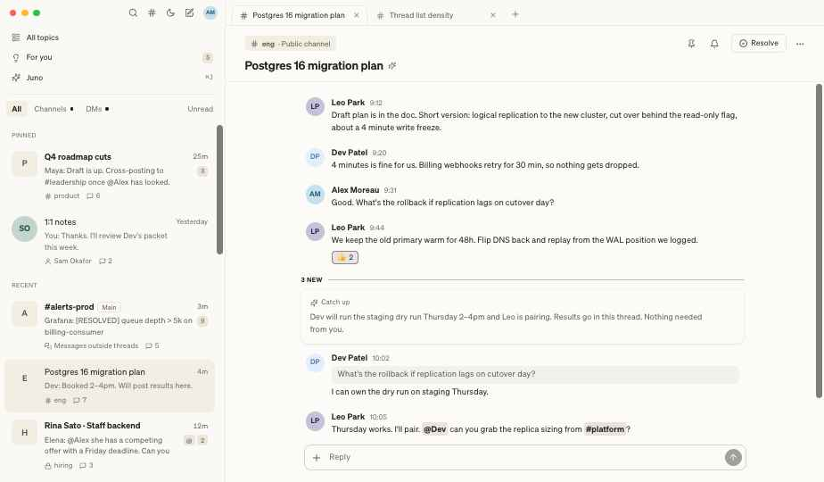
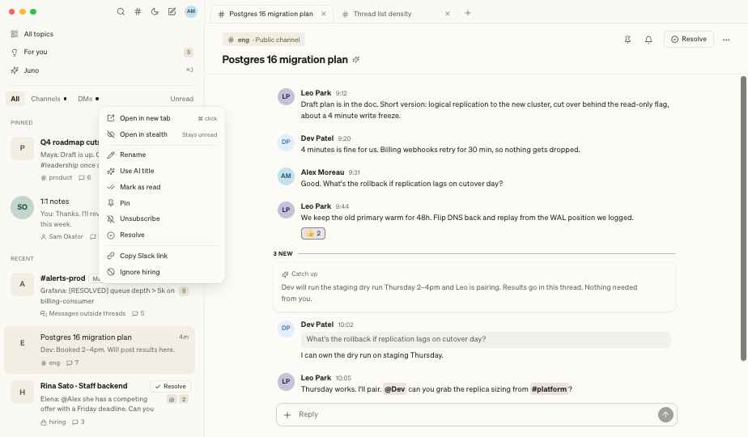
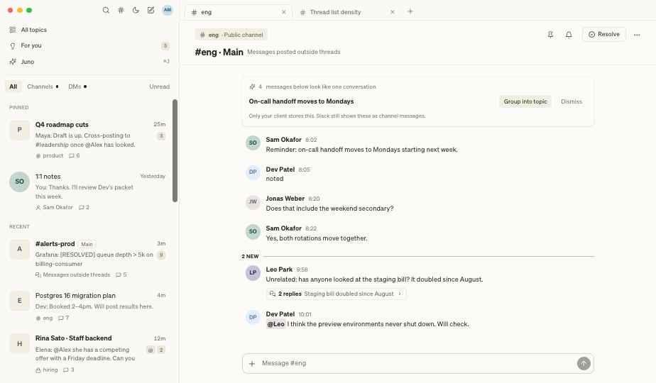
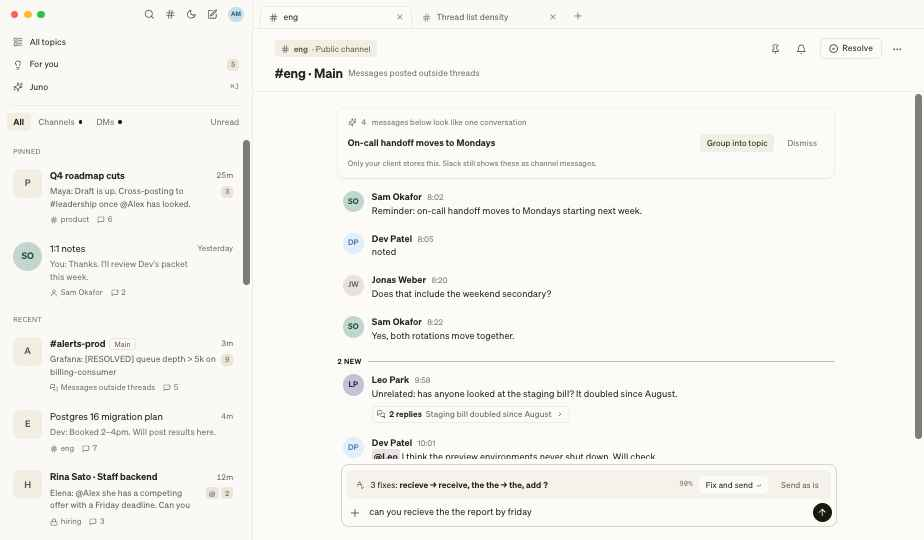
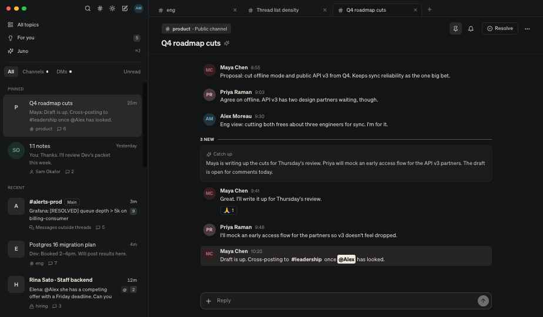

# Juno

A calm, topic-first desktop client for Slack. Product and design spec for the build.

Version 1 · October 2026 · Owner: Tushar · Prototype: Threads v3.dc.html

**How to read this.** This is a product and design doc, not a technical plan. It describes what Juno is, how every surface behaves and how it should look and feel. The build is expected to reverse-engineer the Slack desktop client's data access and run as an Electron, React and TypeScript app, styled with StyleX, using pi-ai with the OpenRouter provider for AI. Implementation choices beyond that are open.

## 1. What Juno is

Juno is a personal Slack client for someone who manages people and gets pulled in many directions. It reads and writes real Slack data, but reorganizes it around **topics** instead of channels. A topic is a Slack thread, or the unthreaded stream of a channel or DM. The sidebar is a single list of topics with recent activity, shown like a WhatsApp chat list: one wide row per topic with its title, the latest message, where it lives and who is in it.

It borrows the thread-first discipline of Zulip, the simplicity of WhatsApp and the polish of Slack. Anything quiet, resolved or irrelevant gets out of the way. AI helps manage and orchestrate. It names topics, catches you up, routes messages to the right thread, decides when to interrupt you and suggests next steps. It never writes on your behalf unless you ask, and it never sends anything without your confirmation.

*Figure 1. The main window. The sidebar holds topics, the right side holds tabs. Here a topic is open at its "new" divider. (The prototype shot still shows the catch-up card, which is removed; section 7.)*

## 2. Principles

1. **Calm by default.** Show less. Unread counts are quiet tags, not black badges: in the sidebar, the accent at reduced brightness. Nothing shouts. The interface relies on whitespace, not lines.
2. **Topics, not channels.** You think in conversations. Channels and DMs are filters and context, not the primary navigation.
3. **Quiet things disappear.** No activity for 7 days, resolved, or a thread set to Never means the topic is gone from the sidebar until something new happens. Everything stays reachable from All topics and ⌘K.
4. **Always know where you are posting.** Public, private and DM contexts are visually distinct on every topic, so private things never land in public channels by mistake.
5. **AI manages, you write.** AI organizes, summarizes, routes and gates. It does not ghostwrite, with one exception you set up yourself: when a reply watch runs out, Juno brings a nudge draft (13.6). Every outbound action it proposes waits for a click.
6. **Fast to clear.** Resolving is one hover and one click, with an undo toast and ⌘Z.
7. **Feels native.** It should feel like a well-made macOS app, not a web page. See section 15.

## 3. Mapping Slack to Juno

Slack has no concept of a topic. Juno builds one on top of Slack's data. Anything Juno adds that Slack does not have, like titles and resolution, is stored only on the client and never written back to Slack.

| Slack | Juno |
| --- | --- |
| Public or private channel | A container of topics. Used as a filter and as context, never as the main list. |
| DM and group DM | Treated exactly like a channel. A DM has a Main thread and can have topics too. |
| Thread (a message with replies) | A **topic**. Its first message is the thread root. |
| Top-level channel messages that are not in a thread | That channel's **Main** thread, one per channel or DM. Rows read "#eng" with a small Main tag, never a bare "Main thread". |
| Replying in thread | Replying inside a topic. From Main, **Start thread** turns that message into a topic; **Open thread** opens an existing topic. |
| Follow / unfollow thread | Notify me on a thread (section 5). Every message and When it matters follow the thread; Never unfollows it, and it leaves the sidebar. |
| Mark unread | Works on a topic or on a whole channel. |
| Quote (the ">" prefix) | Rendered as a soft quote block. Quoting inserts ">" lines. There is no separate reply object. |
| Not in Slack | Client-only: topic titles, resolved state, pins, ignored channels, notification settings. |
| Presence (active or away) | Set by your active hours and the avatar menu, and written to Slack with `presence.set`. |

### Topic titles

Titles resolve in this order. A title you set by renaming (stored in Juno only) comes first. Next is a title generated by AI. Last, as a fallback while AI hasn't run, the first six or so words of the first message. For an integration event summary, use its attachment or header title instead; a pull request title starts with "PR #N:". AI titles just happen: there is no marker and no switch. Rename (double-click the title, or the menu) is the only control, and saving an empty name brings back the AI title.

## 4. Window and layout

- **Two panes.** A sidebar on the left, 384px wide by default, and a tabbed workspace on the right.
- **Resizing the sidebar.** Drag its right edge to make it between 280 and 480px wide; double-click the edge to go back to 384. The width is remembered. The list does not re-render while you drag.
- **Hiding the sidebar.** The sidebar button in its top bar, ⌃⌘S, or View › Hide Sidebar hides it; the same again shows it. ⌃⌘S is the macOS standard for Show and Hide Sidebar (Mail, Notes, Reminders and SwiftUI's default sidebar command use it). Dragging the edge far enough left also hides it. Hidden or shown is remembered. While hidden, the traffic lights, the sidebar button, Back and Forward move to the start of the tab strip, so nothing becomes unreachable.
- **Title bar.** The macOS traffic lights sit in the sidebar's top bar, followed by the sidebar button, Back and Forward. The workspace's top bar is the tab strip. Both bars are window drag regions.
- **Workspace tabs** work like browser tabs. The "+" button sits right after the last tab, as in Safari and Chrome, and stays at the strip's end when the tabs scroll. It opens a new tab (section 6). Every page opens in a tab: a topic, a New chat, Home, All topics, Juno, a Juno page or Settings.
- **There is always a tab.** Closing the last tab opens a new one, and a first launch opens one; the workspace is never empty.
- **Reading width.** Message columns are capped around 800px and centered, so long lines stay readable on wide windows.

### Sign-in

- **The sign-in page.** With no session the window is one page: "Hi, I'm Juno", **Sign in to Slack** (Slack's own sign-in, in a window) and **Use the Slack app's session** (reads the signed-in Slack app; macOS asks for its keychain item). One line under them says what is happening or what went wrong. A session Slack no longer accepts shows "Slack signed you out" with the same two actions.
- **Set up Juno.** After the first sign-in, when no model provider is set up, the same page shows "Set up Juno" before the app. It offers **OpenRouter** (an API key), **OpenAI-compatible** (a base URL and an optional key) and **Codex** when it is installed on this Mac (Sign in to Codex opens the browser and signs in to Juno's own Codex home, not yours). Once one is set up, a Model row offers its chat models, Sonnet by default. **Continue** saves the key, then finishes with the chosen model; **Skip for now** opens the app with nothing set up. Keys go to the keychain, as in Settings › Juno (13.10). After Skip, AI assist stays on, and the Juno tab and panel say "Juno needs a model" with Add a provider (13.7). The step shows once; Settings › Juno is where the model changes later. Slack syncs in the background while it shows.

## 5. Sidebar

### Top to bottom

1. **Title bar**: on the left, after the traffic lights, the sidebar button, Back and Forward (section 6); on the right, Search (⌘K), New chat (⌘N, section 9), and your avatar. The avatar menu holds Set yourself away or active, Hide message text, status, Notifications, Settings (⌘,), AI assist, switch workspace and sign out. Notifications and Settings open Settings (section 14) at those sections. Diagnostics are not in the menu; they are in Settings › About. There is no name label and no status line in the header. The footer holds only the sync status card (item 5) and, while privacy mode is on, the privacy footer (below).
2. **Navigation**: Home, All topics and Juno (⌘J). Only Juno shows a count: its unread messages, in the sidebar's counter colours (the accent at reduced brightness, as on the rows). A properly spaced hairline separates these from the list.
3. **Quick filters** on one row: a horizontally scrollable row of pills on the left and an Unread only toggle on the right, an icon pill like Channels and DMs (a box with a dot on its corner) with that tooltip and accessible name, shown pressed while it is on. The pills are All, Channels (a hash icon), DMs (a person icon), then your views (below). A fixed "+" pill beside Unread only makes a new view. Channels and DMs are icon-only, with a tooltip and an accessible name. DMs include group DMs. The row never grows taller: when the pills overflow, the row scrolls sideways with the trackpad or the mouse wheel and the list does not move. New view and Unread only stay fixed at the right. There are no counters or dots on it. A small dot appears on Channels or DMs when that group has unread topics you are not viewing.
4. **Scope chip**, shown only when narrowed to one channel: "#eng ×". Picking a view clears it. Narrowing is rare. It happens from ⌘K (a channel's "Show its topics" result), by clicking a #channel chip in a message, or by clicking a topic's context pill.
5. **The topic list**: Pinned first, then Recent, sorted by latest activity. On an empty cache, hold the first list until cold sync establishes membership, including Automated exclusions. Cached rows paint immediately. During the first sync, the held list says "Getting your topics" and a status card at the foot of the sidebar shows a progress ring, "Syncing with Slack" and "N of M conversations", as Messages does while it downloads from iCloud. Offline, rate-limit and stopped notices use the same card, with Restart when the engine has stopped. Every state of the card is the same height, so one replacing another moves nothing, and the card only takes room from the bottom of the list, so starting or ending sync moves nothing above it. Later catch-ups show no card.

### Views

A view is a set of channels and DMs you pick. Its pill shows the Main and threads of those conversations, by the same rules as All ("What shows up"). Views are Juno's own: nothing is written to Slack.

- **The pill** shows the view's icon when it has one, otherwise its name. An icon pill has the name as its tooltip and accessible name. A view's pill shows a dot only when one of its topics has an unread mention of you; plain unread does not light it, so a view of bot channels stays quiet.
- **Keep these out of All.** Each view has this one setting. When it is on, the view's conversations show only in that view: never in All, Channels or DMs, and they light none of those dots. ⌘K, All topics, Home and notifications still see everything. Narrowing to one of those channels ("Show its topics") still shows it. A conversation in two views is kept out of All when either view says so.
- **Making and editing.** The "+" pill opens a small sheet with four fields and nothing else: the name, an optional icon from the app's icon set, the conversations (a searchable picker), and the Keep these out of All setting. Save makes the view and selects it. Right-click a pill for Edit view, Move left, Move right and Delete view; dragging a pill also reorders. Delete has Undo.
- **Adding a conversation.** A channel's or DM's menu (and a Main row's menu) has **Add to view ›**: your views with a check on the ones that hold it (choosing a checked one removes it), then New view…, which opens the sheet with the conversation already in it. Adding and removing show a toast with Undo.
- **Juno can make one.** "Make a Bots view with every alerts channel" is a Juno settings task: the same command the sheet uses. (Not wired to Juno yet; the engine command is the seam.)

### Automated

Juno has one view of its own, **Automated** (the robot icon), for bot and alert channels and DMs with apps. It keeps them out of All. It appears once it holds a conversation, and from then on it is a view like any other: edit it, reorder it, turn off Keep these out of All, or delete it. A deleted Automated view is never made again.

- **Clear cases move by themselves.** A channel goes in when most of its latest messages come from apps, or half do and its name says integration (alerts, deploys, ci, notifications and the like), and you have not written there. A DM with an app goes in. This happens as conversations sync, so a bot channel is not in All after the first sync. The view sheet marks these "Added by Juno"; unchecking one takes it out.
- **Unclear ones are asked.** With AI assist on, Juno judges a channel the rules cannot place, once, from its latest messages. What stays unclear, and every unclear channel while AI assist is off, becomes a Home item: "Move #releases?" with **Move** and **Keep in All** (12). Right-click the item for the channel's menu, which has Ignore channel for a channel you never want to see.
- **Your choice wins.** A conversation you put in or took out of any view by hand, or answered about on Home, is never moved again. New channels are sorted when they appear; nothing already answered is asked again.
- **Noise you never want** is Ignore channel (below, "What shows up"), as before. Automated is for channels worth a look now and then.

### Privacy mode

For screen sharing. **Hide message text** in the avatar menu (or ⌃⌘H, View › Hide Message Text) blurs message text that shows without you opening anything, so it cannot be read over a shared screen:

- the sidebar row preview ("Sender: text"),
- the All topics preview line,
- a Home row's title when Juno wrote it (the plain titles, such as "Elena asked you something", stay).

What you need to find your way stays readable: titles, channel and people names, times, counts and tags. A topic, the Juno chat and a peek are not blurred: you open them on purpose. Hovering or focusing a blurred line does not reveal it, and blurred text cannot be selected.

While the mode is on, macOS notifications keep their title (who or where) and replace the message with "Message hidden", because they show over a shared screen too.

While the mode is on, a small footer at the bottom of the sidebar says "Message text hidden" with a **Show** button, which turns it off in one click. The avatar menu item reads **Show message text**.

The mode is remembered across a relaunch, and the first frame after a relaunch is already blurred: a restart in the middle of a call must never show text. Juno never turns it off by itself. (Turning it on by itself when sharing starts is researched in `docs/research/screen-share-detection.md`, not built.)

### Row anatomy

Each row is a tile followed by three lines. The tile is the topic's art: a small AI-drawn illustration about what the topic discusses, with no container. Every topic gets one, including a channel's Main and threads inside DMs. Until the art exists, or when AI is off, the tile shows a calm free-form placeholder shape picked per topic. A DM's Main shows the person's Slack profile photo instead (coloured initials when there is no photo). Line one is the title and time. Line two is a one-line preview of the latest message as "Sender: text", ending with an ellipsis when it does not fit, with any ">" quote lines stripped. Every row is the same height. Line three is meta: the place, its tags such as Main or Reopened, and at the right end a small stack of the people talking. The place is a glyph and the name; the glyph says only what kind of place it is: # for a public channel, a lock for a private one, a person for a DM. A channel's own icon is for its art, not this line. The stack shows who sent the topic's unread messages, looking at the last 15 of them, most recent first: at most four avatars, then "+N" for the rest. It never shows you, a read topic shows no stack, and rows in a DM or a group DM (its Main and its threads) have none, since the row already names the people. The stack takes only its own width and ends on the row's trailing edge, under the time and the counts; with no people there is no slot, and the place takes the whole line. When people appear, the place name may be cut shorter; nothing moves. Text has three clear levels in both themes: the title strongest, the preview a step down, the place and time a step below that, each at least 4.5:1 on its row. There is no message count and no "messages outside threads" label. A Main row may also show a thread icon with the number of threads started in that channel since you last read its Main, hidden when zero. Unread topics have a semibold title and a count tag in the accent at reduced brightness: a pale tint of it with deeper accent text (lighter in dark mode), at least 4.5:1. Mentions of you get a quiet "@" tag. Density (Settings › Appearance, section 14) is the only choice that changes the row.

### What shows up

- **Which threads.** The sidebar shows threads you follow, plus any thread with an unread mention of you. Following is Slack's "Get notified about new replies": you follow a thread when you start it, reply or are mentioned, or by choosing Every message or When it matters in Notify me. A thread started from New chat appears immediately as locally followed, even before its first reply (section 9). Other threads are not in the sidebar. They are reachable from their channel's Main (as thread links), All topics and ⌘K. Choosing Every message or When it matters for one from there (Notify me, or Follow in its header, section 7) follows it and adds it to the sidebar.
- **Notify me on a thread** is the same three choices as on a channel or person (section 14), and it is how you follow and unfollow. **Every message** and **When it matters** both follow the thread in Slack; Every message also notifies you for every reply. **Never** unfollows the thread in Slack, so it leaves the sidebar and Slack stops notifying you about it on every device. As in Slack, a later mention of you follows it again. A thread you do not follow shows Never as its choice, and its header shows Follow instead of Resolve (section 7). Every message on a thread wins over Never on its channel, and a channel's Every message covers its Main and the threads you follow in it.
- **Notify me on Main** is the channel's or DM's own choice; Main has no separate one.
- **First sign-in.** Threads you do not follow start as read, so Juno does not open with hundreds of unread topics. Followed threads and Main keep Slack's unread state.
- **Quiet.** Topics with no activity inside the window chosen in Settings › General are hidden unless pinned, unread or open in a tab. Choose 1, 3, 7 or 14 days; the default is 7. All topics status and Home use the same window where recency applies. Lowering it only hides topics; nothing is deleted or fetched. Raising it fetches missing history in the background, and older rows appear without moving painted rows. The same window limits the first sync.
- **Resolved.** Resolved topics are hidden until a new message arrives, which brings them back tagged "Reopened".
- **Ignored.** Ignored channels, such as noisy alert or deploy channels, are hidden everywhere in Juno and never notify.
- **Main threads** follow the same rules. A channel's Main appears only when the channel had recent activity of any kind, including replies in its threads. A channel with no recent activity simply does not appear.

*Figure 2. Right-click a row for the full set of actions.*

### Read-dependent membership

In Unread only, including within a view or channel scope, a topic already in the list stays in place while any tab shows it, even after it becomes read. It shows its actual read state: no unread count or bold title, and it stays selected when its tab is active. The same rule applies wherever sidebar membership depends on read state, including a thread shown only for an unread mention. Becoming unread again leaves it in place.

The row leaves when the last tab showing it closes or navigates elsewhere. History entries do not count. Removing it does not reorder the rows above it. Changing filters starts a fresh list; an open topic that was never in that list is not added. Resolve and Ignore still remove topics.

### Row actions

- **Hover** (or keyboard focus) shows an icon-only **Resolve** button (a check) over the right end of the meta line, in the stack's place: the stack fades out under it, or the end of the place fades when there is no stack. It takes no space while hidden, and nothing shifts. Its tooltip and accessible name say "Resolve" (with the topic title for screen readers). Resolving hides the row, marks it read and shows a toast with Undo. ⌘Z also undoes. Main threads resolve the same way.
- **Context menu** (right-click, or the context-menu key; in an open topic, ⋯ in the header or a right-click on its title):
  - Open in new tab (⌘-click)
  - Rename
  - Redraw (a new drawing for the topic's art, with Undo; only while AI assist is on, and not on a DM's Main)
  - Mark as read or unread
  - Pin
  - Notify me: Every message, When it matters or Never
  - Resolve or reopen
  - Copy Slack link
  - Open in Slack
  - Add to view (Main rows: the channel or DM)
  - Ignore #channel
- **Channel context menu** (right-click a topic's context pill, a #channel chip in a message, or a channel result in ⌘K): Show its topics, Open Main, Mark channel as read or unread, Notify me, Add to view, Ignore channel, and Ask Juno (section 7, Juno panel).
- **Person menu** (right-click a sender's name or avatar in a message, or an @person chip): Notify me about them, and Ask Juno.
- **Peek** is how you read without marking anything read. Hold the peek key while the pointer is over a sidebar row and the topic opens in a popover to the right of the sidebar. It is read-only and scrolls, and it does not mark anything read, open a tab or move focus, so you stay where you were. Moving to another row while holding the key switches the peek; releasing it closes the popover. The key defaults to ⌥ Option, which works while you type; Settings › General can change it to Space, which works only when no text field has focus. (Fn is not offered: macOS does not report it to apps reliably.)
- **Rename** happens inline in the row or the topic header. Enter saves and Esc cancels.
- **Undo toasts** appear bottom-left for reversible actions only. Info-only toasts like "Prompt copied" never show Undo.

## 6. Opening things and tabs

- Everything opens in the **current tab**, the header's topic switcher included (section 7). A new tab opens only on ⌘-click, ⌘ Enter or "Open in new tab".
- A plain open of a topic or page that another tab shows focuses that tab, the one active last if several do, so the sidebar's selection stays one place. ⌘-click and "Open in new tab" always open a new tab, so the same topic, Home, All topics or Juno can show in several tabs.
- **One place in several tabs.** Each tab keeps its own scroll position, "N new" divider, composer focus and selection. A press on a tab gives its page focus (the composer it had, or its composer), as in Safari; the keyboard keeps focus in the strip. Everything else is shared: the messages, the read state, the Juno chat and the draft of each topic. Two Juno tabs show the same chat, and a message sent in one shows in both. Two tabs on one topic can sit at different places in it.
- **New tabs.** The "+" button and ⌘T open a new tab with a New chat (section 9), or Home when Settings › General says so ("New tabs open": New chat, the default, or Home). ⌘N and the sidebar's New chat button always open a New chat. Each opens a new tab, even when a New chat tab is already open. Closing the last tab opens a new tab the same way, so there is never no tab.
- Tabs carry the topic's art and title, or the channel name for a Main thread. Closing a tab focuses its neighbour.
- **Unread dot.** A tab whose topic has unread messages shows a small soft grey dot after its title. One style for all unread, mentions included. The active tab never shows it, since opening marks read.
- **Back and Forward.** Each tab has its own history, like a browser tab. An entry is a topic or page opened in that tab; scrolling, peeks, popovers and the Juno panel are not entries. Back returns to the previous topic where you left it in it. A New chat that sends replaces its own entry with the topic. Back and Forward are the buttons in the title bar, ⌘[ and ⌘], the mouse's back and forward buttons, and a three-finger swipe. Holding a button lists the tab's history.
- **Tab menu** (right-click a tab): Pin tab, Close tab, Close other tabs, Close tabs to the right, Close all tabs, and for a topic Copy Slack link and Open in Slack.
- **Pinned tabs** sit first, as small icon-only tabs with no close button. "Close other", "to the right" and "all" leave them open, as in browsers; closing one directly works.
- **Reopen closed tab.** ⌘⇧T reopens the last closed tab with its history, and again for the one before, up to 20.
- The usual browser keys work: ⌘T new tab, ⌘W close, ⌘1 to ⌘8 a tab by position, ⌘9 the last tab, ⌃Tab and ⌃⇧Tab or ⌘⇧] and ⌘⇧[ for the next and previous tab (section 18).
- To read a topic without marking it read, peek at it (section 5).

## 7. Topic view

### Header

The header has no bar. Two islands float over the top of the message list, 8px under the tab strip, aligned to the reading column. Design: `docs/design/header/`.

- **Left island:** the context pill, then the title with a chevron.
  - The **context pill** shows the channel name, with its type in its tint, its icon and its tooltip. This is the main defence against posting in the wrong place, so it is always visible, at every width. People and message counts are deliberately left out. Clicking it narrows the sidebar to that channel; right-clicking it opens the channel menu.
    - **Public channel:** neutral.
    - **Private channel:** warm amber.
    - **Direct message or group DM:** soft blue.
  - **The title** is a topic switcher. Clicking it (or Enter, Space or ↓ on it) opens a popover under the left island: a search field, then this channel's Main and its threads, newest activity first, with resolved threads last under "Resolved". Unread shows as in the sidebar (a bold title and a count, and @ for a mention), and the topic on screen is marked. Typing filters by title, ↑ ↓ move, Enter opens in the current tab, ⌘Enter or ⌘-click in a new tab, and Esc closes. Right-clicking the title opens the topic's menu. Rename turns the title into a field in place.
- **Right island:** Resolve or Reopen (not on Main), ⋯ and Juno (opens the Juno panel, below). A thread you do not follow (Notify me is Never, section 5) shows **Follow** (a bell) in Resolve's place, since resolving only hides a sidebar row. Follow opens a small native menu: **When it matters** first, with the line "Juno decides when to notify you" under it, then **Every message**. A choice is the same as choosing it in Notify me: it follows the thread in Slack, the thread joins the sidebar, the toast has Undo and ⌘Z undoes it. The island then shows Resolve. Follow and Resolve keep the wider of their two widths, so the swap moves nothing. A followed thread's level shows only in ⋯ › Notify me. **⋯** opens the topic's menu, the same menu as its sidebar row: Open in new tab, Rename, Redraw, Mark as unread, Pin, Resolve, Copy Slack link, Open in Slack, Notify me and Ignore #channel. Main has no Threads button: its title's switcher lists the channel's threads.
- **Under the islands** the list scrolls on: the page colour is solid behind the islands and fades out just below them, so text never shows through or around them. The first message sits below the islands when scrolled to the top.
- **Narrow windows.** The islands keep their places at every width. Under 480px, Resolve and Follow show as icons; the title shortens first, then the channel name, and the pill's tint and icon always show.

### Messages

- **Style.** Flat Slack-style messages. Consecutive messages from the same person group under one header.
- **Stable geometry.** The list is as dense as Slack's. A message is as tall as what it shows; no space is held for something that might arrive later. Space is reserved only for content the message already has: an image or file of known size, and reactions or a thread link the data already lists, while their images and counts load. A first reaction or a new thread link grows its message at the bottom, a rare and small change that is better than empty space under every message. The time sits right after the sender's name; a name that resolves late moves the time along its line once. What never moves is what the user is reading: rows in view stay still when anything changes above them (scroll anchoring), and at the bottom the list keeps its bottom, so a message that grows there lifts the rows above it in the same frame. The Threads counter keeps a fixed-width slot. Home enters by opacity only; its greeting and rows stay in their final positions.
- **Where it opens.** A topic opens at a "N new" divider when it has unread messages, otherwise at the bottom. There is no summary card at the divider; to catch up, ask Juno in the panel.
- **Mentions.** @people and #channels render as soft chips. Mentions of you get the accent colour and a lightly tinted message background. Clicking a #channel filters the sidebar to it.
- **Hover toolbar:**  Reactions are toggleable chips under the message.
  - Three one-click reactions (👍 ✅ 👀).
  - A full emoji picker.
  - Quote.
  - In Main threads, Start thread or Open thread.
  - More: Edit, Delete and Tell me if nobody replies (13.6) on your own messages, Copy Slack link and Open in Slack. Right-clicking a message opens the same menu.
- **Open actions.** A message keeps its active background and toolbar while its reaction picker or More menu is open.
- **Keyboard.** ↑ in an empty composer selects the newest message; ↑ and ↓ move the selection, and Esc returns to the composer. On your own selected message, E edits it inline and Delete or Backspace deletes it after one inline confirm (Enter confirms, Esc cancels).
- **Quoting** follows Slack. Quoting inserts "> " lines into your reply. Selecting any part of a message shows a floating Quote button that quotes only the selection.
- **Thread links.** In Main, a message that has a thread shows a small "2 replies · Title ›" link under it.
- **Settled hint.** When AI thinks a thread is settled, a quiet line at its top says why, with Resolve and Not yet.

### Main thread

Main is the unthreaded stream of a channel or DM. Its header reads "#eng" in the pill and "Main" as the title.

*Figure 4. The #eng Main thread, with a message that already has a thread, shown with a link. (The grouping card at the top of the prototype shot is removed.)*

### Juno panel

Juno can sit beside any topic, so you can talk about what you are looking at without leaving it. Design: `docs/design/juno-panel/`.

- **Open and close.** The Juno button in the header, or ⌘J while a topic tab is active, opens the panel and focuses its composer. The same button, ⌘J again, or Esc in its empty composer closes it, and focus goes back to the topic's composer. Open state belongs to each tab: the panel can be open in one tab and closed in another, and switching tabs shows each tab's own state. In a tab where it is open, it stays open while that tab shows a topic, and is saved with the tab. It never shows on Home, All topics or other pages.
- **Look.** A floating inspector, like a macOS inspector: inset by the header islands' 8px gap from the tab strip, the window edge and the topic, with rounded corners and a soft layered shadow. Its surface is a calm secondary one, a step below the page in light and a step above it in dark, with no accent in it, so it separates without a heavy border and its composer and Juno's bubbles stand out on it. Its header row lines up with the topic's islands, and its composer ends on the topic composer's line. Juno's bubbles have no mark beside them.
- **Size.** 440px wide by default, so a Juno bubble holds about 50 characters a line. Dragging its left edge sets a width from 360 to 640px, kept for every tab; a double-click restores 440. The topic keeps its header, list and composer, and its reading column re-centres in the space left. The panel gives way to keep the topic 480px wide, down to 360px; under that it covers the topic, and the topic shows through it, blurred.
- **One Juno.** The panel is the same single chat as the Juno tab (13.1), shown narrower and opened at the bottom: the first frame it paints already shows the newest message. A message you send from the panel carries the topic it was sent from: a small "About {topic}" line above your bubble, in the chat and in the Juno tab alike. There is no second conversation and no per-topic history. The panel's header is the same pair of islands as the topic's: "Juno" with the Juno menu on the left; Open in a tab and Close on the right.
- **What Juno knows.** With each message sent from the panel, Juno gets the topic (its id, title, channel and kind), the messages on screen, the "new" divider's position, and your text selection in the topic if there is one. "This" means that topic.
- **Context chip.** A small chip inside the top of the panel's composer, lined up with its text, says what Juno sees: the channel's kind icon and "eng · Main" or "eng · {topic title}", cut with an ellipsis when long. While text is selected in the topic a second chip reads "Selection", with the selected words as its tooltip and an x to remove it. The topic itself cannot be removed.
- **Ask Juno about a person or channel.** Ask Juno in a person's or channel's menu (section 5) opens the panel, or the Juno tab when no topic tab is active, with the composer focused and the context chip reading "About Maya Chen" or "About #eng", with an x to remove it. You type the question. The message carries that person or channel in place of the topic and the messages on screen, and its About line names them. A chip holds only a name, so it does not count as reading Slack; Juno then reads what it needs with its read tools.
- **Trust.** Anything Juno reads from the topic, the selection included, is Slack content. A message sent from the panel therefore counts as having read Slack in that run, and the untrusted-content rule (13.9) applies: work that would need no click proposes a card instead, with a Because line.
- **AI assist off.** The Juno button is hidden, and so are Ask Juno and Tell me if nobody replies in the menus.

## 8. Composer

- **Shape.** A single line with a round send button on the right. A + attach button joins it on the left when attachments are built; until then there is none. It grows with content to about 8 lines, then scrolls inside itself.
- **No helper text.** Shortcuts like @, # and Enter to send are obvious and not spelled out. The channel is not repeated above the composer, because the header pill already shows it.
- **Sending.** Enter sends at once: the message shows in the topic straight away and goes to Slack in the background, never twice. If Slack refuses it, it stays where it is with "Not sent.", Retry and Delete draft. Sends wait out a lost connection and go when it is back.
- **Drafts.** Each topic keeps its own draft, through tab switches and restarts.
- **Mentions.** Typing @ suggests people and # suggests channels, with arrow keys and Enter or Tab to pick.
- **Links.** URLs, addresses and bare domains like example.com are links as typed, in the composer and in the sent message, as Slack links them. Pasting a URL over selected words makes those words a link, as in Slack, Notion and Notes; ⌘Z gives the plain paste back. ⌘K with words selected edits their link, and ⌘-click opens it. In messages a link shows its label, the URL shows on hover, and a click opens it in the default browser, never inside Juno.
- **Audience check.** When what you type reads like hiring or people details and the channel is public, a quiet amber line warns you as you type.

- **Emoji suggestions.** In every composer and the inline edit field, `:` at a word start followed by at least two characters opens local emoji matches, ranked by recent use, then common emoji (👍 ✅ 👀 🙏 🎉 ❤️ 😂 🔥 💯 🙌, in that order), then prefix, then substring, so `:thumbs` offers 👍 first. Rows show the glyph or workspace image and `:shortcode:`. ↑ and ↓ move; Enter or Tab inserts; Esc closes and keeps the text. An exact closing `:` converts a standard shortcode to Unicode. Workspace emoji insert `:name:` for Slack.

### Checks on send

Pressing Enter runs fast checks before anything goes out. If they find nothing, the message just sends. If they flag something, a compact bar appears inside the composer. Enter takes the first option and Esc returns to editing.

1. **Wrong place.** In a Main thread, your message is compared against the last 3–4 topics in that channel. If it looks like a reply to one, you get "Looks like a reply to *Staging bill doubled since August*", with Post in thread or Send to Main.
2. **Clarity.** Catches typos, doubled words, a lowercase "i", a missing question mark and very long sentences. Offers Fix and send or Send as is. Fixes are minimal corrections, never rewrites.

*Figure 5. The route check catching a reply typed into Main.*

*Figure 6. The clarity check listing fixes before sending.*

The send-check bar shows the finding and two choices, without a confidence number.

## 9. New chat

A conversation where you write first and choose where it goes, with frequent destinations one press away. Design: `docs/design/new-chat/`.

- **Opening.** The New chat icon in the sidebar title bar and ⌘N each open a New chat in a new tab with the composer focused, and so do the tab strip's "+" and ⌘T unless new tabs open Home (section 6). The tab is titled "New chat" until you pick a destination, then takes the destination's name, keeping the New chat icon until you send. Each of these opens another New chat tab even when one is already open, empty or not; each keeps its own draft and destination.
- **Frequent destinations.** A block centred as a whole in the space above the destination chips shows the section label "Frequent" and up to six compact standard list rows. All rows share the sidebar width, capped at the composer column. Their highlights align with the composer’s left edge; the label, leading glyphs and hint share the rows’ inner inset. A fixed leading slot aligns every name. DMs show the person’s avatar and name; group DMs use the group treatment; channels show # and their name, with a lock for private channels. The quiet hint "Write your message, then pick where it goes." sits below. With no destinations, only the centred hint shows. The two pickers stay directly above the composer.
  - Rank local own messages from the last 30 days by the sum of `0.5 ^ (age_in_days / 7)`, breaking ties by latest send. Fill remaining places with member conversations by latest activity, DMs before channels. Archived channels are excluded. Fetch on opening without delaying first paint; no Slack calls.
  - A primary mouse down, Return or Space chooses a row and focuses the composer. Every row is reachable with Tab. Picking changes the destination chip without sending or opening a conversation. The list stays visible and marks the chosen row.
- **Two pickers.** The first chooses the conversation: a channel, a person or a group DM. The second chooses the thread inside it, with Main as the default. Each is a button that opens a small searchable list; typing filters, ↑ ↓ move, Enter picks and Esc closes. Shift Tab from the composer reaches the thread picker, then the conversation picker; Space, Enter or ↓ opens the focused one.
  - **Conversation list.** Recent conversations first, then every channel you are in and everyone in the workspace, including people you have never messaged ("No messages yet"). Ignored channels are left out.
  - **Thread list.** With a conversation chosen: Main first, then its threads by latest activity, followed or not. With none chosen: recent threads from everywhere, each with its conversation beside it; picking one also fills in the conversation.
  - Changing the conversation sets the thread back to Main.
- **The conversation picker is the context pill.** Once chosen it takes the pill's look for its kind (neutral, amber for private, blue for DMs), so where the message will go is visible while you write, the same as in a topic (section 7).
- **Preview.** When no frequent destinations are available, picking a destination fills the space above with that topic's latest messages, opened at the bottom. The preview is read-only: no hover toolbar, no reactions, and nothing is marked read, as with peek. Changing the destination swaps the preview at once. A person you have never messaged shows "This is the start of your conversation with Jonas Weber."
- **The draft is kept** through every change of destination, attachments included. The text and destination are saved with the tab and come back after a restart. Closing the tab with a draft shows "Draft closed · Undo".
- **Sending.** Enter with no destination opens the conversation picker and keeps the draft; Enter after picking sends. The send checks (section 8) run as usual: the wrong-place check in Main can move the message into a thread, and the audience check reads the chosen channel. A person you have never messaged gets a DM opened first, then the message.
- **After the first send** the pickers go away as soon as the send is queued locally. With Main chosen in a channel or group DM, this tab becomes the thread rooted at the sent message, with a Reply composer. Its pending root stays visible, including “Not sent.” and Retry on failure. Acknowledgement replaces the pending topic ID with Slack’s thread ID without replacing the tab, adding history, losing the reply draft or moving painted messages or the composer. The next send is a reply; if the root is still pending, the reply waits for its acknowledgement.
- **The new thread** appears immediately in the sidebar as the user’s locally followed topic, even before it has replies. Its title starts with the root’s first words and uses the AI title when available. It adds no separate unread item. Main keeps the root and its thread link, including the reply count.
- **Other destinations.** One-to-one DMs still become their Main. An existing thread or Any thread keeps its current behaviour. For these destinations the tab becomes that topic, marked read as when you open it, and stays in its own tab even when another tab shows that topic too.
- **Not in v1:** starting a new group DM from here, and sending to several places at once.

## 10. Search and commands (⌘K)

- **Two tabs.** A small segmented control at the top of the palette switches between **Conversations** and **Messages**. Each open starts on Conversations. Tab and Shift Tab, or ⌘1 and ⌘2, switch tabs; the text stays, and focus stays in the field.
- **Conversations.** DMs, group DMs and channels. With an empty query it lists the ones you use most ("Frequent"): your own messages and your topic visits from the last 30 days, each counted as `0.5 ^ (age_in_days / 7)` (the ranking of New chat's Frequent, section 9), then the rest by latest activity, DMs first. Typing filters by name or, for a group DM, by member, ranked the same way, names that start with the text first among the unused ones. DMs show the person's avatar, channels # or a lock, group DMs the group icon. Enter opens the conversation's Main in the current tab, or a New chat to a person you have never messaged; ⌘Enter opens it in a new tab.
- **Commands.** In Conversations, the commands that match the text show beside the conversations, at most four of each group; a leading ">" lists them all and nothing else, and filters them by what follows.
  - Global: Theme (Light, Dark, Match system), each accent, New tab, New chat, Settings by section, Hide or Show message text, and Set yourself away or active. The current theme and accent say "Current".
  - For the topic in the active tab, grouped under its name at the top: Resolve or Reopen, Pin or Unpin, Mark as unread or as read, Open or Close Juno panel (when Juno is on), Copy Slack link, Open in Slack, Rename thread (threads only), and Start thread when a message was selected in a Main as the palette opened, which opens that message's thread.
- **Messages.** The message search: topic titles, message text, channels and people. With an empty query it shows recent topics.
  - **DMs.** A person's result reads "Message Maya Chen" and opens your Main with them, or a New chat addressed to them when you have never messaged (section 9).
  - **Channels.** A channel has two results: open its Main, and "Show its topics", which narrows the sidebar to it.
- **Placeholder.** "Find a conversation, or type >" in Conversations; "Search, or ask Juno" in Messages.
- **Juno commands.** Natural-language input is recognised as a command, in both tabs: above the results in Messages, under the conversations in Conversations. The command shows with a small confidence badge. Enter runs it.
  - "tell maya …" or "post in #eng …": an instant send card.
  - "summarize …" or "what did I miss": opens Juno with that request.
  - "resolve pricing": resolves the best-matching topic.
- **Keys.** Arrow keys move the selection. ⌘Enter opens a result in a new tab.

*Figure 8. "tell maya the wednesday slot works" becomes a send action.*

## 11. All topics

A full page in a tab, listing everything: quiet, resolved, unfollowed. On an empty cache, its controls paint immediately and its first rows wait for cold sync to establish membership and names. Cached rows paint immediately. It is the guarantee that anything in Slack can be found with filters and recency, including threads that were never in the sidebar, so the sidebar can stay small. Status chips with counts (All, Open, Resolved, Quiet, Unfollowed; Unfollowed is a thread set to Never). Filters for channels or DMs, a specific channel and sort order (most recent, oldest, most messages), plus a text filter. A table shows the topic and preview, where it lives, status, message count and last update. Rows open topics and carry the usual context menu, so reopening and following again (Notify me) happen here. The topic column keeps a minimum width and the table scrolls sideways on narrow windows.

*Figure 9. All topics.*

## 12. Home

Home is a calm resting page: a small scene with Juno's mascot that changes with the time of day, a short greeting, at most three things that want you, an "Ask Juno…" field, and an all-caught-up scene when nothing needs you. Design: `docs/design/home/` (layout A).

On a cold visit, the greeting says "Syncing with Slack." and reserves space for the possible rows and the Browse link. Rows fill the reserved slots from the top as conversations land; a row shown never moves, so one that lands later goes below it even when it ranks higher. When sync finishes, the rows shown stay, the empty slots take the next items, and the space stays for the visit, so the greeting and Ask Juno field do not move. Later visits use the items available when Home opens.

- **Getting there.** Home is the first item in the sidebar navigation. It opens in a tab like any page: a plain click focuses a tab that shows it, and ⌘-click opens another (section 6). New tabs can open Home instead of a New chat (Settings › General).
- **What wants you.** Each item is one row with a title line and a plain meta line. The kinds, ranked:
  - **Waiting on you.** A message that asks you something and has no reply from you.
  - **Pick up where you left off.** The last topic you had open, when it has new messages.
  - **Moved a lot.** A followed topic with many new messages since you looked.
  - **Follow-up** (AI on). Something you said you would do, with Mark done.
  - **Automated.** A channel neither the rules nor Juno could place (5, "Automated"): "Move #releases?", with "To Automated" on the line below, quiet Keep in All then raised Move, each with Undo. Right-clicking it opens the channel's menu.
  - **Tidy up** (AI on). Topics that look settled, listed in the meta line, with Resolve all and Undo.
  Clicking a row opens its topic. Items are computed when Home appears and do not change under the pointer. With AI on, a row's title line may be rewritten to say what it is about; the meta line never changes.
- **Ask Juno** opens the Juno chat. Anything else that used to be a suggestion card (a coding prompt from a discussion, reply ideas) is something you ask Juno for, here or in the Juno panel beside the topic.

## 13. Juno Agent

Juno is also the assistant's name. It is one long chat with one assistant that reads your topics, answers from memory of everything you have told it, and acts for you through connections (Slack, Notion, Littlebird, T3 Code) when you ask. The chat looks like a messaging thread: your bubbles and Juno's, nothing else. Tool calls, delegation and the machinery that does the work stay behind the conversation. Juno is a standalone module with its own state, so the same chat can later run on other surfaces; in v1 it lives in the Juno tab and in the Juno panel beside a topic (section 7).

*Figure 11. The Juno chat.*

### 13.1 The chat

- **Header.** The same islands as a topic's (section 7): "Juno" with a chevron for the Juno menu (13.10) on the left, and the banner chip (13.7), when there is one, on the right.
- **One thread.** There is no "new chat". Everything you and Juno have said is in one scrolling list, with day separators and the "New" divider before the first message you have not seen. Opening the chat lands at the divider, otherwise at the bottom. A "New message" pill appears when you are scrolled up and something arrives.
- **What is on screen:** your bubbles, Juno's bubbles and cards, one status bubble while Juno is working, and separators. Quiet one-line notes ("Remembered · Undo", "Removed") sit between bubbles.
- **Not a transcript.** You see only what Juno chose to say to you. Its working (what it read, how it reasoned, an input it decided to let pass) never shows.
- **Bubbles.** Yours are right-aligned in an accent tint (option B in `docs/design/juno-chat/`), with text in the default ink. Juno's are left-aligned on the hover surface, with no mark beside them: the bubbles carry Juno's voice. Consecutive messages from the same sender within two minutes group, and the last bubble of a group has the small tail. A message with a different origin (your reply, a schedule, a job) always starts a new group. Times show on hover. Text is selectable.
- **Plain text.** Juno's bubbles are plain text; the chat does not render markdown. How many bubbles and how long each one is are Juno's judgement: a long answer can be one big bubble, and a long job can post many updates. A recall answer cites the day ("On 12 Mar you said …") and the citation scrolls the chat to that message.
- **Sources.** Every claim Juno makes about Slack links to the messages it came from, in the same look as a recall citation: the words that make the claim are the link. A click opens the topic at that message in the current tab and flashes it; ⌘-click opens a new tab. This covers answers, catch-ups and scheduled summaries. Which words carry a link, and how many links there are, is Juno's judgement. A link that does not match a message Juno read in that reply is dropped and its words show as plain text, so a link always points at a message Juno actually read.
- **Reactions.** You can react to any Juno bubble or card with any emoji: hover › React, or right-click › React. One reaction per person per item; picking another replaces it, picking the same one removes it. A thumbs up is only recorded: Juno does not run for it. Any other reaction goes to Juno like a message, at its next step if it is working, and Juno answers only if the reaction calls for it; often you see nothing more. Juno can also react to your messages with any emoji, with or instead of words. A reaction shows as the emoji on the bubble's corner.
- **Replies.** You can reply to a Juno bubble or card (hover › Reply, or right-click › Reply). The composer shows the quote above the field, and your bubble shows a one-line quote above it; a click scrolls to the original. Juno gets the quoted item in full. Juno can reply to one of your messages when it helps, with the same quote. A reply sent while Juno is working joins the work like any message.
- **A reaction or a reply is never a click.** A thumbs up under a Send message card does not send, and "send it" as a reply to a card does not send either; only the card's button does (13.3). Neither pins anything (13.8).
- **"This"** means the topic you were last viewing.
- **Empty state.** "What do you need?" with the seated-j illustration, one line on what Juno can do, and four suggestion chips, quiet outlined pills with a small icon and verb-first text. Clicking one sends it.
- **Composer.** Enter sends, Shift Enter adds a line. The chat works like a text conversation: you can send while Juno is working, and Juno reads the message at its next step (13.5).
- **Context menu on a message:** Copy, React, Reply (on Juno's), Remember this (on your own messages), Remove. Remember this pins the selected text when there is a selection inside the message, otherwise the whole message; it is disabled when that is longer than a sentence (280 bytes). Remove opens a local sheet (13.8) that works in every state, including paused, offline and AI off.
- **Read.** A Juno bubble counts as read once it has been fully on screen in the focused chat for one second. Opening the chat does not read what is below the fold.

### 13.2 Working

- **Acknowledge at once.** Your bubble appears before the send is stored. The status bubble appears within a tenth of a second: three looping dots, like someone typing.
- **Status text.** A tool call gives the status bubble a line that names real things ("Reading 3 topics", "Looking back through March"). "Thinking" and percentages never appear.
- **Bubbles arrive whole.** Each Juno bubble appears complete, as a text does, never word by word. It takes the status bubble's place, and the dots show again below it while Juno is still working, until the run ends.
- **One status bubble, for runs only.** It exists while Juno is answering you, a schedule or a job report, and clears when that run ends. Work that goes on in the background (a T3 Code session, a delegate) never shows as the typing bubble; it has a Task card (13.4) and the sparkle on the sidebar's Juno row.
- **No Stop.** There is no Stop button and no key that stops Juno. To change course, send another message ("stop", "do X instead"); Juno reads it at its next step and answers it. A background job stops only from its Task card (13.4).
- **A run that fails says so.** If the provider does not answer, a line says what happened and offers Try again: "Juno didn't answer. Give it a moment and try again." (13.7).

### 13.3 Cards

Anything that leaves Juno, or that Juno wants you to decide, is a card under its bubble. The card shows exactly what will happen and runs once, after a click. Typing "yes" is not a click, and neither is a reaction or a reply to the card. The set is fixed; the model cannot invent a card.

| Card | Shows | Buttons | Afterwards |
| --- | --- | --- | --- |
| Send message | One to five messages, each with a context pill for where it goes, "in {topic}" when it replies inside a thread, and editable text | Send (all), Dismiss | Per row: "Sent · Open" or "Failed". The card itself says "Sent 3", "Sent 1 of 3" or "Failed" once every row has settled, and stays working until then |
| Resolve | The topics | Resolve, Dismiss | "Resolved 3 · Undo" |
| Topics | Links to topics; click opens, ⌘ click opens a tab | none | none |
| Task | A job: its title, the project and branch it runs on ("juno · fix-sidebar-flake"), a live state line ("Tests running, 2 of 5") | Open, Stop | "Done · Open PR 412", "Failed · Show in Activity" or "Stopped" |
| Proposed task | The same, with the branch it starts from, for work that needs your tap to start: every T3 Code session, and a delegate Juno may not start on its own (13.9) | Start, Dismiss | "Started", then a Task card under Juno's next message |
| Question | Who asks ("Juno asks", "T3 Code asks" with the job's pill), the question, two to four options, and a reply field | An option, Reply | "You chose …" or "You replied" |
| Schedule | What, when, how it delivers | Keep, Pause, Delete | "Kept", "Paused" or "Deleted" |
| Proposed schedule | The same, plus the instruction Juno will follow at each run, word for word, for a schedule Juno may not create on its own (13.9) | Start, Dismiss | "Started" |
| Connect | The server, the scopes and one line on what leaves the machine | Connect, Skip | "Connected" |
| Change | The server, the target, the fields that change with their new values, rendered from the payload, and for a connection call the auto-review's line ("Asked because deleting can't be undone.") | Apply, Dismiss | "Applied · Open" |
| Remove | Only when Juno proposes a removal ("forget what I said about the offsite"). The messages, "Also remove Juno's reply" when the next message is Juno's, and the line that copies already sent to the provider cannot be recalled | Remove, Keep | "Removed 2 messages" |
| Budget | Today's spend and the cap | Allow $1 more today, Wait until tomorrow | "Allowed until midnight" |
| Provider | "Choose a model provider": OpenRouter or Codex, with the fixed line that Juno sends its memory of the chat to the provider on every turn | Set up | "Using Claude Sonnet 5.5" |

- **Because.** When Juno proposes a card for something it would otherwise have done quietly (because a message it read in Slack or a report from a job was in the conversation, 13.9), the card carries one line saying why.
- **One click, one action.** A click authorizes exactly the payload shown, once. A card runs once and has no retry button. If an action is rejected, or Juno cannot confirm it went through (the connection dropped), the card says "Failed", and the same for a Task card whose session Juno cannot tell started. Juno never tries it again on its own, after a crash or otherwise. To try again, check by hand, or ask Juno and it proposes a new card.
- **Dismiss is a no.** Dismiss, Skip and Keep on a Remove card tell Juno you declined it, and an expired card tells Juno it was not taken. Juno does not offer the same thing again unless you ask or what it was about changes. This starts no run and shows nothing. To say why, reply to the card.
- **Expiry.** Cards expire after seven days or when what they refer to changes: "Expired · Ask again". Ask again sends Juno a message quoting the card's request, so a fresh card follows from a fresh read.
- **Restored.** After a restore from backup (13.8), each pending card reads "This may already have happened." above its buttons until you decide it.
- **Keyboard.** Every card button is reachable with Tab, and the first option of a question takes Enter.
- Cards sit at full column width, with rounded corners, the soft shadow in light and the ring in dark. They fade in at full size and never change height while entering.

### 13.4 Delegated work

Juno hands long work to delegates: a T3 Code session for code, or a cheaper copy of itself for a side task. Juno speaks for them; you never talk to a delegate directly.

- **Starting** a T3 Code session always takes one tap: Juno proposes it as a Proposed task card with Start, whatever it has read. Sessions run with full access, each in a new worktree. The card shows the project and the branch Juno picked, so a wrong guess shows before you tap Start. To correct it, say so ("no, the juno-web repo"); Juno proposes a new card and the old one expires. The Task card appears under Juno's message with the live state line, Open and Stop. The sidebar's Juno row shows the duotone sparkle while any job runs, and the home's Ask Juno field reads the job's state line in place of its placeholder.
- **A plan first when the work needs one.** For large or unclear work, Juno asks the session to write a plan and wait. The plan comes back as a Question card headed "T3 Code asks", so you approve it or reply with changes. Whether a task needs a plan is Juno's judgement; small fixes start straight away.
- **Updates are Juno's call.** Juno hears when a job needs a decision, finishes (with the PR) or fails, and decides what to tell you and when. A long job may get many short updates or one at the end. When a fix is done, Juno says what the cause was, when the session found one.
- **Questions from a session** become a Question card headed "T3 Code asks", so you know the answer goes to the session. Each new question reaches Juno, even while the session waits on an earlier question. Juno never merges or pushes.
- **"How is it going?"** is answered from what Juno knows of its jobs, without a card.
- **Telling a running session something** ("also fix the tests") needs no click for a session you started in this chat, while Juno has not read Slack, a connection or a session report in this reply (13.9); otherwise it is a card. After Pause and Resume it needs a card again. Stopping a session is the Task card's Stop, and nothing else stops it. If Stop cannot be completed, the card says "Could not stop the task. Open it in T3 Code." and keeps watching the session. That Stop ends the running coding task; it is not a chat Stop, and the chat itself has none (13.2).
- If the T3 Code sign-in lapses while a session runs, the session keeps running and the Task card says "Sign in to T3 Code to keep watching".

### 13.5 Steering and interruptions

- **Typing sends.** A message, reply or reaction sent while Juno is working joins the work at Juno's next step, inside the same run: after the tool call it is waiting on, or before it writes more. Your bubble shows nothing extra; Juno takes it in, and acknowledges it in words or with a reaction if it judges that helps. Things sent close together are read together. If the run fails before its next step, the input starts a run of its own.

### 13.6 Proactive

Juno speaks on its own only about things you set up: schedules you asked for, progress of work you started, and things you told it to watch. Never observations.

- **Schedules.** "Catch me up on #eng every weekday at 9" creates a schedule only from a clean conversation with you, and the Scheduled page lists them with the next run, how each delivers, Pause, Edit and Delete. The daily spend cap (13.10) bounds what they cost; there are no other limits.
- **Reply watches.** A reply watch is a one-time watch on one of your messages.
  - **In the chat.** "Tell me if Sam doesn't reply by Thursday" sets one. Juno picks who has to reply and how long to wait from your words, or by its own judgement when you gave none, and shows the watch as a Schedule card.
  - **From the menu.** Tell me if nobody replies in your own message's menu (section 7) sets the watch at once, without asking Juno: your click is the approval. A reply from anyone but you counts. The wait is one notification day: the same time on your next notification day, or the start of your notification hours if that time falls outside them. A toast says "Watching for a reply until Thu 9:00 · Undo", and the chat shows the watch as a Schedule card. To change the time or who must reply, reply to the card or just say so. The item is disabled while Juno is paused or working on your other Mac.
  - A reply ends the watch quietly. If the wait runs out with no reply, Juno says so and brings a Send message card with a nudge draft in that thread, written to sound like you. You can edit it, and it sends only on your click. If a reply arrives while the card is open, the card expires. Juno never sets a watch again on its own. Watches are listed on Scheduled with the schedules.
- **The label.** A proactive group carries a small label ("Scheduled · Daily catch-up", "T3 Code · Fix the sidebar flake") with "Why this?" and one quiet action: "Pause schedule" on a schedule's group, "Mute updates" on a job's group. Mute updates stops Juno's updates about that job; the job runs on and stops only from its Task card.
- **Nothing to say, nothing shown.** A wake that finds nothing worth saying shows nothing in the chat; Activity records that it ran.
- **Delivery.** The chat always gets the message. Whether your Mac notifies follows section 14. A schedule either notifies or doesn't; there is no digest.

### 13.7 States

Every state the chat can be in, and what it shows.

| State | What shows |
| --- | --- |
| Empty | "What do you need?" with the illustration and four suggestion chips |
| Idle | Nothing extra |
| Running | The status bubble |
| Waiting | "Waiting for network", "Waiting for Resume" or "Waiting for your review" under your bubble. The message is stored and runs when it can |
| Not delivered | "Not delivered · Try again". Only when Juno could not store the message on this Mac. Try again resubmits the same message |
| Too long | "That is too long to send as one message. Split it up and send the parts." The message stays in the chat, marked not sent |
| Interrupted | "Juno was interrupted. Your message is kept. Try again". No Try again when a schedule or a job started the run |
| Failed | One line and Try again: "Juno didn't answer. Give it a moment and try again.", "Add an OpenRouter key in Settings to send this message.", "The provider is busy. Your message is kept. Try again shortly.", "OpenRouter rejected the key. Check it in Settings.", "Codex is signed out on this Mac. Sign in to Codex and try again.", "Codex is not installed on this Mac. Install Codex and try again.", "Codex has used the available ChatGPT quota. Try again when it resets.", "Codex stopped before finishing. Check any action cards before trying again.", or "Juno lost the connection. Try again when you are back online." |
| Blocked | "Juno can't fit this in one request. Removing a pin or starting a smaller task helps." No card |
| Budget reached mid-reply | "Juno has used today's budget." under the reply, with the Budget card |
| Offline | A chip, "You're offline". The composer works and a send that needs the network waits. Schedules that fall due offline run once when back |
| No provider | A Provider card: "Choose a model provider" |
| Budget reached | A Budget card |
| Paused | A header chip, "Juno is paused · Resume". The composer works and messages wait for Resume |
| AI off | One line, "Juno is off. Turn on AI assist in Settings." The composer is disabled and schedules show as paused |
| Expired card | "Expired · Ask again" |
| Recovery | A chip, "Juno restored from backup · Review". The composer works and sends wait for your review (13.8) |
| Update needed | A chip, "Juno needs an update": Juno's records are newer than this build. Nothing runs and nothing is lost. The composer is disabled |
| Another device | "Juno is working on your other Mac." The chat is read-only |
| Removal pending | A Settings line, "Removal pending · 1 copy in a running job · Stop job", until the copy is gone (13.8) |
| Secret blocked | A quiet line where Juno would have acted: "Juno stopped a tool call that held a key or a token. Nothing was sent." |

The header shows one chip at a time. When several apply, the order is: another device, update needed, recovery, AI off, paused, offline.

Failures follow one rule: say what failed, what is kept safe, and one action. Every such line is fixed copy; Juno never writes its own failure line. Technical reasons live on the Activity page behind "Copy details", never in the chat. Silence is a failure: if Juno cannot answer, a line says so.

### 13.8 Memory

Juno remembers the whole chat. Older parts are kept as a summary that grows denser with age, and the full text stays on disk, so Juno can look back at any day and quote it.

- **Recall** answers cite the day and scroll to the message.
- **Remember this** (on your own message, or "remember that …") pins the exact words, up to a sentence, and shows "Remembered · Undo". Undo stays until your next message or for a minute, whichever is first. Pins come only from your own words, never from a reaction or a quote in a reply; from the context menu, the pin is the selection or the whole message (13.1). **What Juno remembers** lists them for editing; an edit replaces the pin with your words.
- **Forget** as a correction is a message ("forget the Wednesday slot"); Juno confirms in words. **Remove**, from a message's context menu, opens a local sheet that works in every state: it deletes the message, everything Juno derived from it, and pending actions that saw it. The chat shows "Removed" where it was. Juno's later replies that quote it stay unless you also remove them. Copies already sent to the model provider cannot be recalled, and the sheet says so. A removal Juno proposes is a Remove card with the same text.
- **Memory of this chat** shows Juno's summary as a dated timeline. Lines being rebuilt after a removal read "being updated".
- **One Mac at a time.** Juno's state lives on this Mac with an encrypted backup in a folder you choose (under the app's data folder by default). Moving to another Mac is a handover from the old one. A restore from backup opens in recovery (13.7) until you review what was pending.
The Backup folder path is cut in the middle when it does not fit; hovering shows the full path. Export recovery phrase remains focusable during export and ignores repeat presses. Closing the phrase sheet returns keyboard focus to its opener.

- **Move, restore and activate.** Settings › Backup & This Mac shows who owns Juno's state, and offers "Export recovery phrase", "Move to another Mac" and "Restore from backup". Move finishes what is running, makes this Mac read-only, writes a final backup and shows a move code; the other Mac restores from it, shows the code of the backup it found, and takes over once you confirm the two codes match. Restore without a move asks you to confirm the old Mac is off, erased, or has Juno removed, and says Juno cannot check this: "If Juno is still running on the old Mac, both Macs can act until it sees this Mac's backup, which happens only if they share a backup folder." Either way Juno opens in recovery: nothing runs, the header chip offers Review, and the Review page lists every pending card with "This may already have happened." Approve the ones you still want, then press "Activate Juno". Cards still open are expired.
- **Removed messages and an older backup.** When Juno restores on a new Mac without a move code, and "Rotate recovery phrase after removals" is off, it cannot tell whether the folder holds your newest backup. The Review page says: "Juno can't check that this backup is the newest. If the folder is out of date, messages you removed may come back. You can remove them again."

### 13.9 Trust

| Tier | What | Rule |
| --- | --- | --- |
| Read | Reading topics and channels, lookups in Notion, Littlebird and T3 Code, looking back in memory | No click. Folded into one line on Activity |
| Local | Remember, schedules and reply watches from a conversation with you or your click in a message's menu, notifications to you, notification settings and hours from your own words | No click. Undo where one applies |
| Work you asked for | Starting a T3 Code session | Always a card with Start, one tap, whatever Juno has read |
| | Starting a delegate; steering or stopping a session or a delegate | No click while Juno has not read Slack, a connection or a session report in this reply. Otherwise a card |
| Connection calls | Any tool of a connected server (Notion, Littlebird, T3 Code, a server you added) that is not a read | The auto-review below decides: run once with no click, or a card. Your rule for the tool or the connection comes first |
| Outward | Sending to Slack, resolving, answering a session's approval request, starting or steering a T3 Code session through a generic tool | Always a card, every time, once per click |
| Destructive | Merging, force-pushing, buying, and deleting anything of Juno's own | Not offered at all, including a connection's tool that merges, buys or force-pushes. A connection's delete tool is offered, but it always asks with a card, whatever your rule |

- **Untrusted content.** Anything Juno reads from Slack, a connection or a delegate can contain instructions. Once such content is in the conversation, the no-click rules for the Work tier stop for that run and Juno proposes cards instead, with a Because line. Text Juno read never counts as you asking, under any rule.
- **Reads.** A connection tool is a read when the code's read list names it and its schema has not changed since Juno first saw it. Reads run with no click and no review. A tool the server marked read-only the first time Juno saw it, with its schema unchanged since, is not a read: it skips the review only while Juno has read nothing in this conversation, and never when your rule is Always ask. After Juno has read something, it is reviewed like any other call. What a server says later never counts.
- **Auto-review.** Every other connection call gets one check by the cheap decision model before it runs. It sees only your own words in this conversation turn and the call itself, never what Juno read, and answers two questions: how clearly you asked for this exact action (in so many words, only implied, or not at all), and whether it can be undone or is a write, delete or send that cannot. A call you asked for in so many words that can be undone runs once with no card. Anything else shows its Change card, with one line saying why ("Asked because you didn't ask for exactly this.", "Asked because deleting can't be undone."). If the check fails or takes too long, Juno asks. Activity records both answers and the line, also for a call that ran with no card.
- **Your rules come first.** In Settings › Connections › Configure, each tool, and each connection as a whole, is Auto (the default), Always ask or Never ask; a tool's own rule comes before its connection's. Always ask is a card every time. Never ask runs with no check in a conversation where Juno has read nothing; after Juno has read something, it still checks your words, and asks when only what it read asked for the call or when the check finds it can't be undone. Never ask never covers a delete. A tool whose schema changed, or that appeared after you set Never ask for its connection, gets its own Auto and is marked Changed or New in Configure; it follows the connection's Never ask again only once you set a rule on it or on the connection. Juno reads your rule again just before a call runs, so a rule you make stricter while Juno checks a call applies to that call. T3 Code's tools that are not reads always ask, because they can start or steer a session. Every tool of a connected server is on by default; one you turn off is never offered to Juno.
- **Secrets.** Juno never puts a key or token into a tool call or a brief. A match is blocked and a fixed line says so (13.7).
- **Three switches.** Pause Juno, a connection's own switch, and the global AI assist switch (section 15), which turns the chat off entirely. None of them is a Stop for a reply. Pause lets the current reply finish without acting (no card runs and no action is authorized), asks every running session and delegate to stop, and starts nothing new; the composer still works and messages wait for Resume. After Resume, telling a session something needs a card again, because Pause revokes what the conversation had allowed.
- **Activity** lists every run: who asked, when, the outcome, each action from the Local tier up with the decision made, and one folded read line. Only a run with actions gets a card; a run with none is its line alone, with its read line under it. Failures are in plain words with "Copy details". When Juno read through a script (a test flag, off by default), the read line says so ("Ran 1 script: 4 reads, 1 cancelled") and each read the script made follows it on its own line, with what it asked for and how it ended.
- **Settings are yours.** Models, the spend cap, rules, tiers and connections change only in Settings. No conversation can change them. Notification settings and hours (section 14), and custom sidebar views (section 5), are the exceptions: Juno changes them from your own words in a clean conversation, like a schedule, never from something it read, and the change shows Undo ("Notifications changed · Undo" for notifications, "Applied · Undo" for a view). A correction about a message Juno read (Tell Juno quotes it, 14) brings Slack content into the run, so Juno proposes that change as a Change card with the old and new text; Apply makes it, and the card then reads "Applied · Undo".

### 13.10 Settings and pages

The Juno header menu (the chevron beside "Juno" in the Juno tab and the panel) opens Scheduled, What Juno remembers, Memory of this chat, Activity, Connections and Settings. Connections and Settings are sections of the one Settings page (section 14); the menu's Settings opens it at Juno. **Settings › Juno** holds the provider and its key (the OpenRouter key, with a line when the provider rejected it, or an OpenAI-compatible endpoint), the chat model (the newest of Claude Sonnet, Claude Opus, Muse, GPT Sol or Grok, resolved from the provider's catalogue; Sonnet by default; each choice reads as the model's own name and its price, "Claude Sonnet 5.5 · $2 in, $10 out per million tokens"), the compaction model, today's spend and the daily cap ($2 by default; lowering it below today's use blocks new spending without cancelling work already under way), Codex status, your rules and Pause. Codex is marked "Coming soon" and cannot be selected while the single `CODEX_ENABLED` flag is off. Its row reads "Use your ChatGPT plan instead of an API key." Rules use the specified explanatory copy, add checks only, and never let Juno skip one; the empty row says "Add a rule". Pause Juno stops current work and starts nothing new; messages sent while paused wait until it is turned off. The paused chat line reads "Juno is paused. Messages you send wait until you resume." Set up Juno offers OpenRouter and OpenAI-compatible providers while Codex is disabled. **Settings › Backup & This Mac** holds the backup folder with "Rotate recovery phrase after removals" (off by default), and who owns Juno's state with Export recovery phrase, Move to another Mac and Restore from backup (13.8); with no provider no agent runs, so it points to Settings › Juno. **Connections** shows each server as one compact row: its name and state, the address in use, Connect, Sign in or Disconnect, and Configure. Configure opens a sheet with the connection's own auto-review rule at the top ("Auto-review for all tools"), a search box, and every tool with its one-line description, an Enabled switch (all on by default) and its Auto-review rule (Auto, Always ask or Never ask; a read shows Read). A delete shows Always ask, which you can't change, with "Deleting can't be undone, so Juno always asks." under its name; a tool that merges, buys or force-pushes shows Not offered with "Juno never merges, buys or force-pushes." A changed or new tool shows a quiet Changed or New under its name. Connect, Sign in and Configure are secondary buttons; no action on this page is accent-filled. T3 Code's Configure sheet also holds its address and the switch "Allow T3 Code over the local network", off by default; over the network only an https address works, so with the switch off Juno uses T3 Code on this Mac only.

Topic art, topic titles and Home’s background AI use the saved OpenRouter key, including when chat uses an OpenAI-compatible endpoint. With AI assist on and no OpenRouter key, Settings › Juno shows one quiet line: “Topic art and AI titles need an OpenRouter key.” Saving a key starts these jobs without restarting the app; removing it cancels their current requests and stops new calls. They spend inside the same daily cap as chat and may use at most half of it, so chat always keeps the rest; today's spend includes them. Recent sidebar threads get AI titles after first sync without being opened, once per thread, within the background title budget; a renamed thread keeps your title.

### 13.11 Writing

Section 17 applies to the app's own copy. Juno says "I" in its own bubbles; the app around it has no voice. Status lines are present tense and name real things. Card buttons start with a verb. How Juno writes is the model's judgement, guided by a short prompt, not by fixed rules.

### 13.12 Performance

Your bubble within a frame of Enter. A reaction on its bubble within a frame of the click. The status bubble within 100ms. First status text or first bubble within 2.5s on OpenRouter (a Codex turn can be slower and says “Waiting for Codex” until a tool supplies progress). A 5,000-message chat opens within the list budget in `docs/performance.md`.

### 13.13 Not in v1

Destructive actions and purchases of Juno's own (a connection's delete tool asks, 13.9), a mobile surface, more than one person in the chat, live sync across two running Macs, and messages Juno sends on its own that you did not set up.

## 14. Notifications and settings

Everything is always visible when you open Juno. Notification settings only decide when the operating system interrupts you, which is the main fix for constant pings during a manager's day. Juno's judgement does most of the work; you set a few things in plain words. Design: `docs/design/notifications/`.

- **Two sets of hours**, each with days and a from and to time, both weekdays 9am to 7pm by default:
  - **Notification hours.** Outside them your Mac does not notify. Held messages stay in Juno. Starting notification hours or launching the app never sends a summary notification or posts a summary in the Juno chat. Juno also writes these hours to Slack's own notification schedule, so your phone goes quiet too (once verified, section 19).
  - **Active hours.** Inside them Slack shows you as active, outside as away. Juno sets presence at each switch, on launch and on wake. It can only do so while it runs: if it is closed when your active hours start, you stay away until you open it. The page says so in one line.
- **Juno decides** each message inside notification hours: notify now, or hold. Held means no notification; the message is in Juno as always. There is no threshold to set.
- **What matters to you** is a short text you write ("The launch and hiring. Anything from my reports that needs a decision today."). Juno reads it with every message.
- **People, channels and threads** have three settings, chosen from their context menu (Notify me; for a thread also the header's topic menu, and what each choice does to following is in section 5): **Every message** (notifies, even outside notification hours), **When it matters** (the default: Juno decides) and **Never** (no notifications, still in Juno). There is no order: if a person and a channel disagree, Every message wins, so nothing important is silently lost.
- **Away by hand.** The avatar menu's Set yourself away or Set yourself active changes presence until the next switch in your active hours.
- **Why.** A message's context menu has "Why did this notify?" or "Why no notification?", with the reason in words ("#design-review is set to Never", "Juno: asks you to approve the release before 2pm"). A setting reason offers Change; a Juno reason offers Tell Juno, which opens the chat quoting the message. The page has one line for today ("4 messages interrupted you. Juno held 23.") with Show why, listing the messages that interrupted you.
- **Say it to Juno.** "Stop pinging me about #design-review", "I'm off Friday", "Sam can always reach me" change these settings from the chat, with Undo (13.9). Requested digests are Juno schedules ("summarise what you held at 1pm on weekdays").
- **Corrections teach.** When you tell Juno a call was wrong ("that wasn't important", "this should have pinged me"), from Tell Juno or in your own words, Juno updates What matters to you so the next call like it goes the other way. It rewrites the text as a whole rather than adding to it, and shows the new text with Undo (13.9). If the correction may be a one-off, Juno may ask first. The text stays yours to edit on the Notifications page.
- **AI assist off.** DMs and mentions notify inside notification hours, as in Slack. Every message and Never still apply.

The order: ignored channel → Every message (thread, channel or person) → Never → outside notification hours (hold) → AI assist off (DMs and mentions) → Juno.

**Juno's own messages** (section 13.6) skip the people and channel settings and follow this table. The chat always gets the message; this only decides whether your Mac notifies.

| Juno message | OS notification |
| --- | --- |
| A scheduled message | At its time, at any hour, since you set the time; or none if the schedule says so. Set from your words and editable on Scheduled |
| A job needs a decision, failed, or has been quiet for 30 minutes | Now inside notification hours; no notification outside them |
| A job you started finished | Now inside notification hours; no notification outside them |
| A job started | None |

**Settings** (⌘,) is the one place for everything you set, in the app and for Juno Agent. It opens in a tab like any page, and there is one Settings tab. A quiet list of sections runs down its left side, as in a Mac app's settings, and the open section shows beside it in the settings column:

- **General**: "Show topics active in the last", a segmented control with 1 day, 3 days, 7 days (the default) and 14 days, saved as a workspace preference (section 5); New tabs open, a New chat (the default) or Home, which covers "+", ⌘T and the tab that replaces the last one closed (section 6); the peek key (section 5); Mark messages read in Slack too (on by default, also covers Mark as unread); and Use fast classifier (section 15).
- **Appearance**, **Notifications** (the settings above), **Ignored** and **About**, below.
- **Juno**, **Connections**, and **Backup & This Mac** (section 13.10).

The read switch says: “When you read something in Juno, Slack shows it as read too, on all your devices. Peeking never marks anything read.” When enabled and earlier Juno read pointers are ahead of known Slack pointers, offer “Also mark what you already read in Juno” once. Catch-up uses background pacing and a reserved progress line. Existing installs that never chose the preference catch up automatically once with the new default. Peek, stealth and the focused-bottom read rule stay unchanged.

⌘,, the avatar menu's Settings and Juno › Settings… in the app menu open it at General. The avatar menu's Notifications opens it at Notifications. The Juno menu's Settings, and Add a provider when Juno needs a model, open it at Juno, with the key field focused while no provider is set up. Picking a section shows it in the same tab and adds nothing to Back.

**Settings › Ignored** holds the **ignore list** for noisy channels such as alerts and deploys. Ignored channels are hidden from topics, search and All topics, and never notify. Nothing changes in Slack. You can also ignore a channel from any context menu, with undo.

**Settings › Appearance** has three choices and nothing else:

- **Theme:** System (the default), Light or Dark.
- **Accent:** the accent colours in `docs/design/tokens.md`, Coral by default.
- **Density:** Comfortable (the default) or Compact, which fits more text in the sidebar and the messages.

**Settings › About** shows the version and an opt-in "Download updates automatically" setting. Checks and downloads are quiet. Once downloaded, one line says "Juno {version} is ready" with **Restart to update**. Updates are off in development and tests; ordinary quit never installs an update. About also holds the diagnostics: the sync engine's state ("Engine catching up, 30 of 143") and Ping engine.

*Figure 13. The ignore list, from an earlier design; it is now Settings › Ignored.*

## 15. AI system

Split the AI work into two kinds. **Decisions** are fast, cheap and structured: a choice, a score or a probability, in well under a second. They can run on every message and every send. **Generation** is a language model producing text, used sparingly. A decision-model approach (such as TypeSafe's Jev) suits the first kind. A general model through OpenRouter suits the second. Show nothing unless a decision is confident, and use calibrated thresholds so the UI stays quiet.

| Feature | Kind | When it runs | Shows when |
| --- | --- | --- | --- |
| Topic titles | Generation | New thread, and on drift | Always, with no marker |
| Wrong-place check | Decision | Typing pause in Main, against the last 3–4 topics; read on send, never waited for | Likely reply to one of them |
| Clarity check | Decision plus minimal fixes | On send | Concrete fixes found |
| Audience check | Decision | Typing pause | Sensitivity does not fit the channel |
| Settled, suggest resolve | Decision | Each new message | High score |
| Notification gate | Decision, reading your What matters text | Each incoming message not settled by Every message or Never | Only as an outcome, and its short reason under "Why did this notify?" |
| Command routing (⌘K) | Decision | As you type in ⌘K | Clear intent and target |
| Home items | Both | When Home appears, from cached rules first | On Home: follow-ups, settled topics, and a sharper title line for an item |
| Juno chat | Generation with tools | On request, and for schedules and jobs you set up | In chat, with action cards (section 13.3) |

Things AI must not do: send anything without a click, rewrite your voice (the one exception is the nudge draft when a reply watch runs out, 13.6), add "needs you" style labels to the sidebar, or create noise to look helpful. A global AI assist switch turns off every AI surface, the Juno chat included.

The Juno chat runs apart from the decision features: its own process, its own memory, and a chat model you pick in Settings (section 13.10) from OpenRouter or a local Codex. The decision features keep the fast path above. Settings › General has a Use fast classifier switch, on by default; turning it off uses the decision chat model instead.

## 16. Visual system

Use the Littlebird design system's tokens.

- **Colour.** Warm paper backgrounds (hsla 48 50% 98%). Warm near-black text. Nearly invisible borders. A single accent, chosen in Settings › Appearance (section 14).
- **Type.** Söhne for UI and Meraki serif only for page titles such as "All topics" and the sections of Settings.
- **Icons.** Lucide outline icons, tinted with the surrounding text colour.
- **Radii.** 6–10px. Inner and outer radii nest, so the outer radius equals the inner radius plus the padding.
- **Surfaces.** Popovers, menus and toolbars float on a layered shadow ring, not a hard border. Cards use a 1px shadow ring. Inputs keep a soft border.
- **Page headers** (a topic, the Juno tab, the Juno panel) have no bar and no rule. Their controls sit in solid pill-shaped islands over the content, which scrolls under them and fades out below them. No blur. The Juno panel floats already, so its controls sit on the panel itself, on the islands' line.
- **Bubbles** (the Juno chat, section 13.1). Yours take the owner fill, pending the owner's choice between the four options in `docs/design/juno-chat/` (section 19); Juno's take the hover surface. Radius 16 with a 4px tail corner on the last bubble of a group, text at 14px, at most three quarters of the column wide. Cards under a bubble take the card radius, the soft shadow in light and the ring in dark.
- **Context tints** for channel types: neutral for public, amber for private, blue for DMs.
- **Dark mode** uses the cool near-black system palette. Theme is chosen in Settings › Appearance and follows the system by default. Switching theme suppresses transitions so colours change in one frame.

*Figure 14. Dark mode.*

### Feels native

- **Pointer cursor.** Use the default arrow cursor for buttons, rows, tabs, menu items, and links that navigate inside Juno. Links in message content that open outside the app use `cursor: pointer`, as native Mac apps do for text links. The text cursor appears only over editable text.
- **Real menus.** Use native right-click context menus and the context-menu key on every row, tab and channel.
- **Instant feedback.** High-frequency interactions get instant feedback or at most 150ms on background colour. These include row hover, tab switching and typing. Buttons scale to 0.96 when pressed, never when disabled.
- **Hover only with a pointer.** Hover styles apply only on devices with a hover-capable pointer.
- **Contained scrolling.** Scroll stays inside menus, popovers and the palette, and never scrolls the page behind.
- **Text selection.** Text is selectable in messages and not in chrome.
- **Window chrome.** Window controls and drag regions follow macOS: traffic lights in the sidebar bar, and the tab strip as a drag region.

### Accessibility and polish

- **Keyboard.** Every row, tab, menu item and card action is reachable by keyboard. Hover-revealed actions also appear on focus.
- **Focus.** A visible 2px focus ring in the selection blue, shown for keyboard focus only.
- **Names.** Icon-only buttons have accessible names that describe the action.
- **Contrast.** Body and meta text meets 4.5:1. The muted grey is darkened in light mode to get there.
- **Motion.** Motion respects reduced-motion settings.
- **Numbers.** Times, counts and table numbers use tabular figures.
- **Empty states** say why they are empty and offer one next step, such as "Clear filters" or "View all topics".

## 17. Writing

- **Case.** Sentence case everywhere, small labels included: "Today", "3 new", "Channels", never uppercase.
- **Buttons** are short and start with a verb: Resolve, Send, Post in thread, Fix and send.
- **Relative time:** 4m, 2h, Yesterday, 3d.
- **Emoji.** None in chrome. Users' messages are their own, and so are reactions in the Juno chat: a reaction is content, not chrome.
- **Undo over confirm.** Prefer undo to confirmation for reversible actions. Toasts read "Resolved · Postgres 16 migration plan · Undo".
- **Main thread labels** always say whose Main it is: "#eng · Main".
- **The "#" prefix.** Don't repeat the channel # in text when a hash icon is already beside it.

## 18. Keyboard shortcuts

| Keys | Action |
| --- | --- |
| ⌘K | Search and commands. Inside it, Tab or ⌘1 and ⌘2 switch between Conversations and Messages (section 10). With words selected in a composer, edit their link (section 8) |
| ⌘, | Settings (section 14) |
| ⌘N | New chat in a new tab (section 9) |
| ⌘T | New tab: a New chat, or Home if Settings › General says so (section 6) |
| ⌘W / ⌘⇧T | Close the tab / reopen the last closed tab |
| ⌘1 to ⌘8, ⌘9 | Go to that tab, or the last tab |
| ⌃Tab / ⌃⇧Tab, ⌘⇧] / ⌘⇧[ | Next / previous tab |
| ⌘[ / ⌘] | Back / forward in the tab's history |
| ⌃⌘S | Hide or show the sidebar |
| ⌃⌘H | Hide or show message text (privacy mode, section 5) |
| ⌘J | In a topic, open or close the Juno panel. Elsewhere, open the Juno tab with the composer focused |
| ⌘Z | Undo the last topic action: resolve, reopen, pin, rename, mark read or unread, Notify me change or ignore. Sends are final (ADR 0010) |
| ⌘ click / ⌘ Enter | Open in a new tab |
| ↑ in an empty composer, then ↑ ↓ | Select a message. E edits and Delete or Backspace deletes your own selected message |
| Hold ⌥ (or Space) over a sidebar row | Peek at the topic without opening it or marking it read |
| Enter / Shift Enter | Send / new line. During a send check, Enter takes the first option. |
| Esc | Close a menu or palette, or dismiss a send check. In the Juno panel with an empty composer, close the panel |

## 19. Not in v1, and open questions

- **Not designed yet:** calls and huddles, canvases, workflows, the app directory and Slack Connect specifics. For Juno Agent: a mobile surface, several people in one chat, and live sync between running Macs (section 13.13).
- **Slack's notification schedule.** Notification hours should also set Slack's own schedule so the phone goes quiet. It is the `dnd_*` user prefs, found read-only on 10-15 (`docs/research/slack-data-access.md` section 7) and not yet written by Juno (`docs/backlog.md`); until then only the Mac follows the hours. Slack cannot let a channel set to Every message through at night: its pause lets only VIP people through, so such a channel reaches only the Mac.
- **Syncing client-only data.** Should client-only data (titles, resolution, notification settings) sync across devices? Juno's own state is answered: one Mac writes, an encrypted backup follows, and moving is a handover (section 13.8). Live sync between two running Macs is later.
- **Settled for Juno Agent on 10-16** and written into section 13: every tool of a connected server is on by default, and each call that is not a read gets the auto-review instead of a card every time, with your rules per tool and per connection on Configure (13.9, 13.10). Slack messages to other people keep their card.
- **Settled for Juno Agent on 10-14** and written into section 13: your bubble is an accent tint (13.1); Juno says "I" in its own chat (13.11); every T3 Code session start is a one-tap card (13.4, 13.9); "Rotate recovery phrase after removals" is off by default, so a restore from an out-of-date folder can bring back removed messages (13.8); and a restore while the old Mac still runs is an accepted v1 limit, which the restore sheet states (13.8).
- **Adopted from the product research on 10-14** (`docs/research/agent-native-chat-products.md`) and written in: sources on Slack claims (13.1), reply watches with a nudge draft (13.6; from a message's menu the watch is set in code, decided 10-14 23:25), Ask Juno in person and channel menus (7), corrections that update What matters to you (14, 13.9), Dismiss as a no (13.3), and the project, branch, plan and cause for coding work (13.4).
- **Re-titling.** Should AI re-title a topic when it drifts, or only suggest a branch?
- **Mobile.** Is there a mobile companion?

Prototype files: Threads v3.dc.html (the first design) and Layout Options.dc.html (the exploration history). Where they differ from this spec, the spec wins. The AI judgements in the prototype are simulated.
