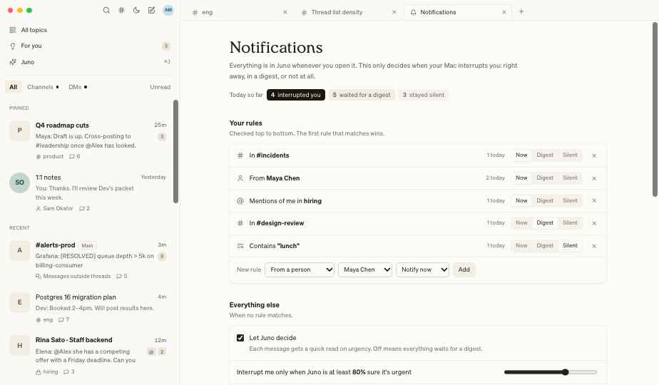

# Juno

A calm, topic-first desktop client for Slack. Product and design spec for the build.

Version 1 · October 2026 · Owner: Tushar · Prototype: Threads v3.dc.html

**How to read this.** This is a product and design doc, not a technical plan. It describes what Juno is, how every surface behaves and how it should look and feel. The build is expected to reverse-engineer the Slack desktop client's data access and run as an Electron, React and TypeScript app, styled with StyleX, using pi-ai with the OpenRouter provider for AI. Implementation choices beyond that are open.

## 1. What Juno is

Juno is a personal Slack client for someone who manages people and gets pulled in many directions. It reads and writes real Slack data, but reorganizes it around **topics** instead of channels. A topic is a Slack thread, or the unthreaded stream of a channel or DM. The sidebar is a single list of topics with recent activity, shown like a WhatsApp chat list: one wide row per topic with its title, the latest message, where it lives and who is in it.

It borrows the thread-first discipline of Zulip, the simplicity of WhatsApp and the polish of Slack. Anything quiet, resolved or irrelevant gets out of the way. AI helps manage and orchestrate. It names topics, catches you up, routes messages to the right thread, decides when to interrupt you and suggests next steps. It never writes on your behalf unless you ask, and it never sends anything without your confirmation.

*Figure 1. The main window. The sidebar holds topics, the right side holds tabs. Here a topic is open at its "new" divider with a catch-up summary.*

## 2. Principles

1. **Calm by default.** Show less. Unread counts are soft grey, not black badges. Nothing shouts. The interface relies on whitespace, not lines.
2. **Topics, not channels.** You think in conversations. Channels and DMs are filters and context, not the primary navigation.
3. **Quiet things disappear.** No activity for 7 days, resolved or unsubscribed means the topic is gone from the sidebar until something new happens. Everything stays reachable from All topics and ⌘K.
4. **Always know where you are posting.** Public, private and DM contexts are visually distinct on every topic, so private things never land in public channels by mistake.
5. **AI manages, you write.** AI organizes, summarizes, routes and gates. It does not ghostwrite. Every outbound action it proposes waits for a click.
6. **Fast to clear.** Resolving is one hover and one click, with an undo toast and ⌘Z.
7. **Feels native.** It should feel like a well-made macOS app, not a web page. See section 15.

## 3. Mapping Slack to Juno

Slack has no concept of a topic. Juno builds one on top of Slack's data. Anything Juno adds that Slack does not have, like titles, resolution and groupings, is stored only on the client and never written back to Slack.

| Slack | Juno |
| --- | --- |
| Public or private channel | A container of topics. Used as a filter and as context, never as the main list. |
| DM and group DM | Treated exactly like a channel. A DM has a Main thread and can have topics too. |
| Thread (a message with replies) | A **topic**. Its first message is the thread root. |
| Top-level channel messages that are not in a thread | That channel's **Main** thread, one per channel or DM. Rows read "#eng" with a small Main tag, never a bare "Main thread". |
| Replying in thread | Replying inside a topic. From Main, "Reply in thread" turns that message into a topic. |
| Follow / unfollow thread | Subscribe / unsubscribe. Unsubscribed topics leave the sidebar. |
| Mark unread | Works on a topic or on a whole channel. |
| Quote (the ">" prefix) | Rendered as a soft quote block. Quoting inserts ">" lines. There is no separate reply object. |
| Not in Slack | Client-only: topic titles, resolved state, pins, stealth reads, groupings of Main messages, ignored channels, notification rules, channel icons. |

### Topic titles

Titles resolve in this order. A title you set by renaming (stored in Juno only) comes first. Next is a title generated by AI. Last, as a fallback while AI hasn't run, the first six or so words of the first message. A small sparkle beside the header title marks an AI title. Renaming always wins, and a context menu option brings back the AI title.

## 4. Window and layout

- **Two panes.** A fixed sidebar about 384px wide on the left, and a tabbed workspace on the right.
- **Title bar.** The macOS traffic lights sit in the sidebar's top bar. The workspace's top bar is the tab strip. Both bars are window drag regions.
- **Workspace tabs** work like browser tabs. The "+" button is labelled "New tab" and opens search (⌘K) from M9; until then it opens All topics in a new tab. Every page opens in a tab: a topic, All topics, For you, Juno, Notifications or Preferences.
- **Home.** With no tab open, the workspace shows a calm home: a small scene with Juno's mascot that changes with the time of day, a short greeting, at most three items that want you (computed from data, sharpened by AI when it is on), an "Ask Juno…" field, and an all-caught-up scene when nothing needs you. Design: `docs/design/home/` (layout A).
- **Reading width.** Message columns are capped around 800px and centered, so long lines stay readable on wide windows.

## 5. Sidebar

### Top to bottom

1. **Title bar icons**: Search (⌘K), Browse channels and people, Theme, and your avatar. The avatar menu holds status, Notifications, Preferences, AI assist, switch workspace and sign out. There is no footer and no name label.
2. **Navigation**: All topics, For you (with a quiet count) and Juno (⌘J). A properly spaced hairline separates these from the list.
3. **Quick filters** on one row: All · Channels · DMs on the left and an Unread toggle on the right. DMs include group DMs. There are no counters or dots on Unread. A small dot appears next to Channels or DMs when that group has unread topics you are not viewing.
4. **Scope chip**, shown only when narrowed to one channel: "#eng ×". Narrowing is rare and happens from Browse channels or ⌘K.
5. **The topic list**: Pinned first, then Recent, sorted by latest activity. A tweak can group the list by channel instead.

### Row anatomy

Each row is a tile followed by three lines. The tile is the topic's art: a small AI-drawn illustration about what the topic discusses, with no container. Every topic gets one, including a channel's Main and threads inside DMs. Until the art exists, or when AI is off, the tile shows a calm free-form placeholder shape picked per topic. A DM's Main shows the person's Slack profile photo instead (coloured initials when there is no photo). Line one is the title and time. Line two is a two-line preview of the latest message as "Sender: text", with any ">" quote lines stripped. Line three is meta: channel icon and name, a small stack of participant avatars, and tags such as Main or Reopened. There is no message count and no "messages outside threads" label. A Main row may also show a thread icon with the number of threads started in that channel since you last read its Main, hidden when zero. Unread topics have a semibold title and a soft grey count tag. Mentions of you get a quiet "@" tag. Row style (chat, list or cards), density and preview lines are tweaks. Chat is the default.

### What shows up

- **Which threads.** The sidebar shows threads you follow, plus any thread with an unread mention of you. Following is Slack's "Get notified about new replies": you follow a thread when you start it, reply, are mentioned, or subscribe. Other threads are not in the sidebar. They are reachable from their channel's Main (as thread links), All topics and ⌘K. Subscribing to one from there adds it to the sidebar.
- **Subscribe works on any thread.** Subscribe and unsubscribe are mirrored to Slack's follow state.
- **First sign-in.** Threads you do not follow start as read, so Juno does not open with hundreds of unread topics. Followed threads and Main keep Slack's unread state.
- **Quiet.** Topics with no activity in the last 7 days are hidden unless pinned or unread. The window can be configured.
- **Resolved.** Resolved topics are hidden until a new message arrives, which brings them back tagged "Reopened".
- **Unsubscribed.** Unsubscribed topics are hidden from the all-topics view.
- **Ignored.** Ignored channels, such as noisy alert or deploy channels, are hidden everywhere in Juno and never notify.
- **Main threads** follow the same rules. A channel's Main appears only when the channel had recent activity of any kind, including replies in its threads. A channel with no recent activity simply does not appear.

*Figure 2. Right-click a row for the full set of actions.*

### Row actions

- **Hover** (or keyboard focus) shows an icon-only **Resolve** button (a check) at the right end of the meta line. The time stays in place, and the button's slot is always reserved, so nothing shifts. Its tooltip and accessible name say "Resolve" (with the topic title for screen readers). Resolving hides the row, marks it read and shows a toast with Undo. ⌘Z also undoes. Main threads resolve the same way.
- **Context menu** (right-click, or the context-menu key):
  - Open in new tab (⌘-click)
  - Open in stealth
  - Rename
  - Use AI title
  - Mark as read or unread
  - Pin
  - Subscribe or unsubscribe
  - Resolve or reopen
  - Copy Slack link
  - Open in Slack
  - Ignore #channel
- **Channel context menu** (from Browse channels): Show its topics, Open Main, Open Main in stealth, Mark channel as read or unread, Change icon and colour, and Ignore channel.
- **Peek.** Hold the peek key while the pointer is over a sidebar row and the topic opens in a popover to the right of the sidebar. It is read-only and scrolls, and it does not mark anything read, open a tab or move focus, so you stay where you were. Moving to another row while holding the key switches the peek; releasing it closes the popover. The key defaults to ⌥ Option, which works while you type; Preferences can change it to Space, which works only when no text field has focus. (Fn is not offered: macOS does not report it to apps reliably.)
- **Rename** happens inline in the row or the topic header. Enter saves and Esc cancels.
- **Undo toasts** appear bottom-left for reversible actions only. Info-only toasts like "Prompt copied" never show Undo.

## 6. Opening things and tabs

- Everything opens in the **current tab**. A new tab opens only on ⌘-click or "Open in new tab".
- If the topic is already open in another tab, that tab is focused instead of opening a duplicate.
- Tabs carry the channel icon and title, or the channel name for a Main thread. Closing a tab focuses its neighbour.
- **Stealth** opens a topic without marking it read. The tab shows an eye-off icon. The header shows "Stealth. Not marking as read." with a Mark read button. Sending a reply ends stealth.

*Figure 3. A private-channel topic opened in stealth. The amber context pill marks the private channel.*

## 7. Topic view

### Header

- A **context pill** shows the channel and its type:  This is the main defence against posting in the wrong place, so it is always visible. People and message counts are deliberately left out.
  - **Public channel:** neutral.
  - **Private channel:** warm amber.
  - **Direct message or group DM:** soft blue.
- The title, with a sparkle if AI-generated. Double-click to rename.
- Actions on the right: Pin, Subscribe (bell), Resolve or Reopen, and More (the same menu as the row).

### Messages

- **Styles.** Flat Slack-style messages by default. WhatsApp-style bubbles are a tweak. Consecutive messages from the same person group under one header.
- **Where it opens.** A topic opens at a "N new" divider when it has unread messages, otherwise at the bottom.
- **Mentions.** @people and #channels render as soft chips. Mentions of you get the accent colour and a lightly tinted message background. Clicking a #channel filters the sidebar to it.
- **Hover toolbar:**  Reactions are toggleable chips under the message.
  - Three one-click reactions (👍 ✅ 👀).
  - A full emoji picker.
  - Quote.
  - In Main threads, Reply in thread.
  - More: Edit and Delete on your own messages, Copy Slack link and Open in Slack.
- **Keyboard.** ↑ in an empty composer selects the newest message; ↑ and ↓ move the selection, and Esc returns to the composer. On your own selected message, E edits it inline and Delete or Backspace deletes it after one inline confirm (Enter confirms, Esc cancels).
- **Quoting** follows Slack. Quoting inserts "> " lines into your reply. Selecting any part of a message shows a floating Quote button that quotes only the selection.
- **Thread links.** In Main, a message that has a thread shows a small "2 replies · Title ›" link under it.

### Main thread

Main is the unthreaded stream of a channel or DM. It reads "#eng · Main" in the header. AI may notice a run of messages that belong together. It then offers "Group into topic" with a suggested title. Grouping is client-only, and Slack still shows the messages in the channel.

*Figure 4. The #eng Main thread. At the top is a grouping suggestion. Lower down is a message that already has a thread, shown with a link.*

## 8. Composer

- **Shape.** A single line with a + attach button on the left and a round send button on the right. It grows with content to about 8 lines, then scrolls inside itself.
- **No helper text.** Shortcuts like @, # and Enter to send are obvious and not spelled out. The channel is not repeated above the composer, because the header pill already shows it.
- **Mentions.** Typing @ suggests people and # suggests channels, with arrow keys and Enter or Tab to pick.
- **Audience check.** When what you type reads like hiring or people details and the channel is public, a quiet amber line warns you as you type.

### Checks on send

Pressing Enter runs fast checks before anything goes out. If they find nothing, the message just sends. If they flag something, a compact bar appears inside the composer. Enter takes the first option and Esc returns to editing.

1. **Wrong place.** In a Main thread, your message is compared against the last 3–4 topics in that channel. If it looks like a reply to one, you get "Looks like a reply to *Staging bill doubled since August*", with Post in thread or Send to Main.
2. **Clarity.** Catches typos, doubled words, a lowercase "i", a missing question mark and very long sentences. Offers Fix and send or Send as is. Fixes are minimal corrections, never rewrites.

*Figure 5. The route check catching a reply typed into Main.*

*Figure 6. The clarity check listing fixes before sending.*

## 9. Removed

Removed on 10-14: open a channel, DM or group’s Main from the sidebar kind icon or search (⌘K) and post there; a separate page is redundant, and reply tracking is unreliable and out of scope.

## 10. Search and commands (⌘K)

- **Search.** ⌘K searches topic titles, message text, channels and people. With an empty query it shows recent topics.
- **DMs.** A person's result reads "Message Maya Chen" and opens your Main with them.
- **Commands.** Natural-language input is recognised as a command:  The command appears as the top result with a small confidence badge. Enter runs it.
  - "tell maya …" or "post in #eng …": an instant send card.
  - "summarize …" or "what did I miss": opens Juno with that request.
  - "resolve pricing": resolves the best-matching topic.
- **Keys.** Arrow keys move the selection. ⌘Enter opens a result in a new tab.

*Figure 8. "tell maya the wednesday slot works" becomes a send action.*

## 11. All topics

A full page in a tab, listing everything: quiet, resolved, unsubscribed. Status chips with counts (All, Open, Resolved, Quiet, Unsubscribed). Filters for channels or DMs, a specific channel and sort order (most recent, oldest, most messages), plus a text filter. A table shows the topic and preview, where it lives, status, message count and last update. Rows open topics and carry the usual context menu, so reopening and resubscribing happen here. The topic column keeps a minimum width and the table scrolls sideways on narrow windows.

*Figure 9. All topics.*

## 12. For you

The surface for proactive suggestions. It is separate from the Juno chat, where Juno speaks only when you ask it or about something you set up (section 13). Each card has a type, a source topic, a title, a short body and actions, and can be dismissed. Card types:

- **Coding agent.** A ready prompt drawn from a discussion, with Copy prompt and Refine with Juno.
- **Waiting on you.** A thread that needs your reply, with short reply starters.
- **Reply ideas.** A few directions to start from. Clicking one opens the topic with it in the composer.
- **Follow-up.** Something you said you would do, with Mark done.
- **Tidy up.** Topics that look settled, with Resolve all.

"Ask Juno" on a card switches to the Juno chat and asks there.

*Figure 10. For you.*

## 13. Juno Agent

Juno is also the assistant's name. It is one long chat with one assistant that reads your topics, answers from memory of everything you have told it, and acts for you through connections (Slack, Notion, Littlebird, T3 Code) when you ask. The chat looks like a messaging thread: your bubbles and Juno's, nothing else. Tool calls, delegation and the machinery that does the work stay behind the conversation. Juno is a standalone module with its own state, so the same chat can later run on other surfaces; in v1 it lives in the Juno tab.

*Figure 11. The Juno chat.*

### 13.1 The chat

- **One thread.** There is no "new chat". Everything you and Juno have said is in one scrolling list, with day separators and the "New" divider before the first message you have not seen. Opening the chat lands at the divider, otherwise at the bottom. A "New message" pill appears when you are scrolled up and something arrives.
- **Four kinds of thing on screen:** your bubbles, Juno's bubbles with their cards underneath, one status bubble while Juno is working, and separators. Quiet one-line notes ("Remembered · Undo", "Removed") sit between bubbles.
- **Bubbles.** Yours are right-aligned in the owner fill, whose colour is still the owner's choice (section 19). Juno's are left-aligned on the hover surface, with the 28px mark beside the last bubble of a group. Consecutive messages from the same sender within two minutes group, and the last bubble of a group has the small tail. A message with a different origin (your reply, a schedule, a job) always starts a new group. Times show on hover. Text is selectable.
- **Plain text.** Juno writes short plain text with no markdown and no emoji. A recall answer cites the day ("On 12 Mar you said …") and the citation scrolls the chat to that message.
- **"This"** means the topic you were last viewing.
- **Empty state.** "What do you need?" with the seated-j illustration, one line on what Juno can do, and four suggestion pills. Clicking one sends it.
- **Composer.** Enter sends, Shift Enter adds a line. Sending while Juno is working is allowed: the message queues and Juno reads it mid-task (13.5).
- **Context menu on a message:** Copy, Remember this (on your own messages), Remove. Remember this pins the selected text when there is a selection inside the message, otherwise the whole message; it is disabled when that is longer than a sentence (280 bytes). Remove opens a local sheet (13.8) that works in every state, including paused, offline and AI off.
- **Read.** A Juno message counts as read once its bubble has been fully on screen in the focused chat for one second. Opening the chat does not read what is below the fold.

### 13.2 Working

- **Acknowledge at once.** Your bubble appears before the send is stored. The status bubble appears within a tenth of a second: three looping dots, like someone typing.
- **Status text.** The dots stay alone until Juno has something specific to say. The first tool call gives the bubble a line that counts real things ("Reading 3 topics", "Looking back through March"), which changes at most every two seconds. "Thinking" and percentages never appear.
- **The reply takes the bubble's place.** On the first token the status bubble becomes Juno's reply, in place, and the text streams in. If Juno then reads or calls something before writing more, the status bubble reappears below the reply, and the next token clears it again: the text joins the same bubble, so one reply is one bubble however many steps it took.
- **One status bubble, for runs only.** It exists while Juno is answering you, a schedule or a job report, and clears when that run ends. Work that goes on in the background (a T3 Code session, a delegate) never shows as the typing bubble; it has a Task card (13.4) and the sparkle on the sidebar's Juno row.
- **Stop.** Hovering or focusing the status bubble shows Stop. Esc with the composer empty does the same. Stop ends the current run only, never a background job. The reply ends with "Stopped. Juno won't start anything new for this reply." Anything Juno handed off before Stop may still finish, and its card says how it ended.
- **A run that fails says so.** If the provider does not answer, the line under the reply says what happened and offers Try again: "Juno didn't answer. Give it a moment and try again." A run that ends before its first word shows only the line (13.7).

### 13.3 Cards

Anything that leaves Juno, or that Juno wants you to decide, is a card under its bubble. The card shows exactly what will happen and runs once, after a click. Typing "yes" is not a click. The set is fixed; the model cannot invent a card.

| Card | Shows | Buttons | Afterwards |
| --- | --- | --- | --- |
| Send message | One to five messages, each with a context pill for where it goes, "in {topic}" when it replies inside a thread, and editable text | Send (all), Dismiss | Per row: "Sent · Open" or "Not sent · Try again". The card itself says "Sent 3", "Sent 1 of 3" or "Not sent · Try again" once every row has settled, and stays working until then |
| Resolve | The topics | Resolve, Dismiss | "Resolved 3 · Undo" |
| Topics | Links to topics; click opens, ⌘ click opens a tab | none | none |
| Task | A job: its title, where it runs, a live state line ("Tests running, 2 of 5") | Open, Stop | "Done · Open PR 412", "Failed · Show in Activity", "Stopped", or "Juno can't tell whether this is running. Open" |
| Proposed task | The same, for work Juno may not start on its own (13.9) | Start, Dismiss | "Started", then a Task card under Juno's next message |
| Question | Who asks ("Juno asks", "T3 Code asks" with the job's pill), the question, two to four options, and a reply field | An option, Reply | "You chose …" or "You replied" |
| Schedule | What, when, how it delivers | Keep, Pause, Delete | "Kept", "Paused" or "Deleted" |
| Proposed schedule | The same, plus the instruction Juno will follow at each run, word for word, for a schedule Juno may not create on its own (13.9) | Start, Dismiss | "Started" |
| Connect | The server, the scopes and one line on what leaves the machine | Connect, Skip | "Connected" |
| Change | The server, the target, and the fields that change with their new values, rendered from the payload | Apply, Dismiss | "Applied · Open" |
| Remove | Only when Juno proposes a removal ("forget what I said about the offsite"). The messages, "Also remove Juno's reply" when the next message is Juno's, and the line that copies already sent to the provider cannot be recalled | Remove, Keep | "Removed 2 messages" |
| Budget | Today's spend and the cap | Allow $1 more today, Wait until tomorrow | "Allowed until midnight" |
| Provider | "Choose a model provider": OpenRouter or Codex, with the fixed line that Juno sends its memory of the chat to the provider on every turn | Set up | "Using Claude Sonnet 5.5" |

- **Because.** When Juno proposes a card for something it would otherwise have done quietly (because a message it read in Slack or a report from a job was in the conversation, 13.9), the card carries one line saying why.
- **One click, one action.** A click authorizes exactly the payload shown, once. A retry is a new click. If Juno cannot tell whether a send landed, the row says so: "Juno can't tell whether this was sent. Check channel · Send again". Every retry of something the destination cannot recognise as a repeat (Send again, Try again) says "If the first try went through, this does it again." beside its button, whatever happened the first time.
- **Expiry.** Cards expire after seven days or when what they refer to changes: "Expired · Ask again". Ask again sends Juno a message quoting the card's request, so a fresh card follows from a fresh read.
- **Restored.** After a restore from backup (13.8), each pending card reads "This may already have happened." above its buttons until you decide it.
- **Keyboard.** Every card button is reachable with Tab, and the first option of a question takes Enter.
- Cards sit at full column width, with rounded corners, the soft shadow in light and the ring in dark. They fade in at full size and never change height while entering.

### 13.4 Delegated work

Juno hands long work to delegates: a T3 Code session for code, or a cheaper copy of itself for a side task. Juno speaks for them; you never talk to a delegate directly.

- **Starting** a session you asked for needs no click while Juno has not read Slack, a connection or a session report in this reply (13.9); otherwise Juno proposes it as a card with Start. Sessions run with full access, each in a new worktree. The Task card appears under Juno's message with the live state line, Open and Stop. The sidebar's Juno row shows the duotone sparkle while any job runs, and the home's Ask Juno field reads the job's state line in place of its placeholder.
- **Milestones as messages.** Juno posts once each when a job starts, needs a decision, finishes (with the PR), fails, or has been quiet for 30 minutes ("T3 Code has been quiet for 30 minutes. I'll keep watching, or you can stop it."). Reports that arrive together are one message.
- **Questions from a session** become a Question card headed "T3 Code asks", so you know the answer goes to the session. Juno never merges or pushes.
- **"How is it going?"** is answered from what Juno knows of its jobs, without a card.
- **Telling a running session something** ("also fix the tests") needs no click under the same rule, for a session you started in this chat. After Pause and Resume it needs a card again. Stopping a session is the Task card's Stop, and nothing else stops it.
- If the T3 Code sign-in lapses while a session runs, the session keeps running and the Task card says "Sign in to T3 Code to keep watching".

### 13.5 Steering and interruptions

- **Typing sends.** A message sent while Juno is working shows "Queued" under it after half a second and Juno reads it at its next step, inside the same run. Juno acknowledges it in its reply.
- **Stop with a queued message** ends the run; the queued message then starts a fresh run on its own. Queued never becomes Not delivered.
- **Juno never speaks over its own question.** While a Question card of Juno's is open, scheduled messages wait, until the question is answered, expires, or 24 hours pass. Reports from jobs do not wait.

### 13.6 Proactive

Juno speaks on its own only about things you set up: schedules you asked for, progress of work you started, and things you told it to watch. Never observations.

- **Schedules.** "Catch me up on #eng every weekday at 9" creates a schedule only from a clean conversation with you, and the Scheduled page lists them with the next run, how each delivers, Pause, Edit and Delete. Limits: 20 active, at least 15 minutes apart, one-shot at most a year ahead. A schedule nothing has touched for 30 days pauses itself and says so once.
- **The label.** A proactive group carries a small uppercase label ("Scheduled · Daily catch-up", "T3 Code · Fix the sidebar flake") with "Why this?" and one quiet action: "Pause schedule" on a schedule's group, "Mute updates" on a job's group. Mute updates stops the milestone messages; the job runs on and stops only from its Task card. Reports from several jobs that arrive together are one message, labelled "T3 Code · 2 jobs".
- **Monitors speak only on change.** A wake that finds nothing new says nothing in the chat; Activity records that it ran.
- **Delivery.** The chat always gets the message. Whether your Mac notifies follows section 14.

### 13.7 States

Every state the chat can be in, and what it shows.

| State | What shows |
| --- | --- |
| Empty | "What do you need?" with the illustration and four suggestion pills |
| Idle | Nothing extra |
| Running | The status bubble |
| Queued | "Queued" under your last bubble, after half a second |
| Waiting | "Waiting for network", "Waiting for Resume" or "Waiting for your review" under your bubble. The message is stored and runs when it can |
| Not delivered | "Not delivered · Try again". Only when Juno could not store the message on this Mac. Try again resubmits the same message |
| Too long | "That is too long to send as one message. Split it up and send the parts." The message stays in the chat, marked not sent |
| Stopped | "Stopped. Juno won't start anything new for this reply." under the reply |
| Interrupted | "Juno was interrupted. Your message is kept. Try again". No Try again when a schedule or a job started the run |
| Failed | One line and Try again: "Juno didn't answer. Give it a moment and try again.", "OpenRouter rejected the key. Check it in Settings.", "Codex is signed out on this Mac. Sign in to Codex and try again.", or "Juno lost the connection. Try again when you are back online." |
| Blocked | "Juno can't fit this in one request. Removing a pin or starting a smaller task helps." No card |
| Budget reached mid-reply | "Juno has used today's budget." under the reply, with the Budget card |
| Offline | A chip, "You're offline". The composer works and a send that needs the network waits. Schedules that fall due offline run once when back |
| No provider | A Provider card: "Choose a model provider" |
| Budget reached | A Budget card |
| Paused | A header chip, "Juno is paused · Resume". The composer works and messages wait for Resume |
| AI off | One line, "Juno is off. Turn on AI assist in Settings." The composer is disabled and schedules show as paused |
| Expired card | "Expired · Ask again" |
| Recovery | A chip, "Juno restored from backup · Review". The composer works and sends wait for your review (13.8) |
| Update needed | A chip, "Juno needs an update": Juno's records are newer than this build. Nothing runs and nothing is lost. The composer is disabled |
| Another device | "Juno is working on your other Mac." The chat is read-only |
| Removal pending | A Settings line, "Removal pending · 1 copy in a running job · Stop job", until the copy is gone (13.8) |
| Secret blocked | A quiet line where Juno would have acted: "Juno stopped a tool call that held a key or a token. Nothing was sent." |

The header shows one chip at a time. When several apply, the order is: another device, update needed, recovery, AI off, paused, offline.

Failures follow one rule: say what failed, what is kept safe, and one action. Every such line is fixed copy; Juno never writes its own failure line. Technical reasons live on the Activity page behind "Copy details", never in the chat. Silence is a failure: if Juno cannot answer, a line says so.

### 13.8 Memory

Juno remembers the whole chat. Older parts are kept as a summary that grows denser with age, and the full text stays on disk, so Juno can look back at any day and quote it.

- **Recall** answers cite the day and scroll to the message.
- **Remember this** (on your own message, or "remember that …") pins the exact words, up to a sentence, and shows "Remembered · Undo". Undo stays until your next message or for a minute, whichever is first. Pins come only from your own messages; from the context menu, the pin is the selection or the whole message (13.1). **What Juno remembers** lists them for editing; an edit replaces the pin with your words.
- **Forget** as a correction is a message ("forget the Wednesday slot"); Juno confirms in words. **Remove**, from a message's context menu, opens a local sheet that works in every state: it deletes the message, everything Juno derived from it, and pending actions that saw it. The chat shows "Removed" where it was. Juno's later replies that quote it stay unless you also remove them. Copies already sent to the model provider cannot be recalled, and the sheet says so. A removal Juno proposes is a Remove card with the same text.
- **Memory of this chat** shows Juno's summary as a dated timeline. Lines being rebuilt after a removal read "being updated".
- **One Mac at a time.** Juno's state lives on this Mac with an encrypted backup in a folder you choose (under the app's data folder by default). Moving to another Mac is a handover from the old one. A restore from backup opens in recovery (13.7) until you review what was pending.
- **Move, restore and activate.** Settings › Juno shows who owns Juno's state, and offers "Export recovery phrase", "Move to another Mac" and "Restore from backup". Move finishes what is running, makes this Mac read-only, writes a final backup and shows a move code; the other Mac restores from it, shows the code of the backup it found, and takes over once you confirm the two codes match. Restore without a move asks you to confirm the old Mac is off, erased, or has Juno removed, and says Juno cannot check this: "If Juno is still running on the old Mac, both Macs can act until it sees this Mac's backup, which happens only if they share a backup folder." Either way Juno opens in recovery: nothing runs, the header chip offers Review, and the Review page lists every pending card with "This may already have happened." Approve the ones you still want, then press "Activate Juno". Cards still open are expired.
- **Removed messages and an older backup.** When Juno restores on a new Mac without a move code, and "Rotate recovery phrase after removals" is off, it cannot tell whether the folder holds your newest backup. The Review page says: "Juno can't check that this backup is the newest. If the folder is out of date, messages you removed may come back. You can remove them again."

### 13.9 Trust

| Tier | What | Rule |
| --- | --- | --- |
| Read | Reading topics and channels, lookups in Notion, Littlebird and T3 Code, looking back in memory | No click. Folded into one line on Activity |
| Local | Remember, schedules from a conversation with you, notifications to you | No click. Undo where one applies |
| Work you asked for | Starting, steering or stopping a T3 Code session or a delegate | No click while Juno has not read Slack, a connection or a session report in this reply. Otherwise a card |
| Outward | Sending to Slack, resolving, writing to Notion or Littlebird, answering a session's approval request, any connection tool not on its read list | Always a card, every time, once per click |
| Destructive | Deleting, merging, force-pushing, buying | Not offered at all |

- **Untrusted content.** Anything Juno reads from Slack, a connection or a delegate can contain instructions. Once such content is in the conversation, the no-click rules for the Work tier stop for that run and Juno proposes cards instead, with a Because line. Only you can move a connection tool between Read and Outward, in Settings › Connections.
- **Secrets.** Juno never puts a key or token into a tool call or a brief. A match is blocked and a fixed line says so (13.7).
- **Four ways to stop.** Stop (this reply), Pause Juno, a connection's own switch, and the global AI assist switch (section 15), which turns the chat off entirely. Pause stops the current reply, asks every running session and delegate to stop, and starts nothing new; the composer still works and messages wait for Resume. After Resume, telling a session something needs a card again, because Pause revokes what the conversation had allowed.
- **Activity** lists every run: who asked, when, the outcome, each action from the Local tier up with the decision made, and one folded read line. Failures are in plain words with "Copy details".
- **Settings are yours.** Models, the spend cap, rules, tiers and connections change only in Settings. No conversation can change them.

### 13.10 Settings and pages

The Juno header menu opens Scheduled, What Juno remembers, Memory of this chat, Activity, Connections and Settings › Juno. **Settings › Juno** holds the chat model (the newest of Claude Sonnet, Claude Opus, Muse, GPT Sol or Grok, resolved from the provider's catalogue; Sonnet by default), the compaction model, today's spend and the daily cap ($2 by default), the OpenRouter key (with a line when the provider rejected it) and Codex status, your rules, Pause, the backup folder with "Rotate recovery phrase after removals" (off by default), and who owns Juno's state with Export recovery phrase, Move to another Mac and Restore from backup (13.8). **Connections** shows each server's state, the address in use, and the tools it offers with their tier. The T3 Code row also holds its address and the switch "Allow T3 Code over the local network", off by default; over the network only an https address works, so with the switch off Juno uses T3 Code on this Mac only.

### 13.11 Writing

Section 17 applies. Juno says "I" only in its own bubbles (proposed; section 19); the app around it has no voice. Status lines are present tense and name real things. Card buttons start with a verb. Juno never apologizes, exclaims or jokes.

### 13.12 Performance

Your bubble within a frame of Enter. The status bubble within 100ms. First status text or first token within 1.5s on OpenRouter (a Codex turn is slower and shows the dots meanwhile). A 5,000-message chat opens within the list budget in `docs/performance.md`.

### 13.13 Not in v1

Destructive actions and purchases, a mobile surface, more than one person in the chat, live sync across two running Macs, and messages Juno sends on its own that you did not set up.

## 14. Notifications and preferences

Everything is always visible when you open Juno. Notification settings only decide when the operating system interrupts you, which is the main fix for constant pings during a manager's day. Each incoming message gets one of three outcomes:

- **Now:** an OS notification right away.
- **Digest:** bundled into the next digest time.
- **Silent:** no notification.

- **Your rules** come first, checked top to bottom, and the first match wins. A rule matches a person, a channel or DM, mentions of you in a channel, or a keyword. Each rule shows how many messages it caught today.
- **Everything else** is decided by Juno. A threshold slider sets how urgent a message must look before it interrupts you. Turning Juno off sends everything to digest.
- **Digest times** are editable chips. **Quiet hours** hold everything except rules set to Now.
- **Today** is a log of messages so far with the decision and why, for example "Rule: In #incidents" or "Juno · 89% urgent". It updates live as you change rules.

**Juno's own messages** (section 13.6) skip the person, channel and keyword rules and follow this table instead. Quiet hours hold them too, except schedules set to Now. The chat always gets the message; this only decides whether your Mac notifies.

| Juno message | OS notification |
| --- | --- |
| A scheduled message | As the schedule says: Now, Digest or Silent, set from your words and editable on Scheduled |
| A job needs a decision, failed, or has been quiet for 30 minutes | Now |
| A job you started finished | Now |
| A job started | Silent |

*Figure 12. Notifications.*

**Preferences** holds the **ignore list** for noisy channels such as alerts and deploys. Ignored channels are hidden from topics, search and All topics, and never notify. Nothing changes in Slack. You can also ignore a channel from any context menu, with undo.

*Figure 13. Preferences and the ignore list.*

## 15. AI system

Split the AI work into two kinds. **Decisions** are fast, cheap and structured: a choice, a score or a probability, in well under a second. They can run on every message and every send. **Generation** is a language model producing text, used sparingly. A decision-model approach (such as TypeSafe's Jev) suits the first kind. A general model through OpenRouter suits the second. Show nothing unless a decision is confident, and use calibrated thresholds so the UI stays quiet.

| Feature | Kind | When it runs | Shows when |
| --- | --- | --- | --- |
| Topic titles | Generation | New thread, and on drift | Always, with a sparkle |
| Group Main messages | Decision | Each new Main message | Run of 3 or more, high confidence |
| Wrong-place check | Decision | On send in Main, against the last 3–4 topics | Likely reply to one of them |
| Clarity check | Decision plus minimal fixes | On send | Concrete fixes found |
| Audience check | Decision | Typing pause | Sensitivity does not fit the channel |
| Settled, suggest resolve | Decision | Each new message | High score |
| Notification gate | Decision | Each incoming message, after rules | Never in the UI, only as an outcome |
| Command routing (⌘K) | Decision | As you type in ⌘K | Clear intent and target |
| Catch-up summary | Generation | Opening a topic with 2 or more new | At the "new" divider |
| For you cards | Both | In the background | On the For you page only |
| Juno chat | Generation with tools | On request, and for schedules and jobs you set up | In chat, with action cards (section 13.3) |

Things AI must not do: send anything without a click, rewrite your voice, add "needs you" style labels to the sidebar, or create noise to look helpful. A global AI assist switch turns off every AI surface, the Juno chat included.

The Juno chat runs apart from the decision features: its own process, its own memory, and a chat model you pick in Settings (section 13.10) from OpenRouter or a local Codex. The decision features keep the fast path above.

## 16. Visual system

Use the Littlebird design system's tokens.

- **Colour.** Warm paper backgrounds (hsla 48 50% 98%). Warm near-black text. Nearly invisible borders. A single accent, near-black by default. Midnight blue, dark emerald, claret and cyan are optional tweaks.
- **Type.** Söhne for UI and Meraki serif only for page titles such as "All topics", "For you", "Notifications" and "Preferences".
- **Icons.** Lucide outline icons, tinted with the surrounding text colour.
- **Radii.** 6–10px. Inner and outer radii nest, so the outer radius equals the inner radius plus the padding.
- **Surfaces.** Popovers, menus and toolbars float on a layered shadow ring, not a hard border. Cards use a 1px shadow ring. Inputs keep a soft border.
- **Bubbles** (the Juno chat, section 13.1). Yours take the owner fill, pending the owner's choice between the four options in `docs/design/juno-chat/` (section 19); Juno's take the hover surface. Radius 16 with a 4px tail corner on the last bubble of a group, text at 14px, at most three quarters of the column wide. Cards under a bubble take the card radius, the soft shadow in light and the ring in dark.
- **Context tints** for channel types: neutral for public, amber for private, blue for DMs.
- **Dark mode** uses the cool near-black system palette. Switching theme suppresses transitions so colours change in one frame.

*Figure 14. Dark mode.*

### Feels native

- **No pointer cursor.** Use the default arrow cursor everywhere, including buttons, rows, tabs and menu items, as macOS apps do. The text cursor appears only over editable text. Never set `cursor: pointer`.
- **Real menus.** Use native right-click context menus and the context-menu key on every row, tab and channel.
- **Instant feedback.** High-frequency interactions get instant feedback or at most 150ms on background colour. These include row hover, tab switching and typing. Buttons scale to 0.96 when pressed, never when disabled.
- **Hover only with a pointer.** Hover styles apply only on devices with a hover-capable pointer.
- **Contained scrolling.** Scroll stays inside menus, popovers and the palette, and never scrolls the page behind.
- **Text selection.** Text is selectable in messages and not in chrome.
- **Window chrome.** Window controls and drag regions follow macOS: traffic lights in the sidebar bar, and the tab strip as a drag region.

### Accessibility and polish

- **Keyboard.** Every row, tab, menu item and card action is reachable by keyboard. Hover-revealed actions also appear on focus.
- **Focus.** A visible 2px focus ring in the selection blue, shown for keyboard focus only.
- **Names.** Icon-only buttons have accessible names that describe the action.
- **Contrast.** Body and meta text meets 4.5:1. The muted grey is darkened in light mode to get there.
- **Motion.** Motion respects reduced-motion settings.
- **Numbers.** Times, counts and table numbers use tabular figures.
- **Empty states** say why they are empty and offer one next step, such as "Clear filters" or "View all topics".

## 17. Writing

- **Case.** Sentence case everywhere.
- **Buttons** are short and start with a verb: Resolve, Send, Post in thread, Fix and send.
- **Relative time:** 4m, 2h, Yesterday, 3d.
- **Emoji.** None in chrome. Users' messages are their own.
- **Undo over confirm.** Prefer undo to confirmation for reversible actions. Toasts read "Resolved · Postgres 16 migration plan · Undo".
- **Main thread labels** always say whose Main it is: "#eng · Main".
- **The "#" prefix.** Don't repeat the channel # in text when a hash icon is already beside it.

## 18. Keyboard shortcuts

| Keys | Action |
| --- | --- |
| ⌘K | Search and commands |
| ⌘J | Open Juno with the composer focused. Inside the chat, focus the composer |
| ⌘Z | Undo the last resolve, unsubscribe, ignore or routed post |
| ⌘ click / ⌘ Enter | Open in a new tab |
| ↑ in an empty composer, then ↑ ↓ | Select a message. E edits and Delete or Backspace deletes your own selected message |
| Hold ⌥ (or Space) over a sidebar row | Peek at the topic without opening it or marking it read |
| Enter / Shift Enter | Send / new line. During a send check, Enter takes the first option. |
| Esc | Close a menu or palette, or dismiss a send check. In the Juno chat with an empty composer, stop Juno's current reply (never a background job) |

## 19. Not in v1, and open questions

- **Not designed yet:** calls and huddles, canvases, workflows, the app directory and Slack Connect specifics. For Juno Agent: a mobile surface, several people in one chat, and live sync between running Macs (section 13.13).
- **Starting a new DM.** How do you start a DM with someone you have never messaged? This would come through search.
- **Syncing client-only data.** Should client-only data (titles, resolution, rules) sync across devices? Juno's own state is answered: one Mac writes, an encrypted backup follows, and moving is a handover (section 13.8). Live sync between two running Macs is later.
- **Your bubble colour.** Pending: the owner chooses between options A (accent fill), B (accent tint), C (neutral tint) and D (ink) from the mock in `docs/design/juno-chat/`. The mock's README recommends B.
- **Juno's voice.** Juno saying "I" in its own bubbles (13.11) is a proposal awaiting the owner.
- **Starting work without a click.** The owner's decision is "no click to start a T3 Code session I asked for". The rule written in 13.4 and 13.9 is narrower: no click only while Juno has not read Slack, a connection or a session report in the same reply, because anything read there can carry instructions. The owner has not yet confirmed the narrowing.
- **A restore while the old Mac still runs.** Without a central service, Juno cannot stop an old Mac that is still on from acting after a restore elsewhere, unless both Macs share one backup folder (13.8). The restore sheet says so. The owner has not yet confirmed this limit for v1.
- **Removed messages and an out-of-date backup.** A restore on a new Mac without a move code, from a folder that missed the newest backup, can bring back removed messages (13.8). "Rotate recovery phrase after removals" closes this but asks for a new phrase after every removal; it is off by default. The owner has not yet chosen the default.
- **Re-titling.** Should AI re-title a topic when it drifts, or only suggest a branch?
- **Mobile.** Is there a mobile companion?

Prototype files: Threads v3.dc.html (the current design, with tweaks for row style, density, preview lines, avatars, grouping, quiet window, message style, AI assist, accent and dark mode) and Layout Options.dc.html (the exploration history). The AI judgements in the prototype are simulated.
