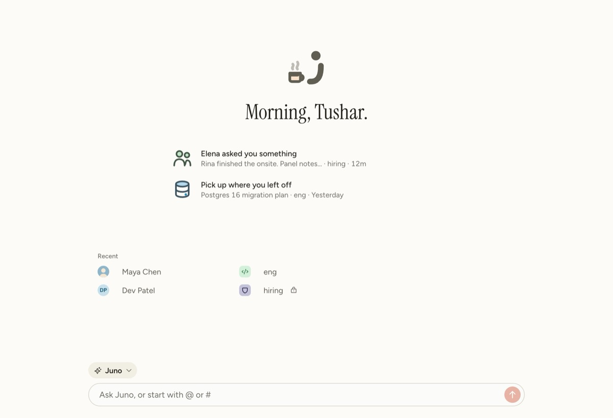
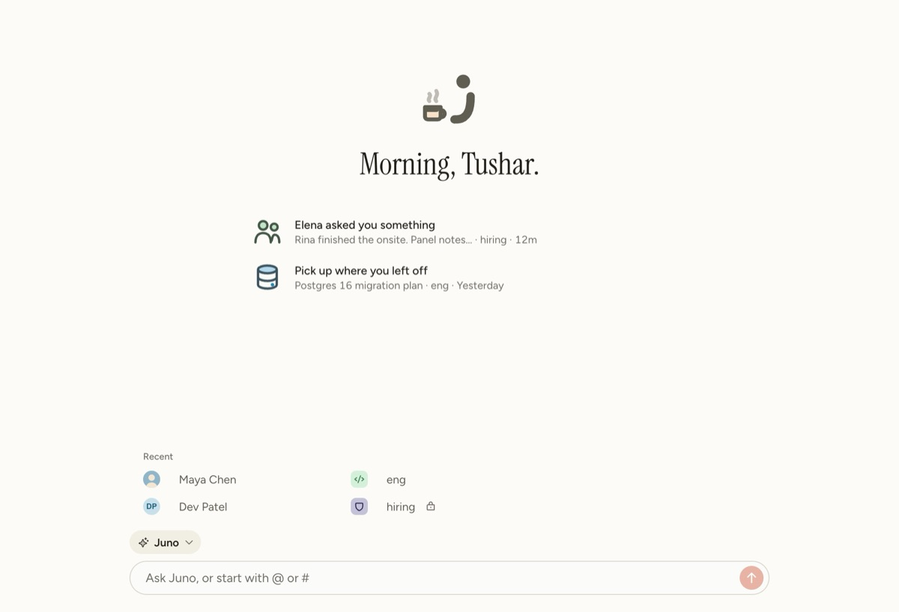
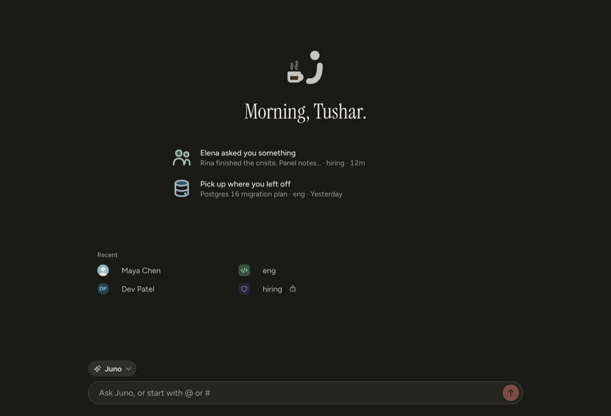
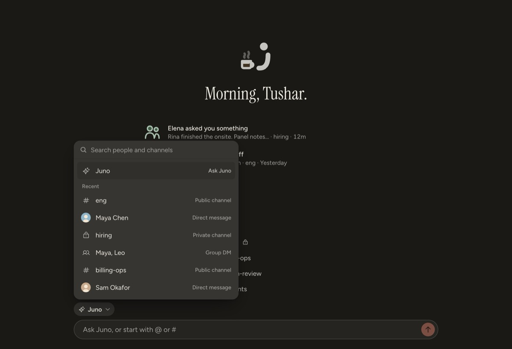
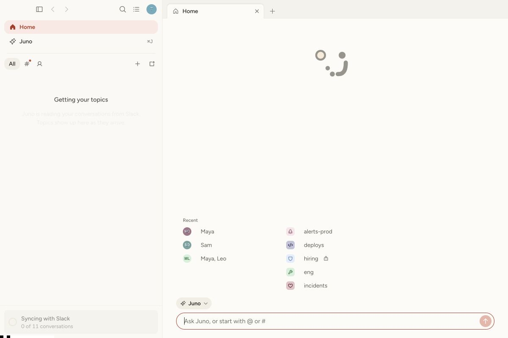
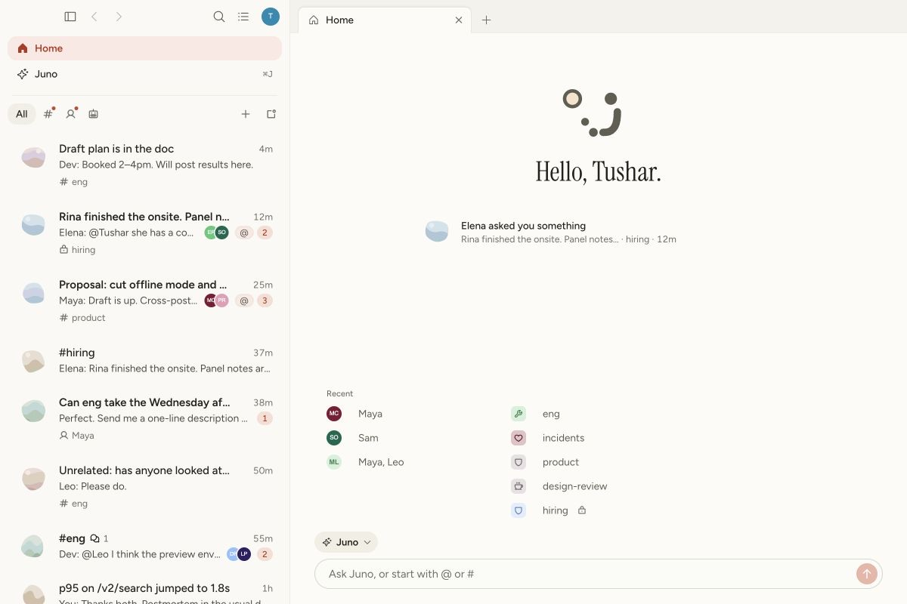

# Design review, 2026-10-17: the unified Home

A milestone review of Home after New chat was folded into it (layout B, the destination chip above the field, All topics in the sidebar's title bar). The layout is the owner's choice and is not reopened here. Scope: the gallery's `Home` and `Sidebar` states in light and dark, including the narrow (560), short (720 by 520) and minimum (336 by 436) windows; `Home.tsx`, `HomeWrite.tsx`, `DestinationPickers.tsx`, `DestinationLists.tsx` and the `Home` and `HomeComposer` containers; the Home feel scenarios.

## Fixed on `home-review`

**Recent floated away from the chip when it had fewer than five rows.** Each column kept room for five rows under its rows, so a new account with two people and two channels had about 100px of empty space between Recent and the chip. Recent no longer read as part of the composer. The room is now above the label: the last row is always 12 above the chip, and rows that land later still move nothing (the greeting is at the same place in both shots). New gallery state `Home/write/few-recent`, and `home-write-geometry.spec.ts` now checks the 12.

| | Before | After |
| --- | --- | --- |
| Light |  |  |
| Dark |  |  |

**The destination list's names did not line up.** Kind icons are 15px and faces 20px, so a name after a face sat 5px right of a name after an icon. The mark now sits in a 20px slot. All topics' place filter uses the same list and gets the same fix.

| | Before | After |
| --- | --- | --- |
| Light |  |  |
| Dark |  |  |

**Settings › General › Tabs still described the removed setting.** Its description said the section chooses what "+", ⌘T and closing the last tab open. It now reads "Tabs you have not looked at close by themselves. Tabs with a draft stay; ⌘⇧T reopens one."

**The first-sync feel scenario measured nothing at the bottom.** `home-first-sync` probed the Ask Juno field, which Home no longer has, so that check passed without anything to measure. It now probes Recent (its room, then its rows), the chip and the field. All three held still from frame 2 in the run below.

**New chat leftovers.** The tabs section of `docs/architecture.md` still described `newTabPageAtom` and the sidebar's New chat button. About thirty comments still named New chat. The topic switcher repeated the destination list's 360px as a literal instead of using its token.

## For the owner

1. **Recent changes under the pointer during the first sync.** Recent shows its rows as soon as the ranking has any, then re-ranks as history lands. In the feel run, `alerts-prod` and `deploys` showed first and then left (they became Automated). A click aimed at one could land on another. Home's own rows avoid this by never moving once shown. Recommendation: keep Recent's room empty until the first sync is done, as the rows' slots are while nothing has landed. The destination list still has every conversation.  
2. **The same conversation has two marks.** Recent and the `@`/`#` list show a channel's art tile and a group DM's initials. The chip's destination list shows a plain `#`, lock or people glyph. Recommendation: use Recent's 20px mark in the destination list too, so a channel looks the same in all three places (`shots/destination-list-after-dark.jpg`, `shots/three-light.jpg`).
3. **Three inner edges at the bottom.** The chip's icon starts 10px inside the field's edge, Recent's marks and label 16px, and the field's text about 19px. Each follows its own control's padding, and the outer edges all match. Recommendation: leave it. A shared inner edge would mean a chip with wider padding than every other pill (`shots/three-light.jpg`).
4. **No perf budget for a new Home tab.** `docs/performance.md` stopped measuring "New tab with Home" when New chat left (10-17), and ⌘N and ⌘T now land on Home's composer. Recommendation: give ⌘T to a focused composer the budget New chat open had. `a new tab with Home open to its composer painted` in `perf.spec.ts` already records it: 16.5 ms median and 18.5 ms p95 in this review's run (n=20, load 2.9), against New chat's last 18.0 ms median and 24.7 ms p95.

## Checked and clear

- Layering: views take props and callbacks only. Effect, state and Electron stay in the containers.
- Tokens only, no `cursor: pointer`, hover styles behind `@media (hover: hover)`, the chip's rise behind reduced motion.
- Focus rings on Recent's rows, the chip and Home's rows, light and dark (`Home/interaction/focus-*`). Contrast: the chip's "Juno" is `#C6C4BE` on `#302F2C` in dark, Recent's names the same subtle tone on the page.
- Keys: Tab goes rows, Recent (one stop, arrows inside), chip, field. Esc in the destination list returns focus to the chip (`home-write.spec.ts`). Shift Tab from the field reaches the chip, since Attach files is out of the Tab order.
- Copy follows SPEC §17: sentence case, "Recent", "Send to a person", "Keep as text", and no `#` repeated beside a channel's mark.
- Narrow, short and minimum windows: the columns stack under 400px, and Recent hides under 560px of page height.

## Verification

- `pnpm test:feel home.feel home-write.feel`, once, on the Mac: 5 of 5 passed (load 3.3 to 3.7). In `home-first-sync`, Recent (480 by 178), the chip and the field held still from frame 2 to the end, and no layout shift was counted.
- `pnpm perf -g "home open: from a topic|a new tab with Home open"`, once: a new Home tab to its focused composer took 16.5 ms median and 18.5 ms p95. Home open from a topic took 131.8 ms p95 against the single 50 ms gate on this branch's base. This is the known miss: the p95s documented on main are 106 to 215 ms, and main has since split the gate into 150 ms after idle and 50 ms for quick opens. This branch adds one hidden 8-node box to Recent on that path.
- `pnpm affected`, once: typecheck, lint, unit tests, spec conformance and the desktop e2e specs passed. The gallery had 241 passed and 1 failed: `toolbar-geometry.spec.ts:77`, the message hover toolbar under the header band (toolbar top 42, expected at least 143). This branch does not touch message rows or the toolbar, so it goes to the CI keeper. The new `few-recent` geometry case measured the last row 12 above the chip, light and dark.
- Gallery shots for `Home` and `Sidebar` regenerated. Only `Home/write/destination-list-*` changed, and `Home/write/few-recent-*` is new.
