# Design review, 2026-10-17: the first sync's progress

The owner's note on the first sync's progress line: it looked cramped, and it looked like a web app rather than a Mac app. The line said "Syncing 11 of 148" in 12.5px text squeezed under the traffic lights, over a 2px bar along the header's bottom edge.

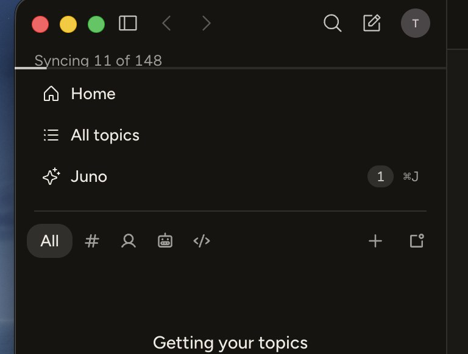

Three directions were drawn as gallery states, in light and dark, at the default 384px sidebar. Each one keeps the same rules: nothing moves when sync starts or ends, the offline and rate-limit notices go in the same place, the progress is a `progressbar` with a VoiceOver name, motion uses the motion tokens, and the spacing is measured.

## Recommended: C, a status card at the foot of the sidebar

Shipped on this branch. During the first sync a card under the list shows a progress ring, "Syncing with Slack" and "11 of 148 conversations". Messages does the same while it downloads from iCloud.

- **Why this one.** It is the most native and the calmest of the three. It sits under the list, so it never competes with the rows. It has room for a full sentence and a button, at every sidebar width. It uses the strip and the card the privacy footer already uses, so it adds no new pattern.
- **Shared place.** You're offline, Slack asked us to slow down, and Sync stopped (with Restart) use the same card. Every state is 56px tall, so one state replacing another moves nothing.
- **No movement.** The header loses its status line, so the nav sits right under the title bar. The card takes room only from the bottom of the list. When it appears or goes, the header, nav, filters and rows stay where they are.
- **Accessibility.** The ring is the `progressbar` "Sync progress", with the value text "11 of 148 conversations". The title is the `status` "Sync status".
- **Motion.** The card fades in over `--duration-appear`, which reduced motion turns off. The ring's arc does not animate (only transform and opacity animate, `performance.md`); each count repaints it.
- **New primitive.** `ProgressRing` in `@juno/ui`: 16 or 20px, a `--border-strongest` track and an `--hl` arc. Without a total it draws the track only ("Finding your conversations").

| | Light | Dark |
| --- | --- | --- |
| Nothing has arrived yet | 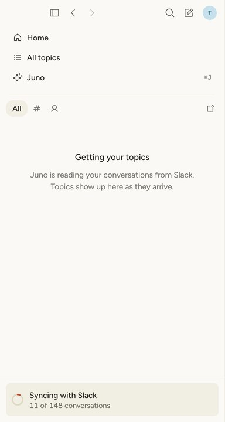 |  |
| Rows have landed |  | 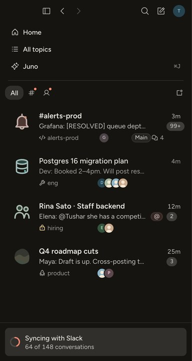 |
| Still listing conversations |  | 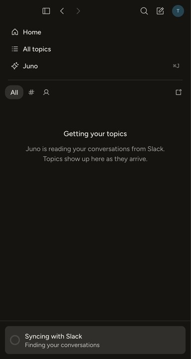 |
| Offline |  |  |
| Rate limited |  | 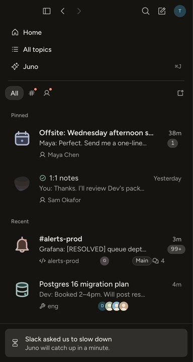 |
| Stopped, with Restart | 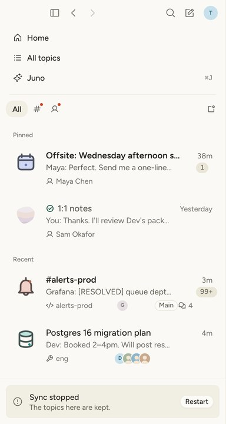 | 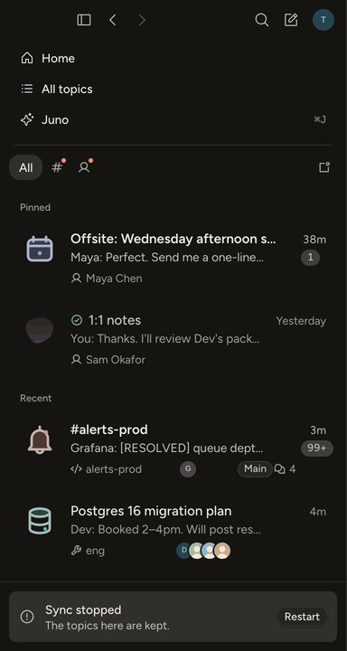 |
| With the privacy footer | 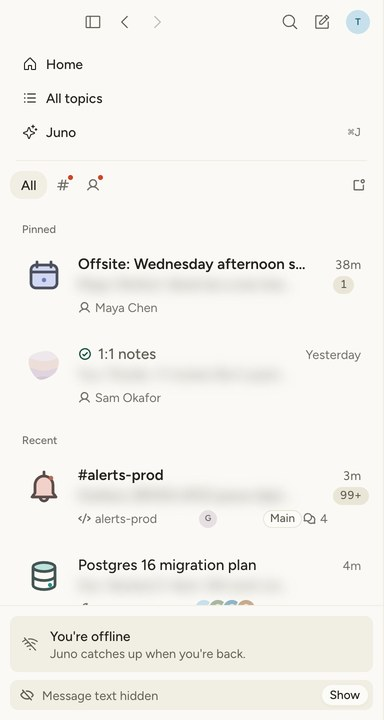 | 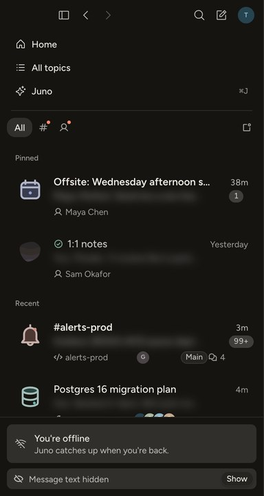 |

## A. An activity ring in the title bar

A 16px ring before Search, as Safari's downloads button and Xcode's activity viewer show progress. Hovering or clicking it opens a popover: "Syncing with Slack", "11 of 148 conversations", and "Topics show up in the sidebar as they arrive. Older history follows." The popover is the `Popover` primitive, whose panel sets `-webkit-app-region: no-drag`. Offline shows `wifi-slash` in the same place.

- **Why not.** It does not fit. At the 280px minimum sidebar the title bar is already full: 78px for the traffic lights, 94 for Hide sidebar, Back and Forward, 98 for Search, New chat and the avatar, and the 10px inset. A ring needs 32px more, so it would overlap Forward or push the avatar out. A stopped engine, which needs Restart, would also hide behind a 16px glyph and a hover. That is the problem the M3 review found with "Engine failed" hidden in the avatar menu (finding H5).

| | Light | Dark |
| --- | --- | --- |
| Syncing | 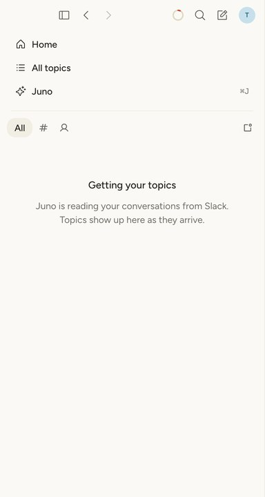 | 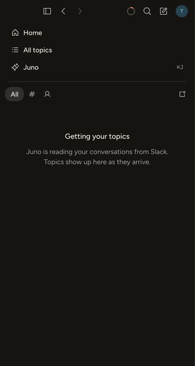 |
| Popover open | 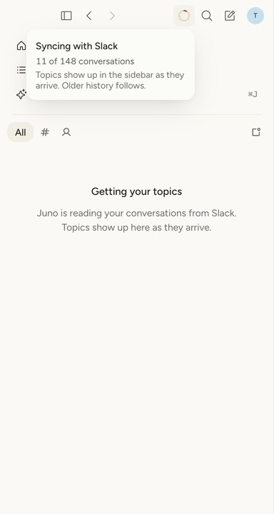 |  |
| Rows have landed |  | 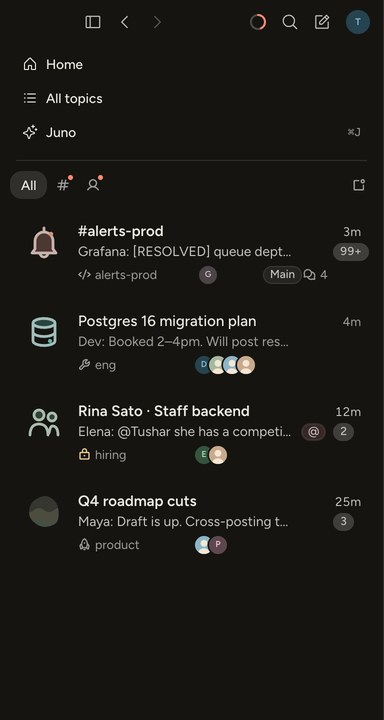 |
| Offline, popover open | 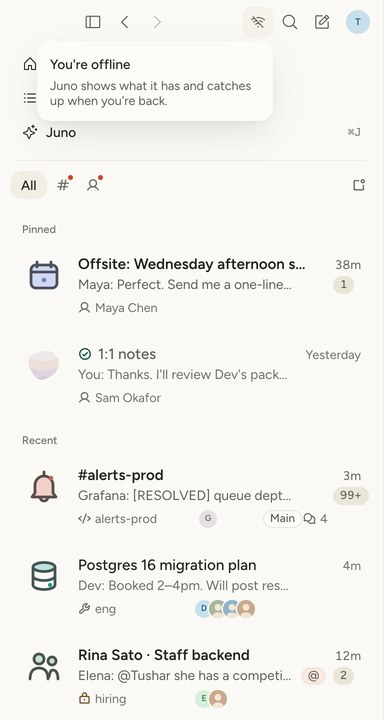 | 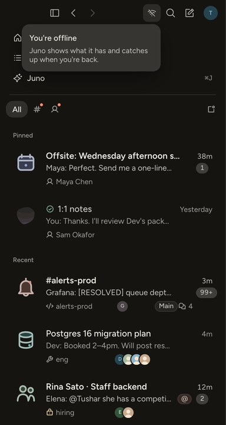 |

## B. The empty state carries it

The held list's "Getting your topics" gets a 20px ring above the title and the count in the body: "Juno has read 11 of 148 conversations." Once rows land, a quiet line follows the last row: "Getting more topics, 64 of 148".

- **Why not.** It works only while the list is empty. Once rows land, the line after the last row is out of sight on any real workspace, below the fold. Offline and rate limited have no place in it while there are rows, so they would need a second place.

| | Light | Dark |
| --- | --- | --- |
| Nothing has arrived yet |  |  |
| Rows have landed | 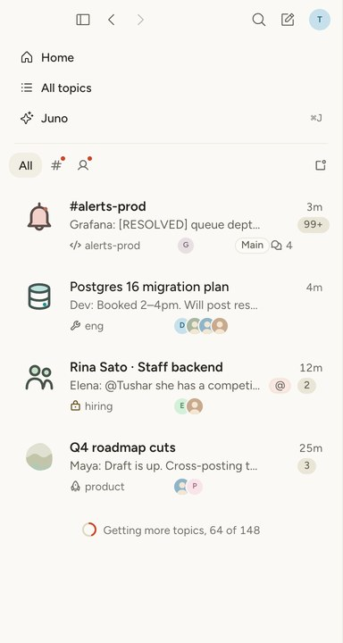 |  |

## Side by side

C first, then A, then B.

Nothing has arrived yet:

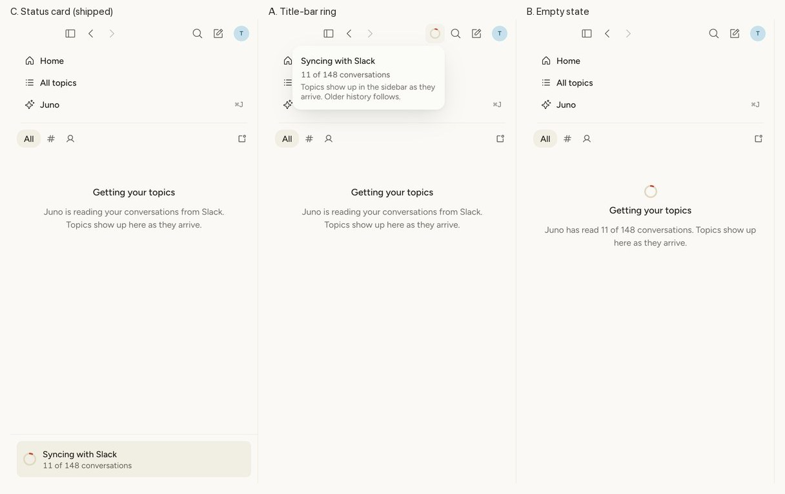

Rows have landed:

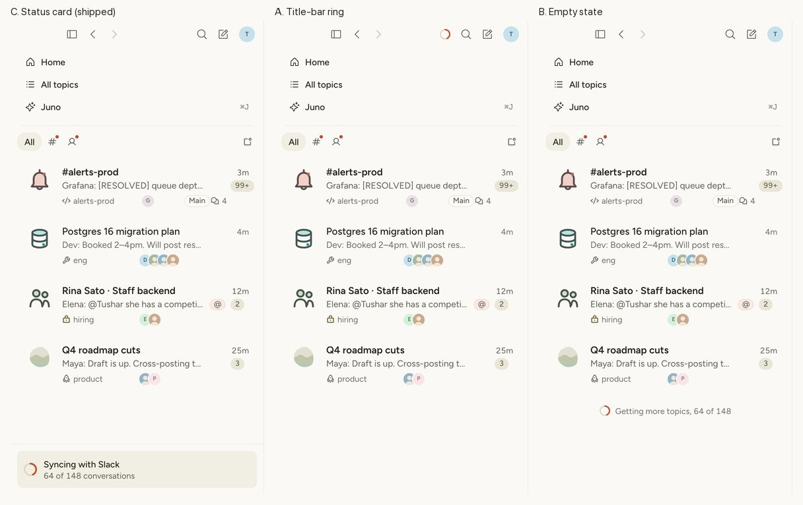

Notices (C offline, A offline, C stopped):

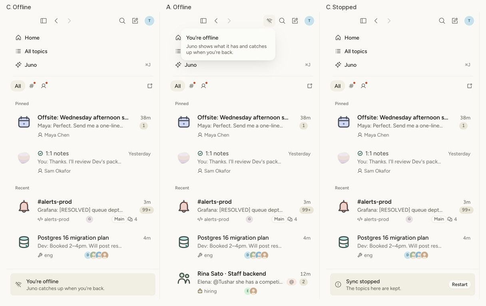

## How the shots were made

`GALLERY_SHOTS_ONLY=Sidebar pnpm gallery:shots`, with the shots kept here as half-size JPEGs. C's states are `Sidebar` › Sync. A and B were drawn as `Sidebar` › Sync A and Sync B in commit `991cb5ec`, then removed once C was chosen. Check out that commit to see them in the gallery. `compare/` was put together from the same shots.
