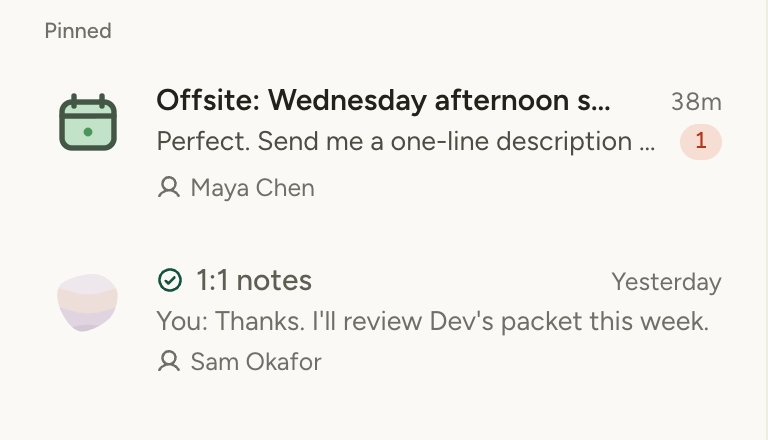
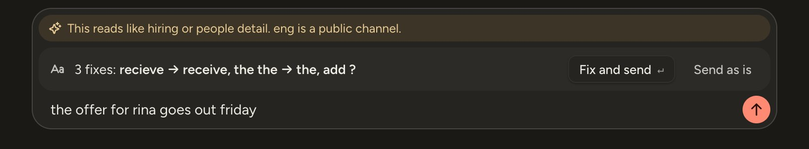
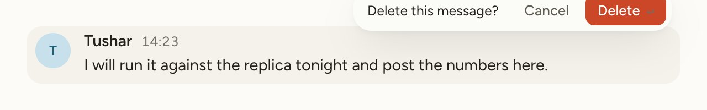
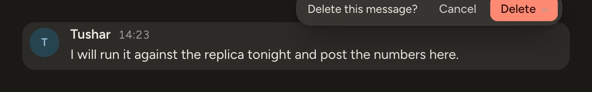
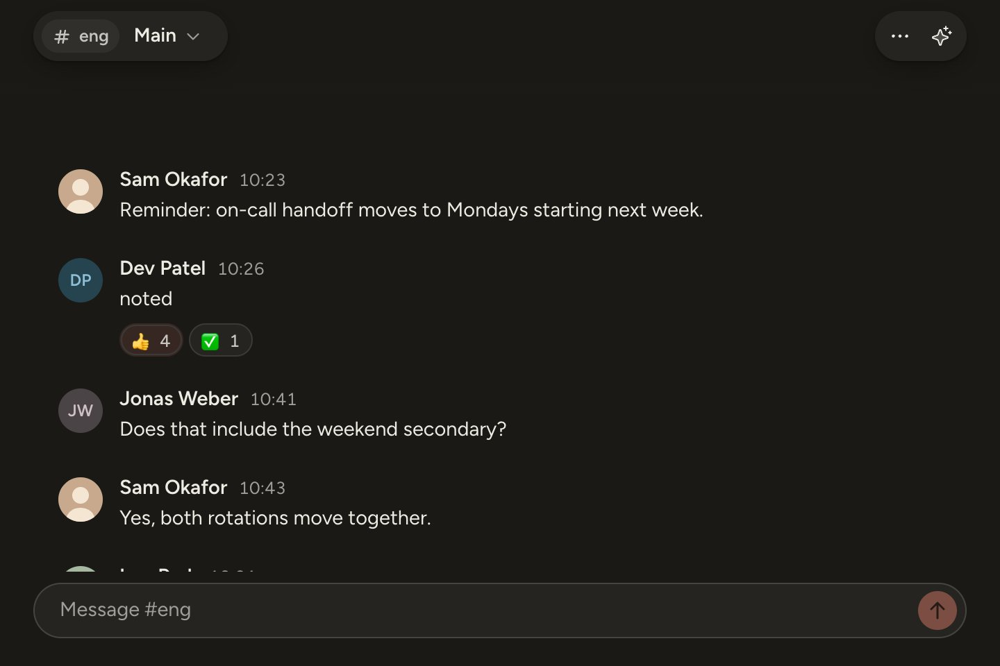

# Design review, 2026-10-17: the sidebar and the topic view

A milestone review of the sidebar (title bar with All topics, nav, quick filters and views, topic rows and their art, the sync notices, the narrow and full-screen windows) and the topic view (header, message list, message rows, hover toolbar, media, reactions, peek, composer, send checks, link editor, edit field). Layouts are not reopened. Scope: the gallery's `Sidebar`, `TopicRow`, `Shell`, `Workspace`, `TopicView`, `TopicHeader`, `MessageList`, `Message`, `HoverToolbar`, `Reactions`, `PeekView`, `Composer`, `SendCheckBar` and `ThreadLink` states in light and dark, including the 336px header, the minimum window (720 by 480) and the short and widest peeks; the views and containers behind them; the topic, interaction, long-thread, composer and launch feel scenarios.

## Fixed on `topic-sidebar-review`

**A row's place line sat 3px higher when the row had no Resolve.** Line three is a grid cell shared with the hidden Resolve button, so the 22px button set its height. A resolved row (no Resolve) and a row being renamed lost it, and their place line moved up 3px. In the sidebar a pinned resolved row ("1:1 notes") was out of step with its neighbours, and starting Rename moved the place line under the field. Line three is now always 22px tall. `sidebar-rows.spec.ts` checks the place line's offset on a read row, the same row being renamed, and a resolved row.

| | Before | After |
| --- | --- | --- |
| Rename, light |  |  |
| Rename, dark |  |  |
| Resolved row, light |  |  |
| Resolved row, dark |  |  |

**The audience line and the check bar started their text on different edges.** Both sit in the composer, one above the other, 6px in. The audience line had a 13px icon, 10px padding and a 6px gap; the check bar a 14px icon, 12px padding and a 10px gap. Their icons were 2px apart and their text 7px apart. The audience line now uses the check bar's values. `geometry.spec.ts` checks both edges.

| | Before | After |
| --- | --- | --- |
| Light |  |  |
| Dark |  |  |

**My reaction chip did not answer the pointer.** Hovering a chip darkens its border, but the chip you reacted with set its ring for both states, so it showed no change. It keeps its ring and its fill steps up to `--hl-bubble`, the stronger accent tint. New gallery state `Reactions/toggle/hover-chip-other` shows the plain chip's hover beside it.

| | Before | After |
| --- | --- | --- |
| Light |  |  |
| Dark |  |  |

**The empty Main pointed at a control that is gone.** It said "Threads live behind the Threads button." Main has had no Threads button since the header moved its threads into the title's switcher. It now says "New messages in this channel show up here. Click Main above for its threads." (`shots/empty-main-after-light.jpg`). `IslandButton` still carried the Threads button's count width, narrow label, separate name and pressed state, and two tokens existed only for them. They are removed, with the views README's description of the header.

**Links in message text had no focus ring of ours.** Tabbing onto a link showed Chromium's default ring; the #channel chip next to it has the token ring. Links now use the same ring.

**Smaller fixes.**

- The context pill's accessible name lowercased the whole kind, so a group DM was read as "group dm". Only the first letter steps down now ("group DM").
- The sidebar's Juno item spelled out "⌘J". It now reads the shortcut from the menu, as the header's Juno button does.
- Gallery: every `Message` state with a toolbar or a delete confirm cut it off at the frame's top, and `MessageList/interaction/focus-thread-link` showed the row's ring, not the link's. Both fixtures are fixed.

| | Before | After |
| --- | --- | --- |
| Delete confirm, light |  |  |
| Delete confirm, dark |  |  |
| Thread link focus, light |  |  |
| Thread link focus, dark |  |  |

**Leftovers.**

- `docs/architecture.md` still described the New chat preview, New chat's attachments key and a "New Chat ⌘N" menu item. The menu item is "New Message".
- The e2e list still named a New chat flow.
- SPEC 14 still listed stealth.
- Stale comments: the `newThreads` row prop is wired now, the composer slot no longer waits for M6, and an orphaned doc comment sat in `MediaGrid.tsx`.

## For the owner

1. **Empty space above the first message.** A topic opened at its start has 66px between the header islands and the first message. 28px of that is the "Loading older messages" slot, kept even when there is nothing older to load. The rest is the list's 20px top padding and the header band. At the minimum window it is 78px, about a sixth of the list. Recommendation: drop the slot once the start of the topic is known (`older === 'none'`), and keep it while older messages may come. Removing it then moves nothing on screen, because nothing is above the first row.  
2. **The title gives way before the place at 336px.** The header shortens the title first, down to 72px, then the place pill. A 336px header shows "Maya Ch… Offs…" and "hiri… Rina Sato…". Four letters of title tell less than the place's icon alone. Recommendation: below the 480px breakpoint, show the pill as its icon only (the kind and name stay in its tooltip and accessible name) and give the title the room.   
3. **The hover toolbar is up to ten Tab stops.** Every button on the focused row's toolbar is in the Tab order (`HoverToolbar.tsx`), so Tab walks the quick reactions, More reactions, Quote, the thread button and More before it leaves the message. The toolbar pattern is one stop with arrow keys inside. Recommendation: make the toolbar one stop with a roving tabindex, as the sidebar's rows and Recent already work. It changes the keyboard flow, so it needs your decision.
4. **The view sheet's icon and colour choices are radio groups in name only.** The icon grid is 24 `role="radio"` buttons, each a Tab stop. The colour row is a `radiogroup` of swatches that say `aria-pressed`, not `aria-checked` (`ViewSheet.tsx`, and the same in `ChannelIconPicker.tsx`). Recommendation: make both real radio groups, one Tab stop each with arrow keys, and change the e2e driver's queries to match. The other choice is to call them plain groups of toggle buttons. Both are small changes, but they change the keyboard flow.

## Not fixed, for later

- **The focus ring is written out by hand in six views** (`ThreadLink`, `MessageBody` twice, `MediaGrid`, `HeaderControls`, and inset copies in `TopicRow` and `Message`). `@juno/ui`'s `interactive.focusRing` is internal, which is why they copy it. Exporting `focusRing` and `focusRingInset` from `@juno/ui` would remove the copies.
- **The token check does not look at `color-mix(`** in `stylex.create` values, or at named constants. `MessageBody.tsx` mixes `currentColor` at 6% and 35% with no token, and px constants such as the header pill's 160px and the title's 72px floor pass unchecked. These are named one-offs today, but `scripts/check-tokens.mjs` should see them.
- **Duplicates:**
  - The kind-to-icon map exists three times (`TopicHeader`, `TopicRow`'s `whereIcon`, `look.ts`'s `kindIcon`).
  - The attachment chip's `kindOf` repeats the engine's file-kind rule.
  - The reactors card's 700ms delay repeats the tooltip's.
- **Small accessibility items:**
  - Every attachment card is a `section` named "Attachment", which gives many identical landmarks.
  - The link editor shows no message when the link is invalid.
  - The thread link is a `div role="button"` where a `button` would do.

## Checked and clear

- **Layering.** No view in `packages/views` imports state, Effect, Electron or IPC.
- **Tokens and pointers.** No raw colours in components. No `cursor: pointer` except the marked external link in message text. No `transition: all`. Hover styles sit behind `@media (hover: hover)`.
- **Spacing.**
  - The header islands, the hover row, the composer and peek share the column's left edge (74px at the 900px pane).
  - The hover toolbar sits 8px in from the row's end.
  - The sidebar's nav icons, section labels and row tiles line up on one edge.
  - The quick filters and the view strip fade at the add button, never clip.
- **Focus rings, light and dark.** Rows, nav items, filters, views, the unread toggle, the header's pill, title, Resolve and More, the toolbar's buttons, thumbnails and tiles.
- **Copy (SPEC 17).** Sentence case, verb-first buttons ("Fix and send", "Send as is", "Post in thread", "Keep editing"), no emoji in chrome. "Colour" in the view sheet follows the spec's spelling.
- **Windows.**
  - Full screen moves the title bar's buttons to the window's edge.
  - The sidebar at its narrowest keeps every row's trail whole.
  - At 336px the header's Resolve and Follow become icons.
  - The check bar's choices move under the finding.

## Verification

- **Gallery shots** before and after for `Sidebar`, `TopicRow`, `TopicView`, `TopicHeader`, `MessageList`, `Message`, `Reactions` and `Composer`. The changes are the ones above:
  - the rows and the sidebar lists that hold a resolved row;
  - the composer's audience states;
  - the `Message` frames, now with room above the row;
  - the reaction hover;
  - the empty Main.
- **`pnpm test:feel topic.feel interaction.feel long.feel composer.feel launch.feel`**, once, on the Mac. It ran on `8c501ca8` with the first two fixtures in the working tree, which the app does not use. Results: 8 tests, 19 scenarios, 84 checks, 0 failed, 3 warnings, load 4.1 to 12.5, 2.2 minutes. I read every filmstrip. Nothing shifted, flashed empty or answered late. The warnings:
  - `live-reply-scrolled-up` #10: "the sidebar holds still" counted a 0.0001 layout shift on a row's preview. The box is the same before and after (78, 210, 228 by 17), and frames #9 to #11 show nothing moving (`shots/feel-live-reply-scrolled-up-0010.jpg`). This is a suite problem: the probe should ignore an entry whose box does not change.
  - `mention-typing` #3 to #8 and `scroll-long-thread` #15, #18 and #256: long animation frames with no blocking time from the page, at loads of 4.1 and 10. Weak evidence under that load.
- **`pnpm affected`**, once, on `fa30107f`, against base `8c501ca8`. One run, not repeated.
  - Typecheck passed.
  - Gallery: 272 passed, including the new place-line and audience-line checks and `toolbar-geometry.spec.ts`.
  - Lint failed on the health ratchet: the link's focus ring took `MessageBody.tsx` to 404 lines. `f573ada2` shares one ring style between links and channel chips, so the file is back at 400 lines. `pnpm lint` then passed locally (10 of 10).
  - Desktop e2e: 417 passed, 38 skipped, 3 failed. All three are the sidebar list gaining or reordering rows during the action, on a machine at 85% CPU pressure:
    - `layout-shift.spec.ts:103` (partial thread at bottom): the click meant for `#eng` opened "Unrelated: has anyone looked at the…". `#eng` had just moved to the top after the injected message.
    - `layout-shift.spec.ts:183` (sidebar rows while sync fills): the anchor row was removed as rows landed.
    - `tour.spec.ts:24`: the Topics group grew 77px, one more row, while the tour stepped.
  - This branch changes no row's height and no list order (rows have a fixed height, and the place line fits in it), so these go to the CI keeper. A row that moves under the pointer during sync is still worth a look: Home holds its rows still for the same reason.
