# Design review, 2026-10-17: the sidebar and the topic view

A milestone review of the sidebar (title bar with All topics, nav, quick filters and views, topic rows and their art, the sync notices, the narrow and full-screen windows) and the topic view (header, message list, message rows, hover toolbar, media, reactions, peek, composer, send checks, link editor, edit field). Layouts are not reopened. Scope: the gallery's `Sidebar`, `TopicRow`, `Shell`, `Workspace`, `TopicView`, `TopicHeader`, `MessageList`, `Message`, `HoverToolbar`, `Reactions`, `PeekView`, `Composer`, `SendCheckBar` and `ThreadLink` states in light and dark, including the 336px header, the minimum window (720 by 480) and the short and widest peeks; the views and containers behind them; the topic, interaction, long-thread, composer and launch feel scenarios.

## Fixed on `topic-sidebar-review`

**A row's place line sat 3px higher when the row had no Resolve.** Line three is a grid cell shared with the hidden Resolve button, so the 22px button set its height. A resolved row (no Resolve) and a row being renamed lost it, and their place line moved up 3px. In the sidebar a pinned resolved row ("1:1 notes") was out of step with its neighbours, and starting Rename moved the place line under the field. Line three is now always 22px tall. `sidebar-rows.spec.ts` checks the place line's offset on a read row, the same row being renamed, and a resolved row.

| | Before | After |
| --- | --- | --- |
| Rename, light |  |  |
| Rename, dark | 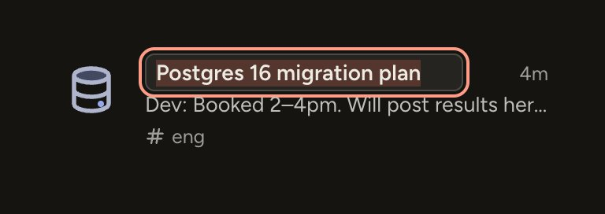 | 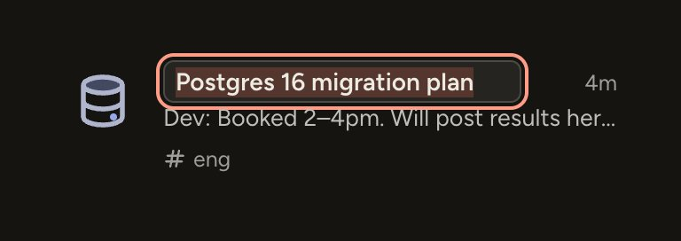 |
| Resolved row, light |  |  |
| Resolved row, dark | 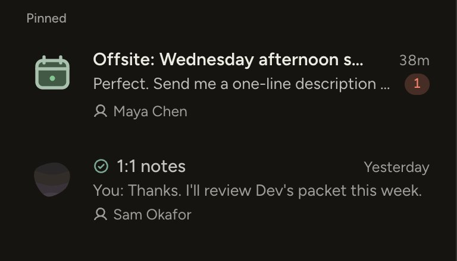 |  |

**The audience line and the check bar started their text on different edges.** Both sit in the composer, one above the other, 6px in. The audience line had a 13px icon, 10px padding and a 6px gap; the check bar a 14px icon, 12px padding and a 10px gap. Their icons were 2px apart and their text 7px apart. The audience line now uses the check bar's values. `geometry.spec.ts` checks both edges.

| | Before | After |
| --- | --- | --- |
| Light |  |  |
| Dark |  |  |

**My reaction chip did not answer the pointer.** Hovering a chip darkens its border, but the chip you reacted with set its ring for both states, so it showed no change. It keeps its ring and its fill steps up to `--hl-bubble`, the stronger accent tint. New gallery state `Reactions/toggle/hover-chip-other` shows the plain chip's hover beside it.

| | Before | After |
| --- | --- | --- |
| Light |  |  |
| Dark | 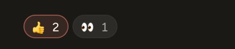 | 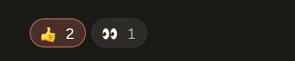 |

**The empty Main pointed at a control that is gone.** It said "Threads live behind the Threads button." Main has had no Threads button since the header moved its threads into the title's switcher. It now says "New messages in this channel show up here. Click Main above for its threads." (`shots/empty-main-after-light.jpg`). `IslandButton` still carried the Threads button's count width, narrow label, separate name and pressed state, and two tokens existed only for them. They are removed, with the views README's description of the header.

**Links in message text had no focus ring of ours.** Tabbing onto a link showed Chromium's default ring; the #channel chip next to it has the token ring. Links now use the same ring.

**Smaller fixes.**

- The context pill's accessible name lowercased the whole kind, so a group DM was read as "group dm". Only the first letter steps down now ("group DM").
- The sidebar's Juno item spelled out "⌘J". It now reads the shortcut from the menu, as the header's Juno button does.
- Gallery: every `Message` state with a toolbar or a delete confirm cut it off at the frame's top, and `MessageList/interaction/focus-thread-link` showed the row's ring, not the link's. Both fixtures are fixed.

| | Before | After |
| --- | --- | --- |
| Delete confirm, light |  |  |
| Delete confirm, dark |  |  |
| Thread link focus, light | 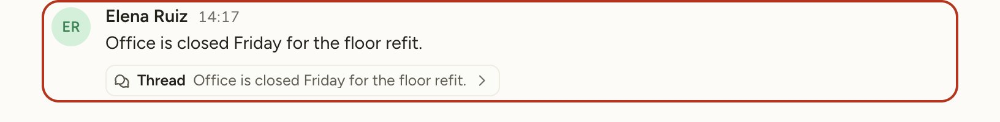 |  |
| Thread link focus, dark |  |  |

**Leftovers.**

- `docs/architecture.md` still described the New chat preview, New chat's attachments key and a "New Chat ⌘N" menu item. The menu item is "New Message".
- The e2e list still named a New chat flow.
- SPEC 14 still listed stealth.
- Stale comments: the `newThreads` row prop is wired now, the composer slot no longer waits for M6, and an orphaned doc comment sat in `MediaGrid.tsx`.

## For the owner

1. **Empty space above the first message.** A topic opened at its start has 66px between the header islands and the first message. 28px of that is the "Loading older messages" slot, kept even when there is nothing older to load. The rest is the list's 20px top padding and the header band. At the minimum window it is 78px, about a sixth of the list. Recommendation: drop the slot once the start of the topic is known (`older === 'none'`), and keep it while older messages may come. Removing it then moves nothing on screen, because nothing is above the first row.  
2. **The title gives way before the place at 336px.** The header shortens the title first, down to 72px, then the place pill. A 336px header shows "Maya Ch… Offs…" and "hiri… Rina Sato…". Four letters of title tell less than the place's icon alone. Recommendation: below the 480px breakpoint, show the pill as its icon only (the kind and name stay in its tooltip and accessible name) and give the title the room.   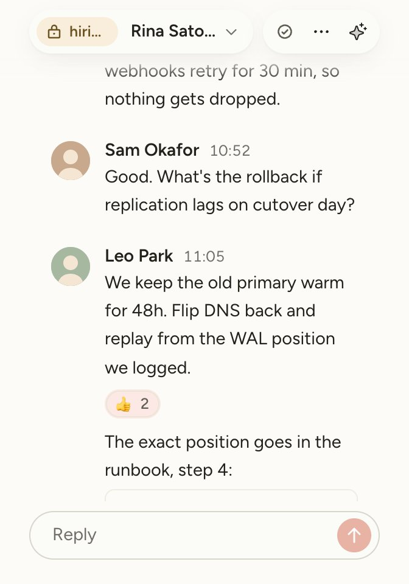
3. **The hover toolbar is up to ten Tab stops.** Every button on the focused row's toolbar is in the Tab order (`HoverToolbar.tsx`), so Tab walks the quick reactions, More reactions, Quote, the thread button and More before it leaves the message. The toolbar pattern is one stop with arrow keys inside. Recommendation: make the toolbar one stop with a roving tabindex, as the sidebar's rows and Recent already work. It changes the keyboard flow, so it needs your decision.
4. **The view sheet's icon and colour choices are radio groups in name only.** The icon grid is 24 `role="radio"` buttons, each a Tab stop. The colour row is a `radiogroup` of swatches that say `aria-pressed`, not `aria-checked` (`ViewSheet.tsx`, and the same in `ChannelIconPicker.tsx`). Recommendation: make both real radio groups, one Tab stop each with arrow keys, and change the e2e driver's queries to match. The other choice is to call them plain groups of toggle buttons. Both are small changes, but they change the keyboard flow.

## Not fixed, for later

- **The focus ring is written out by hand in six views** (`ThreadLink`, `MessageBody` twice, `MediaGrid`, `HeaderControls`, and inset copies in `TopicRow` and `Message`). `@juno/ui`'s `interactive.focusRing` is internal, which is why they copy it. Exporting `focusRing` and `focusRingInset` from `@juno/ui` would remove the copies.
- **The token check does not look at `color-mix(`** in `stylex.create` values, or at named constants. `MessageBody.tsx` mixes `currentColor` at 6% and 35% with no token, and px constants such as the header pill's 160px and the title's 72px floor pass unchecked. These are named one-offs today, but `scripts/check-tokens.mjs` should see them.
- **Duplicates:**
  - The kind-to-icon map exists three times (`TopicHeader`, `TopicRow`'s `whereIcon`, `look.ts`'s `kindIcon`).
  - The attachment chip's `kindOf` repeats the engine's file-kind rule.
  - The reactors card's 700ms delay repeats the tooltip's.
- **Small accessibility items:**
  - Every attachment card is a `section` named "Attachment", which gives many identical landmarks.
  - The link editor shows no message when the link is invalid.
  - The thread link is a `div role="button"` where a `button` would do.

## Checked and clear

- **Layering.** No view in `packages/views` imports state, Effect, Electron or IPC.
- **Tokens and pointers.** No raw colours in components. No `cursor: pointer` except the marked external link in message text. No `transition: all`. Hover styles sit behind `@media (hover: hover)`.
- **Spacing.**
  - The header islands, the hover row, the composer and peek share the column's left edge (74px at the 900px pane).
  - The hover toolbar sits 8px in from the row's end.
  - The sidebar's nav icons, section labels and row tiles line up on one edge.
  - The quick filters and the view strip fade at the add button, never clip.
- **Focus rings, light and dark.** Rows, nav items, filters, views, the unread toggle, the header's pill, title, Resolve and More, the toolbar's buttons, thumbnails and tiles.
- **Copy (SPEC 17).** Sentence case, verb-first buttons ("Fix and send", "Send as is", "Post in thread", "Keep editing"), no emoji in chrome. "Colour" in the view sheet follows the spec's spelling.
- **Windows.**
  - Full screen moves the title bar's buttons to the window's edge.
  - The sidebar at its narrowest keeps every row's trail whole.
  - At 336px the header's Resolve and Follow become icons.
  - The check bar's choices move under the finding.

## Verification

- **Gallery shots** before and after for `Sidebar`, `TopicRow`, `TopicView`, `TopicHeader`, `MessageList`, `Message`, `Reactions` and `Composer`. The changes are the ones above:
  - the rows and the sidebar lists that hold a resolved row;
  - the composer's audience states;
  - the `Message` frames, now with room above the row;
  - the reaction hover;
  - the empty Main.
- **`pnpm test:feel topic.feel interaction.feel long.feel composer.feel launch.feel`**, once, on the Mac. It ran on `8c501ca8` with the first two fixtures in the working tree, which the app does not use. Results: 8 tests, 19 scenarios, 84 checks, 0 failed, 3 warnings, load 4.1 to 12.5, 2.2 minutes. I read every filmstrip. Nothing shifted, flashed empty or answered late. The warnings:
  - `live-reply-scrolled-up` #10: "the sidebar holds still" counted a 0.0001 layout shift on a row's preview. The box is the same before and after (78, 210, 228 by 17), and frames #9 to #11 show nothing moving (`shots/feel-live-reply-scrolled-up-0010.jpg`). This is a suite problem: the probe should ignore an entry whose box does not change.
  - `mention-typing` #3 to #8 and `scroll-long-thread` #15, #18 and #256: long animation frames with no blocking time from the page, at loads of 4.1 and 10. Weak evidence under that load.
- **`pnpm affected`**, once, on `fa30107f`, against base `8c501ca8`. One run, not repeated.
  - Typecheck passed.
  - Gallery: 272 passed, including the new place-line and audience-line checks and `toolbar-geometry.spec.ts`.
  - Lint failed on the health ratchet: the link's focus ring took `MessageBody.tsx` to 404 lines. `f573ada2` shares one ring style between links and channel chips, so the file is back at 400 lines. `pnpm lint` then passed locally (10 of 10).
  - Desktop e2e: 417 passed, 38 skipped, 3 failed. All three are the sidebar list gaining or reordering rows during the action, on a machine at 85% CPU pressure:
    - `layout-shift.spec.ts:103` (partial thread at bottom): the click meant for `#eng` opened "Unrelated: has anyone looked at the…". `#eng` had just moved to the top after the injected message.
    - `layout-shift.spec.ts:183` (sidebar rows while sync fills): the anchor row was removed as rows landed.
    - `tour.spec.ts:24`: the Topics group grew 77px, one more row, while the tour stepped.
  - This branch changes no row's height and no list order (rows have a fixed height, and the place line fits in it), so these go to the CI keeper. A row that moves under the pointer during sync is still worth a look: Home holds its rows still for the same reason.

## Round 2: the decisions on the owner's items

Decided by the orchestrator for the owner, on `topic-sidebar-review-2` from `41ad6fe9`.

**1. No space kept for older messages.** The "Loading older messages" slot is gone. The line now shows only while an older page loads, out of the flow, in the room above the first message, so it never moves anything (`olderInRoom`). A topic whose start a page reached this run asks for no older page when it opens again (`topicStartKnownAtom`). Peek keeps its small in-flow slot, as before.

**The gap that remains is the hover toolbar's room, so it barely changed (60px → 58px).** A first version made the gap 24px, matching the gap above the composer. `pnpm affected` then showed what the 28px slot had been doing: it was also the room the first message's hover toolbar needs to show above it at scroll top. With 24px, that toolbar flips below the first message and covers the next message's name. `toolbar-geometry.spec.ts` treats that as a failure, and the decision behind it (5629badc) is that the toolbar always straddles its own row's top edge.

So the gap is now measured from that need: the toolbar's height less the row's top padding, plus 2, which is 34px under the header band (36px in Compact). The first message sits 58px under the islands, not 24px, and top and bottom are not symmetric. `message-geometry.spec.ts` checks the room and that the loading line takes none of it.

The 24px gap is a choice for the owner. It costs the first message's toolbar flipping below at scroll top, as it already does for a message under the header band. Shots of that option: `shots/r2-top-gap-24px-option-light.jpg`, `shots/r2-top-gap-minimum-24px-option-dark.jpg`.

That first version also showed a real shift. In a short Main, the start became known while the slot was on screen. Committing the "keep the slot" state and the store's change in two renders let one frame drop the slot, and the messages moved up 28px (`peek.spec.ts:120`). The shipped version keeps no slot, so this cannot happen.

| | Before | After |
| --- | --- | --- |
| Thread at its top, light |  |  |
| Thread at its top, dark |  |  |
| Minimum window, light | 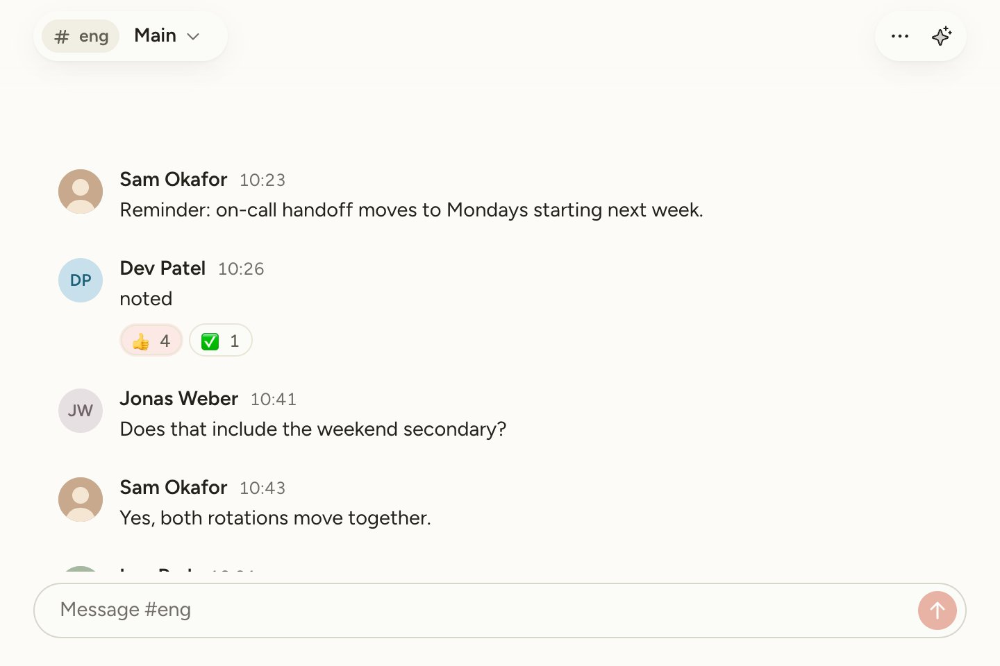 | 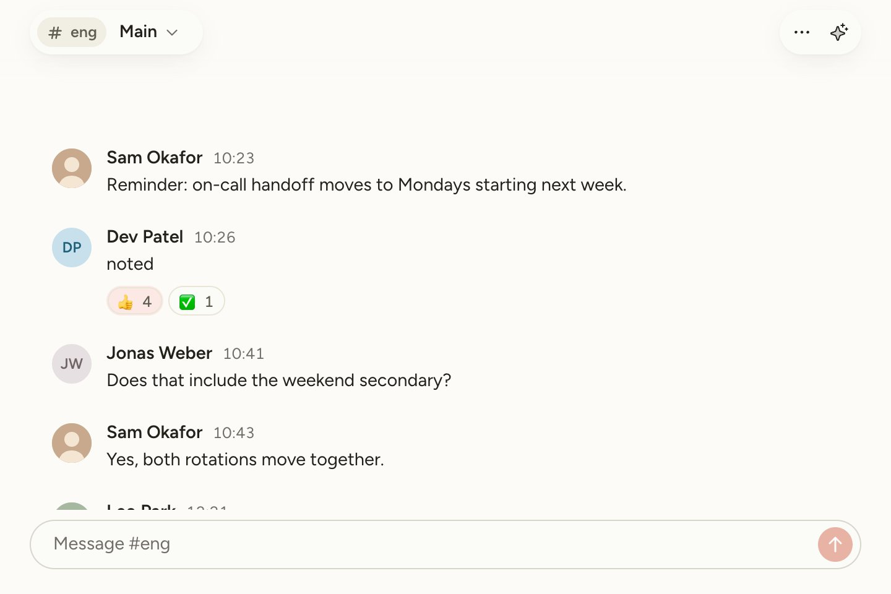 |
| Minimum window, dark |  |  |
| Loading an older page, dark | |  |

**2. The place pill gives way first in a narrow header.** Under the header's 480px width, a thread's place pill is its icon alone: a 24px circle in its tint (`ContextPill iconWhenNarrow`). It keeps the same accessible name, and its tooltip names the place and its kind ("hiring · Private channel"). The title takes the room. One refinement: a Main keeps its channel's name, because its title is the one word "Main" and needs no more room (`shots/r2-narrow-main-after-light.jpg`). `narrow-geometry.spec.ts` checks all three forms.

| | Before | After |
| --- | --- | --- |
| DM thread, light | 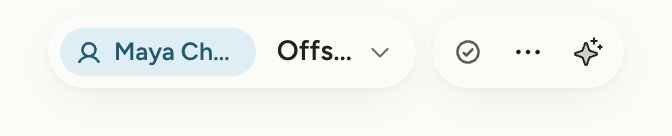 |  |
| DM thread, dark | 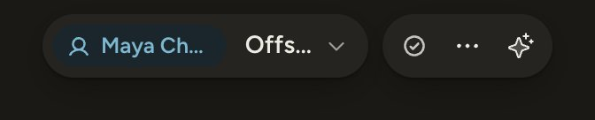 |  |
| Private thread, light |  |  |
| Private thread, dark |  | 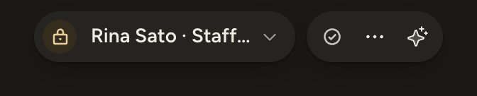 |

A first version wrote the narrow styles with `default: null`. In StyleX that removes the wide value, so every header shot lost its pill's padding. The stylex skill now lists this pitfall.

**3. The hover toolbar is one Tab stop.** Tab reaches one button on the focused message's toolbar: the one last focused, or the first reaction. ← and → move along the visible buttons and wrap, Home and End go to the ends, and Esc returns focus to the message. This uses `moveFocus` from `@juno/ui` and is covered by `roving.spec.ts`.

Writing that test turned up a keyboard bug that is on main too: Tab from a focused message could not reach its toolbar at all. The toolbar is out of the layout unless something in its row has keyboard focus. As the row let go of focus, the toolbar hid before its button could take focus, and focus fell to the page. The arrows had the same problem. The row now keeps the toolbar laid out for the one key press that moves focus into or along it (`holdToolbarForMove` in `Message.tsx`), and lets go once focus lands. Checked against the built gallery, on this branch and on `41ad6fe9`.

**4. The icon and colour pickers are radio groups.** In the view sheet and the channel icon picker, each group is one Tab stop on its chosen item. Every arrow moves to the next or previous choice and chooses it, and Home and End go to the ends. The items say `aria-checked`, not `aria-pressed`. This uses `radioItem` and `radioKeys` from `@juno/ui`. The e2e driver's colour query and `views.spec.ts` now ask for radios. The channel picker's focus shot now shows the ring on the chosen icon, where Tab lands.

| | Before | After |
| --- | --- | --- |
| Light |  | 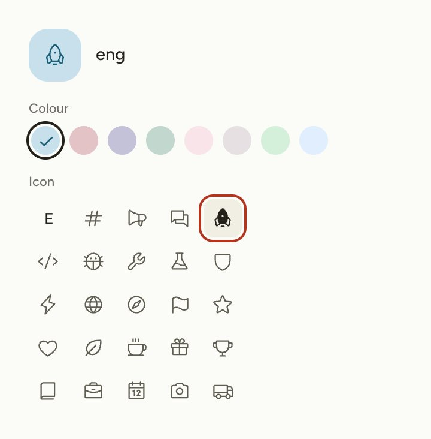 |
| Dark |  |  |

**5. Code follow-ups.**

- **Focus ring.** `focusRing` (`outside`, `inset`) is exported from `@juno/ui`, and every primitive uses it. The six topic views (`ThreadLink`, `MessageBody`, `MediaGrid`, `HeaderControls`, `TopicRow`, `Message`) no longer write the outline by hand.
- **Kind icon.** `kindIcon` in `look.ts` is the one kind-to-icon map. The header pill and the row's meta line use it, as the scope chip and the view sheet already did.
- **Token lint, new rules.**
  - A module constant used in a style is checked as its value. A number used as a factor in a `calc()` is not counted as a length.
  - A `color-mix(` with a literal share is a raw colour.
  - Rule tests are in `check-tokens.test.mjs`.
- **What the new rules found.**
  - New tokens replace values in the topic views: `--link-underline`, `--quote-fill`, `--header-pill-max-width` and `--header-title-min-width`. The reaction chip's emoji uses `--icon-14`.
  - 18 documented one-offs elsewhere now carry a `tokens-allow` reason.

Not done here: 17 other views still write their focus ring by hand, mostly in Home, the Juno chat and the tour. Those areas belong to other work, so they should move to `focusRing` when next touched (`docs/design/primitives.md` says so).

**Verification, round 2.**

- **Gallery shots.** Regenerated for `TopicView`, `TopicHeader`, `MessageList`, `HoverToolbar`, `Sidebar`, `ChannelIconPicker` and `PeekView`. They changed only as intended:
  - the topic lists moved up 2px, to the toolbar's room;
  - the 336px headers show the icon pill;
  - the channel picker's focus shot moved to the chosen icon.
  - The few other differences are one-pixel anti-aliasing and the random topic art.
- **Typecheck and lint.** Local typecheck of `ui`, `views`, `state`, `gallery` and `desktop`; `pnpm lint` passed (10 of 10). `node --test scripts/check-tokens.test.mjs`: 7 of 7.
- **`pnpm affected`, first run** (on `6e8bb88e`).
  - Typecheck, lint, unit tests and spec conformance passed.
  - Gallery failed on the top-gap version described above: `toolbar-geometry.spec.ts` three times, and `roving.spec.ts`'s Esc test, which looked for the hidden toolbar by role.
  - Desktop failed on `peek.spec.ts:120`, the 28px shift above. 420 passed.
  - All four failures were fixed in `cadcd590`.
- **`pnpm affected`, second run** (on `1ba061da`).
  - Everything passed except one gallery test: `roving.spec.ts`'s Esc test. Looking into it found the keyboard bug in item 3.
  - Two runs of that one spec were used to find it; it was then diagnosed locally against the built gallery.
- **`pnpm affected`, third run** (on `08eee002`).
  - Passed: typecheck, lint, gallery (278 passed) and desktop e2e (420 passed).

## Round 3: the 24px top gap, with the toolbar inside the first message

Decided by the orchestrator, on `topic-top-gap` from `4c4ac09b`. `small-ui-1017` added a toolbar placement inside the row's top edge. The first message at scroll top now uses it too, in place of keeping room above it or flipping the toolbar below. That makes the 24px gap possible:
- **Gap:** at scroll top the first message starts where the header band ends, 24px under the islands. That is the same 24px the last message keeps above the composer.
- **Loading line:** "Loading older messages" shows in that gap, out of the flow and drawn over the band's fade.
- **Toolbar placement:** `placeToolbar` puts the toolbar 2px inside the row when there is no room above and the row's top is in view. A row whose top is under the band still flips it below, and a row taller than the list still takes it in the part in view.
- **Tests:** `toolbar-geometry.spec.ts` now checks that the first row's toolbar sits inside the row, below the band and clear of the name and time. `message-geometry.spec.ts` checks the 24px gaps at the top and bottom.

| | Before | After |
| --- | --- | --- |
| Thread at its top, light | 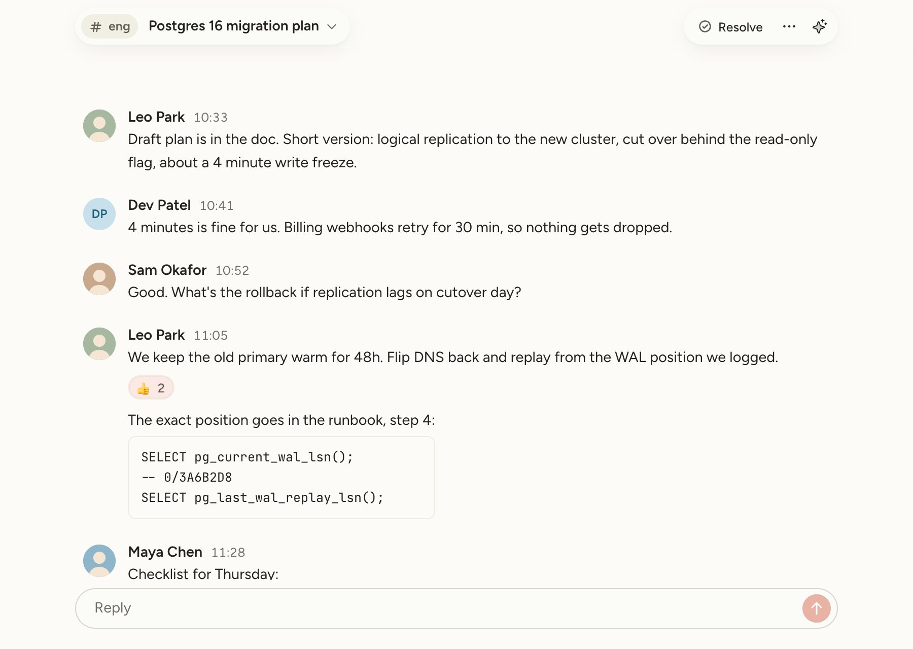 | 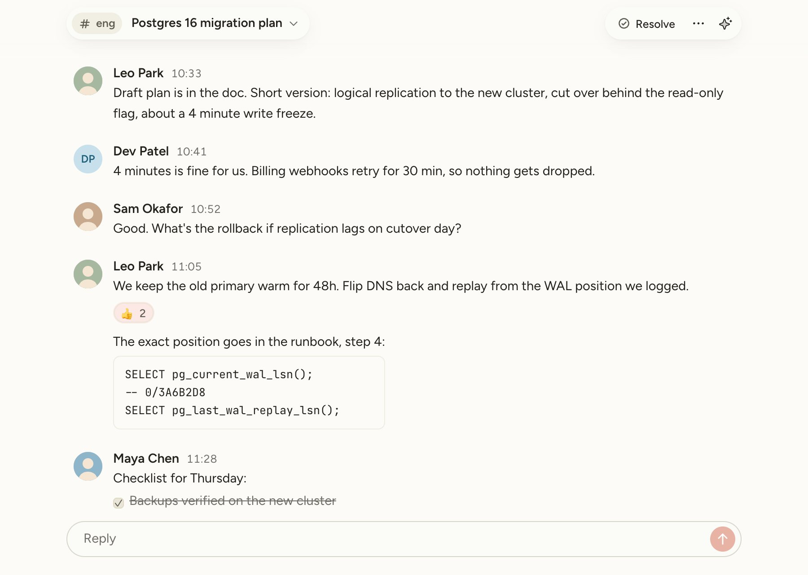 |
| Thread at its top, dark |  |  |
| Minimum window, light |  | 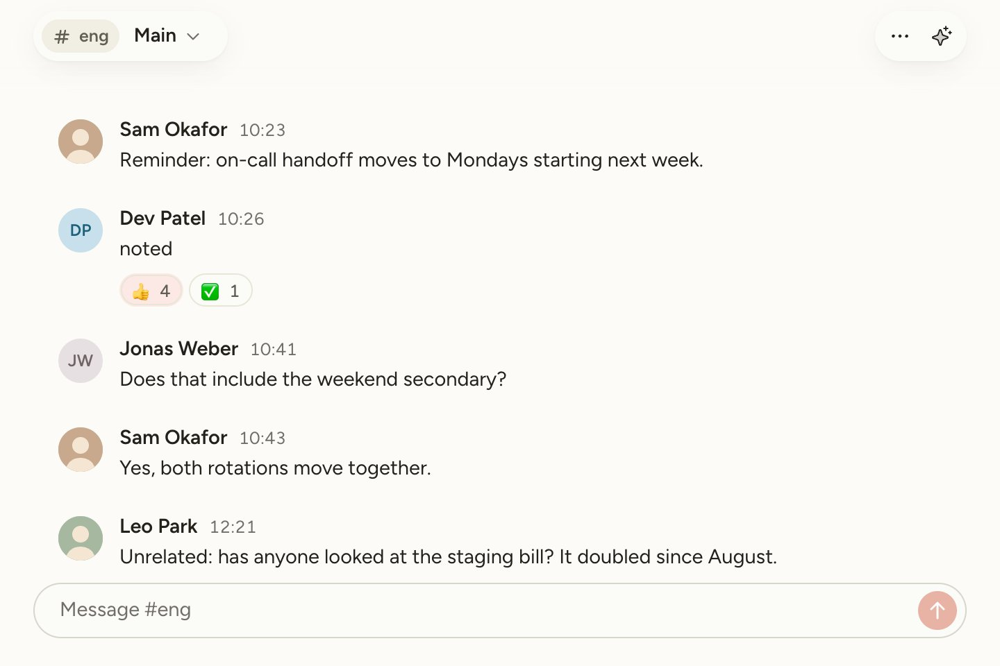 |
| Minimum window, dark | 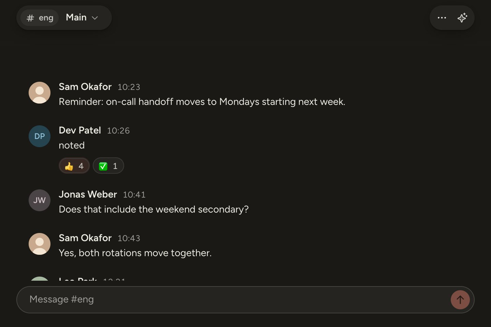 |  |
| First message hovered, light |  |  |
| First message hovered, dark |  |  |
| Loading an older page, light | |  |

**What this costs.** Inside the row, the toolbar (36px) is taller than the name line (about 26px). While the first message is hovered or focused, it covers the right end of the first body line, about 14px of it, when that line runs to the edge (`shots/r3-first-toolbar-closeup-light.jpg`). The name and time stay clear. Flipped below, it would have covered the next message's name instead. SPEC 7 now says "clear of the name and time" for this case, not "never covers the message's own text".

**Verification.** Gallery shots of `TopicView` and `MessageList` before and after; only the topic lists' first rows moved, up 34px. Typecheck and lint ran locally. `pnpm affected`, once: see the report.
