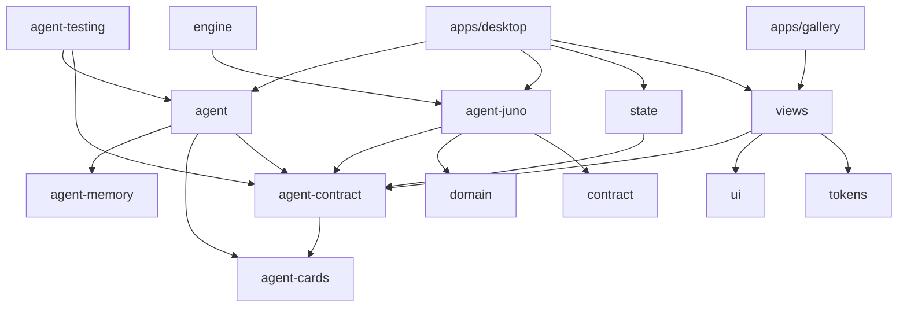

# Juno Agent: architecture plan, v3

Opus, 2026-10-14. This version replaces `plan-v2.md`. It answers both reviews of v2: `review/astra-v2.md` (correctness, R1–R15) and `review/fable-v2.md` (experience, B1–B5, H1–H5, M1–M11, L1–L6). It also takes in the owner's later decisions: the MCP endpoints, the model picker and the defaults. SPEC.md still decides behaviour. The Juno Agent chapter is written in M1 (WP7).

## 0. Review decisions

Each finding is accepted (A) and changed in the plan, or rejected (R) with a reason. No finding is rejected outright. Where a change goes further than the finding asked, the row says so.

| ID | Finding | Decision | Where |
| --- | --- | --- | --- |
| R1 | A folder cannot fence a partitioned old writer | A. v1 supports **cooperative transfer only**. Forced recovery needs the owner to attest that the old Mac is off or erased, and starts in recovery mode. There is no "safe forced takeover" claim. A dispatch gateway comes with the later always-on authority | §14 |
| R2 | A restore repeats completed actions | A. A restored store opens in **recovery mode** with dispatch off. Approvals are void, executable work is quarantined, a new incarnation starts, and action ids are global UUIDv7. The recovery point limit (5 min) is stated | §14 |
| R3 | The request builder has no bounded result | A. `buildRequest` returns `Admitted \| Blocked`. A **provider-boundary guard** refuses any request without a builder stamp. Tokens are counted with a safe upper bound (1 per UTF-8 byte plus framing). Model windows are checked when a model is picked | §5 |
| R4 | Redaction leaves copies and misses non-ancestor dependencies | A, with a design change: the compaction context becomes a **local window** with recorded dependencies, so taint is exact and bounded. Exclusion is immediate; storage purge is eventual, with a deadline. The scope is stated plainly | §4.5 |
| R5 | Versioned nodes are not bound to the view | A. A singleton `memory_head` holds revisions with exact node versions, `covered` and the redaction generation, under compare-and-swap. Requests read one snapshot. Masked intervals are their own entry type | §4.2 |
| R6 | A projection of a weaker journal cannot be the archive | A. An authoritative `FULL` **inbox** is written before any acknowledgement. Juno's own SQLite facade runs pi at `FULL`. Journals have incarnations. A journal behind the archive means safe stop and rotation, never replay | §3 |
| R7 | "Check before retry" proves nothing | A. Approvals, authorizations, attempts and receipts are separate records. An authorization is consumed before transport. There are no hidden retries. A negative lookup keeps the state `unknown`. Retrying after `unknown` needs a new click that states a duplicate may result. "Exactly once" and "effectively once" are removed | §6 |
| R8 | Run origin is not owner authorization | A. **Clean-run rule plus scoped grants.** A no-click Tier 2 action or a schedule needs an owner run that has not yet read untrusted content, and it mints a grant scoped to its target. "Ask once per job" is deleted | §6.4 |
| R9 | Pin exactness contradicts editing | A. Pins are exact **spans** of an owner message (id, version, byte range), derived on the trusted side, or owner-edited records. The claim is attribution, not injection-proofing | §4.4 |
| R10 | Tail and active run overlap | A. A run-start history cutoff `H` and per-request cutoffs partition view, tail and active suffix by source id. Truncation rules are defined per kind. Oversized input is refused locally | §5.2 |
| R11 | Approval needs a full executable identity, and batches need children | A. The digest covers connection, account, destination ids, tool, schema hash, canonical arguments (JCS), preconditions and the operation list. A batch approves immutable child actions | §6.2 |
| R12 | Unknown recovery must not block | A. Startup classifies interrupted attempts as `unknown` and reconciles asynchronously. Pause and Stop stop new authorizations and request cancellation | §6.5 |
| R13 | Backup needs a replay and redaction protocol | A. Generation, schema version, snapshot position, ordered segments, an authenticated manifest, gap-free replay into a fresh database, persisted export progress, fresh nonces, sanitized regeneration and a deletion record | §14 |
| R14 | Work packages outrun their protocols | A. Contracts and specs are M1. Inbox, lock, journal identity and the admission guard come before chat. Writable MCP depends on the dispatcher. One owner (WP16) is responsible for redaction end to end | §17 |
| R15 | The cap is not a hard cap | A. A **hard cap with reservations** across every model path, plus a compaction allowance. At the cap, a card asks the owner. Progress is not promised once the allowance is exhausted | §5.4 |
| B1 | The status bubble has two jobs | A. The bubble covers **runs only** and clears when the run settles. Background jobs show on their Task card and as the sidebar sparkle. The "+1 more" popover is gone | §8, §13 |
| B2 | A watch can spawn watches | A. `schedule_create` works only in a clean owner run, with a source message from that run. Wake and report runs may only pause or delete the schedule that woke them | §11 |
| B3 | Read lookups may default to cards | A. Notion, Littlebird and T3 are trusted, with a read allowlist matched against the tool list found at connect time. The allowlist and tiers are editable. Any unknown tool defaults to Tier 3 | §10 |
| B4 | Chat states are not enumerated | A. A full state table with copy, in the contract and the spec | §13.2 |
| B5 | Esc stops background jobs | A. Esc and the bubble's Stop abort the **run** only. Jobs stop only from their Task card | §8 |
| H1 | Chat view models are owned by the wrong package owner | A. WP7 (Fable) owns `agent-contract/src/chat/**` and the SPEC chapter in M1 | §17 |
| H2 | Steering T3 needs a click | A. `t3_send` and `t3_stop` are Tier 2 under the job's grant. `t3_respond` stays Tier 3 | §9 |
| H3 | Milestones have no notification rule | A. Delivery is a field: `deliver: now \| digest` on schedules, plus a fixed milestone table | §11.2 |
| H4 | Quiet hours hold the wrong thing | A. Quiet hours hold **OS notifications only**. Astra's `quietHoursHoldAuthorization` becomes `quietHoursHoldNotifications`, because Tier 3 always needs a click, so there is nothing to hold at authorization | §11.2 |
| H5 | Tier 1 "settings" is too wide | A. Tier 1 is exactly `remember`, `schedule_create` (under B2), pause and delete of own schedules, and `notify`. Every setting, including the cap and the models, is owner-only in Settings | §9 |
| M1 | `sendMessage` holds one message | A. `messages[1..5]`, each a child action with its own status | §12 |
| M2 | The Change card approves a summary | A. The card renders the argument preview from the stored payload. The model's summary is a caption only | §12 |
| M3 | Activity becomes one row per zoom | A. Activity is grouped by run, with reads folded into one line and failures in plain words with "Copy details" | §13.3 |
| M4 | Home and ⌘J are not wired | A. Ask Juno and ⌘J focus the composer. A grey unread count on the nav item. The home field shows the state line of a running job | §13.4 |
| M5 | Proactive messages can join a group | A. A different origin always starts a new group | §13.1 |
| M6 | Pin rules contradict the pins page | A. Merged into R9 (owner-edited records). "Remember" requests are added to the eval | §4.4 |
| M7 | Stop drops a queued steer | A. After Stop, a queued steer starts a fresh run. The Queued look appears after 500 ms | §8 |
| M8 | Status text before the first tool call | A. Dots only, until the first token or the first tool call | §8 |
| M9 | The spec chapter touches more than §13 | A. WP7 writes the chapter plus cross-edits to §12, §14, §15, §16, §18 and §19 | §17 |
| M10 | Page views are blocked behind wiring | A. WP12 owns every dumb view, including the Sidebar props. WP14 owns containers only | §17 |
| M11 | `expected_by` has no default | A. 30 minutes after the last step change | §8 |
| L1 | Resolve's tier reason is wrong | A. It is a card because SPEC §13 says so | §9 |
| L2 | Removal leaves Juno's quote | A. The dialog offers "Also remove Juno's reply" | §4.5 |
| L3 | T3 questions should name their source | A. The header reads "T3 Code asks", with the job pill | §12 |
| L4 | Cards in dark mode | A. Use the dark theme's ring, and run a 200-message transcript in the mock review | §13.1 |
| L5 | Interrupted copy | A. "Juno was interrupted. Your message is kept. [Try again]" | §13.2 |
| L6 | What leaves the machine | A. The first-run provider card says it once. Settings shows spend today | §13.2 |
| G1 | WP2 spec gap 1: the 16 KB window does not bound the rebuild after a redaction, and pin inputs are untracked | A, with a design change: the compaction context is **raw archive messages**, not summaries, and compaction does **not read pins**. A redaction now rebuilds only nodes within 16 KB after the removed message plus their ancestors | §4.2, §4.5 |
| G2 | WP2 spec gap 2: compaction can move the view past a run's `H` | A. While a run is live, no compaction job starts on an interval that ends after its `H`, and publication rechecks it. The spec's empty-view fallback is removed | §4.2, §5.2 |
| G3 | WP2 spec gap 3: pin edits need a revision check beyond `gen` | A. `memory_head` holds `pin_rev`, bumped by every pin change. Requests revalidate it with `gen`. A pin edit is a compare-and-swap on the pin version and its source lineage | §4.3, §4.4 |
| G4 | WP2 spec gap 4: oversized children can block a parent compaction | A. A stored node is **at most 16 KB**. A leaf with no attempt under that copies its source. A parent keeps its shortest attempt cut to 16 KB. So a parent input is always ≤ 32 KB and every merge can start | §4.2, §5.3 |
| W1 | WP7 review B1: run endings cannot represent failures | A. `Ending` gains `failed` (provider, key rejected, Codex signed out, offline) and `blocked.budget`; every variant has fixed copy, and a run that wrote nothing shows the line alone. After Stop the line is fixed too; Juno no longer "states what was kept" | §8, §13.2 |
| W2 | WP7 review 1: offline sends cannot be Not delivered | A. The inbox is local, so a send is accepted offline, paused and in recovery, and **waits**. Not delivered means only that the inbox write failed | §13.2 |
| W3 | WP7 review 3: Remove as a card fails when needed most | A. The owner's Remove is a local sheet that needs no run. The `remove` card stays for removals Juno proposes | §4.5, §12 |
| W4 | WP7 review 4 and 9: recovery, transfer and the owner's later decisions were not in the plan | A. A Review page, an ownership block in Settings and an update-needed banner. T3 sessions run with full access in a new worktree. The LAN switch exists, off by default, and only an `https` address works over the network (spikes, finding 1). The backup folder is local by default | §1, §13.2, §13.3, §14.3, §18 |
| W5 | WP7 review 5: a card with two machines | A. `proposedTask` and `proposedSchedule` are their own kinds with the click machine; `task` has only `phase`, which gains `unknown`; `schedule` has only `status` | §12 |
| W6 | WP7 review 8 and 11: the clean-run rule read broader than decided, and the question hold was unbounded | A. The spec states the rule as §6.4 defines it ("has not read Slack, a connection or a session report in this reply"), and §19 records that the owner has not confirmed the narrowing. A proactive run waits for an open question at most until it expires or 24 hours, and job reports never wait | §8, §18 |
| W7 | WP7 review 12: "Stop these" could kill a T3 session from a label | A. The label's action is "Pause schedule" or "Mute updates". Jobs stop only from their Task card (B5) | §13.1 |
| W8 | WP7 review 17 and nits: pins from the context menu, `deliver: silent`, the budget card's kind | A. The context-menu pin is an owner action on the trusted side, with the selection or the whole message and the 280-byte limit. `deliver` is `now \| digest \| silent`. The cap shows a `budget` card | §4.4, §5.4, §11.1 |
| G5 | WP3/WP4 spec gap 1: a full chat reservation plus the compaction allowance exceeds the cap | A. The compaction allowance is a **sub-budget inside** the cap (at most 25% of the day's cap and raises), not extra on top. At the cap, compaction stops too | §5.4 |
| G6 | WP3/WP4 spec gap 2: a click after an untrusted report cannot create a schedule under the clean-run property | A. A click on a `proposedSchedule` card is owner authority, the same as a `proposedTask` click. The card renders the exact stored schedule, prompt included. The property becomes `scheduleFromOwnerAuthority` | §6.4, §11.1, §12 |
| G7 | WP3/WP4 spec gap 3: an offline old owner still authorizes after a forced recovery | A, as a stated limit. No fix without a central authority. v1 guarantees one writer under a move, or under a restore whose attestation is true. An old Mac that is still running stops when it sees a newer owner's backup in a shared folder. The UI says both Macs can act until then | §14.1, SPEC §13.8 |
| G8 | WP3/WP4 spec gap 4: a crash before projection leaves the journal ahead of the archive, which §3 called impossible | A. Journal ahead is normal: resume and project. Only a journal **behind** the cursor (a rolled-back file) rotates. The comparison is `next_seq - 1` against the last projected position | §3 |
| G9 | WP3/WP4 spec gap 5: a collected SQLite lock handle lets a second writer in | A. The lock is the S5 SQLite exclusive lock, not `flock`. Its connection is held by a module-level reference for the process's life and closed only after owned I/O stops | §2.2, §14.1 |
| G10 | WP3/WP4 spec gap 6: publishing release before a durable local release lets both Macs activate | A. The old Mac commits `released` first, then captures the final checkpoint (which therefore holds `released`), then publishes | §14.2 |
| G11 | WP3/WP4 spec gap 7: a deletion during staging lets a stale install restore removed content | A. The install transaction rechecks the deletion record. An older candidate stays quarantined and waits for a sanitized generation | §14.4 |
| G12 | WP3/WP4 spec gap 8: the export cursor update captures itself, so backup never settles | A. Capture attaches only to replicated tables. Backup bookkeeping is local and never captured | §14.4 |
| G13 | WP3/WP4 spec gap 9: a fresh Mac has no trusted deletion record | A, partly as a stated limit. A trusted record comes from this Mac's keychain, the move code, or a rotated recovery phrase. Without one, Juno restores the newest generation in the folder and says that removed messages may come back if the folder is out of date. The record reaches the keychain before "Removed" shows | §14.3, §14.4, §18, SPEC §13.8 |
| P1 | WP5 finding: the 64k minimum for the compaction model is below the §5.3 bound (67,584 tokens) | A. The compaction model needs a window of at least 131,072 tokens, matching the spec | §5.3, §7.1 |
| W9 | WP6 difference 2: Quint needs a warned click for every repeat of a non-deduplicated action; the plan named only `unknown` | A. Every repeat authorization of a child without dedupe needs a new click with the duplicate warning, whatever the earlier outcome. `agent-cards` already does this; the copy gains `card.mayDuplicate` | §6.3, SPEC §13.3 |
| W10 | WP6 difference 1: §6.4 used stale proposal names | A. §6.4 already names `proposedTask` and `proposedSchedule` (G6). The check found one more gap: no kind for steering from a tainted run. `t3_send` there is a `change` card; `t3_stop` is the Task card's Stop | §6.4 |
| W11 | WP6 difference 4: "Stopped. Nothing after this was sent." promises more than §6.5 allows | A. The line becomes "Stopped. Juno won't start anything new for this reply." Work handed off before Stop may still land and shows on its own card | §6.5, §8, §13.2, SPEC §13.2, §13.7 |
| W12 | WP6 difference 3: the chat shows one result per row and per card, while the record keeps each attempt and both cancellation states | A, as intended. The view summarizes and Activity shows the evidence. The projection rules are written down | §12 |
| W13 | WP6 difference 5: the chat contract has no approval identities or edit revisions | A, as intended. RPC metadata (`CardBinding`) carries them beside the view models | §12 |

## 1. Owner decisions in force

- **Providers:** OpenRouter and local Codex. Sign in with ChatGPT only if Juno can register. No Claude Code subscription.
- **Chat model:** chosen in Settings from the latest Claude Sonnet, Claude Opus, Muse, GPT Sol and Grok (§7.1). The default is **Claude Sonnet 5.5**. **Compaction:** Haiku 5.5, editable. **Spend cap:** $2 a day, editable in Settings and never by the model.
- **Proactive messages** only about things the owner set up.
- **No click** for read lookups, OS notifications to the owner, self-scheduling, and starting T3 sessions he asked for. Everything else outward is a card and runs at most once after a click. The plan applies this through the clean-run rule (§6.4), which is narrower than the words above; the spec records that in its open questions (W6).
- **Sync in v1:** one writer, an encrypted backup, and a way to move ownership.
- **MCP endpoints:** Littlebird: `https://mcp.littlebird.ai/mcp`, with OAuth. T3 Code: `http://192.168.1.22:3773/mcp`; the spikes found it needs OAuth and that plain `http` works only on loopback. Prefer loopback when T3 runs on the same machine. The URL is a setting. Never send it secrets.
- **T3 sessions** Juno starts run with full access, each in a new worktree.
- **T3 over the network** needs the Settings switch "Allow T3 Code over the local network", off by default. With it on, only an `https` address works, because the sign-in refuses plain `http` off loopback (spikes, finding 1).
- **Backup:** a local folder the owner chooses, under the app's data directory by default. The owner may point it at a synced drive later.
- **Sign in with ChatGPT:** not planned. Codex local and OpenRouter cover it.
- **Still pending:** the owner bubble colour, between options A to D in `docs/design/juno-chat/` (the mock's README recommends B).

## 2. Shape

### 2.1 Packages


| Package | Owns | Must not |
| --- | --- | --- |
| `agent-memory` | Pure rules: node keys, due order with integer cross-multiplication, batches, view rendering, local-window selection, the dependency closure, request partition and budget, the pin span rules, ready queues, the compaction task text | I/O, Effect services, pi |
| `agent-cards` | The card catalogue (TypeBox and Effect Schema), canonical payloads, digests, child-action expansion, card status machines | UI, I/O |
| `agent-contract` | `src/chat/**` (owned by WP7): chat items, states, card view models, pages. `src/rpc/**` and `src/host/**` (owned by WP6): RPC groups and the `AgentHost` port | logic |
| `agent` | The runtime (the only pi-durable importer), store, inbox, journal bridge, projection, recovery, request builder and guard, spend ledger, compactor, router, jobs, the action ledger and dispatcher, grants, policy, redaction, scheduler, providers, MCP and adapters, ownership and backup | import Electron, Slack, `@juno/store`, `sync` or `engine` |
| `agent-juno` | Juno as host, in the engine: Slack read tools, Slack send and resolve through the outbox in single-attempt mode, "this" topic, presence, the notification gate | call a model |
| `agent-testing` | Fakes and the memory simulator | be imported by `src` |

`check-deps` gets these rules:

- No `agent-*` package imports `electron` or `@juno/slack*`.
- `pi-durable` is imported only in `agent/src/runtime/`. `pi-mcp` only in `agent/src/mcp/`. `pi-ai` and `@openai/codex-sdk` only in `agent/src/providers/`.

Versions are pinned exactly: pi 1.2.0 and Codex SDK 0.162.1.

### 2.2 Process and files
- The agent is a utility process at `apps/desktop/src/agent/`. Main brokers its ports (agent↔engine for `AgentHost` over `effect/rpc`, and agent↔renderer). Main holds the keychain and opens OAuth windows. This is ADR 0012.
- Files live in a per-user `agent/` directory:

| File | What | Durability |
| --- | --- | --- |
| `agent.sqlite` | Juno-owned: inbox, archive, memory, pins, ledger, grants, schedules, jobs, connections, spend, backup progress | WAL, `synchronous=FULL` |
| `pi-<incarnation>.sqlite` | pi-durable journal, opened through **Juno's SQLite facade** (pi's portable core accepts one) at `synchronous=FULL` | FULL. Verified in S1 |
| `owner.lock` | An SQLite file held with `locking_mode = EXCLUSIVE` (S5), held until all owned I/O stops | local only |

## 3. Durable core: inbox, journal and projection (R6)

- **Inbox first.** An owner send writes `inbox(op_id UUIDv7, text, at, state: accepted)` in `agent.sqlite` (FULL), and only then does the renderer clear its local pending state. "Not delivered" means that write failed. Steers, reports, wakes and card clicks also enter through the inbox, each with a stable `op_id`.
- **Bridge.** A single router fiber serializes: idle detection, then `reset`, then `submit(input, requestId = op_id)`, then a commit of `inbox.state = submitted` with `(incarnation, submission id)`. A reset is idempotent. A crash between the reset and the submit resubmits on recovery with the same `op_id`, which pi deduplicates.
- **Incarnations.** Each journal file has an incarnation UUID. Projection cursors, task references and action origins are keyed by `(incarnation, commit position)` and are never reused.
- **Projection.** The indexer tails pi's commits in order. It writes archive messages and advances the cursor in one transaction. Source bytes are always stored whole. Presentation clipping (the 30,000-character tool head and tail) applies only to what the model sees. Full tool results go to `attachments`.
- **Recovery** at open, in order: (1) Take the lock. (2) Open `agent.sqlite`. (3) Open the current journal. (4) Compare the journal's last committed position, `durable_metadata.next_seq - 1`, with the archive cursor (the last projected position) for the same incarnation. **Journal ahead** is normal after a crash between a journal commit and its projection: resume, and projection catches up. **Journal behind** means an older file was restored under a newer archive (G8): do not resume. Mark the live runs interrupted, rotate to a new incarnation, and leave every `submitted` inbox op whose run did not finish in `interrupted`. The owner sees "Juno was interrupted". Why: projection runs after the journal commits, so the journal can lead but never trail. A trailing journal can only be a rollback, and replaying it would repeat or lose work. WP8 tests the `next_seq` indexing on both sides, since `next_seq` is the next free position, not the last used one. (5) Otherwise, classify ledger attempts (§6.5), then call `harness.resume()`. (6) An unsupported journal schema (after a pi upgrade) stops safely with "Juno needs to update its records" and never replays.
- **Rotation:** stop admitting, drain the projection, let tasks settle or abandon them with `abortReason` and record each as interrupted, then commit a new incarnation in `agent.sqlite`, open the new journal, and delete the old file. It runs monthly, and on a redaction deadline (§4.5).
- **Tool replay.** pi restores tool arguments without rerunning `beforeTool`. So every authority check (approval, grant, epoch, pause, redaction generation, cap) runs inside the dispatcher on every path. Proposals are deduplicated on `(incarnation, tool task id)`.

## 4. Memory

### 4.1 Records
- `messages(id, kind, bytes, text, at, origin_op, incarnation, source_pos, redacted_gen)`. Ids are dense and never reassigned. The kinds are `user`, `juno`, `tool`, `echo`, `work`, `wake`, `card` and `note`. Long text is split into chunks of at most 16 KB.
- `nodes(l, i, ver, text, bytes, cut, inputs, input_digest, model, prompt_ver, gen, built_at)`. `inputs` lists the exact child versions or source, **plus every context message it read** (source ids). `text` is at most 16 KB. `cut` is set when a parent's text was cut to fit (§4.2).
- `memory_head(singleton: rev, gen, pin_rev)` and `view_rev(rev, entries, covered, gen)`. `entries` is an ordered list of `{node: (l,i,ver)}` or `{masked: (l,i)}`.
- `queue(l, i, ver, due_at, attempts, last_error)`, with retries at 30 s, 2 min, 10 min, then hourly. A worker fiber wakes at `due_at`; no new message is needed.
- `pins(id, kind: span | owner, source_id, source_ver, from, to, text, active, supersedes, at)`.
- `redactions(message_id, gen, at)`, plus the `purge` jobs.

### 4.2 Tree, view and publication
- **The gist's rules hold:** Nodes target 512 bytes, with a ruler and up to 5 retries, keeping the shortest. 512 is a target, not an invariant. A source that fits is copied. Merges happen only between siblings with a built parent, in due order measured from the pair's last message, ties going to the oldest. Batches run from 128,000 bytes down to a 64,000-byte target. At most 8 jobs run at once, and a leaf starts once fewer than 8 earlier leaves are unbuilt. The `T=10` case is a test and a Quint witness.
- **Compaction context (changed from the gist, R4, G1).** Instead of a coarse whole-history view, a job reads a **local window**: the archive messages just before its interval, newest first, rendered as tail items, up to 16 KB. Removed messages are skipped. The window stops before the first message that does not fit; it does not skip it to reach an older one. Every context message is recorded in `inputs`. Compaction does not read pins; every chat request carries them anyway (§5.2). Why: summaries as context form a chain, because each node read earlier nodes that read earlier nodes, so one redaction could taint every later summary. Raw messages have no dependencies of their own, so the taint of a redaction is the nodes whose interval contains the message, the nodes whose window reached it, and their ancestors (§4.5). Pins read by every job would form the same chain. The cost: less long-range context for resolving references than the gist's view. The compaction eval (WP23) compares the local window with the gist's view on recall. If recall drops past the target, the window grows. The rebuild bound grows with it, linearly. It never returns to summaries or an untracked whole view as context.
- **Node size (G4).** A stored node is at most 16 KB. If none of the five attempts fits, a leaf stores a copy of its source (a chunk is at most 16 KB), and a parent stores its shortest attempt, cut at a character boundary to 16 KB and ending with "(cut)", with `cut` set and logged. Why: a parent then reads at most two 16 KB children, so its input is always within 32 KB and no merge is blocked by an earlier output. The cut loses text, but only after five failed attempts, and the eval counts cuts.
- **Cutoff ceiling (G2).** While a run is live, no job starts on an interval that ends after the run's `H`, and publication rechecks this in its transaction. So `covered ≤ H` for the whole run, and the view never overlaps the active suffix. Jobs for the run's own messages start when it settles. Why: it keeps one head for every reader, with no historical copy to mask or purge. The run's messages are in the active suffix meanwhile, which has its own 64 KB cap.
- **Publication.** A job snapshots its inputs and `gen`, then builds outside any transaction. In one transaction it checks that the input digest and `gen` are still current, inserts the node, and, if the change affects the view, writes `view_rev(rev+1)` and advances `memory_head` from the expected `rev`. A stale job is discarded and re-queued.
- **Restart** loads `memory_head` and its `view_rev`. The view is never rebuilt from the log.

### 4.3 What a request reads
- One read transaction gives pins, `pin_rev`, `view_rev`, `covered`, `gen` and the tail cutoff. The builder prepares outside the transaction, then **revalidates `gen` and `pin_rev`** at admission (§5). If either changed, the request is rebuilt. Why `pin_rev` (G3): a pin edit does not change `gen`, and a request must carry the current pins exactly.

### 4.4 Pins (R9, M6)
- `remember(source_id, from, to)` is Tier 1. `source_id` must be a `user` message admitted in this run. The trusted side copies `text = bytes[from, to)` (at most 280 bytes) and records the source version.
- An edit on "What Juno remembers" writes `kind: owner`, which supersedes the old pin and keeps its `source_id`, so a later redaction of that source still removes it. The 4 KB active budget is checked in the same transaction as the insert. Over budget, Juno asks in words which pin to drop.
- **Revisions (G3).** Every pin insert, edit, deactivation and Undo bumps `memory_head.pin_rev` in the same transaction. An edit is a compare-and-swap: it names the pin version it replaces, and commits only if that version is still active and its source is not redacted. Otherwise the page reloads the pin and shows "This changed. Check it and save again."
- **The context menu path.** "Remember this" on an owner message is an owner action on the trusted side, not the `remember` tool: the renderer sends the message id and the selected byte range (or none, for the whole message), and the agent writes the pin with the same 280-byte limit. The renderer disables the item when the message, or the selection, is longer than that.
- A redaction deactivates pins sourced from that message in the redaction transaction. **Claim:** pins are attributed exact text from the owner's own messages. They do not make injection impossible. A pin shows "Remembered · Undo". The recall eval includes "remember …" requests, so the line is reliable.

### 4.5 Redaction (R4, L2)
**Scope, stated in the UI and the spec:**

- Removed: the selected messages, their attachments, every tree node or pin that depends on them through recorded inputs, pending actions and grants created in runs that saw them, the Codex thread files for those turns, the pi journal that holds them (by rotation), and backup generations (by regeneration).
- Kept: Juno's later replies that quote them (the owner can also remove those; the dialog offers "Also remove Juno's reply"), metadata without content in Activity, and copies at model providers. Forensic erasure is not promised.

**Steps:**

1. **The redaction transaction** (the owner's click, after the keychain deletion record is raised, §14.4): Tombstone the messages and `gen += 1`, and bump `pin_rev` if a pin is deactivated. Compute the taint closure over `nodes.inputs`. Because context is raw messages (§4.2), the closure of a message `m` holds only nodes whose interval contains `m`, nodes that start within 16 KB of archive after `m`, and their ancestors: about two nodes per message in that 16 KB, plus two per tree level. Write `view_rev` with `masked` entries for tainted lines, and advance the head. Deactivate the pins. Mark tainted pending proposals `expired` and revoke grants from tainting runs. Enqueue rebuilds at `ver+1`, and enqueue `purge` jobs for old node versions and attachments. From this commit on, no request, zoom or publication can expose tainted text: the builder renders masked lines as `(being updated)`, zoom returns `removed`, and jobs with an older `gen` are discarded.
2. **In-flight work:** the active run is aborted if its request included tainted content, and its queued steer starts a fresh run. Running subagents spawned in tainting runs are stopped, and their reports are quarantined.
3. **Purge**, eventually: Delete old node versions and attachment pages. Delete the Codex session files. Rotate the journal within 24 hours. If a background job blocks rotation, Settings shows "Removal pending · 1 copy in a running job · Stop job". Start a new backup generation (§14).
4. The chat shows "Removed". "Memory of this chat" shows masked lines until they are rebuilt.

## 5. Requests, admission and spend (R3, R10, R15)

### 5.1 Budget arithmetic
- The **token upper bound** is `utf8Bytes(text)` plus 64 tokens of framing per message. It is valid for byte-level tokenizers. S7 checks it against the providers' reported usage, and a provider whose count ever exceeds the bound gets a 1.25 multiplier.
- `admit(request, model)` requires `upper(input) + outputReserve(16k) ≤ model.contextWindow`.
- **Model compatibility.** A model is offered only if `contextWindow ≥ required`, where `required` = system and tools + 4 KB of pins + the 128 KB view high mark + the 24 KB tail cap + the 64 KB active-run cap + the reserve. That is about 250k tokens under the bound. Codex's 272k window passes.

### 5.2 Partition (R10)
- At run start the router commits the **history cutoff `H`**: the archive position before the run's first input. The compactor does not move `covered` past `H` while the run is live (§4.2), so the view always ends at or before `H`.
- A request contains: **View**: the clean entries of the snapshot covering `[0, covered)`. **Tail**: archive records in `[covered, H)`, verbatim. Beyond the 24 KB cap they become **one range placeholder** ("messages 900–1400 not summarized yet: zoom them"), which is bounded no matter how far the compactor lags. **Active suffix**: pi's entries for this run with `source_pos ≥ H`. Steers come in order, and tool call and result pairs keep their ids and provider metadata.
- No source id appears in two parts. The builder asserts this, and Quint checks `requestCoverageDeclared`.
- **Truncation per kind:** A tool result over 2 KB is shown as head and tail with "(paged: zoom N)". Tool-call arguments over 8 KB are refused at the tool. The model gets an error. An owner input over 64 KB is refused locally: "That is too long to send as one message. Split it up and send the parts." It is stored, marked not sent.
- Fallback order when over budget: clip tail echoes, collapse the tail to the range placeholder, page the active run's old tool results, emergency merges of built parents only, and finally **Blocked**. Blocked makes no provider call. The run ends with "Juno can't fit this in one request. Removing a pin or starting a smaller task helps." Pins are never dropped silently.

### 5.3 The guard at the provider boundary
- Every model path (chat, compaction, subagent, harness prompt) goes through `providers/guard.ts`. The guard checks the builder's stamp (the snapshot `rev` and `gen`, plus a hash of the messages) and the admission bound, and reserves spend.
- A request without a valid stamp, such as pi's raw context after a hook error, is refused with a local error. The run fails visibly as interrupted.
- Compaction requests are bounded the same way: fixed text, the local window (≤ 16 KB), the input (≤ 32 KB, either two nodes of at most 16 KB or one ≤ 16 KB chunk), and the 16k output reserve. No pins. That sum is at most 67,584 tokens under the bound (2,048 of task text + 16,384 context + 32,768 input + 16,384 reserve), plus the system text and tools; `agent-memory` computes it as `requiredWindow(…, 'compaction')`. The compaction model is offered only if its window is at least **131,072 tokens** (§7.1, P1).

### 5.4 Spend (R15)
- A `spend` ledger holds per-day `reserved`, `actual` and `unknown`. Before each billable call the guard reserves `upper(input) × price + maxOutput × price`. Actual usage reconciles it. A lost stream keeps its reservation as `unknown` spend.
- The cap defaults to $2 a day. It is a hard cap over all OpenRouter paths: `reserved + actual ≤ cap + raises`, whichever path reserves. **Compaction has a sub-budget inside the cap** (G5): its own reservations and actual spend may use at most 25% of `cap + raises`. Chat may use the whole cap. Why: an allowance on top of the cap would let a day reach 125% of it, and the owner set one number. The cost: once chat has used the cap, compaction also stops until midnight or a raise, and the tail placeholder (§5.2) covers the gap.
- At the cap: New runs are Blocked with a `budget` card: "Juno has used today's budget. [Allow $1 more today] [Wait until tomorrow]". A run that reaches the cap mid-way, or inside a subagent, ends `blocked (budget)` with the same line and the same card. The click is the owner's, and it is a one-day raise. Compaction pauses at its allowance, and the tail placeholder covers the gap.
- Codex turns are counted, not charged. Only Settings can change the cap. No tool exists for it.

## 6. Actions (R7, R8, R11, R12)

### 6.1 Records
`intents` (immutable), `approvals` (owner clicks, `revision` and `digest`), `authorizations` (one per dispatch, consumed before transport), `attempts` (transport submissions), and `receipts` (evidence). Plus `grants`. All of them are in `agent.sqlite` at FULL, with UUIDv7 ids that are global across restores.

### 6.2 Executable identity and batches
- `digest = sha256(JCS({ connection_id, account_id, destination_ids, tool, schema_hash, args, preconditions, ops }))`. The card renders its preview **from the stored payload**. Dispatch sends exactly that payload.
- Before authorizing, the dispatcher re-checks expiry, source invalidation, connection and account identity, the schema hash (a changed tool schema voids the approval), and destination preconditions such as a Notion `last_edited_time` match.
- A batch card approves an ordered list of **child actions**. Each child has its own key, authorization, attempt and outcome. A retry touches only unresolved children.

### 6.3 Dispatch, retry and reconcile
```text
intent ─(Tier 3: owner click on rev/digest)─▶ approved ─authorize(consume)─▶ attempt ─▶ receipt: done
                                                                    │                 └▶ definite rejection: failed
                                                                    └ crash or timeout after consume ─▶ unknown
unknown ─reconcile─▶ done (positive evidence) | unknown (kept, shown) ; retry = new owner click "may duplicate"
```

- **Every repeat needs a warned click** (W9). A second authorization of a child whose destination does not deduplicate needs a new owner click that carries the duplicate warning, whatever the earlier attempt's outcome: `unknown`, `failed` or `cancelled`. Why: "definite rejection" rests on reading a destination's error correctly, and the spec (`retryRequiresAuthority`) does not trust that. A deduplicated child (natural or local-id dedupe) retries under its key with a plain click. The card prints the warning beside the retry button (`chatCopy.card.mayDuplicate`).

- **Transports never retry by themselves.** pi-mcp is called with no retry. Agent sends go through the engine outbox in **single-attempt** mode. pi-ai `maxRetries: 0` stays as it is.

| Destination | Dedupe | Reconcile |
| --- | --- | --- |
| Slack send | none proven server-side | A history lookup for `client_msg_id`. A positive result proves success. A negative result keeps `unknown`: "Juno can't tell whether this was sent. [Check channel] [Send again]" |
| Resolve (local) | natural | Re-apply |
| T3 launch, send, respond | none | `t3_thread_search` for the tag `juno:<action id>` in the first message. Positive proves it. Negative keeps `unknown` |
| Notion, Littlebird writes | none known | Read back. Positive identification of the exact change proves it. Otherwise `unknown` |
| OS notification | local id | at most once |

### 6.4 Grants and the clean-run rule (R8, B2, H2)
- A run is **clean** while its request holds only owner inputs and Juno-internal state. It becomes **tainted** at the first untrusted content: any MCP or Slack read result, a `work` report, a wake, or a steered report.
- **Grant creation.** A Tier 2 start (`t3_start`, `delegate.spawn`) or a `schedule_create` without a click is allowed only in a clean owner run. It **mints a grant** `{ id, op_class, target (project, job or schedule), bounds (one job; or a schedule's revision and purpose), source_op, revoked }`. The model never supplies a grant id. The application binds the grant to the call it made.
- **In a tainted run,** or when the scope cannot be established, the same tool produces a card (`proposedTask` or `proposedSchedule`), and the owner's click mints the grant. **A click is owner authority** (G6): it enters through the inbox as an owner op, and that op is the grant's `source_op`. It mints the grant only if the card's stored revision and digest are still current, as in §6.2. Why: the click approves the exact stored payload, which no untrusted content can change after the card renders. The model wrote the payload in a tainted run, so the card must show all of it, including a schedule's prompt.
- **Grant use.** `t3_send` and `t3_stop` need a live grant for that job. From a tainted or report run, `t3_send` becomes a `change` card (server T3 Code, target the job, the stored message as its preview), and `t3_stop` produces no card: Juno points to the Task card, whose Stop is the owner's click (W10). Reports, tool output and steering cannot create, broaden or restore a grant.
- Revocation happens through a job Stop, a schedule delete, a redaction, or Pause.

### 6.5 Startup, Pause and Stop (R12)
- At startup, every `attempt` without a receipt becomes `unknown` before `resume()`. A reconcile fiber works through them in the background. Unrelated chat runs at once. Resumed runs see unresolved outcomes in turn state.
- Pause, Stop and AI off **stop new authorizations** and ask jobs to cancel. Authorizations already consumed may still land. States distinguish `cancel-requested`, `cancelled`, `unknown` and `done`, and earlier evidence is never overwritten. Stop's fixed line therefore promises only that nothing new starts (W11); anything already handed off reports on its own card.

## 7. Providers and the model picker

### 7.1 Chat model picker
- Settings › Juno › Model lists one row per family, resolved **at runtime**, with nothing hard-coded beyond the family patterns:

| Family | Pattern (OpenRouter) | Via Codex |
| --- | --- | --- |
| Claude Sonnet (default) | `anthropic/claude-sonnet-<ver>` | no |
| Claude Opus | `anthropic/claude-opus-<ver>` | no |
| Muse | `meta/muse-*` | no |
| GPT Sol | `openai/gpt-<ver>-sol` | yes (`gpt-<ver>-sol`) |
| Grok | `x-ai/grok-<ver>` | no |

- **Resolution:** Fetch OpenRouter's public `GET /api/v1/models` at startup and daily, caching the last result in `agent.sqlite`. Keep models whose `supported_parameters` include `tools`. Exclude `:batch` (which does not stream), `~…-latest` aliases (a moving target breaks cache stability), `-pro`, `-contributor`, `-lite`, `-preview` and `-image` variants, non-numeric versions (Muse is the exception: `meta/muse-<word>[-<ver>]`, spikes finding 5), and models below the compatibility window (§5.1). Pick the newest `created` per family. Join with pi-ai 1.2.0's catalogue for API kind and compat. pi-ai's chat catalogue holds only tool-calling models, and every chat API it uses streams. A slug missing there is sent as OpenAI-compatible, with the price taken from OpenRouter's `pricing` field.
- **Sol via Codex:** the list comes from Codex's own model listing (app-server, S3), falling back to pi-ai's `openai-codex` catalogue. Today that resolves to `gpt-6.1-sol` with a 272k window.
- The row shows the family, the resolved model ("Claude Sonnet 5.5"), its provider (OpenRouter, or Codex for Sol), and a price hint.
- The saved choice is `{ family, provider }`. The resolved slug is stored per day, so a newer release takes over only at the next daily refresh, and the change is logged in Activity.
- **On 2026-10-14 this resolves to** `anthropic/claude-sonnet-5.5`, `anthropic/claude-opus-5.5`, `meta/muse-wonder`, `openai/gpt-6.1-sol` and `x-ai/grok-4.7`. These are examples only: the code holds patterns, not slugs.
- A model change costs one cache miss and applies from the next run.
- **Compaction model:** a second picker, defaulting to the latest `anthropic/claude-haiku-<ver>` (Haiku 5.5 today), with the latest `google/gemini-<ver>-flash` as the alternative. The same filters apply (tools are declared but never called, so the tool block matches turns), with a compaction window minimum of **131,072 tokens** (P1). Why: the largest compaction request is 67,584 tokens under the bound before system text and tools (§5.3), and up to 84,480 with the 1.25 multiplier. 131,072 covers both with room, and it is the window the Quint spec checks. Haiku 5.5 and the current Flash pass it easily.

### 7.2 Adapters
- **Model providers** (OpenRouter now; Sign in with ChatGPT if feasible): pi-ai through the guard, a key from the keychain via main, `sessionId` affinity, cache marks (S2).
- **Codex (local) harness:** Each turn is a fresh Codex thread through the SDK, running in an empty temporary directory with a `read-only` sandbox. Juno's tools are offered through a loopback MCP endpoint (`127.0.0.1`, a random port, a per-turn bearer token) served by `agent/src/mcp/serve.ts`. Codex's built-in tools are turned off where possible (S3). The turn runs as the custom task `juno.harnessTurn`, which is not replay-safe. Its prompt passes through the same builder and guard. Its thread files are recorded for redaction.

## 8. Orchestration behind the status bubble (B1, B5, M7, M8, M11)

- **The router** owns the current run, `H`, and the clean or tainted flag. An idle owner input: reset, then the input. A busy owner input: a steer, with "Queued" shown after 500 ms. A report or wake: a steer if a run is active, otherwise a new run. Several reports within 30 s are coalesced. A proactive run waits while Juno has an open question of its own, at most until the question expires or 24 hours pass; job reports never wait.
- **The status bubble covers runs only.**. Dots only until the first token (the bubble becomes the reply in place) or the first tool call (text appears, specific and counting real things, changing at most every 2 s). It clears when the run settles. Esc with the composer empty, or its Stop, aborts **the run only**. After a Stop, a queued steer starts a fresh run, and the reply ends with the fixed line "Stopped. Juno won't start anything new for this reply." (W11). If the run then calls tools between tokens, the bubble reappears below the streaming reply, and the next token clears it: one run is one Juno bubble. A run whose provider call fails (pi-ai runs with `maxRetries: 0`) ends `failed` with a fixed line per cause, never a model-written one.
- **Background jobs** (`jobs` table: subagents and T3 sessions) never use the bubble. Each job has a **Task card** under the message that started it, with a live state line ("T3 Code · tests running, 2 of 5"), Open and Stop. The sidebar's Juno row shows the duotone sparkle while any job runs. "How is it going?" is answered from turn state, which lists the jobs.
- **Subagents** follow pi's background pattern behind a `delegate` tool, with depth 1 and a cheaper model. Their first message is pins + view + task. Reports post once each (`report:<task>:<seq>`).
- **T3 jobs:** A watcher fiber loops `t3_thread_wait(10 min)` and `t3_thread_read`, updating the state line. It posts a `work` report only on a milestone: started, a question or pending approval, done (with the PR), failed, or quiet for 30 minutes after the last step change. The last one reads: "T3 Code has been quiet for 30 minutes. I'll keep watching, or you can stop it." A pending approval becomes a `question` card headed "T3 Code asks" (Tier 3). Juno never merges or pushes.

## 9. Action tiers

| Tier | What | Rule |
| --- | --- | --- |
| 0 Read | Slack and topic reads, allowlisted MCP reads (§10.1), zoom, date, T3 status | No click. Folded into Activity |
| 1 Local | Exactly: `remember`, `schedule_create` (clean owner run only), pause and delete of the schedule that woke the run, `notify` | No click. Undo line where one applies |
| 2 Owner-asked work | `t3_start`, `t3_send`, `t3_stop`, `delegate.spawn`, `delegate.message`, `delegate.stop` | No click in a clean owner run (start) or under a live grant (send and stop). Otherwise a card |
| 3 Outward | Slack send, resolve (a card because SPEC §13 says so), Notion and Littlebird writes, T3 approval answers, every MCP tool not on an allowlist | A card for the exact payload, every time, at most once per authorization |
| 4 Destructive | delete, merge, force push, purchase | Not offered. No card kind. Generic MCP tools on a denylist are refused |

- Settings, models, the cap, rules, the allowlists and the tiers are owner-only, in Settings. No tool can change them. Owner rules can only tighten tiers, except that the owner may move a discovered MCP tool between Tier 0 and Tier 3 (§10.1). Typing "yes" is not a click.

## 10. MCP manager and adapters

### 10.1 The manager
- **Connection config** (owner-editable): `{ id, label, url, transport: http, auth: none | oauth | bearer(secretRef), trusted, allowlist: [tool], tiers: { tool: 0 | 3 }, enabled }`.
- **States:** `off → connecting → ready ⇄ degraded → needs-sign-in → error(backoff 1 s, 5 s, 30 s, 5 min)`.
- **Tool lists are discovered at connect** (paginated `tools/list`) and on `list_changed`. Each tool's `schema_hash` is stored. A tool on the server's **default allowlist** and present at connect is Tier 0. A **new or unknown tool is Tier 3** until the owner moves it on Settings › Connections, which lists the discovered tools with their hints. A changed schema on an allowlisted tool drops it to Tier 3 until reviewed, and voids open approvals (§6.2). Annotations are shown as hints and never grant Tier 0 by themselves.
- **The model sees two fixed tools,** `find_tools` and `call_tool`. Turn state lists the ready servers. Results longer than 20 KB become attachments, and the prompt requires Juno to say when a result was cut or a server is down.
- **Secrets policy:** Every outgoing MCP argument passes a secret filter: an exact match against the keychain values Juno holds, plus token patterns. A hit blocks the call and tells the owner in words. For servers marked `noSecrets` (T3), Juno sends only the server's own OAuth token, only to the origin that issued it (spikes, finding 1); no other header, cookie or stored credential is attached, whatever the config says.

### 10.2 Default servers
| Server | Connection | Default Tier 0 allowlist | Notes |
| --- | --- | --- | --- |
| Notion | `https://mcp.notion.com/mcp`, OAuth (PKCE, DCR, refresh) through pi-mcp, tokens in the keychain | The search and fetch tools, matched by name at connect | Writes are Tier 3 with a `last_edited_time` precondition |
| Littlebird | `https://mcp.littlebird.ai/mcp`, OAuth | The search and read tools, matched at connect against the read names Littlebird publishes (meetings, context search, routine reports, account). Anything else is Tier 3 | Adding material and creating or updating routines are writes, so Tier 3 |
| T3 Code | Setting `t3.url`, default `http://192.168.1.22:3773/mcp`. OAuth (registration, PKCE, no refresh token, spikes finding 1). `noSecrets: true` for briefs and arguments; the OAuth token is the connection's own. See the connection rule below | `t3_thread_read`, `t3_thread_list`, `t3_thread_search`, `t3_thread_wait`, `t3_pending_request_list`, `t3_project_list`, `t3_worktree_list`, `t3_worktree_status` | Launch, send and interrupt are Tier 2 through the T3 adapter. Pending-request answers are Tier 3 |

**T3 connection rule:**

- (1) Try `http://127.0.0.1:<port>/mcp` with the configured port. If it initializes, use it. (2) Otherwise use the configured URL. (3) Plain `http` is accepted only for loopback, RFC 1918 or link-local hosts. A public host must use `https`. (4) Show which address is in use on Settings › Connections.

**T3 security notes:**

- Anyone on the LAN can reach the server, and plain HTTP can be spoofed, so T3 results are untrusted data and taint the run (§6.4). Juno sends T3 only task briefs, and every brief passes the secret filter.
- The T3 adapter (`agent/src/t3/`) requires its tools to be present at connect. If any are missing, the connection is `degraded`, with a plain message listing what is missing.

Fakes for all three servers (WP10) mirror the shapes above. Real adapters are built in M4.

## 11. Proactive scheduling and delivery (B2, H3, H4)

### 11.1 Schedules
- `schedule_create({ at | every | wallClock (time, time zone, weekdays), reason, prompt, deliver: now | digest | silent, source_op })` works with no click only in a clean owner run. `source_op` must be an owner input from that run, and the call mints the schedule's grant. In a tainted owner run it returns a `proposedSchedule` card instead. Start on that card is the owner's click; its op becomes `source_op` and mints the grant (§6.4, G6). Wake and report runs get neither path.
- From wake and report runs, only `schedule_pause` and `schedule_delete` on the schedule that woke them are available.
- Limits: 20 active schedules, intervals of at least 15 minutes, and one-shot wakes at most a year ahead. A schedule untouched for 30 days pauses itself and says so once.
- Wakes are admitted once per `(schedule_id, schedule_rev, due_at)` through the inbox, revalidating the revision and the grant first.
- A missed wake is coalesced and admitted once at the next launch. A wake run that finds no change ends with `stay_quiet(reason)`, which appears only in Activity.

### 11.2 Delivery
| Event | OS notification |
| --- | --- |
| Schedule message | its `deliver` field (set from the owner's words, editable on Scheduled) |
| Job needs a decision, failed, or quiet for 30 minutes | Now |
| Owner-started job done | Now |
| Job started | Silent (the chat shows it) |

- **Quiet hours hold OS notifications only**, except schedules set to `now`. Runs, chat messages and cards are not held. AI assist off delivers nothing. Juno's own messages skip the Slack rules (person, channel, keyword).

## 12. Cards catalogue

| Kind | Props | Actions | After |
| --- | --- | --- | --- |
| `sendMessage` | `messages[1..5]: { target pill, text (editable), result }`, `because?` | Send (all), Dismiss | A result per row: "Sent · Open" or "Not sent · Try again"; the card's status derives from the rows (`sendMessageStatus`) |
| `resolve` | topics[] | Resolve, Dismiss | "Resolved 3 · Undo" |
| `topics` | links | open | none |
| `proposedTask` | kind, title, where | Start, Dismiss | "Started" |
| `task` | job, title, where, phase (`running`, `needsYou`, `quiet`, `lostSight`, `stopping`, then `done`, `failed`, `stopped` or `unknown`), live state. No `status`: `phase` is its only machine. `lostSight` reads "Sign in to T3 Code to keep watching" and Open becomes Sign in | Open, Stop | "Done · Open PR 412", "Failed · Show in Activity", "Stopped", or the can't-tell line |
| `question` | source header ("T3 Code asks", "Juno asks"), prompt, 2–4 options, free text | option, Reply | "You chose …" or "You replied" |
| `proposedSchedule` | what, when, deliver, and `prompt`, the instruction each wake will run, all **rendered from the stored payload** (G6) | Start, Dismiss | "Started" |
| `schedule` | what, when, deliver | Keep, Pause, Delete | "Kept", "Paused" or "Deleted" |
| `connect` | server, scopes, what leaves the machine | Connect, Skip | "Connected" |
| `change` | server, target, a field preview **rendered from the payload**, model caption | Apply, Dismiss | "Applied · Open" |
| `remove` | messages, only for a removal Juno proposes; the owner's Remove is the local sheet (§4.5) | Remove, Keep | "Removed 2 messages" |
| `budget` | spend today, cap | Allow $1 more today, Wait until tomorrow | "Allowed until midnight" |
| `provider` | "Choose a model provider": OpenRouter key or Codex, with the fixed disclosure | Set up | "Using Claude Sonnet 5.5" |

- The model cannot invent a kind. Cards expire after 7 days, or when the source changes ("Expired · Ask again"). An unknown kind renders "This card needs a newer Juno".
- **The view summarizes; the record keeps the evidence** (W12). `agent-cards` keeps every attempt per child (`ChildEvidence`), including an `unknown` attempt after a later attempt succeeded, and both `cancel-requested` and `cancelled`. The card shows one result per row and one status per card: a row is `sending` while any attempt is unsettled (including `cancel-requested`), `sent` once any attempt has a receipt, `unknown` if an attempt may have landed, and `notSent` when every attempt failed or was cancelled before transport. So "Sent" means at least one copy landed, not that no duplicate exists; the owner was warned at the retry click (§6.3). Activity lists every attempt with its evidence. Why: the owner decides from the row, and two cancellation states or an attempt history would not change what they can do there.
- **Approval identities travel beside the view** (W13). The chat contract (`agent-contract/src/chat`) carries no revisions, digests or action ids. The renderer RPCs (`agent-contract/src/rpc`) send a `CardBinding` (card revision and digest, plus each child's action id, revision, digest and `duplicateWarning`) with each card, and a click returns it. Editing a send's text stores a new proposal with a new revision. Scheduled and Remembers snapshots carry revisions the same way. Why: views take props and return ids; the binding is checked by the agent, so no view can compose or alter it.

## 13. Chat UI (dumb views, friendly layer)

### 13.1 Look
The chat has four item kinds: owner bubble, Juno bubble with cards, the status bubble (only during a run), and separators.

- **Owner bubbles**: the colour is pending the owner's choice between options A to D in `docs/design/juno-chat/README.md`, which recommends B (an accent tint, `--hl-bubble`, with `--foreground-default` text). `--radius-bubble` 16, with the 4 px tail on the last bubble of a group. Max width 76%, 14 px text, padding 8×12.
- **Juno bubbles** use `--surface-hover`, with the 28 px mark beside the last bubble of a group. Plain text. Recall answers cite the day ("On 12 Mar you said …") with a link that scrolls to the message.
- **Groups** are formed by sender within 2 minutes **and the same origin**. A proactive group carries an 11 px uppercase label ("SCHEDULED · DAILY CATCH-UP") with "Why this?" and one quiet action: "Pause schedule" or "Mute updates". Neither stops a job (B5).
- **Cards:** Column width up to 560 px, `--radius-card` 20. Light theme: the wide soft shadow. Dark theme: the ring from `docs/design/dark-theme/`. Laid out at full height, with a `--duration-appear` fade.
- **Status bubble:** three dots looping over `--duration-pop` (static under reduced motion), 13 px status text with a 150 ms cross-fade, and Stop on hover or focus.
- **Inline lines:** "Remembered · Undo" (Undo until the next send or 60 s), "Removed", and the fixed secret-blocked line.
- **Times** show on hover. **Day and gap separators** follow SPEC §17 wording. **Scroll:** the "New" divider, and a "New message" pill when scrolled up. The list uses `@tanstack/react-virtual`.

### 13.2 States (B4), with copy
| State | What shows |
| --- | --- |
| Empty | "What do you need?" with the illustration and four suggestion pills |
| Idle | Nothing extra |
| Running | The status bubble |
| Queued | "Queued" under the last owner bubble, at 70% opacity, after 500 ms |
| Waiting | "Waiting for network", "Waiting for Resume" or "Waiting for your review". The inbox write succeeded; the run starts when it can |
| Too long | "That is too long to send as one message. Split it up and send the parts." The message stays, marked not sent |
| Not delivered | "Not delivered · Try again". Only when the inbox write failed. Retrying resubmits the same `op_id` text |
| Stopped | "Stopped. Juno won't start anything new for this reply." Work already handed off before Stop may still finish; its card shows the result (§6.5) |
| Interrupted | "Juno was interrupted. Your message is kept. [Try again]". No Try again for wake and report runs |
| Failed | "Juno didn't answer. Give it a moment and try again." (provider), "OpenRouter rejected the key. Check it in Settings.", "Codex is signed out on this Mac. Sign in to Codex and try again.", "Juno lost the connection. Try again when you are back online." |
| Blocked (too large) | §5.2 copy, with no card |
| Blocked (budget) | "Juno has used today's budget." with the `budget` card |
| Offline | A chip, "You're offline". The composer works and a send that needs the network waits. Wakes that fall due offline are admitted once when back |
| No provider | A `provider` card: "Choose a model provider", with OpenRouter and Codex. Its fixed line says Juno sends its memory of the chat to the chosen provider each turn |
| Budget reached | A `budget` card |
| Paused | A header chip, "Juno is paused · Resume". The composer works, and messages queue until Resume |
| AI off | One line, "Juno is off. Turn on AI assist in Settings." The composer is disabled and schedules show as paused |
| Expired card | "Expired · Ask again" |
| Recovery mode | A chip, "Juno restored from backup · Review". The composer works and sends wait for the review. Review opens the Review page (§13.3) |
| Update needed | A chip, "Juno needs an update" (§3 step 6). The composer is disabled |
| Another device owns | "Juno is working on your other Mac", with the chat read-only |
| Removal pending | A Settings line, "Removal pending · 1 copy in a running job · Stop job" (§4.5) |
| Secret blocked | A note line, "Juno stopped a tool call that held a key or a token. Nothing was sent." |

The banner chips are not exclusive conditions; the container shows one by precedence: another device, update needed, recovery, AI off, paused, offline. Every line in this table is fixed copy in `chatCopy`; the model writes none of them.

### 13.3 Pages
Pages open from the Juno header menu:

- **Scheduled:** next run, deliver, Pause, Edit and Delete. **What Juno remembers:** pins, editable. **Memory of this chat:** the view as a dated timeline, with masked lines shown as "being updated".
- **Activity:** grouped by run: who asked, when, outcome. Under each run, one row per Tier 1–3 action with its decision, and one folded read line ("Read 3 topics, looked back 4 times"). Failures appear in plain words with "Copy details".
- **Connections:** status, address in use, discovered tools with tiers; the T3 row holds the address and the local-network switch. **Settings › Juno:** chat model picker, compaction model picker, spend today and the cap, Codex status, the OpenRouter key (with a rejected state), rules, Pause, backup, and ownership (state, export recovery phrase, move, restore). **Review** (recovery only): the pending cards, each "may already have happened", and Activate.

### 13.4 Elsewhere (M4)
- Ask Juno on the home and ⌘J open the Juno tab with the composer focused. Inside the chat, ⌘J focuses the composer. The nav item shows a grey count of unread Juno messages. The home's Ask Juno field shows a running job's state line, as a text swap with no reflow.

Budgets go in `docs/performance.md`: send to bubble under 16 ms, status bubble under 100 ms, first text or token under 1.5 s, and opening a 5,000-message chat within the list budget.

## 14. Ownership, backup and transfer (R1, R2, R13)

### 14.1 Ownership
- `owner.lock` gives a single local writer (G9). It is the S5 lock: an SQLite connection with `locking_mode = EXCLUSIVE` after one write, busy timeout 0. The connection is held by a module-level reference in `ownership/` for the life of the process and closed only after owned I/O has stopped. Process death releases it. Why: Node has no `flock`, and a collected `DatabaseSync` closes and drops the lock while the process still writes (S5).
- `ownership { device_id, epoch, state: active | released | recovery }` is kept in `agent.sqlite` and in the backup manifest. The dispatcher checks `state = active` locally.
- **v1 claims nothing about fencing across machines** (G7). `staleOwnerCannotAuthorize` stays a visible counterexample in `agent-recovery.qnt`. What v1 guarantees: one writer after a move (§14.2), and after a restore whose attestation is true (§14.3). What it cannot guarantee: if the owner restores on a new Mac while the old one is still running Juno and believes it owns, both can authorize. The old Mac stops itself only if it sees the new owner's manifest: before each backup write it reads the newest manifest in its backup folder, and a manifest with a higher epoch from another device turns its ownership to `released` and shows "Juno is working on your other Mac". That needs both Macs to use one synced folder; with the default local folder it never happens. The restore sheet and SPEC §13.8 say this. Why: a fence needs an authority both Macs must ask before acting, and v1 has none. Detection in the folder costs one read and is the most v1 can do. The fence comes with the later always-on authority (R1).

### 14.2 Cooperative transfer, the only supported move
1. The old device stops admissions and the scheduler, drains authorizations and attempts (any `unknown` remains as such), and drains projection.
2. It **commits `ownership.state = released`** (epoch e) at FULL. From here it is read-only: it authorizes and admits nothing, also after a crash and restart. It may still write the checkpoint and backup files.
3. It writes the **final checkpoint**: a full snapshot at commit position P, which therefore holds `released`.
4. It publishes a manifest naming that checkpoint with `state: released, epoch e`, and shows the **move code**: 8 characters from the manifest's hash.
5. The new device verifies the manifest's authentication and chain, shows the code of the manifest it found, and the owner confirms it matches the old Mac. It installs the checkpoint into a fresh database, takes `epoch e+1, active`, and starts.

Why this order (G10): if the manifest were published first and the old Mac crashed before releasing, it would restart active while the new Mac also activated. Releasing first means any published release is already durable. Taking the checkpoint after the release means that opening the checkpoint can never bring back the old active record. The move code tells the new Mac that this manifest is the old Mac's last one, and not an older copy in the folder, so its deletion record is trusted (§14.3).

### 14.3 Restore from backup, and forced recovery
- The owner must confirm the old Mac is off, erased, or has Juno removed. Juno cannot check this, and the UI says so.
- The restored store opens in **recovery**: Dispatch is off. Every approval and unconsumed authorization is void. Pending intents are quarantined as `restored`. Every attempt without a receipt is `unknown`. A new journal incarnation and archive incarnation start.
- The owner reviews pending actions on the Review page and re-approves them with "may already have happened" wording, then presses Activate; cards still open are expired. The composer works in recovery and sends wait for the review. The recovery point is the last backup, at most 5 minutes old.
- **The deletion record on a fresh Mac (G13).** Install needs a trusted deletion record: the latest backup generation that removed something. It comes from one of three places, in order: (1) this Mac's keychain, when Juno is restored on the Mac that wrote it; (2) the manifest of a move, confirmed by its move code (§14.2); (3) the recovery phrase, when "Rotate recovery phrase after removals" is on (§14.5), because generations from before the last removal were encrypted under an older backup key that the current phrase does not open. With none of these, Juno restores the **newest authenticated generation** in the folder, and the Review page says: "Juno can't check that this backup is the newest. If the folder is out of date, messages you removed may come back. You can remove them again." Why: on a new Mac the only other witness is the folder itself, and an older copy of the folder looks valid. Refusing to restore would lose the whole chat to protect removals that may not exist. A stated limit keeps the restore and leaves the choice with the owner, who can turn on the strict option to close it.

### 14.4 Backup format
- **Layout:** a generation `g` with a fresh data key `K_g` per generation, a schema version, a snapshot at commit position P, and ordered delta segments `P..Q`. The capture method is the SQLite session extension (S6). **Capture attaches only to replicated tables** (G12). Backup bookkeeping (`backup_progress` with the export cursor and nonce counter), the lock file, the model catalogue cache and other per-device rows are local and never captured. A restore starts them fresh. Why: if writing the export cursor were captured, each export would create a new change to export, and backup would never settle.
- **Encryption:** AES-GCM with a fresh nonce per encryption. The associated data is `(g, position, prev_hash)`.
- **Write order:** write the segment, then write and rename the manifest, which is an authenticated chain head. Persist the export cursor only after the manifest is renamed. On restore, a manifest whose segment is missing waits.
- **Restore:** gap-free replay into a fresh database, then atomic install. **The install transaction rechecks the deletion record** (G11): if a removal committed while the candidate was staging and the candidate's generation is now older than the record, the install does not happen. The candidate stays quarantined and the restore waits for the sanitized generation. Why: checking only when staging starts leaves a window in which a removal lands and the old generation is installed anyway.
- **Redaction:** start generation `g+1` from a sanitized snapshot with a fresh `K_{g+1}`, then delete generation `g`'s files and **destroy `K_g`** (crypto-shredding).
- **Deletion record:** the latest redaction generation and a hash are stored in the keychain and the manifest. Restoring a generation older than that record keeps it quarantined. **Order** (G13): the redaction raises the keychain record to `g+1` first, then commits the redaction transaction (§4.5), and only then does the chat show "Removed". The record only grows, so a crash between the two leaves it ahead of the data, which blocks older backups and never admits them. At startup, a record ahead of the newest generation starts generation `g+1` from the current data, so a restorable backup exists again; the owner sees no "Removed" and can remove again. Where a fresh Mac gets a trusted record is in §14.3.
- **Keys:** data keys are wrapped by a backup key kept in the keychain. The owner exports a recovery phrase, which wraps the backup key. Destroying `K_g` means removing its wrapped copy from every manifest Juno writes.

### 14.5 Backup destination
- **Decided (W4):** a local folder the owner chooses, under the app's data directory by default. The owner may point it at a synced drive later, so the trade-off below is stated in Settings when the folder is on one.
- **Earlier proposal, kept for the trade-off:** the folder `Juno Backup` in the owner's iCloud Drive, with per-generation keys.
- **The trade-off, as Settings will state it:** iCloud keeps deleted files in Recently Deleted for 30 days, and those old manifests still hold the wrapped `K_g`. So someone with the recovery phrase could read a removed message from iCloud's trash for up to 30 days.
- **The strict option:** Settings › Backup › "Rotate recovery phrase after removals". This rotates the backup key on each redaction and needs the owner to save a new phrase. It also makes the phrase a trusted deletion record on a new Mac (§14.3, G13). An external disk or NAS folder is offered as the alternative destination.

## 15. Quint specs (content of WP2, WP3, WP4)

The specs follow `specs/README.md`: shared protocol actions, bounded Apalache instances, sampled simulation, and directed broken/corrected pairs. A broken variant must produce a real violation; a disabled transition or a syntax error does not count. Liveness formulas are typechecked only, plus finite drain checks.

- The LLM is modelled as nondeterministic, with omissions, invention, oversize output and failure. Payloads are opaque, provenance is kept as sets, and dependencies are tracked conservatively. Relational properties use ghost pre-state.

The property names and meanings below follow `review/astra-v2.md`. Where this plan changed one, the entry says so.

**WP2 `specs/agent-memory.qnt`, safety:**

- Astra's 24: `sourceIdentityStable`, `retainedSourceExact`, `redactionMonotone`, `nodeIdentityStable`, `nodeInputsCurrent`, `treeClosed`, `viewPartition`, `viewReferencesValid`, `viewCAS`, `restartPreservesHead`, `mergePreservesCoverage`, `mergeDueOrder`, `prefixBetweenBatches`, `pinAuthorityExact`, `pinBudget`, `redactionExcludesReads`, `retrievalSound`, `requestSnapshotConsistent`, `requestCoverageDeclared`, `requestProtocolValid`, `requestBounded`, `mandatoryPinsIncluded`, `compactorLimits`, `pendingWorkRecoverable`.
- Changed: `nodeInputsCurrent` includes the local-window context messages, and nodes record no pins (G1). `requestSnapshotConsistent` revalidates `pin_rev` as well as `gen` (G3). The empty-view fallback for `covered > H` is removed (G2).
- Added: `taintClosureExact`: masked entries are exactly the closure of a redaction over recorded inputs. `guardStampRequired`: no dispatch without a valid builder stamp. `taintLocal` (G1), `viewWithinCutoff` (G2), `pinEditCurrent` (G3), `nodeBounded` and `parentInputFits` (G4). Exact definitions are in `review/wp2-gaps.md`. The spec also checks `pinsSurviveCompaction`.

**WP3 `specs/agent-actions.qnt`, safety:**

- Astra's 21: `intentBeforeDispatch`, `approvalExact`, `approvalCurrentAtAuthorization`, `approvalConsumption`, `noHiddenRetry`, `retryRequiresAuthority`, `unknownPreserved`, `dedupeIdentityStable`, `dedupedEffectOnce`, `receiptMatchesAction`, `scopedNoClickGrant`, `untrustedCannotGrant`, `tier4NeverDispatched`, `allWritesGated`, `currentOwnerAuthorizes`, `pauseBlocksAuthorization`, `scheduleGrantValid`, `occurrenceAdmissionOnce`, `cancelWinsBeforeAdmission`, `batchEffectsIndependent`, `outcomeEvidenceStable`.
- Changed: `quietHoursHoldAuthorization` is replaced by `quietHoursHoldNotifications`: no OS notification in quiet hours unless the schedule is `now` (H4). `scheduleFromCleanOwnerRun` becomes `scheduleFromOwnerAuthority`: every schedule has a source from a clean owner run or an owner click on a current `proposedSchedule` card (G6). `currentOwnerAuthorizes` is the local check only (G7).
- Added: `cleanRunForNoClick`: a no-click Tier 2 start happens only in a clean owner run (R8). `capHard`: reserved plus actual spend never exceeds the cap plus the owner's raises, with compaction inside it (R15, G5). `scheduleFromOwnerAuthority` (B2, G6) is above.
- `authorizeDispatch`, `transportSend`, `destinationAccept` and `recordReceipt` are separate actions.

**WP4 `specs/agent-recovery.qnt`, safety:**

- Astra's 10: `singleLocalOwner`, `acknowledgedInputDurable`, `projectionPrefix`, `journalIdentityUnique`, `ordinaryCrashPreservesCommittedAuthority`, `transferCheckpointComplete`, `restoreDoesNotAuthorize`, `backupChainComplete`, `restoreRespectsDeletion`, and `staleOwnerCannotAuthorize` (expected to fail under folder-only recovery, and kept as a documented counterexample).
- Added (G7–G13): `observedOwnerStops`, `checkpointHoldsRelease`, `exportNotCaptured`, `deletionRecordedBeforeRemoved`, and `staleFolderCannotRestoreRemoved` (expected to fail without a trusted deletion record, and kept as a documented counterexample like `staleOwnerCannotAuthorize`). Exact definitions are in `review/wp3-wp4-gaps.md`. The spec also checks `lockBeforeWrite`, `journalRollbackStopsResume`, `bridgeDedupe`, `exportAfterManifest`, `encryptionNonceFresh`, `backupSanitized`, `generationKeyAvailable`, `releaseBeforePublication` and `finiteDomains`.

**Temporal properties,** typechecked, with drains:
- `eventuallyProjected`, `eventuallySummarized`, `retryEventuallyRuns`, `redactionEventuallySettles`, and `batchEventuallyFinishes` (memory). `unknownEventuallyExplained`, `approvedEventuallyAttempted`, `missedWakeEventuallyAdmitted`, and `pauseEventuallyQuiescent` (actions). `transferEventuallyCompletes` and `backupEventuallyCatchesUp` (recovery).

**Directed schedules** (pairs of broken and corrected), with the spec that runs each:
| # | Schedule | Spec |
| --- | --- | --- |
| 1 | The old owner loses folder sync, a successor takes over, and the old owner still reaches the destination | recovery (kept as a counterexample) |
| 2 | An epoch is read, takeover commits, and the old process sends | recovery (counterexample, plus cooperative-transfer correction) |
| 3 | A backup holds an approval, the effect succeeds, and the backup is restored | recovery |
| 4 | pi acknowledges input before projection, then loses commits on power failure | recovery |
| 5 | Rotation reuses entry ids under a surviving cursor | recovery |
| 6 | A redaction commits between digest validation and node publication | memory |
| 7 | A compaction outside the ancestry copied the source from its context | memory |
| 8 | A stale subagent result, pin edit or active-run request arrives after a redaction | memory |
| 9 | A small model or oversized node pushes pins plus view over the last fallback | memory |
| 10 | The current input is in both the tail and the active suffix | memory |
| 11 | A non-idempotent effect succeeds, its response is lost, and a negative lookup precedes a retry | actions |
| 12 | The outbox or transport retries under one attempt | actions |
| 13 | A report steers an owner run into a T3 launch or a schedule | actions |
| 14 | One child of a multi-send succeeds, a crash follows, then the rest retry | actions |
| 15 | A schedule cancellation races a persisted wake | actions |
| 16 | A manifest arrives before its segment, or a redaction replaces the chain during restore | recovery |
| 17–20 | Merging non-siblings; due measured from `first` (`T=10`); a stale request after a pin edit; an approval reused after an edit | memory, actions |
| 21 | A wake run creates a schedule | actions |
| 22 | A tool schema changes between approval and dispatch | actions |
| 23 | A redaction early in a long chat taints only the local nodes and their ancestors (G1) | memory |
| 24 | A steer is compacted and published while its run is live (G2) | memory |
| 25 | Two saves edit the same pin version (G3) | memory |
| 26 | Every attempt for two children is oversized, then their parent is queued (G4) | memory |
| 27 | A report taints the run, Juno proposes a schedule, the owner clicks Start, and the proposal changes before the schedule is created (G6) | actions |
| 28 | B activates after a forced recovery and publishes; A, still running, reads B's manifest and then tries to authorize (G7) | recovery |
| 29 | Release, checkpoint, publish, then a crash and reopen of the old Mac (G10) | recovery |
| 30 | A fresh Mac restores from a folder whose newest generation predates the last removal (G13) | recovery (kept as a counterexample, plus the strict-phrase correction) |
| 31 | A crash between raising the keychain deletion record and the redaction commit (G13) | recovery |

The due-against-push check (t = 0…20,000) is a TypeScript property test in WP5.

## 16. Testing

**Fakes** (WP10):
- A scripted model on pi-ai's faux provider, including lost streams and usage reports. A deterministic compactor model. A fake Codex binary.
- Fake MCP servers over pi-mcp in-memory transport and loopback HTTP: Notion: OAuth, expired tokens, lost writes, `last_edited_time` conflicts. Littlebird: OAuth, discovered tools including unknown ones, `list_changed`. T3: the real tool names, scripted threads, approvals, loopback versus LAN address, and a missing tool.
- Hostile fake Slack fixtures.
- A crash harness that kills the agent process at named points (after the inbox commit, between reset and submit, after authorization consumption, before receipt, mid-rotation, mid-backup) and simulates power loss by restoring a file snapshot taken at a commit boundary.

**E2E** (Playwright driver, one spec per flow):
1. Send, then the bubble, then the reply in place.
2. Steer while busy: Queued, then read. Stop with a queued steer: the steer starts a fresh run.
3. A multi-send card: Send, one child fails, retry only that one. Kill after authorization: shows unknown, then "Send again" with a warning.
4. "Fix the sidebar flake": a T3 start with no click, a Task card with live state, the sparkle, a "T3 Code asks" card, done with a notification.
5. A hostile Slack message: the run is tainted, `t3_start` becomes a card, and there is a "Because" line.
6. A schedule from a clean run: quit, advance the clock, relaunch: one wake. Quiet hours hold the notification only.
7. Connect Notion, then Littlebird with an unknown tool: the tool is Tier 3 until moved on Connections.
8. T3 on loopback is preferred over the LAN URL. A secret in a brief is blocked.
9. Recall over 5,000 messages, with a citation that scrolls.
10. Remember from a span, edit the pin, remove its source: the pin is gone and the line is masked, then rebuilt.
11. Budget: reach the cap, the card appears, allow $1.
12. Model picker: the fake OpenRouter catalogue offers the newest per family. A `:batch` model, a no-tools model or a small-window model is hidden. Sol appears under Codex too.
13. Pause and AI off states.
14. Cooperative transfer between two agent directories, and restore into recovery mode.
15. Each state in §13.2 is reachable in the gallery and in the app.

**Unit tests** cover the pure rules in `agent-memory` and `agent-cards` (digest canonicalization, child expansion) and policy tiers.

**Evals** (manual):
- Recall: target ≥ 90%. If missed, turn on the `search_memory` flag. Compaction: the local window against the gist's view, Haiku against Flash, and the rate of cut parents (G4). Remember reliability, and truncation honesty.

**Bench:** the 30,000-message cache simulation.

## 17. Work packages and milestones

Files are disjoint across packages that run concurrently. A later package extends a directory only where the table says so. Models: **Opus** for correctness, **Fable** for UI and experience, **Astra (Codex)** for Quint and well-defined code (no UI, and no tests coupled to the implementation).

| WP | Model | Owns | Needs |
| --- | --- | --- | --- |
| WP0 Spikes | Opus | `docs/juno-agent/spikes/**` | none |
| WP1 Scaffold | Opus | `packages/agent*/{package.json,tsconfig.json,README.md}`, `scripts/check-deps.mjs`, root `package.json`, `packages/ai/package.json` (pi 1.2.0), ADR 0012, `docs/architecture.md` §10 | S1 |
| WP2 Memory spec | Astra | `specs/agent-memory*.qnt`, `specs/check.mjs`, the `specs/README.md` section | WP1 |
| WP3 Actions spec | Astra | `specs/agent-actions*.qnt` | WP2 |
| WP4 Recovery spec | Astra | `specs/agent-recovery*.qnt` | WP2 |
| WP5 agent-memory | Astra | `packages/agent-memory/src/**`, its property tests | WP2 |
| WP6 Cards, RPC, host port | Astra | `packages/agent-cards/src/**`, `packages/agent-contract/src/{rpc,host}/**` | WP1, WP7 types |
| WP7 Chat contract and SPEC | Fable | `packages/agent-contract/src/chat/**`, SPEC Juno Agent chapter plus edits to §12, §14, §15, §16, §18, §19, `docs/design/inventory.md` §12 | WP1 |
| WP8 Durable core | Opus | `packages/agent/src/{runtime,store,inbox,projection,recovery}/**` | WP4, WP5, WP10 |
| WP9 Model providers and guard | Astra | `packages/agent/src/providers/{guard,openrouter,catalog,compaction,index}.ts`, `packages/agent/src/spend/**` | WP8, S2, S7 |
| WP10 Fakes | Opus | `packages/agent-testing/**` | WP6 |
| WP11 Turns | Opus | `packages/agent/src/{request,compactor,router,jobs,memory-tools,pins}/**` | WP8, WP9 |
| WP12 Views | Fable | `packages/views/src/juno-chat/**`, `packages/views/src/juno-pages/**`, Sidebar busy and unread props, gallery registry, status bubble tokens | WP7 |
| WP13 Juno host | Opus | `packages/agent-juno/**`, `packages/engine/src/agent-host/**`, outbox single-attempt mode, `packages/state/src/agent/**`, `apps/desktop/src/{agent,main/agent}/**`, removing `chat` from `packages/ai/src/**` | WP11 |
| WP14 Containers | Fable | `apps/desktop/src/renderer/containers/juno/**`, home Ask Juno wiring, Settings › Juno container, `docs/performance.md` budgets | WP12, WP13 |
| WP15 Actions | Opus | `packages/agent/src/{actions,grants,policy}/**` | WP3, WP11 |
| WP16 Redaction | Opus | `packages/agent/src/redaction/**`, and the purge hooks it calls in store, providers and backup (through interfaces their owners export) | WP15 |
| WP17 MCP manager and Notion | Astra | `packages/agent/src/mcp/**` (including `serve.ts`) | WP15 |
| WP18 T3 and Littlebird adapters | Astra | `packages/agent/src/{t3,littlebird}/**` | WP17 |
| WP19 Scheduler | Astra | `packages/agent/src/schedule/**` | WP15 |
| WP20 Codex and ChatGPT | Astra | `packages/agent/src/providers/{codex,chatgpt}/**` | WP9, S3 |
| WP21 Ownership and backup | Opus | `packages/agent/src/{ownership,backup}/**` | WP4, S6 |
| WP22 E2E and crash harness | Opus | `apps/desktop/e2e/juno-agent/**`, `apps/desktop/e2e/driver/juno.ts` | grows per milestone |
| WP23 Evals | Opus | `packages/agent/eval/**` | WP11 |

**Spikes (WP0):**

| Spike | Question |
| --- | --- |
| S1 | pi-durable through Juno's FULL facade: reset per run keeps `sessionId`, `beforeRequest` replacement works, compaction off, hook failure behaviour, kill and power-loss with an archive cursor ahead, rotation, reopen after a pi schema change |
| S2 | Cache marks inside a user message via pi-ai on OpenRouter |
| S3 | Codex SDK: turning built-ins off, loopback MCP with a bearer token, the model listing, latency |
| S5 | `flock` and FULL write rates in the utility process |
| S6 | Backup capture: session extension availability in the actual runtime |
| S7 | The token upper bound against reported usage for the five families and Haiku |
| S8 | T3 MCP at the owner's address: initialize, the tool list, and whether loopback works |

S4 (how to reach T3) is resolved by the owner and replaced by S8.

**Milestones:**

| Milestone | Work packages | Done when |
| --- | --- | --- |
| **M1 Contracts** | WP0, WP1, WP2, WP3, WP4, WP5, WP6, WP7 | Specs pass with every broken pair failing. Pure memory is done. The chat contract and SPEC chapter are reviewed |
| **M2 Chat** | WP8, WP9, WP10, WP11, WP12, WP13, WP14, WP22 flows 1, 2, 9, 12, 13 and 15 | The chat runs in the app on OpenRouter with the model picker. Slack reads only. External writes are disabled |
| **M3 Actions** | WP15, WP16, WP22 flows 3, 5, 10 and 11 | Cards, ledger, grants, Activity, pins and redaction, budget |
| **M4 Connections** | WP17, WP18, WP22 flows 4, 7 and 8 | Notion, Littlebird and T3 for real. Writes go only through the dispatcher |
| **M5 Proactive** | WP19, flow 6 | |
| **M6 Codex** | WP20 | Sol via Codex in the picker. ChatGPT sign-in if feasible |
| **M7 Ownership** | WP21, flow 14 | |

Each UI milestone ends with the design and performance reviews. WP23 runs from M2 onward.

## 18. Open questions for the owner

Answered by the owner on 10-14 (see §1): T3 sessions run with full access in a new worktree; the backup is a local folder; Sign in with ChatGPT is not planned; T3 over the network needs the switch, off by default.

These five are open on 10-14. SPEC §19 lists the same five. None blocks M2: the bubble colour and the voice land in WP12 as tokens and copy, the narrowing is a policy in WP15, and the two limits are M7 behaviour.

1. **Owner bubble colour:** A (accent fill), B (accent tint), C (neutral tint) or D (ink), from `docs/design/juno-chat/`. The mock's README recommends B. WP12 builds B behind one token until the owner decides.
2. **Juno's voice:** does Juno say "I" in its own bubbles? The spec proposes yes, and the fixed copy already uses it in two places (the empty state, the 30-minute quiet line).
3. **The clean-run narrowing (W6):** the owner said "no click to start T3 sessions I asked for". The rule as built needs no click only while Juno has not read Slack, a connection or a session report in the same reply. Confirm the narrowing, or say which reads should not count.
4. **A restore while the old Mac still runs (G7):** v1 cannot stop an old Mac that is still on from acting after a restore elsewhere, unless both Macs share one synced backup folder. The restore sheet says this. This repeats R1 with the exact limit, and `staleOwnerCannotAuthorize` stays a documented counterexample. Confirm it is acceptable for v1.
5. **Removals and a restore on a new Mac (G13):** without a trusted deletion record, a restore from an out-of-date backup folder can bring back messages the owner removed. Juno says so on the Review page, and `staleFolderCannotRestoreRemoved` stays a documented counterexample. Should "Rotate recovery phrase after removals" be on by default? On closes the gap but asks the owner to save a new phrase after every removal. The plan keeps it off.
