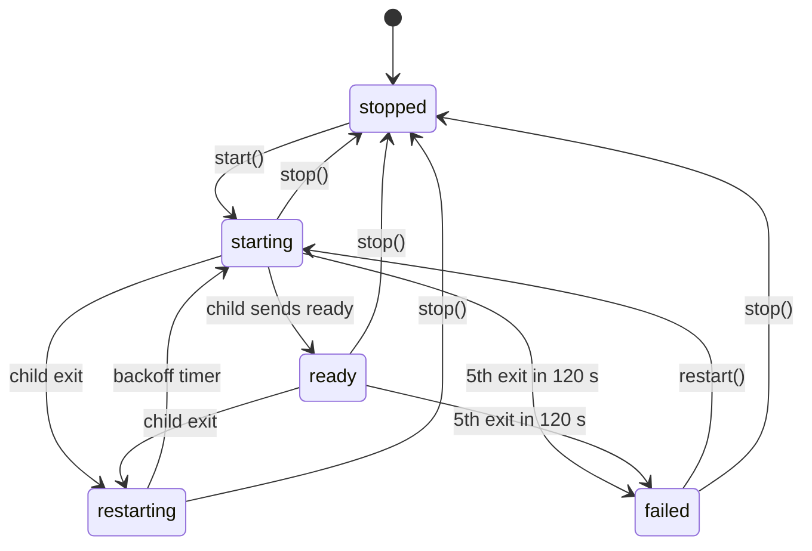
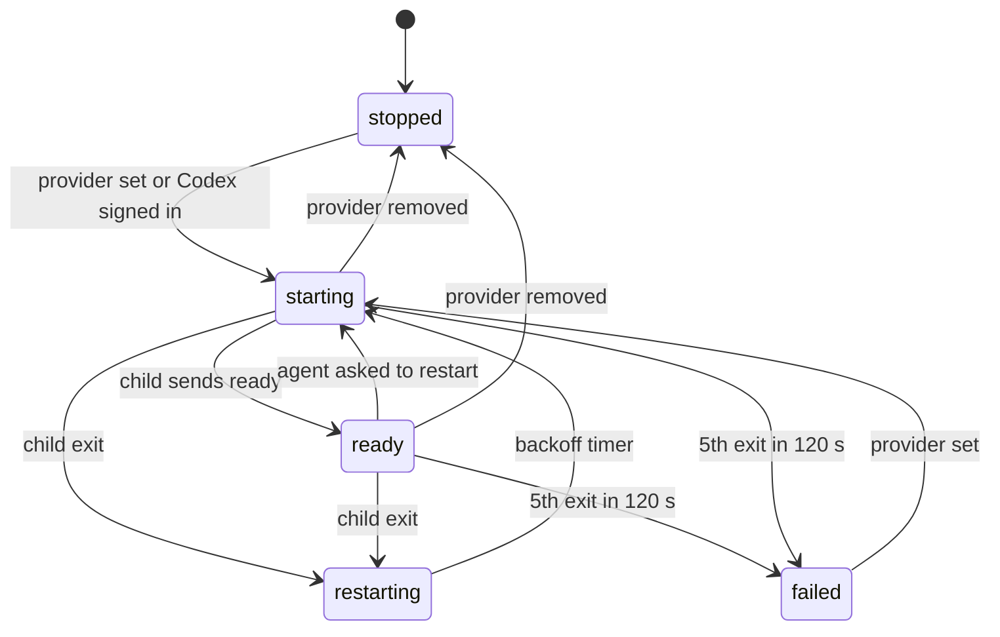
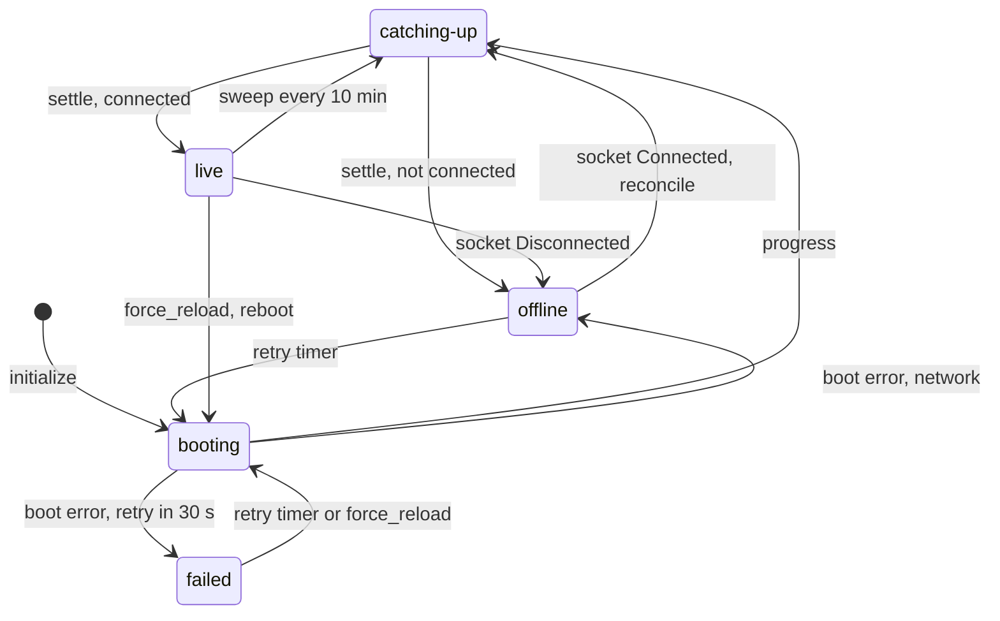
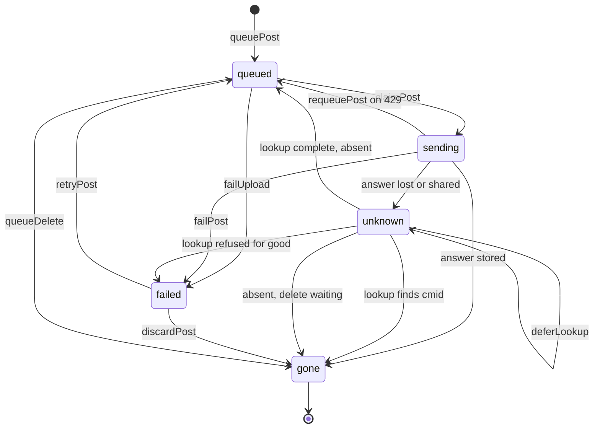
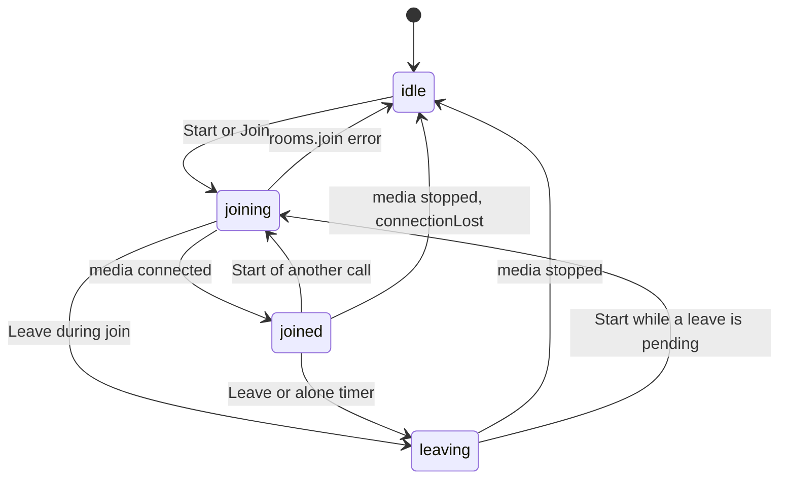

# State machines

This file lists every explicit and implicit state machine in Juno, by process:
- the Electron main process,
- the engine and the sync,
- the outbox and other local-first writes,
- the renderer and the state client,
- huddles,
- the Juno Agent.

An explicit machine has a status or phase union, a reducer or a supervisor. An implicit machine is a set of fields (booleans, nullable values, Refs, database columns) that together encode a lifecycle. For each machine the file gives where its state lives, its states, its transitions, and the rules the code relies on. "Known invalid states and transitions" lists the reachable bad states that the 2026-11 audit confirmed, grouped into issues. "Checked and ruled out" lists the candidates that hold, so nobody checks them again.

## How to read this file

- A location is `path:line (symbol)`. Line numbers drift; the symbol name is the stable part. Lines are as of commit `1df5827c2`; rows that the fixes changed name the symbol only.
- Each section says which directory its short paths are relative to. Other paths are relative to the repo root.
- A transition table has the columns from, event, to, guard and code. "any" in the from column means any state. A transition marked **bug** is reachable today and is listed under "Known invalid states and transitions". A transition a fix changed says "fixed" with the bug's id.
- Invariants are numbered rules the code relies on. A bug entry names the invariant it breaks where it breaks one.
- Severity uses the audit's scale. High is data loss, a duplicate or wrong write to Slack, or a state with no exit. Medium is a stuck UI until restart or a wrong display. Low is cosmetic or needs a rare timing.

## Formal models

The Quint specs in `specs/` are the formal models where they exist (`specs/README.md` explains how to run them). When this file and a spec disagree about what the protocol should do, the spec decides. When the code departs from a spec, the bug entry says so.

| Spec | Machine it covers |
|---|---|
| `outbox.qnt`, `outbox-conformance.qnt` | Post row, action row and copy reconciliation ([Outbox and writes](#outbox-and-writes)). `bun run specs:conformance` replays its traces against the engine. |
| `readstate.qnt`, `readstate-bounded.qnt` | Mark row |
| `follow.qnt`, `follow-bounded.qnt` | Follow command |
| `follownew.qnt` | Follow new threads |
| `drafts.qnt` | Draft row |
| `catchup.qnt` | Catch-up after a socket drop while live (part of the sync boot loop) |
| `requestqueue.qnt` | Request queue pauses and pacing |
| `quietwindow.qnt`, `threadranges.qnt`, `discovery.qnt`, `metadata.qnt`, `reactors.qnt`, `mutation-repair.qnt` | Sync read paths (history coverage, thread ranges, search pages, conversation fields, reactors, mutation repair). They have no lifecycle of their own in this file. |
| `huddle.qnt` | Huddle call lifecycle, pending leaves and the media view |
| `huddle-room.qnt` | The live call's retained room |
| `agent-actions.qnt` | Approval dispatcher and authorization ledger |
| `agent-recovery.qnt`, `agent-recovery-replay.qnt` | Agent ownership, restore and replay after a crash |
| `agent-memory.qnt` | Agent memory jobs |

No spec covers the main process (supervisors, quit, sign-in, auto-update), the engine session status and sync runner, or anything in the renderer.

## Rule for maintainers

A change that adds a state or a transition to any machine below updates this file in the same change. A change that fixes a listed bug sets its Status line to "Fixed" and names the commit. A change to a sync protocol also updates its Quint spec (CLAUDE.md, "Working rules").

## Main process

Short paths in this section are relative to `apps/desktop/src/`.

### Engine supervisor

Where: `main/engine.ts`, class `EngineSupervisor`. Fields `state` (l.30), `child` (l.29), `pendingPorts` (l.31), `exits` (l.32), `aiKey` (l.35), `attempt` (l.36), `restartTimer` (l.37).
States: `stopped`, `starting`, `ready`, `restarting`, `failed` (`SupervisorState`, l.24).

| From | Event | To | Guard | Code |
|---|---|---|---|---|
| stopped, failed (through `restart`) | `start()` | starting | `if (this.child) return` | `engine.ts:58 (start)` |
| starting | child `spawn` | starting; `config` sent | from the current child only | `engine.ts (start)` |
| any | child message `ready` | ready; `attempt = 0`; held ports flushed; ready listeners run | from the current child only (MAIN-3, fixed) | `engine.ts (start)` |
| starting, ready, restarting | child `exit` | restarting; timer `restartBackoff(attempt++)` | from the current child only (MAIN-4, fixed) | `engine.ts (start, onExit)` |
| starting, ready, restarting | 5th exit in 120 s | failed (`giveUp`) | | `engine.ts:180-183` |
| restarting | backoff timer | starting | `state === 'restarting'` | `engine.ts:189-192` |
| failed | `restart()` (sidebar Restart) | starting; `exits = []`; `attempt = 0` | `state === 'failed'` | `engine.ts:145 (restart)` |
| any | `giveUp()` | failed; child killed; held ports closed | production: only from `onExit`; e2e hook `failEngine` (`main/index.ts:358`) | `engine.ts:153 (giveUp)` |
| any | `stop()` (before-quit) | stopped; `quit` posted; kill after 3 s | | `engine.ts:123 (stop)` |
| stopped, failed | child `exit` | no change | | `engine.ts (onExit)` |
| any | `message` or `exit` from a process the supervisor stopped or gave up on | ignored | `this.child !== child` | `engine.ts (start)` |

`connect(webContents)` (`engine.ts (connect)`) answers `failed` in `failed` and `stopped`, sends the port at once in `ready`, and otherwise holds one port per renderer in `pendingPorts` (`main/pendingPorts.ts`, shared with the agent supervisor); a renderer destroyed while it waits has its port closed and dropped, and the `destroyed` listener leaves with the port when it is sent, replaced or closed (MAIN-8, fixed).

Invariants:
1. `failed` and `stopped` are terminal: `failed` leaves only by `restart()`, `stopped` never leaves.
2. `child === undefined` exactly when no engine process runs.
3. At most one engine process runs per userData folder. Events from any other process are ignored (MAIN-3, MAIN-4, fixed).

### Agent supervisor

Where: `main/agent.ts`, class `AgentSupervisor`. Fields `child` (l.53), `spawned` (l.54), `state` (l.55), `hello` (l.56), `pendingRendererPorts` (l.61), `provider` (l.63), `restartAsked` (l.65), plus `exits`, `attempt` and `restartTimer`.
States: `stopped`, `starting`, `ready`, `restarting`, `failed`.

| From | Event | To | Guard | Code |
|---|---|---|---|---|
| stopped, failed | `setProvider(p)` with `p !== null`, or Codex auth present | starting; counters reset | | `agent.ts:154 (setProvider)` |
| not stopped | `setProvider(null)` and no Codex auth | stopped (`stop()`) | | `agent.ts:156-158` |
| starting | `spawn` | `spawned = true`; config and provider sent; `linkHost` if the engine is ready; held renderer ports flushed | from the current child only (MAIN-5, fixed) | `agent.ts` |
| any | message `ready` | ready; `attempt = 0`; `hello` set | from the current child only (MAIN-5, fixed) | `agent.ts` |
| any | message `restart` from the current child | `restartAsked = true`; child killed | `this.child === child` | `agent.ts:130-134` |
| any | `exit` of the current child | asked: starting at once; else restarting, or failed after 5 exits in 120 s | `this.child` is undefined or this child | `agent.ts:142-146`, `agent.ts:227-256` |
| restarting | backoff timer | starting | | `agent.ts:252-255` |
| any | `stop()` | stopped; held ports dropped; child killed; `spawned`, `hello` and `restartAsked` reset (MAIN-5, fixed) | | `agent.ts (stop)` |

Invariants:
1. A `credentialReply` or `secretReply` goes only to the child that asked (`agent.ts:115`, `agent.ts:124`).
2. The engine and the agent are linked by exactly one `linkHost()` per pair of (engine ready, agent spawn), sent by whichever event comes second (`main/index.ts:198-201`, `agent.ts:100`).
3. `spawned` is true only while the current child has spawned.
4. A restart the agent asked for (after a staged restore) is not counted as a crash.

### Quit sequence

Where: `main/huddleQuit.ts` (`call`, `quitting`, `asking`, `hidesOnClose`), `main/index.ts` (`engineStopping`, `before-quit`, `will-quit`, the window's `close`), `launchFile.pending()`.

| From | Event | To | Guard | Code |
|---|---|---|---|---|
| running | `before-quit`, in a huddle, no agreed quit under way | quit prevented; dialog shown | `call !== null && !quitting` | `huddleQuit.ts (before-quit listener, confirm)` |
| dialog | Quit or Restart | `quitting = true`; `go()` runs (`app.quit()`, or `updates.install`) | | `huddleQuit.ts (confirm)` |
| quitting | `go()` started nothing (Restart with no update ready) | `quitting = false`; the next ⌘Q asks again (HUD-5, fixed) | | `huddleQuit.ts (confirm)` |
| running, in a huddle | window `close` | close prevented; window hidden; the huddle goes on (HUD-1, fixed) | `hidesOnClose()` | `index.ts (openWindow)` |
| window hidden | Dock icon (`activate`) or a second launch | window shown | | `index.ts` |
| running | `before-quit`, not prevented | activity, screen watch, updates stopped; `supervisor.stop()`; agent killed | | `index.ts:325-334` |
| quitting | `will-quit` while launch.json or the engine stop is pending | prevented; `app.quit()` again after both | | `index.ts:339-344` |

The second `app.quit()` runs `before-quit` again, so `supervisor.stop()` runs twice and clears any restart timer.

Invariants:
1. An agreed quit covers only the quit it allowed (HUD-5, fixed).
2. `call` is cleared when the engine supervisor gives up (`index.ts:115`) and replaced by each engine's `huddle` message.

### Engine process entry

Where: `engine/index.ts`. `engine: Promise<EngineHandle> | undefined` (l.72).

| From | Event | To | Code |
|---|---|---|---|
| no engine | `config` | `startEngine` running | `engine/index.ts:83-86` |
| running | `startEngine` resolves | `ready` sent to main | `engine/index.ts:92` |
| any | `quit` | waits for the start, stops the engine, exits 0 | `engine/index.ts:109-115` |
| running | start fails | exits 1 | `engine/index.ts:95` |

Host messages that arrive before the engine subscribes are queued (`engine/index.ts:123`).

### Agent process entry

Where: `agent/index.ts`. `started` (l.121), host port queue `ports` and `waiting` (l.64-71), `restarting` (l.88).

- The client takes the next queued host port each time its current one closes.
- After a staged restore, the agent sets `restarting`, sends `restart` to main, and exits after 1 s.

### Sign-in and sign-out handshake

Where: `main/session.ts` (`#busy` l.37, `#signOut` l.110), `packages/engine/src/session/Session.ts` (`askHost` l.173, `storeSecrets` wait l.228-235, `signOut` l.252-268).

The engine and main talk in requests and answers. Each sign-in request carries an `id` the engine makes (`randomUUID`), main's answer echoes it, and the engine waits for the answer with its id; sign-out has no id:

| Engine sends | Main answers | Engine waits for | Code |
|---|---|---|---|
| `requestSecrets {id}` | `secrets {id}` | `secrets` or `sessionFailed` with that id | `Session.ts (askHost)` |
| `importFromSlackApp {id}` | `secrets {id}` after the keychain import | `secrets` or `sessionFailed` with that id | `Session.ts (signIn)`, `main/session.ts (#capture)` |
| `storeSecrets {id}` | `secretsStored {id}` | `secretsStored` or `sessionFailed` with that id | `Session.ts (signIn, stored)` |
| `signOut` | `signedOut` after main clears its side | first `signedOut`, no timeout | `Session.ts (signOut)`, `main/session.ts (#signOut)` |

Main's `#signOut` drops the launch session, removes `secrets.bin` (or empties it in place when the folder refuses the unlink; an empty file reads as no session), forgets the Slack keychain passwords, clears `persist:slack` storage and cache, then sends `signedOut`. Each stage runs on its own; a failed stage is logged and `signedOut` is still sent (MAIN-2, fixed).

Invariants:
1. `#busy` allows one import at a time.
2. An engine takes only the answers to its own requests, by id (MAIN-6, fixed).
3. Every `signOut` gets a `signedOut`.

### Auto-update

Where: `main/updates.ts` (`state: UpdateState`, `found`, `enabled`, `timer`) and `main/updateLooker.ts` (`createLooker`: `generation`, `looking`, `updater` created once, `cancel`).
States: `unavailable`, `idle`, `checking`, `current`, `failed`, `available{download: none | downloading | failed, progress}`, `ready`.

| From | Event | To | Guard | Code |
|---|---|---|---|---|
| idle, current, failed | `check()` or background timer | checking | not `busy()` | `updates.ts:189-193`, `updates.ts:213` |
| checking | newer version found | available, downloading | the look's generation is current | `updates.ts:109-113` |
| available, downloading | `download-progress` | same, progress set | `at === generation` | `updates.ts:106` |
| available, downloading | `update-downloaded` | ready | the event belongs to the look whose download is in progress (MAIN-1, fixed) | `updateLooker.ts` |
| any | `set(false)` or `stop()` | `reset()`: generation + 1, download cancelled | | `updates.ts:137-141`, `updates.ts:196-206` |
| ready | Restart to update | `quitAndInstall`; `install()` says whether it started | `state.kind === 'ready'` | `updates.ts (install)` |

`busy()` (l.183) is true in `checking`, `ready`, and `available` while downloading. `check()`, `background()` and `download()` do nothing while busy.

Invariants:
1. An event of a look counts only while that look's generation is current (`updates.ts:78`).
2. Every `available, downloading` state ends in `ready`, `failed` or a reset.

### Smaller main process machines

| Machine | State and where | Rule it relies on |
|---|---|---|
| Screen watch | `probe`, `sharing`, `trueSince`, `timer` in `main/screenWatch.ts`; privacy from sharing in `privacyBySharing` (`main/index.ts:65`) | Start is guarded by `timer` (`screenWatch.ts:152`); stop on window `closed`. |
| Activity | one interval in `main/activity.ts` | `start()` clears the old interval first (`activity.ts:39-43`). |
| Dock badge and notification permission | `asking`, persisted `notificationPermissionAsked` in `main/dockBadge.ts`, `main/notificationPermission.ts` | `asked` is persisted before asking; waiters fall back after 3 s and 120 s. |
| Provider store | `#loading`, `#active`, `#baseUrl`, `#last` in `main/providers.ts` | `set()` calls run one at a time in order; each writes the keychain, memory, then `juno-provider.json` through a temporary file and a rename, then notifies (MAIN-7, fixed). |
| MCP credentials | per-id promise queue `serial` (`main/mcpCredentials.ts`); count dropped, chunks, then the count | A save is all or nothing: a save that stops part way leaves no state. Removals never trust the count: they delete chunk by chunk until one is missing, so the chunks such a save leaves go at the next clear or save (MAIN-8, fixed). |
| launch.json writer | chained writes, temp file and rename (`main/launch.ts:92-111`) | `will-quit` waits for the pending write. |
| Codex sign-in | `signingIn` promise, `stopped` flag and `children` set in `main/codex.ts (signIn, stop)` | One sign-in at a time: a second call joins the running one; `stop()` on quit kills every Codex child, the status check included, and a sign-in still waiting on that check starts no login (MAIN-8, fixed). |

## Engine and sync

Paths in this section are relative to the repo root. Short names: `Session.ts` and `SyncRunner.ts` are in `packages/engine/src/session/`; `layer.ts` is `packages/engine/src/layer.ts`; `run/` is `packages/sync/src/run/` and `sync/src/boot.ts` is `packages/sync/src/boot.ts`; `queue.ts`, `pacing.ts`, `api.ts` and `permits.ts` are in `packages/slack/src/client/`.

### Session status

Where: `packages/engine/src/session/Session.ts`. `state: SubscriptionRef<SessionStatus>` (l.91) and `active: Ref<ActiveSession | undefined>` (l.92). The two together are the real state, and they can disagree.
States: `starting`, `signedOut`, `signingIn{method}`, `ready{team}`, `authRequired{reason}`.

| From | Event | To | Code |
|---|---|---|---|
| starting | no stored secrets | signedOut | `Session.ts:188` |
| starting | `auth.test` ok | ready; `active` set | `Session.ts (start, build, check, makeActive)` |
| starting | `auth.test` fails with `SlackAuthRequired` | authRequired; `active` undefined | `Session.ts:192`, `Session.ts:131 (expire)` |
| starting | `auth.test` fails with any other error | ready from the stored secrets; `active` set to the unchecked client, so the sync's boot checks the session (ENG-1, fixed) | `Session.ts (start)` |
| any but signingIn | `signIn` | signingIn | `Session.ts:208-211` |
| signingIn | import, store or auth fails | the status before sign-in | `Session.ts:213-247` |
| signingIn | success | ready; `active` set to the new session | `Session.ts:226-236` |
| any | `signOut` | signedOut; `active` undefined | `Session.ts:251-268` |
| any | `expire` (sync auth failure) | authRequired; `active` undefined | `Session.ts:131 (expire)` |

Invariants:
1. `status = ready` implies `active !== undefined`. `SyncRunner` relies on it (`SyncRunner.ts:162`). The offline start no longer breaks it (ENG-1, fixed). A failed `beforeReady` during a re-sign-in from `ready` still can: `makeActive` closes `active` and `signIn` restores `ready`.
2. `expire` closes the session scope before it sets `authRequired`.

### Sync runner

Where: `packages/engine/src/session/SyncRunner.ts`. `running: {active, fiber} | undefined` (l.73, a mutable `let`), and the SubscriptionRefs `phase` (l.70), `syncing` and `slowed`, plus a per-run `cycles` counter.

| From | Event | To | Code |
|---|---|---|---|
| any | status `ready` and `session.active` differs from `running.active` | old run stopped; new run started | `SyncRunner.ts:159-170` |
| any | any other status, or `session.active` fails | run stopped | `SyncRunner.ts:162-166` |
| running | `stop` | `running` cleared; fiber interrupted; fetcher, online, phase, syncing, slowed cleared | `SyncRunner.ts:75 (stop)` |
| running | run fiber exits | if still current: `running`, online, syncing cleared; on `SlackAuthRequired` call `session.expire`; `phase := undefined` | `SyncRunner.ts:139-156` |

Invariants:
1. One sync fiber runs per active session.
2. `syncing` is true exactly while `cycles > 0` for the current run.

### Engine phase

Where: `phaseOf` in `packages/engine/src/layer.ts:83`. One fiber reads the merged stream of session, sync phase and `slowedUntil` changes and pushes each result into `Status.phase` (`layer.ts:91-106`).

| Session status | Sync phase | Rate-limit pause | Engine phase |
|---|---|---|---|
| authRequired | any | any | `session-expired` |
| starting, signedOut, signingIn | any | any | `first-run` |
| ready | undefined or `offline` | any | `offline` |
| ready | any other | set | `rate-limited{until}` |
| ready | any other | unset | the sync phase |

`syncing` passes straight through from `SyncRunner.syncing`.

Invariant: the published phase is `phaseOf` of the latest inputs. One fiber applies each change and publishes before it takes the next, so no older result can land after a newer one (ENG-7, fixed).

### Sync boot loop and phase

Where: `packages/sync/src/run/runtime.ts`. `state = {bootRetry, connected, booted, lastBoot, lastFollowPass, droppedAt, markerCandidates}` and `ctx.socket = {connected, epoch, since}` (l.55-67). One work permit `Semaphore.make(1)` (l.68), a `FiberSet` named `background`, and phases reported through `options.onPhase`. `settle` (l.90) sets `live` if connected, else `offline`.

States (`SyncPhase`): `booting{first?}`, `catching-up{done, total}`, `live`, `offline`, `failed{reason}`. `rate-limited` is added by the engine phase.

| From | Event | To or effect | Guard | Code |
|---|---|---|---|---|
| start | initialize | `booting`, then `catching-up` progress | work permit | `run/boot.ts:10-24`, `sync/src/boot.ts:502-549` |
| booting | boot fails, not auth | `offline` or `failed{reason}`; wait 30 s or a `force_reload` | | `run/boot.ts (bootUntilDone)` |
| booting | boot ok | `booted = true`; `settle`; if a drop was recorded during the boot and the socket is up, fork `reconcile` | | `run/boot.ts (bootUntilDone)` |
| any | socket Connected | `connected = true`; if booted, fork `reconcile`, unless one waits for the work permit (ENG-5, fixed) | `waiting` | `run/socket.ts:16-23`, `run/reconcile.ts (makeReconcile)` |
| any | socket Disconnected after a real connection | `droppedAt ??= now`; event coverage ends; `offline` if booted, else the boot's phase holds (ENG-3, fixed) | `connected` was true | `run/socket.ts` |
| any | socket Disconnected after an attempt that never connected | event coverage ends; no gap recorded | | `run/socket.ts` |
| any | `force_reload` while `bootRetry` is set | wake the boot retry | | `run/socket.ts:46` |
| any | `force_reload` otherwise | fork `reboot`: `bootUntilDone`, so a failure reports `offline` or `failed` and retries like the first boot (ENG-2, fixed) | | `run/socket.ts:47`, `run/boot.ts (reboot)` |
| live | every 10 min, connected | `sweep`: catch-up, progress, then `settle` | | `run/boot.ts:93-101` |
| catching-up | catch-up fails, not auth | `settle`; one retry after Retry-After or 30 s | `retryWaiting` | `run/reconcile.ts:48-68`, `run/reconcile.ts:112-119` |
| booted, socket down | a running cycle reports `booting` or `catching-up` | dropped; `offline` holds until `settle` (ENG-4, fixed) | | `run/runtime.ts (reportBoot)` |

Invariants:
1. Every cycle that reports `booting` or `catching-up` ends with `settle`, or with a failure phase and a retry (ENG-2, fixed).
2. After boot, the phase is `offline` whenever `state.connected` is false (ENG-4, fixed).
3. Every gap between a drop and a reconnect is rechecked by a catch-up with `recheck`, including a drop during a boot (ENG-3, fixed).
4. A boot or catch-up that finishes after a disconnect does not set `live`: `settle` reads `state.connected` when it runs.
5. At most one reconcile waits for the work permit; it reads `droppedAt`, the earliest drop, when it starts (ENG-5, fixed).

Spec: `catchup.qnt` covers a drop while connected and live. Boot is outside the model; a drop during a boot uses the same recheck once the boot ends.

### Request queue

Where: `packages/slack/src/client/queue.ts`. `paused: Map<method, until>` (l.65), `slowed: SubscriptionRef<until | undefined>` with one `clearAt` fiber per raise (l.67-96). Pacing buckets `{next, base, interval, decayAt}` in `pacing.ts:21-43`. Shared interactive and paging permits in `permits.ts`.

| Event | Effect | Code |
|---|---|---|
| real 429 on a method not already paused | interval doubles; `decayAt = now + 5 min` | `pacing.ts:42` |
| 5 quiet minutes | interval halves, down to its base | `pacing.ts` |
| pause raised | `slowed` set; a fiber clears its own `until` | `queue.ts:71-96` |
| interactive call during a pause | refused with a synthetic `SlackRateLimited` | `queue.ts:103-104` |

Invariants:
1. The interval stays within base and 60 s.
2. Only a real 429 from Slack counts as `limited`. A refusal by the queue does not (ENG-6, fixed).

Spec: `requestqueue.qnt`.

### Store live query

Where: `Invalidation.liveQuery` in `packages/store/src/invalidation.ts:179-233`; per-subscription closures `seq`, `order`, `revById`, `last` in `serveLiveList` and `serveLiveValue` (`packages/engine/src/protocol/live.ts:101-245`).
States: idle, running, debounce window. Each signal gives one run, then a debounce sleep, then a poll. A 1-slot dropping `signal` queue holds at most one pending invalidation.

Invariants:
1. Runs never overlap.
2. Each emitted run read later than the previous one.
3. An invalidation during a run or the window gives exactly one trailing run.
4. The first message of every subscription is `reset: true` (`live.ts:193`).

### Profile status expiry

Where: `untilExpiry`, `reach` and the `status.of` handler in `packages/engine/src/profileStatus/handlers.ts`, one per subscription (a person's status in the avatar menu or an avatar's tooltip).
States: none (no status, or past its expiry), shown without expiry, shown until `expiresAt` (a wait on the engine's clock is pending).

| From | Event | To | Guard | Code |
|---|---|---|---|---|
| any | the `users` row or a custom emoji changes (a run) | none | no text and no emoji, or the clock is at or past `expiresAt` | `readStatus`, `untilExpiry` |
| any | a run | shown without expiry | `status_expiration` is 0 | `untilExpiry` |
| any | a run | shown until `expiresAt` | `expiresAt` is later than the clock | `untilExpiry` (`Stream.concat` with `reach`) |
| shown until `expiresAt` | the sleep ends, or main says the Mac woke | none | the clock is at or past `expiresAt` | `reach` |
| shown until `expiresAt` | the sleep ends, or main says the Mac woke | shown until `expiresAt` (a new sleep for what is left) | the clock is still before `expiresAt` | `reach` |

Invariants:
1. A new run cancels the pending wait (`Stream.switchMap`), so a status changed or cleared before it expires never sends a stale "none" later.
2. Nothing polls: the only timer is one sleep to the current status's `expiresAt`, rechecked against the clock each time it ends, and a wake ends it early to recheck. A sleep that ends early waits again; a Mac that slept past the expiry hides it at the wake, not when the slowed timer ends.
3. The stored row keeps Slack's expiry; hiding an expired status changes nothing in the store, and the next user object replaces the row.

### Stale user refresh

Where: `refreshUsers` and `refreshStaleUsers` in `packages/sync/src/users.ts`, per user id, in the sync's context (`userRefresh`). The renderer starts it from the tooltip layer's `prepare` (`status.refresh`) when the pointer reaches an avatar.
States: unread (no `userRefresh.readAt` this session), fresh (read or asked for under `USER_FRESH_MILLIS`, five minutes, ago), stale (older), queued (in `userRefresh.queued`), asked (a `users/info` call out).

| From | Event | To | Guard | Code |
|---|---|---|---|---|
| unread or stale | a hover | queued, marked asked now | the id is a user id Slack knows | `refreshUsers` |
| fresh, queued or asked | a hover | unchanged | | `refreshUsers` |
| queued | the batch wait (`usersBatchMillis`) ends | asked | | `refreshStaleUsers` (`fetchUsers`, interactive lane, joins a call already out) |
| asked | Slack answers | fresh (`readAt` = now), row written | | `chunks` |
| asked | the call fails or Slack holds the lane back | unread (mark cleared) | not an expired session | `refreshStaleUsers` |
| any | a `user_change` frame or any `users/info` answer for the user | fresh | | `events.ts`, `chunks` |

Invariants:
1. A person is asked about at most once per five minutes of hovering, and never while a call for them is out; a failed call is not retried until the next hover.
2. Nothing polls and nothing runs without a hover; the marks live in memory, so the first hover on a person after Juno opens asks once.

### Notifications pause

Where: `packages/engine/src/snooze.ts (SlackSnooze, endAt, sessionSnooze)`; `sleepUntil` and `SystemWake` in `packages/engine/src/systemWake.ts`; the `slackSnooze` pref (`readSnooze`, `writeSnooze` and `readSettings` in `packages/notifications/src/settings.ts`); `pausedUntil` and `pausedLabel` in `packages/domain/src/notifications.ts`. Short paths are relative to `packages/engine/src`.
States: notifications on; paused by the schedule (outside the notification hours); paused by the snooze (`slackSnooze` holds an end in the future); paused by both. The schedule part is a pure function of the clock and the hours. The snooze part is the pref, which holds Slack's last answer, `{ until }` or null. `readSettings` gives `snoozedUntil` only while `until` is after now, so a pref left behind by a quit reads as on.

| From | Event | To | Guard | Code |
|---|---|---|---|---|
| any | Pause notifications picked | snooze, or both | Slack answers `dnd.setSnooze`; the pref takes `snooze_endtime` | `snooze.ts (pause)`, `notifications/handlers.ts ('notifications.pause')` |
| snooze or both | Resume notifications picked | on, or schedule | `dnd.endSnooze` answered, or refused with `snooze_not_active`; any other refusal or failure leaves the pref and shows a toast | `snooze.ts (resume)` |
| any | socket connects, or `dnd_updated` for the user | snooze or not, as `dnd.info` says | the pref is written only when the answer differs | `snooze.ts (sessionSnooze)` |
| snooze or both | the end time passes on the wall clock | on, or schedule | the timer clears the pref only if it still holds that end; a newer value interrupts the wait. After its timer fires and after each wake of the Mac it reads the clock again and waits for what is left, so it neither ends early nor waits past a sleep | `snooze.ts (endAt)`, `systemWake.ts (sleepUntil)` |
| on or snooze | the hours end or start | schedule or both, and back | none: read from the clock at each decision and each status run (the status also ticks each minute) | `pausedUntil` |

Invariants:
1. While `readSettings` has `snoozedUntil`, every decision is `stay` with `decidedBy: 'snooze'`, an incoming huddle is quiet, and the agent host counts the time as quiet hours.
2. "Paused until" is the first time neither part holds (`pausedUntil`): a snooze that ends outside the hours runs on to their next start, and hours that end inside a snooze run on to its end.
3. Calls answer in order on the session's listener, and the last `dnd_updated` always reads `dnd.info` again, so an older answer stored late is replaced by the next read. One write keyed by Slack's answer, with no queue or merge: no Quint spec.

Colleagues' pauses (`presence/dnd.ts (pausedPeople)`) live in memory beside presence, per followed person: unknown (not asked yet, or forgotten when the socket drops), known with Slack's next scheduled pause and any snooze and when Slack answered, paused at a time inside it (`dndPaused`). People are asked about only while the socket is connected (`connected` in `presence/service.ts`, read when the ask runs): each connect asks about everyone followed, so a connect that comes before the first list of whom to follow still leads to an ask when that list arrives; each new followed person is asked about after it. A `dnd_updated_user` asks again about that person. When a DM is shown and its person's answer is older than `dndStaleMillis` (5 minutes), Juno asks again, since `dnd_updated_user` may not come for people it has not subscribed to; nothing polls. `dnd.teamInfo` goes in batches of at most 100, each on its own: a failed batch is logged and its people are asked again after `dndRetryBaseMillis`, doubling, at most four times in a row, and the other batches go on; a forget drops the pending retries. One timer waits for the earliest start or end of anyone's pause (`dndNextChange`) with `sleepUntil`, publishes, and asks again about each person whose scheduled pause ended, since Slack names only the next one. Answers are applied under the presence service's lock.

### Smaller engine machines

| Machine | States and where | Rules it relies on |
|---|---|---|
| Socket connection | connecting, awaiting hello, open, waiting through the backoff (`manage` and `connectOnce`, `packages/slack/src/client/socket.ts:282-296`) | `failures` resets only after a connection that saw hello and lasted at least 10 times `backoffBaseMillis` (`socket.ts:289`). `Disconnected` is emitted after every attempt, including attempts that never connected. |
| Store live query | idle, running, debounce window (`Invalidation.liveQuery`, `packages/store/src/invalidation.ts:179-233`); per-subscription `seq`, `order`, `revById`, `last` in `serveLiveList` and `serveLiveValue` (`packages/engine/src/protocol/live.ts:101-245`) | A 1-slot dropping `signal` queue gives one trailing run per invalidation during a run or the debounce window. Runs never overlap, and each run reads later than the previous one. The first message of every subscription is `reset: true` (`live.ts:193`). |

## Outbox and writes

Paths in this section are relative to the repo root. `worker.ts` is `packages/engine/src/send/worker.ts`; `posts.ts`, `actions.ts` and `startedThreads.ts` are in `packages/sync/src/`. `reads.ts` is `packages/sync/src/write/reads.ts`; `markWorker.ts` is `packages/engine/src/markWorker.ts`.

### Post row

Where: `pending_messages.state` with `attempts`, `next_at`, `last_error`, `draft_id`, `file_ids_json` (per file `fileId` and `staging`) and `thread_ts` (may be `pending:<cmid>`). Only `packages/sync/src/posts.ts` writes it. `PostWorker` drives it from one loop fiber (`worker.ts:281 (pass)`).
States: `queued`, `sending`, `unknown`, `failed`, and gone (row deleted).

| From | Event | To | Guard | Code |
|---|---|---|---|---|
| none | `sendMessage`, forward, agent send | queued | `pending:` thread resolved through `started_threads` at insert | `posts.ts:140 (queuePost)`, l.154 |
| queued | a file is still staging | queued | | `worker.ts (staged)` |
| queued | a file a restart forgot has every declared byte on disk | queued, the file complete (`fileStaged`) | | `staging.ts (recover)`, `worker.ts (staged)` |
| queued | a file will never be staged (the composer could not read it, or a restart lost its bytes) | failed, without that file; its staged bytes released. Removed instead when the post was only that file, as Delete draft would | | `posts.ts (failStaging)`, `worker.ts (staged)` |
| queued | upload refused | failed | | `posts.ts (failUpload)`, `worker.ts (upload)` |
| queued | Slack has a file's bytes | queued, the file's `uploadId` kept until `files.completeUpload` answers; a try that finds one completes that upload instead of uploading again | | `posts.ts (fileUploading)`, `worker.ts (uploadFile, completeUpload)` |
| queued | completion of a kept upload refused | `uploadId` forgotten; the file goes up again in the same try | | `worker.ts (completeUpload)` |
| queued | upload offline, 429 or no session | queued; attempt + 1; backoff | | `posts.ts:265 (deferPost)` |
| queued | claim | sending; attempt + 1; `sent_posts` row; the request is built from the row the claim read | socket online (`worker.ts:212`) | `posts.ts (claimPost)`, `worker.ts (post)` |
| sending | answer with a message | gone | | `fetcher.sent`, `posts.ts:305 (reconcilePost)` |
| sending | answer without a message (`files.share`, `chat.shareMessage`) | unknown, `last_error = 'shared'` | | `worker.ts:228` |
| sending | offline, decode error, defect, or a may-be-posted code | unknown | | `posts.ts:215 (postUnknown)` |
| sending | refusal | failed; `draft_id` cleared | | `posts.ts:271 (failPost)` |
| sending | 429 or `NotSignedIn` | queued; a waiting edit or delete is applied as from unknown | | `actions.ts (requeueUnsentPost)`, `posts.ts (requeuePost)` |
| sending | start of the next pass (restart, store failure) | unknown, due now | | `posts.ts:288 (recoverPosts)`, called at `worker.ts:290` |
| unknown | lookup finds the cmid | gone | | `worker.ts:265` |
| unknown | lookup complete, absent, not `shared` | queued, due now; a waiting edit is applied to the text | no waiting delete | `actions.ts (requeueUnsentPost, applyWaitingActions)`, `worker.ts (lookUp)` |
| unknown | lookup complete, absent, a delete waiting | gone, with the delete row; for a New chat root, its waiting replies and started thread go too | | `actions.ts (requeueUnsentPost, applyWaitingActions)`, `posts.ts (removePost)` |
| unknown | lookup refused for good (`thread_not_found`, `channel_not_found`, `is_archived`, `not_in_channel`; `LOOKUP_REFUSED`) | failed, `last_error` = the code | | `worker.ts (lookUp)` |
| unknown | lookup fails for a transient reason, is refused with a code that does not decide the post (`invalid_cursor`, a code Slack adds later), is incomplete, or is `shared` and absent | unknown; attempt + 1; backoff | the lookup reads from the last claim (`sent_posts.sent_at`) | `posts.ts (deferLookup)`, `worker.ts (lookUp)` |
| failed | Retry | queued | | `posts.ts:274 (retryPost)` |
| failed | Delete draft | gone; a `deleteFile` row per file it had uploaded, unless its lookup was refused because the channel was archived, left or removed (`MAYBE_IN_SLACK`: Slack may show it) | | `posts.ts (discardPost, removePost)`, `fileDeletes.ts` |
| queued, failed | user edit | same state, text replaced | | `actions.ts:218 (queueEdit)` |
| queued, failed | user delete | gone; for a New chat root, its waiting replies, started thread, topic row and pending follow go too; a `deleteFile` row per file the post, or a removed reply, had uploaded (OUT-7, fixed) | | `actions.ts (queueDelete)`, `posts.ts (removePost, discardStartedThread)`, `fileDeletes.ts` |
| any | echo, page or lookup stores the cmid | gone | | `writeMessage` |
| any | catch-up ends | due now | | `posts.ts:295 (flushPosts)` |

Ordering: per channel, the first row that is not failed holds every later row (`held`, `worker.ts:291-297`). Rows with `thread_ts LIKE 'pending:%'` are skipped until `acknowledgeStartedThread` rewrites them (`worker.ts:296`, l.309).

Invariants:
1. One claimer: one loop fiber, and `claimPost` is the only claimer. So a row in `sending` at the start of a pass was cut off.
2. Every `unknown` row eventually gets a decisive lookup, or fails when Slack refuses the lookup for good (OUT-3, fixed).
3. The request sends the row as it is at claim time (OUT-1, fixed).
4. A row the user deleted is never sent to Slack again (OUT-2, fixed; `deletedNeverQueued` in `outbox.qnt`).
5. Every row has an enabled next step or a user exit (Retry, Delete draft). Replies to a discarded New chat root go with it (OUT-4, fixed; `repliesFollowRoot`).

Spec: `outbox.qnt` (`claimWith`, `finishFetch`, `requeueWith`, `refuseFetch`, `discardedWith`, `failLookup`, `seal`, `drainBound`) and `outbox-conformance.qnt`.

### Action row

Where: `outbox` rows of kind `edit`, `delete`, `react` and `broadcast`, keyed by the channel, and `deleteFile`, keyed by the file's id. Fields: `payload.failed`, `payload.stalled`, `rev` (edit), `want` and `base` (react), `fileId` (deleteFile), `depends_on`, `attempts`, `next_at`. Writers: `packages/sync/src/actions.ts`, `reactions.ts`, `broadcasts.ts`, `actionFailure.ts`, `fileDeletes.ts`. Driver: `packages/engine/src/send/actionWorker.ts (pass)`.
States: waiting (the post it depends on is not stored), ready, in flight, done (row deleted), deferred, failed (waits for Retry or Dismiss), dropped.

| From | Event | To | Code |
|---|---|---|---|
| none | edit, delete, react, broadcast on a stored message | ready | `actions.ts` |
| none | the same on a post that is not stored yet | waiting (`depends_on` set) | `actions.ts` |
| waiting | `placeOf`: post stored | ready | `actions.ts:305 (placeOf)` |
| waiting | `placeOf`: post failed | `applyWaitingActions`: an edit rewrites the post (`rewritePost`), a delete removes it (`removePost`; a New chat root takes its waiting replies and started thread), a reaction is dropped | `actions.ts (applyWaitingActions)` |
| waiting | `placeOf`: post gone | dropped | `actions.ts:305` |
| ready | call succeeds and `rev` or `want` unchanged | done | `actions.ts:343 (actionDone)` |
| ready | call succeeds and the intent changed | ready again | `actions.ts:343` |
| ready | transient error | deferred (attempts + 1) | `deferAction` |
| ready | refusal | failed | `failAction` |
| none | a post Slack has not got is removed with uploaded files | `deleteFile`, ready, one per file no other pending row names | `fileDeletes.ts (queueFileDeletes)` |
| `deleteFile` ready | `files.delete` answers `ok`, `file_deleted` or `file_not_found` | done | `actionWorker.ts (run, alreadyDone)` |
| `deleteFile` ready | transient error, 429, offline or no session | deferred (attempts + 1); dropped when the attempts are spent | `actionWorker.ts (settle, defer)` |
| `deleteFile` ready | another refusal, or a defect | dropped | `actionWorker.ts (giveUp)` |

Invariants:
1. A stale answer never ends or fails a newer intent: `dropAction`, `deferAction` and `failAction` compare the payload, `actionDone` compares `rev` and `want`.
2. A copy delete (`clientMsgId = null`, `dependsOn = null`) is rechecked while it holds the send lane (`checkCopyDelete`, `packages/sync/src/sent.ts:247`).
3. A `deleteFile` row names only a file a removed post of Juno's uploaded, holds no channel's edits and deletes (`actionTarget`), and never becomes `failed`: nothing shows it or offers Retry, so it ends or is dropped.

Spec: `outbox.qnt`.

### Copy reconciliation

Where: `sent_posts`, `kept_copies` (`packages/sync/src/sent.ts`).

| From | Event | To | Code |
|---|---|---|---|
| `sent_posts.ts` null | first stored ts | ts set | `sent.ts:180` |
| ts set | a later copy | hidden and deleted, or kept with a reason, or hidden as `FILE_COPY` | `sent.ts` |
| kept | the kept message is deleted elsewhere | the copy becomes the message (`keepCopy 'kept-deleted'`) | `sent.ts` |
| any | own delete succeeds | `deleted_by_user` set | `posts.ts:330 (recordOwnDelete)` |

Spec: `outbox.qnt` (`observeCopy`, `deleteCopy`, `keepCopy`).

### Started thread

Where: `started_threads.root_ts` (`packages/sync/src/startedThreads.ts`).

| From | Event | To | Code |
|---|---|---|---|
| none | New chat root queued | `root_ts` null; `p:<channel>:<cmid>` topic; `thread_subs(pending:...)` | `startedThreads.ts:9 (startThread)` |
| `root_ts` null | the root's first store | `root_ts` set; dependent `pending_messages.thread_ts` rewritten; sub moved | `startedThreads.ts:25 (acknowledgeStartedThread)` |
| `root_ts` null | root deleted while queued, or Delete draft on a failed root, or a delete that waited on the root while it was out applies (the post came back to the queue or was refused) | started thread, its topic row, pending follow and waiting replies removed (OUT-4, fixed) | `posts.ts (discardStartedThread, removePost)`, `actions.ts (applyWaitingActions)` |

Invariant: every `pending:<cmid>` reply belongs to a root that will be stored, will fail, or is removed with it (OUT-4, fixed).

### Mark row

Where: `outbox` rows of kind `mark`, one per topic. `writeLocalMark` (`packages/sync/src/write/reads.ts:167`), `MarkWorker.send` (`packages/engine/src/markWorker.ts:92`) under `exclusive(topicId)`.

| From | Event | To | Code |
|---|---|---|---|
| none | local mark | row due at `now + markDelay` | `reads.ts:167 (writeLocalMark)` |
| row | newer local mark | payload replaced, `gen + 1`, due time kept | `reads.ts:167` |
| in flight | success, `gen` equal | deleted | `endMark` |
| in flight | success, `gen` newer | due now | `endMark` |
| in flight | refused | `rejectMark` and a lookup | `rejectMark` |
| in flight | transient error, `gen` equal | `deferMark`: attempts + 1, backoff | `reads.ts (deferMark)`, `markWorker.ts (send)` |
| in flight | transient error, `gen` newer | due now, attempts reset | `reads.ts (deferMark)` |
| any | setting turned off | dropped | `dropMark` |

Invariant: a stale answer never ends a newer mark, and never delays it: `endMark`, `rejectMark` and `deferMark` compare `gen`, and a replaced intent is due now (OUT-8, fixed).

Spec: `readstate.qnt`, `readstate-bounded.qnt`.

### Follow command

Where: `outbox` rows of kind `follow`, one per thread, present only while a command is in flight. `setSubscribed` (`packages/engine/src/follow.ts:71`); `beginPendingFollow` (`packages/sync/src/write/subscriptions.ts:142`), `endPendingFollow` (l.156), `notePendingFollow` (l.171), `clearPendingFollows` (l.182).

| From | Event | To | Code |
|---|---|---|---|
| none | command | txn 1: `thread_subs` set to the intent; `follow` row inserted | `follow.ts:159` |
| pending | event or page about the thread | ignored; `seen` set | `subscriptions.ts:87`, l.171-179 |
| pending | call ends | txn 2: row deleted; root lookup if `seen` | `follow.ts (setSubscribed)` |
| pending | command fiber cut off during the call (window closed, `FollowNewJob` restarted) | txn 2: row deleted; root lookup in the background | `follow.ts (setSubscribed)`, `uninterruptibleMask` |
| none (row ended) | command fiber cut off during the lookup after the call | the lookup goes on in the background; the command ends at once | `follow.ts (setSubscribed)`, `restore(lookup)` |
| pending | `runSync` starts | row deleted | `packages/sync/src/sync.ts:149` |

Invariant: the command that inserted the row also ends it, a cut-off one too: only the call and the lookup after it are interruptible, and a cut-off lookup goes on in the background (OUT-5, fixed).

Spec: `follow.qnt`, `follow-bounded.qnt`. A cut-off command takes `reject`'s path (the row ends, one lookup), so neither needs an interrupt action. Neither models a crash; sync start clears what one leaves.

### Follow new threads

Where: `auto_followed` (one go per thread, `claimAutoFollow`, `packages/engine/src/follow.ts:167`) and `follow_new_threads.since_ts`. `FollowNewJob` (`packages/engine/src/followNew.ts:120`) runs `setSubscribed(..., 'auto')` one at a time on the background lane, inside a `Stream.switchMap` on the workspace and on "any channel has the setting" (`followNew.ts:133-139`).

Invariants:
1. A thread is followed at most once (`auto_followed`).
2. A thread whose root came before the setting was turned on is never followed.

Spec: `follownew.qnt`.

### Draft row

Where: `outbox` rows of kind `draft`, one per topic. Payload: `gen`, `sending`, `creating`, `findAt`, `unsure[]`, `unsureAt`, `refused`, `next_at` (`MAX_SAFE_INTEGER` means parked for a list).

| From | Event | To | Code |
|---|---|---|---|
| saved | claim | sending | `packages/sync/src/write/draftSaves.ts:33 (claimDraftSave)` |
| sending | answer | `endDraftSave` | `packages/engine/src/draftSend.ts:39` |
| sending | transient error | `deferDraftSave` | |
| sending | refusal | `refuseDraftSave` | |
| sending | restart | unsure (`recoverDraftSaves`) | |

Invariant: the claim reads the row and the stored draft in one transaction.

Spec: `drafts.qnt` (detailed).

### Staging entry

Where: in memory, `packages/engine/src/staging.ts`. `entries` (composer chips) and `claimed` (l.92, taken by a post while still writing). Each entry has `written`, `done`, `failed`.

| From | Event | To | Code |
|---|---|---|---|
| writing | a post takes it | moved to `claimed` | `take` |
| any | `status` asked | writing, ready, failed or unknown; a ready entry is forgotten | `status` |
| claimed, unfinished | `unstage` | failed | `staging.ts:164-187` |
| any | workspace change | both maps cleared | |

After a restart `claimed` is empty, so every file with `staging: true` reads `unknown`: the worker asks `recover`, which answers the complete file when every declared byte is on disk, and otherwise drops the file from the post, or the post when the file was all of it (OUT-6, fixed).

## Renderer and state client

Paths in this section are relative to the repo root. `containers/` is `apps/desktop/src/renderer/containers/`. Short names such as `client.ts`, `port.ts`, `transport.ts`, `tabs.ts` and `atoms.ts` are in `packages/state/src/`.

### Connection state

Where: `connectionStateAtom` (`packages/state/src/client.ts:31`, keepAlive).
States: `connecting`, `connected`, `reconnecting`, `failed`.

| From | Event | To | Code |
|---|---|---|---|
| any | port opens | connected | `transport.ts:57`, `client.ts:43-46` |
| any | port scope closes | reconnecting if ever connected, else connecting | `transport.ts:43-48`, `client.ts:45` |
| any | `acquire` rejects with `EngineFailed`, no Restart since that request went out | failed | `port.ts:78-80`, `client.ts (configureConnection)` |
| any | `acquire` rejects with `EngineFailed` for a request made before the latest Restart | unchanged (REN-6, fixed) | `client.ts (restartsAtom)` |
| failed | sidebar Restart | reconnecting; `restartsAtom` counts up; then main's `supervisor.restart()` | `client.ts (restartEngine)` |

The RPC pool retries the spawn forever, once a second (`Effect.retry(Schedule.spaced(1000))` in Effect's `RpcClient` `makeProtocolWorker`). Main answers each port request at once, even while the engine starts (`main/engine.ts:103-114`). So `connected` means "holds a port", not "engine ready".

Invariant: every attempt ends in `failed` or `connected`, so `reconnecting` cannot last.

### Live query subscription

Where: `packages/state/src/atoms.ts:100-140`, `packages/state/src/list.ts`. Per route and payload: a subscription atom with no TTL and a reader atom with a 30 s idle TTL. `prefetch` keeps up to 3 subscriptions warm per registry (`atoms.ts:181-200`).

| From | Event | To |
|---|---|---|
| Initial | first window | Success(window) |
| any | `RpcClientError` | stream restarted after 1 s; scan state kept (`atoms.ts:69 (retryTransport)`) |
| any | route error | Failure |
| any | `refreshLive` | subscription restarted |

Invariant: after a resubscribe, `applyListDelta` rebuilds rows from the `reset: true` message and keeps objects whose `rev` is unchanged (`list.ts:50-63`).

### Tabs

Where: `tabsAtom` (`packages/state/src/tabs.ts`), `changedTabsAtom` (per team, keepAlive), `savedTabsAtom` (`prefs.get('tabs')` with the signed-in workspace's key, one subscription per workspace), `tabsKnown` and `whenTabsKnown`, `updateTabs`, `saveTabsSoon`, `savedHomeDraftAtom`.

| Condition | `tabsAtom` value |
|---|---|
| no team signed in | `noTabs` |
| `changedTabsAtom(team)` set (anything changed this run) | the changed set |
| saved pref has answered | the saved set |
| saved pref has not answered | `noTabs` |
| saved pref read failed | `noTabs`; the tabs count as known, so the app goes on with none |

Each tab holds a history (`entries`, `index`, at most 50). The strip keeps a `closed` list (at most 20). `updateTabs` writes `changedTabsAtom` and saves the whole set, Home drafts and Search sessions included, through `prefs.set`.

Invariant: no change is applied before the saved tabs are known. The navigation queue waits for them (`whenTabsKnown`) before each step, so the step runs against the real tabs and its follow-up work (the selected topic, a fresh open's window and position, a background tab's window) sees the real result; `updateTabs` before that returns the tabs unchanged (REN-1, fixed). After a sign-in to another workspace in the same run its tabs are unknown again until its own pref answers, since each workspace's saved tabs are their own subscription, keyed by the workspace id the engine sends in `ReadySession` (REN-1 variant, fixed).

### Navigation queue

Where: `containers/navigation.ts`. A global promise `queue` and `enqueue` (l.275-283, each step after `whenTabsKnown`), `currentTicket` (l.285), `latestRequest` (l.296), `pending` (the open being measured), `waitingTabChange`. `whenReady` (l.223).

| Event | Effect | Code |
|---|---|---|
| `show(change, topic)` | takes a ticket; chains `whenReady(view)` before `apply` | `navigation.ts:305-330` |
| ticket replaced before apply | change dropped (`tabs dropped`) | `navigation.ts:310`, l.328 |
| `switchToTab` to a mounted tab, `changeTabs` with no topic | applied at once; ticket bumped | |
| `whenReady` | resolves when the header and window are local, on a Failure, on a null header, or after `READY_WAIT_MS` (150 ms) while the connection is `reconnecting` or `failed`; otherwise the timer only runs `check` again | `navigation.ts (whenReady)` |

Invariants:
1. A change asked for before a newer one never applies after it. A link open records the active tab, place and ticket before its fetch and opens nothing if any changed; a foreground link open also takes a request number (`latestRequest`), so of two link opens waiting together only the one clicked last opens, whichever answers first (REN-2, fixed).
2. Every `whenReady` settles: while the engine is down it settles after `READY_WAIT_MS` (REN-4, fixed).

### Topic composer send check

Where: `containers/TopicComposer.tsx:94-396`. Draft sync uses `unsaved`, `timer`, `written`, `toSlack`, `behind`, `typedSinceShown`, `latestRef`. The send check uses `checking` (a token ref), `waiting` and `bar`.

| From | Event | To |
|---|---|---|
| idle | Enter, route checked | checking(token), waiting |
| idle | Enter, otherwise | `deliver` |
| checking | answer, token current | bar or `deliver` |
| checking | any edit | idle; the answer is dropped by the token |
| checking | Enter | ignored |
| bar | Enter or pick | `deliver`, or bar (clarity after route) |
| bar | Esc or edit | idle |

`deliver` empties the field and the chips synchronously (`takeAttachments`), waits for each file's first chunk (`whenStarted`), then sends. On a Failure it puts the text back if the field is still empty, and restores the chips.

### Message edit and delete

Where: `containers/messageActions.tsx:85-180`, `containers/topic/messageCommands.ts:97`.

`editing = {ts, text, savedRev?}`:

| From | Event | To | Code |
|---|---|---|---|
| any | E or Edit | editing this message (replaces any current editor, no guard) | `messageCommands.ts:97` |
| editing | Save | `savedRev = row.rev`; command in flight | `messageActions.tsx:169-178` |
| saved | the row's rev changes | closed | `messageActions.tsx:107` |
| saved | command Failure | closed only if the open editor is still the failed edit (REN-5, fixed) | `messageActions.tsx` |
| editing | a sending message lands | `ts` moves to Slack's ts | |

`confirming = {ts, sent}` ends when the row leaves.

### Topic open fetch

Where: `useTopicFetch` in `containers/topic/opening.ts:62-108`. `fetchState`, `fetched` (a ref), `slow`.

| From | Event | To | Code |
|---|---|---|---|
| pending | fresh window answer, fetched or cached | done | `opening.ts:82-86` |
| pending | any other outcome or error | offline | `opening.ts:86` |
| pending | 300 ms pass | `slow = true` | |
| offline | network back | the engine refetches every on-screen topic in the catch-up (`refreshOpenTopics` in `packages/sync/src/run/reconcile.ts`); a rate-limited fetch reruns on the background lane when the pause ends (`run/fetcher.ts`) | |

`fetched.current` (l.80-81) makes the fetch once per mount, so `offline` is terminal for the mount.

### Juno chat sends

Where: `PendingSend.delivery` in `packages/state/src/agent/chat.ts:113-319`.

| From | Event | To |
|---|---|---|
| sending | acknowledged | sent |
| sent | a page shows the op | hidden (`landed`); pruned after 60 s |
| sending | refused | `failed(notDelivered)` or `failed(tooLong)` |
| failed(notDelivered) | Retry | sending, same op id |

Card commands run edit rows, prepare, `agent.writes.approve`, then approve, with no local in-flight guard.

### Smaller renderer machines

| Machine | States and where | Rules it relies on |
|---|---|---|
| Port handoff | waiting, resolved(port), rejected(timeout after `PORT_TIMEOUT_MS` = 10 s), rejected(`EngineFailed`) (`acquirePort`, `packages/state/src/port.ts:61-82`) | The listener and the timer are removed on every exit (`port.ts:63-80`). |
| Session shown | `heldSessionAtom` `{session, known}` (`packages/state/src/session.ts:43`). `?session=`: that session, known. `starting` or not a Success: unchanged. `ready`: session, known. `signingIn`: session kept. `authRequired`, `signedOut`: no session, known. | The sign-in page never flashes during an engine restart. |
| Sync notice | undefined, `offline`, `failed`, `rate-limited`, `stopped` (`syncNoticeAtom`, `syncFailureAtom`, `packages/state/src/engine.ts:63`, l.79). `stopped` while the connection is `failed`; `offline` after a 5 s grace (`engine.ts:84-86`); `failed` stays through a `booting` that follows a failure. | Status ticks do not reset the grace timer, because an equal recomputed value does not invalidate dependents. |
| Home composer | `useSend.sending`, the check token, `useSendTo.pending` (`containers/HomeComposer.tsx:169-257`, `homeSendChecks.tsx`) | `sending` guards a second send and the field is emptied before the await. The check token is keyed by text, channel, thread and enabled. Keystrokes are held (`holdKeys`) while the "Send to" rows load. |
| Message picture | Per thumbnail and `src`: loading, shown (`shownSrc`), failed with `failures` and `attempt`, and failed with a try in flight (`trying`) (`packages/views/src/pictureLoad.ts`, `MediaGrid.tsx` `Thumbnail`). failed → trying on a retry, which remounts the `` (`attempt` as its key) under the glyph; trying → failed on `error`, → shown on `load`; loading → failed on `error`, → shown on `load`; a new `src` starts over, the last shown one kept under it. | A retry comes by itself after 2, 8 and 30 s (`PICTURE_RETRY_DELAYS_MS`, indexed by `failures`), and once each on `online`, on coming back into view after being away (`wasAway`: set when the box left view or its effects were torn down while failed, cleared by the next `error`), and on a click. `retry` is a no-op unless failed and not already trying, so a trigger during a try in flight adds nothing. The glyph and the hidden `` stay from the first `error` until a `load`, so a failed picture is one stable state for the eye and for tests. The box's size never depends on the state. Main refuses a host that answered 429 until its `Retry-After` passes (`main/rateLimit.ts`), so retries cannot reach Slack during a pause. |
| Attachment chip | `staging`, `ready`, `failed`; `firstChunks[id]` while staging, `attachedFiles[id]` while in a composer (`packages/state/src/attachments.ts`, `packages/state/src/staging.ts`) | A chip removed or sent while staging asks the engine to `files.unstage`. `restoreAttachments` marks a chip `failed` if its staging ended while it was out (`attachments.ts:150-154`). Juno chips are local; the `taking` set (`containers/junoFiles.ts:111`) stops a second send taking them. |

## Huddles

Paths in this section are relative to the repo root. `core.ts`, `lifecycle.ts`, `attach.ts` and `media.ts` are in `packages/huddle/src/`. `containers/` is `apps/desktop/src/renderer/containers/`, so `containers/huddle/media.ts` is the renderer's media service.

### Call lifecycle

Where: `Lifecycle` (`lifecycle.ts:63`), held in `core.s`. It changes only inside `step` under one semaphore (`core.ts:355`); `drive` runs after every change (`core.ts:325`). Fields: `wanted`, `request`, `cancel`, `current`, `pending[]`, `otherDevice`, `quitting`, `ended`. The phase is derived by `phaseOf` (`lifecycle.ts:290`).

Phases: `idle`, `joining`, `joined`, `leaving`.

| Phase | Condition (`phaseOf`) |
|---|---|
| joined | `current` set and its media is past `connecting` |
| joining | `current` set and media connecting or unknown; or `wanted` set; or a request out and not cancelled |
| leaving | a cancelled request out, or a pending record whose media is not known stopped |
| idle | otherwise |

| From | Event | To | Guard | Code |
|---|---|---|---|---|
| any | Start or Join (`choose`) | `wanted = intent`; `current` cleared; `cancel` if a request is out | page not `gone` (`core.ts:363`) | `lifecycle.ts:112 (choose)` |
| any | Leave or the alone timer | `wanted` and `current` cleared; `cancel` if a request is out; `ended` set | | `lifecycle.ts:122 (leave)`, `core.ts:180-184` |
| wanted | `requestJoin` | `request = wanted` | `canRequest`: no request, stores loaded, no same-workspace pending record, others' media stopped, page live, not `otherDevice`, not `quitting` | `lifecycle.ts:154 (canRequest)` |
| request | `rooms.join` ok | record stored, then pending and current (pending only if cancelled, the caller went, or the page is not live) | | `core.ts:237-272`, `lifecycle.ts:181-200` |
| request | `rooms.join` error | `request` cleared; `ended = joinFailed` unless cancelled | | `lifecycle.ts:203` |
| current | media stopped (report or page gone) | `current` cleared; `ended = reason`; maybe `otherDevice` | | `lifecycle.ts:136 (reconcile)` |
| any | session detach | `quitting`; `request` cleared; unsent leaves queued | | `packages/huddle/src/attach.ts:29-45`, `lifecycle.ts:250-269` |
| any | attach or store load | stored records merged; `quitting = false` | | `attach.ts:48-79`, `lifecycle.ts:272-279` |

Invariants:
1. One `rooms.join` at a time.
2. A record is durable before its credentials leave the engine (`core.ts:252`).
3. No join goes out while a same-workspace pending record exists or another workspace's media may run.
4. The current call's own record is never sent as a leave (`toSend`, `toClear`).
5. Every handed-out attendee is eventually acknowledged by the page, so its media can be proven stopped (HUD-2 and HUD-4, fixed).

Spec: `huddle.qnt`.

### Pending leave per record

Where: `Pending.dispatch` (`lifecycle.ts:40`).

| From | Event | To | Code |
|---|---|---|---|
| queued | `drive` | sending | `core.ts:332-336` |
| sending | request goes out | dispatched | `core.ts:290-293` |
| sending | refused | waiting; backoff fiber | `core.ts:298-304` |
| waiting | backoff ends | queued | `core.ts:305-307` |
| dispatched | media stopped | record cleared; store rewritten | `core.ts:337-341` |
| not dispatched | detach | queued | `lifecycle.ts:268` |

The refusal counter `attempts` resets on success (`core.ts:295`).

Spec: `huddle.qnt`.

### Start waiter

Where: `Waiter.state` (`core.ts:76-80`).

| From | Event | To | Code |
|---|---|---|---|
| waiting | RPC interrupted (no lock) | cancelled | `core.ts:375-377` |
| waiting | `answered`, after the store | delivered | `core.ts:262-271` |
| waiting | ticket no longer live (`settleWaiters`) | cancelled | `core.ts:197-204` |

Note: `Deferred.succeed` (`core.ts:271`) runs before `drive` publishes the new call, and the RPC reply and the `huddle.call` stream are separate fibers. Their order at the renderer is not fixed (see HUD-2).

### Media view

Where: `core.pages {reported, live, maxIssued}`, `core.reports` (latest per generation, with its connection), `core.handed` (attendee to connection) in `core.ts:90-94`. `pageState`: `pending`, `live`, `gone` (`media.ts:54`). `mediaStopped` (`media.ts:77`) is computed, not stored.

| Event | Effect | Code |
|---|---|---|
| `report` | highest `seq` per generation wins | `core.ts:386-390` |
| `pages` from main | generations marked live or gone | `core.ts:393-399` |

Rule (`mediaStopped`): an attendee's media is stopped when its page is gone, or a report on its hand-off connection says `received === attendee` and does not hold it, or a report on a later connection exists.

Spec: `huddle.qnt` (`engStopped`).

### Renderer page media service

Where: module globals in `apps/desktop/src/renderer/containers/huddle/media.ts`: `registration`, `loading`, `session`, `pending` (credentials waiting for the call to name them), `holding`, `received`, `ended`, `seq`. The hand-off rule is the pure function in `containers/huddle/handOff.ts`, which also remembers the attendee the call last named.

| From | Event | To | Code |
|---|---|---|---|
| any | `huddle.start` RPC answer | `pending = creds` | `containers/huddle/media.ts:291` |
| pending | `reconcile(call)`, call names `pending.attendeeId`, `holding === null` | session started; `holding = received = attendee` | `containers/huddle/media.ts:217-221` |
| pending | `reconcile(call)`, call `idle` or names another non-null attendee | `pending` dropped; `received = attendee` | `containers/huddle/media.ts:233-236` |
| pending | `reconcile(call)`, the call has moved past the credentials' attendee (Leave or Switch before the answer arrived) | `pending` dropped; `received = attendee`, so the engine's pending leave clears (HUD-2, fixed) | `containers/huddle/handOff.ts` |
| holding | call no longer names `holding` | `session.leave()` | `containers/huddle/media.ts:213-216` |
| holding | snapshot `ended` for `holding` | `holding = null`; `ended` set | `containers/huddle/media.ts:118-121` |
| any | `report()` | sends `{holds, received, connection, ended, seq}` | `containers/huddle/media.ts:188-208` |

Spec: `huddle.qnt` (`receive`).

### Chime media session

Where: `packages/huddle-media/src/chime/session.ts`. The snapshot's `connection.state`; internal `#starting {left}` (l.48) and `call.started`, `call.leaving`, `call.ended` (`chime/call.ts`).
States: `idle`, `connecting`, `connected`, `reconnecting`, `ended(reason)`.

| From | Event | To | Code |
|---|---|---|---|
| idle | `join()` | connecting | `session.ts` |
| idle | bad join payload | idle; `join` rejects (HUD-4, fixed) | `session.ts (join)` |
| connecting | Chime connects | connected | |
| connected | network loss | reconnecting, then connected or ended | |
| any | `leave()` before the `Call` exists, before start, or after start (5 s timeout) | ended(left) | `session.ts:131-147` |

Invariants:
1. `#end` is idempotent (`session.ts:324-336`).
2. After `#end`, no device stays captured: a microphone start in flight at the end is stopped by the `stopAudioInput` the end queued behind it, and one that starts after the end stops what it got (HUD-3, fixed).

### Smaller huddle machines

| Machine | State and where | Rule it relies on |
|---|---|---|
| Own screen share | `#current`, `#onChime`, `#attempt` (an epoch), `#closed` (`packages/huddle-media/src/chime/ownShare.ts:58-63`) | A start waits for Chime to go idle (20 s cap); a stop waits for `contentShareDidStop` (5 s cap). The epoch stops a stale capture's tracks (`ownShare.ts:92`, l.102). |
| Running huddles | `core.running`, one `Entry` per channel ordered by `eventTs` (`packages/huddle/src/running.ts`) | A frame applies only with the same `callId` and a newer `event_ts` (`running.ts:77-81`). |
| Own room | `core.own`, keyed by attendee (`packages/huddle/src/own.ts:36-55`) | Dropped on any attendee change. Spec: `huddle-room.qnt`. |
| Socket reads | `Info {connection, gap, dirty, dirtyAll, frameGen, quietAt}` (`core.ts:37-50`) | The reader loop drops reads overtaken by a gap or a frame (`packages/huddle/src/reads.ts:27-53`). |
| Engine timers | `core.alone {since, fiber}` (`core.ts:104`, l.163-186), `core.status {attendeeId, fiber}` (`core.ts:313-322`) | Evaluated again on every publish or `drive`; forked into `to.work`, so a detach interrupts them. |
| Incoming | `IncomingState {list, seen}` (`packages/huddle/src/incoming.ts:21`) | `seen` is not pruned within a session. |
| Ring | `until`, `timer`, `audio` (`apps/desktop/src/renderer/containers/huddle/ring.ts:23-26`) | `start()` plays only if `audio === element` (`ring.ts:49`). |

### Page registry in main

Where: `apps/desktop/src/main/huddlePageRegistry.ts:5-6` (`live`, webContentsId to generation, `maxIssued`) and `leaving` per webContents (`apps/desktop/src/main/huddlePages.ts:21`). It is sent to the engine on every change and on engine `ready`.

| Event | Effect | Code |
|---|---|---|
| page registers | entry overwritten with a new generation | `huddlePages.ts` |
| `did-navigate` | the matching generation forgotten | `huddlePages.ts:31-34` |
| `render-process-gone`, `destroyed` | entry forgotten | `huddlePages.ts:36-37` |

A window close destroys the webContents, so the call's page is gone (see HUD-1).

## Juno Agent

Paths in this section are relative to `packages/agent/src/` unless they say otherwise. The main process supervisor for the agent is under [Agent supervisor](#agent-supervisor).

### Authorization ledger

Where: the `authorizations`, `attempts` and `receipts` tables (`store/schema.ts:194-223`), changed only in `store/ledger.ts`.
States: `consumed`, `sent`, `cancel-requested`, `cancelled`, `unknown`, `done`, `failed`.

| From | Event | To | Guard | Code |
|---|---|---|---|---|
| none | `authorize` | consumed | mode on, owner active, incarnation not retired | `ledger.ts:66 (authorize)` |
| consumed | `recordAttempt` | sent; attempt row | | `ledger.ts:99 (recordAttempt)` |
| consumed | Pause or Off (`cancelOpen`) | cancelled | | `ledger.ts:36-39` |
| sent | Pause or Off | cancel-requested | | `ledger.ts:36-39` |
| sent, cancel-requested | executor done | done | | `ledger.ts:110 (recordReceipt)` |
| consumed, sent, cancel-requested | `settleAuthorization` | failed or unknown | | `ledger.ts:123 (settleAuthorization)` |
| open, no receipt | startup | unknown | | `ledger.ts:135 (classifyAtStartup)`, `recovery/recover.ts:44`, l.52 |
| unknown | reconcile finds evidence | done | | `actions/dispatcher.ts:225-243` |

Invariants:
1. Outcomes only move forward. A receipt is never overwritten.
2. An approval gets at most one authorization: `pending()` excludes approvals that have one (`dispatcher.ts:70-80`).
3. No resume runs behind an authorization (`authorized_seq`).

Spec: `agent-actions.qnt`, `agent-recovery-replay.qnt`.

### Approval dispatcher

Where: `actions/dispatcher.ts`. One dispatch chain per card, so a card that waits holds no other card. Queue: approvals with `refused IS NULL` and no authorization, `ORDER BY approvals.at, approvals.op_id, approvals.position`.

Per item, `dispatch` runs the records check (`recordsValid`: expiry, redaction) first, then the destination's `check` (I/O), `position` (await), then a synchronous block (`authorizeDecision`, `authorize`, `recordAttempt`), then `run` (await), then a receipt or a settle.

| From | Event | To | Code |
|---|---|---|---|
| idle | `kick` | a chain per card with approved children (`running` set) | `dispatcher.ts` (`kick`, `startChains`) |
| chains running | `kick` | chains start for cards with none; each running card is marked, and its chain reads its approvals once more before it waits (AGT-7, fixed) | `dispatcher.ts` (`kick`, `runCard`) |
| chain running | item `check` returns `wait`, or refused for paused, off or not owner | that card's chain waits; other cards go on (AGT-1, fixed) | `dispatcher.ts` (`runCard`) |
| waiting | the approval expires or its source is redacted | refused (`expired` or `sourceChanged`), since the records check runs before `check` | `dispatcher.ts` |
| chain running | item `rotated` | the same item goes again | `dispatcher.ts` (`runCard`) |
| chain running | other refusal | refusal written on the approval; next item | |
| chains running | the last chain ends | idle (`running` cleared in `finally`) | `dispatcher.ts` (`startChains`) |

Callers of `kick`: a click, Resume, presence and network changes (`start.ts:162`), MCP manager changes (`start.ts:172`), ownership activation, and `start()` after reconcile (`actions/index.ts:99`, l.135, l.142, l.152).

Invariants:
1. Every pending approval that is still valid is eventually authorized or refused, whatever another card waits on (AGT-1, AGT-2, fixed).
2. A kick is never lost: it starts chains synchronously (AGT-5), a chain it reaches mid-flight reads its approvals again before it waits (AGT-7), and a kick that lands after a chain's last look but before it ends starts the card again as the chain ends (daf858e67). A card that waits for good is read again only on a kick, so nothing spins.
3. Expiry and redaction checks run on every pending approval, a waiting one included (AGT-1, fixed).

Spec: `agent-actions.qnt` (`progress`, `approvedDrain`, l.538-560).

### Card status

Where: derived, never stored. `viewOf` and `statusOf` (`actions/cards.ts:460`, l.509), `transitionCard` and `toCard` (`packages/agent-cards/src/record.ts:42-80`).

| Condition, in order | Status |
|---|---|
| dismissed | `dismissed` |
| not approved | `open` |
| an approval refused with an expiry reason | `expired` |
| any child consumed, sent or cancel-requested, or no attempt yet | `working` |
| all children done | `done` |
| otherwise | `failed` |

Invariants:
1. `expire` moves only `open` (`record.ts:47`). A `working` card never expires on screen.
2. The model learns outcomes only through `card_outcomes` (`recordOutcome`, `carryOutcomes`, `actions/cards.ts:271-311`). Reconcile at start records the outcome of every unknown click, found or not, and calls `onSettled` so a found connection call continues its run (AGT-4, fixed).

### Router run

Where: persisted `runs(ended_at, ending)` with a unique "one live run" index (`router/schema.ts:12-23`); in memory `current`, `latest`, `signalled`, `wake`, `closing` (`router/router.ts:207-225`).

| From | Event | To | Code |
|---|---|---|---|
| idle | input signalled | `begin` commits the run row; `runToEnd` delivers and waits on pi | `router.ts:328-373` |
| running | pi finishes | `finish` commits the ending, settles ops, clears `current` | `router.ts:250 (finish)` |
| startup | `restore` | ops of ended runs settled; live run adopted or rebuilt; `current` set | `router.ts:264 (restore)` |
| any | uncaught error in a step of `loop()` | the run ends visibly and the loop goes on; an ending the store refused is written at the next step before another run begins (AGT-3, fixed) | `router.ts (loop)` |

Driver: one `loop()` promise (`router.ts:565-590`), started once by `start` (`router.ts:596-601`).

Invariants:
1. At most one live run per conversation (unique partial index).
2. `current` is cleared when its run ends.
3. The loop runs for the life of the process (AGT-3, fixed).

Spec: `agent-recovery.qnt` covers runs across a crash.

### MCP connection session

Where: `mcp/manager.ts:11-20`, l.115-217. Session fields `state`, `pending`, `retry` timer, `abort`, `failures`, and the `signIns` map.
States: `off`, `connecting`, `ready`, `needsSignIn`, `error`, `degraded`.

| From | Event | To | Code |
|---|---|---|---|
| off | `connect` | connecting, then ready after `refresh` | `manager.ts:115-125` |
| connecting | auth error | needsSignIn; no retry | `manager.ts:132` |
| connecting | other error | error or degraded; retry after 1 s, 5 s, 30 s, then every 5 min | `manager.ts:132-137` |
| any | `disconnect` | off; `enabled = false` | |
| needsSignIn | `authorizeOnce` | disconnect without forgetting (persists `enabled = false`), then connecting, `signIn`, new epoch, connect | `manager.ts:181-204` |

`signIn` opens a loopback listener with a 120 s timeout and closes it in `finally` (`mcp/auth.ts:37-63`).

Invariant: a quit or relaunch during sign-in leaves the connection needing a sign-in, never Off (AGT-6, fixed).

### Smaller agent machines

| Machine | States and where | Rule it relies on | Spec |
|---|---|---|---|
| Inbox op | `accepted`, `submitted`, `done`, `interrupted`, `failed` (`inbox/inbox.ts:81`, l.90) | Rotation marks the old incarnation's `submitted` ops `interrupted` (`recovery/incarnations.ts:44`); a cancelled schedule marks queued wakes `interrupted` (`schedule/scheduler.ts:78`). | |
| Mode | `on`, `paused`, `off` in `control.mode` (`store/ledger.ts:20 (mode)`, l.31 `setMode`) | Leaving `on` cancels open authorizations in the same transaction. | `agent-actions.qnt` |
| Ownership | `active`, `released`, `recovery`, with an epoch (`ownership/ownership.ts:99-134`). Move: active to released, drain, final checkpoint. Restore install: recovery. Activate: active at epoch + 1. | `admits()` is true only in `active` (`ownership/service.ts:96`). | `agent-recovery.qnt` |
| Restore staging | files: `restore.sqlite.tmp`, `restore.sqlite`, `restore.json`, restart, `installStaged`, `enterRecovery`, `adoptRestoredKeys`, `clearStagedRestore` (`backup/restore.ts:121-205`, `router/open.ts:229-243`) | Every crash point leads to a reinstall or to finishing the install again. `clearStagedRestore` removes `restore.json` before the database. | `agent-recovery.qnt` |
| Jobs (Task cards) | `running`, `needsYou`, `stopping`, then `done`, `failed`, `stopped`, `unknown` (`jobs/jobs.ts`, `transitionJob` in `packages/agent-cards`); in memory `running` and `released` | A report is accepted before the phase moves, under a deterministic op id. On resume `stopping` becomes cancelled, a resumable job relaunches, the rest become `unknown`. | |
| Memory jobs | queue rows with `attempts` and `due_at` (`store/memory.ts:158-171`, l.310-342) | Publication is checked against `gen` and the input digest. | `agent-memory.qnt` |

## Known invalid states and transitions

Each entry is a bug the 2026-11 audit confirmed by reading the code, or marked plausible where one step depends on timing or on a library it could not check. The id is the area prefix and the audit report's bug number. Each issue below groups bugs with one shared cause, ordered by impact. Fixes add a regression test that fails before the fix.

Area prefixes: OUT (outbox and writes), ENG (engine and sync), AGT (Juno Agent), HUD (huddles), REN (renderer and state client), MAIN (main process). Short paths follow the convention of the matching area section above.

### Issue 1: Outbox can send the wrong thing or never drain

Shared cause: the post worker decides from a snapshot taken at the start of the pass and from the row's own state, not from the row and the user's later intent as they are at claim time. Rows that lose their path forward have no give-up and no user exit.

#### OUT-1. Editing a queued post while the worker is busy posts the old text and drops the edit

1. Channel A has a queued post P1 with a file (or any slow call). Channel B has a queued text post P2. A pass starts and reads both rows (`worker.ts:294`, `for (const row of yield* local(pendingPosts))`).
2. The worker uploads P1's file and sends P1 (`worker.ts:119-175`, `worker.ts:216`). This takes seconds.
3. The user edits P2, which is still `queued`. `queueEdit` rewrites `pending_messages.text` and `blocks_json` (`actions.ts:218`). No action row is written, by design. The UI shows the new text.
4. The worker reaches P2 with the old `row`. `claimPost` (`posts.ts:206`) checks only `state = 'queued'`, so it claims. `request(api, row, fileIds)` (`worker.ts:349`) sends the old `row.text` and `row.blocksJson`. `draftId` also comes from the old row.
5. The answer is stored and `reconcilePost` deletes the pending row. Slack and Juno both show the old text.

The same gap exists for a single row: between the snapshot and `claimPost` the worker runs `staged()`, `upload()` and `storedMe`.

- Severity: high. Confirmed. Impact: A wrong write to Slack. The user's edit is lost with no trace. It breaks post row invariant 3.
- Spec: `outbox.qnt` `claimWith` carries no payload, and `queueAction` on a queued row is a local rewrite, so the model cannot see this.
- Test: `packages/engine/test/flows/outbox-actions.flow.test.ts`. Hold P1's `chat.postMessage` in fake Slack, queue P2 in another channel, edit P2, release, and expect P2's `chat.postMessage` to carry the edited text.
- Fix direction: have `claimPost` return the row it read in the claiming transaction, and build the request from that row.
- Status: Fixed in c717477ac. `claimPost` returns the row read in the claiming transaction and the worker sends that. Test: `outbox-actions.flow.test.ts`, step "posts the text edited while an earlier post of the same pass was at Slack".

#### OUT-2. Deleting a post whose send is unknown can still post it to Slack, then delete it

1. Post P is claimed and the answer is lost (offline), so P becomes `unknown` (`worker.ts:244`, `posts.ts:215`). Slack did not receive it.
2. The user deletes P. `queueDelete` inserts a `delete` row with `depends_on = P` (`actions.ts:258`). The list hides the message.
3. The lookup reads history and P is absent, so `requeuePost(..., 'lost')` makes P `queued`, due now (`worker.ts:271`).
4. The next pass claims and posts P (`worker.ts:301-302`). Nothing checks for a pending delete. `claimPost` ignores the outbox.
5. P is stored. The delete row's `placeOf` becomes ready and `chat.delete` runs.

A second delete does nothing, because `queueDelete` returns early when a delete row exists. The same flow sends an edit's old text first and then `chat.update`, which is less harmful.

- Severity: high. Confirmed. Impact: A message the user deleted reaches Slack, with notifications, mentions and unfurls, and is then deleted. It breaks post row invariant 4.
- Spec: `outbox.qnt` `finishFetch` (absent lookup to queued) and `claimWith` do not look at `act`. `localAction` handles a delete only when the row is queued or failed at the time. No invariant forbids a `deleted(k)` followed by a new server acceptance.
- Test: `packages/engine/test/flows/outbox.flow.test.ts` or `outbox-actions.flow.test.ts`. Have fake Slack drop the first `chat.postMessage` without running it, delete the message while it is `unknown`, let the lookup run, and expect no second `chat.postMessage`.
- Fix direction: when a lookup misses and a pending `delete` depends on the row, remove the row and the action in the same transaction instead of requeueing it.
- Status: Fixed in 8db661456. `requeueUnsentPost` applies a waiting delete or edit in the same transaction (`applyWaitingActions`, which the action worker also uses on a refused post), so a deleted post is never queued again. Spec: `requeueWith`, invariant `deletedNeverQueued`, schedule pair `deleteWhileUnknown`. Test: `outbox-actions.flow.test.ts`, step "never posts a message deleted while its send was unknown".

#### OUT-3. An unknown post whose lookup can never finish blocks every later post in its channel

1. Thread reply R is claimed and its answer is lost, so R is `unknown` (`worker.ts:244`).
2. `lookUp` calls `conversations.replies` for R's thread (`worker.ts:252-261`). Slack refuses for good: `thread_not_found` after the root was deleted, or `channel_not_found` after the user left a private channel. `Effect.option` turns the refusal into `None` (`worker.ts:261`), and the row is deferred with capped backoff (`worker.ts:263`, `deferLookup`). There is no give-up.
3. Each pass adds the channel to `held` before the due check (`worker.ts:295-297`), so every later post to that channel, in Main and in every thread, stays `queued`. The rows survive restarts.
4. The user has no exit. Retry and Delete draft work only on `failed` (`posts.ts:274`, l.277). Deleting R adds a delete row that waits forever (`placeOf` returns waiting).

Two more paths reach the same state:
- `conversations.replies` pages oldest first from `createdAt - 5 min` (the comment at `worker.ts:252-259` says newest first, which holds only for history). A reply queued long before it was sent into a busy thread (more than 500 replies since `createdAt`) is never reached in `LOOKUP_PAGES = 5` pages (`worker.ts:82`, l.274-275). Confirmed.
- A forward (`chat.shareMessage`, `last_error = 'shared'`) whose posted message has no `client_msg_id` is never found and stays `unknown` (`worker.ts:269`). Plausible: `docs/research/slack-forward.md` does not record whether the echo carries the cmid.

- Severity: high. Code path confirmed; the trigger is plausible. Impact: Every later message to the channel stays "sending" with no way out. It breaks post row invariants 2 and 5.
- Spec: `outbox.qnt` enables `failLookup` only before `seal` and models no permanent refusal, so `drainBound` holds in the model but not in the code.
- Test: `packages/engine/test/flows/outbox.flow.test.ts` ("flushes when a catch-up ends"). Lose a reply's answer, delete the thread root in fake Slack so `conversations.replies` answers `thread_not_found`, queue a second post in Main of the same channel, step a test clock past the backoff, and expect the second post to be sent.
- Fix direction: treat a lookup refusal that will not change as decided (failed, or queued so the post gets a real refusal). Page replies from the newest end. Fail the row after N incomplete lookups.
- Status: Fixed in d94bbedfd and 2913c1051. A lookup Slack refuses for good moves the row to `failed` with the code, so Retry and Delete draft apply, and the lookup reads from the last claim (`sent_posts.sent_at`). Spec: `refuseFetch`, pair `refusedLookup`. Test: `outbox.flow.test.ts`, "fails a post whose lookup Slack refuses for good, so later posts to the channel go". A review of that fix found it failed the row on every refusal outside the transient codes, so a code that says nothing about the message (`invalid_cursor`, one Slack adds later) offered Retry on a post that may be in Slack, and Retry would post a second copy. Only the codes in `LOOKUP_REFUSED` fail the row now; any other refusal defers the lookup (`failLookup` in the spec). Test: "keeps asking after a lookup refused for a reason that does not decide the post".

#### OUT-4. Replies to a New chat root that is discarded stay queued forever

1. The user starts a thread from New chat. Root R is queued (`startedThreads.ts:9 (startThread)`). The `p:` view lets the user reply, so reply Q gets `thread_ts = 'pending:R'` (`posts.ts:153-156`).
2. R is refused (`failPost`) and the user picks Delete draft (`discardPost`, `posts.ts:277`), or deletes R while it is still queued (`queueDelete`).
3. Nothing touches Q. The worker skips `pending:` rows (`worker.ts:296`, l.309), and only `acknowledgeStartedThread` (`startedThreads.ts:25`) rewrites them. R is never stored, so Q never fails and never offers Retry or Delete draft. Q shows as sending in the `p:` topic, which stays in `topic_index` with its `thread_subs(pending:R)` row.

The user can delete Q by hand.

- Severity: medium. Confirmed. Impact: Replies stuck as sending until the user deletes each one. It breaks the started thread invariant and post row invariant 5.
- Spec: `outbox.qnt` allows `sendReply` onto a failed root and `discard(root)`. The child then has no enabled action. That run breaks `drainBound`, so the simulator has not reached it. It needs a directed schedule.
- Test: `packages/engine/test/flows/outbox.flow.test.ts` (or `sidebar-order.flow.test.ts`, which already uses `pending:`). Fake Slack refuses the root; reply in the `p:` topic; discard the root; expect the reply to be failed or removed.
- Fix direction: in `discardPost` and `queueDelete` of a root with dependents, fail or remove rows whose `thread_ts = 'pending:' || cmid`, and drop the started thread.
- Status: Fixed in 104da4db8. `discardStartedThread` removes the waiting replies, the started thread, its topic row and pending follow when the root is deleted or discarded. Spec: `discardedWith`, invariant `repliesFollowRoot`, pair `discardedRoot`. Test: `outbox.flow.test.ts`, "removes the replies and the thread of a started root the user deletes". A review of that fix found two delete paths it missed: a delete that waited on the root while its send was out, applied when the root came back to the queue or was refused, removed the root's row alone with raw SQL and left its replies and thread. The rule has one copy now, `applyWaitingActions` in `actions.ts`, which goes through `removePost`. Test: "removes the replies and the thread of a started root deleted while its send was out".

#### OUT-5. A follow command cut off mid-call leaves its pending row

1. The user clicks Subscribe. `setSubscribed` writes `thread_subs` and the `follow` outbox row, then calls `subscriptions.thread.add` (`packages/engine/src/follow.ts`).
2. The window closes while the call is out. The RPC server interrupts every fiber of that port (`protocol/runner.ts`), and the command fiber ends between the call and `endPendingFollow`. `FollowNewJob`'s `switchMap` restarting its pass cuts an auto follow off the same way.
3. The row stays. Every event and page about the thread is noted and ignored (`notePendingFollow`) until the next sync start clears it, so an unfollow from a phone does not show until then.

- Severity: medium. Confirmed. Impact: The thread's follow state freezes until the next sync start.
- Test: `packages/engine/test/flows/follow.flow.test.ts`. Hold the add's answer, close the window that sent the command, release, and expect the row gone, a lookup, and a later `thread_unsubscribed` to apply.
- Status: Fixed in ceaca1e6f. The command runs under `uninterruptibleMask` with only the Slack call restored, so a cut-off command still ends its row and asks Slack in the background, as after a failure. The protocol is unchanged (`reject`'s path), so `follow.qnt` needs no new action. Test: `follow.flow.test.ts`, "a Subscribe whose window closes while Slack has the call still ends its pending row, so later news about the thread applies". A review of that fix found that the lookup after a failed call, or after a noted observation, ran inside the mask too: a second Slack call, with the queue's waits and retries, that a window close, a Follow new threads restart or engine shutdown had to wait for while the thread's lock stayed held. That lookup is restored now (9893ade70), and a command cut off during it hands it to the background lane as the cut-off call does. Test: "a failed Subscribe whose window closes while Slack has the lookup ends at once and asks in the background".

#### OUT-6. Retry on a post that failed with file_not_staged can never succeed

1. The user attaches a file and sends while it is still staging. The post's file JSON has `staging: true`.
2. The engine restarts, or the file is unstaged. `claimed` in `packages/engine/src/staging.ts` is empty after a restart.
3. The worker asks `status` and gets `unknown`, so it calls `failUpload(NOT_STAGED)` (`worker.ts:189-199`).
4. The user clicks Retry. `retryPost` only changes the state (`posts.ts:274`). The file still has `staging: true`, so the next pass fails the same way.

- Severity: low. Confirmed. Impact: A Retry button that never works. Nothing special-cases `file_not_staged`. The same loop runs without a restart when the composer could not read the file (`files.unstage` marks the claimed entry failed, and `status` answers failed on every Retry).
- Test: `packages/engine/test/flows/outbox-staging.flow.test.ts`. Name two files with their empty first chunk, send, stage one in full, restart, then Retry.
- Fix direction: hide Retry for this code, or clear the flag when the staged file is complete on disk.
- Status: Fixed in 413cf6d7a. A restart no longer loses a file whose declared bytes are all on disk: `Staging.recover` completes it as the last chunk would. A file whose bytes will never all come is dropped from the post (`failStaging`), its staged bytes released, and the row fails with `file_not_staged` as before, so Retry sends what the row shows (decision 2026-11-07 19:56). Test: `outbox-staging.flow.test.ts`, "after a restart, sends a post that named a file still being read whose bytes are all on disk, and drops a file the restart lost so Retry sends the rest". A review of that fix found the loop it kept: a post that was only the lost file became an empty row whose Retry sent `chat.postMessage` with no text, which Slack refuses (`no_text`) every time. `failStaging` now removes such a post, as Delete draft would (9203a9905; decision 2026-11-07 20:20). Test: "after a restart, a post that was only a file the restart lost is dropped, as nothing is left to send".

#### OUT-7. Uploads can leave orphan private files in Slack

1. A queued post's file goes up: `files.getUploadURL`, the bytes, `files.completeUpload`. Slack takes the completion, and every answer to it is lost (the client's three attempts). The worker defers the post (`Offline`).
2. The next try starts over with `files.getUploadURL`: a second file in Slack. The message shares the second; the first stays as a private file no message shows. Measured with the fake: three lost completion answers gave two `files.getUploadURL` calls and two `notes.txt` files.
3. Separately, a queued post deleted after some of its files got a `fileId` (`removePost`, `discardMessage`) makes no Slack call: those files stay private and unshared.

- Severity: low. Confirmed. Impact: Private files in the user's Slack that no message shows, counted against the workspace's storage.
- Test: `packages/engine/test/flows/outbox-copies.flow.test.ts`. Attach a file, lose every answer to `files.completeUpload`, and expect one `files.getUploadURL`, one file in Slack and the message sharing it.
- Status: Fixed. Steps 1 and 2 in df01c17fb: the upload's id is written to the row once Slack has the bytes (`fileUploading`); a try that finds one completes that upload instead of uploading again, and a completion Slack refuses forgets the id and uploads afresh, which is the old path. The live check of 2026-11-07 (`docs/research/slack-data-access.md`, "Files") saw Slack accept a second `files.completeUpload` for a file it had completed. Test: `outbox-copies.flow.test.ts`, "completes an upload whose completion answers were all lost, instead of making a second file in Slack". Step 3 in c07a4ccc1: `removePost` and `discardStartedThread` queue a `deleteFile` row per uploaded file (`fileDeletes.ts`, keyed by the file's id, skipped for a file another pending row still names), and `ActionWorker` sends `files.delete`, ended on `ok`, `file_deleted` or `file_not_found` (what the live check saw for a repeat and for an upload never completed), retried with backoff on transient errors, dropped when its attempts are spent since nothing offers Retry. Test: `outbox-files.flow.test.ts`, "deletes the uploaded file of a post the user deletes before Slack shares it" and "ends the delete when its first answer is lost and the retry hears file_deleted". A failed row whose lookup Slack refused with `channel_not_found`, `is_archived` or `not_in_channel` keeps its files (`posts.ts`, `MAYBE_IN_SLACK`): its answer was lost, so Slack may show the message, and deleting its files would empty a message people can still read. Test: "keeps the file of a post Slack may show when its lookup is refused because the channel was archived". A file whose completion answers were all lost is named by its `uploadId` until a completion is heard, and is deleted the same way (`fileDeletes.ts`, `slackIds`). Test: "deletes the file of a queued post whose completion answers were lost".

#### OUT-8. A newer mark can be delayed by an older mark's backoff

1. A mark call for topic T is in flight.
2. The user reads further. `writeLocalMark` replaces the payload with `gen + 1` and keeps the due time.
3. The call fails with a transient error (offline, 429). `deferMark` (`reads.ts:231`, called at `markWorker.ts:129-131`) pushes the row, now carrying the newer `gen`, out by the old intent's backoff and counts an attempt against it.

`endMark` and `rejectMark` make a replaced intent due now; `deferMark` does not. `deferMark` also runs outside `transaction(...)`, unlike every other write here. It is one UPDATE, so that is not a correctness problem today.

- Severity: low. Confirmed. Impact: The newer read state reaches Slack up to `retryCapMillis` later.
- Test: `packages/engine/test/reads.test.ts`. Hold a mark at the fake's gate, mark differently while it is out, answer the held call with an error the client does not retry, and expect the next pass to send the newer intent.
- Status: Fixed in 7527934f7. `deferMark` takes the sent `gen`, runs in the worker's transaction, and makes a replaced intent due now with its attempts reset, as `endMark` and `rejectMark` do. Test: `reads.test.ts`, "a newer mark goes at once when the older mark it replaced fails for a transient reason".

#### OUT-9. A reply that keeps a copy leaves the copy's delete row, which holds the channel's later changes

Found by `bun run specs:conformance` on 2026-11-07, in the random trace `outbox-copy-11.itf.json` (the trace file is kept under `specs/traces/conformance/`, which git ignores).

1. A post the network sent twice: the copy is stored and its delete queued, and Slack refuses the delete (`request_timeout`), so the row waits out a backoff.
2. Another person replies to the copy. Sync keeps the copy (`reconcileSent`) and tries to drop its delete row, but the row it hands to `dropAction` is built with made-up fields (`createdAt: 0`), and the drop matches on them: the row stays.
3. The user edits the kept message. The edit waits behind the stale delete row (same channel) until the row's next try, when the worker's check drops it. In the trace, the user's delete replaced the edit during that wait, so the engine sent one call where the model sent two.

- Severity: low. The user's edit or delete in that channel waits for the copy delete's backoff, up to five minutes in production, after the copy was already kept.
- Evidence: the trace replays the same way every time on a quiet machine. On a loaded machine the same trace diverges a step earlier for a different reason: the copy delete's retry fires while a post holds the send lane, and the action worker waits in the lane with it, so the user's edit is not run until the lane frees. The model does not see that wait.
- Status: Fixed in a57f3b241 (engine) and 0f656c547 (conformance spec). `copyDeleteOf` reads the stored row, so the drop ends it. Test: `outbox-copies.flow.test.ts`, "lets the user’s edit go at once when a reply keeps a copy whose delete waits out a backoff", on a frozen clock so the backoff never ends. The wait in the lane is engine timing the harness cannot see or control, so `outbox-conformance.qnt` queues no user change while a copy delete's try may be in the lane (`copyTry`), as it already left out a delete elsewhere during that wait. The regenerated random traces also found three schedule gaps unrelated to this issue, now narrowed in the same spec: a rate-limited post's claim waits for its Retry-After (`limited`), no device deletes a message the user already deleted, and no crash comes while a post is sending (its restart lookup races the boot's catch-up). `specs/README.md`, "Conformance", lists each.

### Issue 2: Engine phase can stick and never recover

Shared cause: several paths leave the session or sync phase without a later transition that can move it. Phase reports carry no check that the sync is still in the state that produced them.

#### ENG-1. Launching while Slack is unreachable leaves the session ready with no client, so sync never starts

1. Juno launches with stored secrets and no network (wake from sleep, captive portal, VPN down). `start` calls `activate` (`Session.ts:186-189`).
2. `activate` opens the workspace and builds the client. `auth.test` fails with `SlackTransportError`, `SlackRateLimited` or `SlackDecodeError` after `withRetries` (`packages/slack/src/client/api.ts:249-262`, 3 attempts). Its scope is closed (`Session.ts:150-152`) and `active` stays undefined.
3. The non-auth branch sets `status := ready` from the stored secrets (`Session.ts:193-203`) and does not set `active`.
4. `SyncRunner` sees `ready` and calls `session.active`, which fails with `NotSignedIn`. It stops and starts nothing (`SyncRunner.ts:162-166`).
5. Nothing calls `activate` again. `start` runs once, and the only other caller is `signIn` (`Session.ts:226`).
6. `phaseOf` gives `offline` for good (`layer.ts:86`). `SyncLink.online` stays false, so the outbox never sends. The socket never opens. Topic opens have no fetcher.

- Severity: high. Confirmed. Impact: Juno stays offline after the network returns, until the app quits. Sends queue without end. Sleep and wake on a flaky network make this common. It breaks session status invariant 1.
- Test: `packages/engine/test/flows/first-sync.flow.test.ts`, beside "a boot that never reaches Slack is offline". Start with `fake.force429({ method: 'auth.test', times: 3 })` and `fake.signIn()`. Wait for `offline`, then expect `live`.
- Fix direction: keep the built client and retry `auth.test`, or set `active` with the unverified client so the sync's boot loop (which already backs off and reports `offline`) takes over.
- Status: Fixed in 76cd2d144. At launch a check that cannot reach Slack makes the stored session active unchecked; the sync's boot backs off and turns a rejection into session-expired. Tests: `first-sync.flow.test.ts`, "a launch whose session check never reaches Slack still syncs once Slack answers" and "... still ends in session-expired when Slack rejects the session".

#### ENG-2. A force_reload whose boot fails leaves the phase on booting until the next sweep or reconnect

1. The sync is `live` and connected. Slack sends a `force_reload` frame, which forks `reboot` (`run/socket.ts:45-47`).
2. `reboot` runs the boot, which reports `booting` (`sync/src/boot.ts:652`) and maybe `catching-up`.
3. A call fails with a non-auth error (a 5xx after retries, a rate limit, a decode error). `Effect.catchIf(isNotAuth, logWarning)` swallows it (`run/boot.ts:63`) and `settle` (l.58) is skipped. Unlike the first boot, there is no retry.
4. The phase stays `booting` until the next `sweep` (every 10 min, only while connected) or a socket drop.

A reboot that overlaps the first boot (while `initialize` waits 30 s at `run/boot.ts:79`) can also set `live` while `state.booted` is still false. The socket then runs with pre-boot rules (no `droppedAt`, no `offline` on a drop) until the third boot.

- Severity: medium. Confirmed. Impact: The sidebar treats `booting` as syncing (`packages/state/src/sidebar.ts:187`) and holds row order for up to 10 minutes. `TopicList` treats it as before-live (`apps/desktop/src/renderer/containers/TopicList.tsx:61`), so an empty list says "syncing". `syncFailureAtom` keeps a stale reason (`packages/state/src/engine.ts:68`). No notice explains it. It breaks boot loop invariant 1.
- Test: `packages/engine/test/boot-retry.test.ts`. Reach `live`, `fake.forceError({ method: 'client.userBoot', error: 'not_allowed', times: 1 })`, emit a `force_reload` frame, wait for the second `client.userBoot` to fail, and expect the phase to leave `booting` without advancing the clock 10 minutes.
- Fix direction: run `settle` in an `ensuring` for the reboot; on failure report the boot failure and arm the same retry as `initialize`.
- Status: Fixed in 2f74c33cd. The first boot's retry loop (`bootUntilDone`) also runs a `force_reload` reboot, so a failed reboot reports `failed` or `offline` and retries. Test: `first-sync.flow.test.ts`, "a force_reload whose boot fails shows the failure and boots again after the retry wait".

#### ENG-3. A socket drop during a boot is never rechecked, so changes in the gap are lost

1. `runSync` opens the socket first (`packages/sync/src/sync.ts:154`) and starts the boot (l.163). The socket says hello.
2. While `initialize` runs (`state.booted = false`; a cold boot takes minutes), the socket drops. `Disconnected` with `!state.booted` only ends event coverage (`run/socket.ts:35`). It does not set `droppedAt` (l.37) or `offline`.
3. Another client edits, deletes, reacts to, or posts a message in a conversation the boot already read.
4. The socket reconnects. `Connected` with `!state.booted` forks no `reconcile` (`run/socket.ts:22`).
5. The boot finishes and `settle` sets `live` (`run/boot.ts:83-84`). `droppedAt` is undefined, so no catch-up with `recheck` runs.
6. The next sweep uses `catchUpAfterGap` with no `recheck` (`run/reconcile.ts:76-78`). It finds new Main messages through `moved` and discovery, up to 10 minutes late. It never finds edits, deletes or reaction changes, which do not move a conversation's latest (`specs/catchup.qnt:1-4`).

On a warm boot the same applies to a drop after the boot's own recheck step (`sync/src/boot.ts:637`).

- Severity: medium. Confirmed by reading; the data impact is plausible. Impact: Stale or deleted messages stay visible until the topic is opened again. It breaks boot loop invariant 3.
- Spec: `catchup.qnt` models a drop only while connected and live. Boot is outside it.
- Test: `packages/engine/test/flows/gap-and-restart.flow.test.ts`. Hold the cold boot on `conversations.history` with `fake.holdNext`, `fake.dropSocket()`, edit a message in a conversation already read, release, wait for `live`, and expect the edit stored without opening the topic.
- Fix direction: record `droppedAt ??= now` whatever `booted` is. When `initialize` finishes with `droppedAt` set, run `reconcile` once.
- Status: Fixed in 95705b870. A drop is recorded during a boot too (only after a real connection), and a boot that ends with a gap and a live socket runs the catch-up at once. Test: `first-sync.flow.test.ts`, "a socket drop and reconnect during the first sync is caught up when the boot ends".

#### ENG-4. The catching-up progress of a running catch-up overwrites offline after a drop

1. While live, a reconnect or sweep catch-up is inside its loop (`sync/src/boot.ts:621-628`).
2. The socket drops. `Disconnected` sets `offline` (`run/socket.ts:40`).
3. The loop's next step reports `catching-up{done, total}` (`sync/src/boot.ts:626`), which replaces `offline`.
4. The remaining history calls fail or time out (`requestTimeoutMillis` 60 s, 3 attempts with backoff). Only then does `settle` set `offline` again (`run/reconcile.ts:116`).

- Severity: low to medium. Confirmed. Impact: The offline notice is hidden for up to a few minutes while the network is down (`packages/state/src/engine.ts:50-52` shows no notice for `catching-up`). The sidebar is treated as syncing. `ctx.socket.epoch` (`run/socket.ts:29`) exists for this check but phase reports do not use it. It breaks boot loop invariant 2.
- Test: `gap-and-restart.flow.test.ts`. Hold `conversations.history` during a reconnect catch-up, `dropSocket`, release, and expect the phase to stay `offline`.
- Fix direction: drop `booting` and `catching-up` reports while `state.booted && !state.connected`, or capture the epoch at cycle start.
- Status: Fixed in b3faa5505. `reportBoot` drops `booting` and `catching-up` reports after the boot while the socket is down. Test: `gap-and-restart.flow.test.ts`, "a drop during a catch-up keeps the phase offline until the catch-up settles".

#### ENG-5. Every Connected queues a full catch-up, so a flapping socket stacks catch-ups

1. The socket stays up at least 10 s (`backoffBaseMillis` times 10), so `failures` resets (`packages/slack/src/client/socket.ts:289`), then drops and reconnects about 1 s later.
2. Each `Connected` runs `FiberSet.run(background, reconcile)` (`run/socket.ts:22`). Each reconcile waits for the work permit and then runs a whole `catchUpAfterGap` (`run/reconcile.ts:112`): `client.counts`, `fillUsers`, thread views, discovery, open topics.
3. While a catch-up is slow, more drops queue more reconciles. Only the first has `droppedAt`; the rest are full passes that find nothing new.
4. The catch-up retry has a `retryWaiting` guard (`run/reconcile.ts:50-54`). Reconnects have none.

- Severity: low to medium. Plausible: each step is confirmed, the frequency depends on the network. Impact: On bad Wi-Fi, bursts of redundant interactive-lane calls, more 429s, and `syncing` held true for a long time.
- Test: `gap-and-restart.flow.test.ts`. Hold `client.counts`, drop and reconnect three times, release, and expect 2 `client.counts` calls, not 4.
- Fix direction: one "catch-up wanted" flag; do not queue a reconcile while one is queued and not started.
- Status: Fixed in cb268fe76. `makeReconcile` queues no reconcile while one waits for the work permit; the waiting one reads the earliest `droppedAt` when it starts. Test: `gap-and-restart.flow.test.ts`, "a socket that flaps during a slow catch-up queues one more catch-up, not one per reconnect".

#### ENG-6. A call refused during a pause counts as another rate limit

1. A method is paused by a real 429 for longer than `interactiveMaxWaitMillis`. `pacing.limited` set its `decayAt` to five minutes from then (`pacing.ts:42`).
2. An interactive call of the method is refused by the queue with a synthetic `SlackRateLimited` (`queue.ts:103-104`).
3. `withRetries` cannot tell the refusal from a 429 and calls `queue.pause` again (`api.ts:254-255`), which sets `decayAt` five minutes from now. Every attempt does, up to `maxAttempts`.

- Severity: low. Confirmed. Impact: the method's doubled background spacing lasts five minutes past the last refused call, not past the 429. Departs from `requestqueue.qnt`, where only a real 429 is `limited`.
- Status: Fixed in c7cdb504a. `withRetries` runs the exchange's result inside the queue, so the queue's own failure is a refusal: final, with no pause. Test: `packages/slack/test/api.test.ts`, "a call refused during a pause is not another rate limit: the method recovers its spacing five minutes after the 429".

#### ENG-7. EnginePhases can publish a phase computed from stale inputs

1. Three fibers run `update` (`layer.ts:97-104`). Each runs `Ref.updateAndGet` and then `status.setPhase(phaseOf(next))` as two steps (`layer.ts:99-100`).
2. Fiber A computes `next1`. Fiber B updates and publishes `next2`. Fiber A publishes `next1` last.
3. The phase shows A's old view of B's input until the next change. For example, `offline` after the sync settled to `live`.

- Severity: low. Plausible: it needs a fiber yield between the two steps. Impact: A wrong offline or live display until the next input change. It breaks the engine phase invariant.
- Fix direction: compute and set under one lock (`SubscriptionRef.modifyEffect` or a semaphore), or derive from `Stream.zipLatestAll`.
- Status: Fixed in 0742cf6c2 by construction: the three input streams are merged and one fiber applies each change and publishes its phase in order. No test: the race needs a fiber yield between two synchronous steps of one fiber, which no test can force.

### Issue 3: Juno Agent approvals and runs can stall for good

Shared cause: the approval dispatcher and the router each run one serial loop, and one item that waits or one error stops the whole loop with no timeout, skip or restart.

#### AGT-1. One waiting approval blocks every later approval, and the blocked card never expires

1. The owner clicks a Notion (or any MCP) Change card. `recordClick` inserts the approval (`actions/cards.ts:232`) and `kick` runs (`actions/index.ts:99`).
2. The Notion OAuth token has expired. `connect` fails with an auth error and the session moves to `needsSignIn` with no retry (`mcp/manager.ts:132`).
3. The drain reaches the item. `check` returns `'wait'` because the connection is not `ready` (`mcp/actions.ts:61`). `dispatch` returns false (`dispatcher.ts:122`) and `drain` breaks out of its loop (`dispatcher.ts:196`).
4. The owner clicks a Slack Send card. Its approval sorts after the Notion one (`ORDER BY approvals.at`, `dispatcher.ts:75`). Every kick restarts at the Notion item, which waits again. The Slack send is never authorized.
5. `recordsValid`, which holds the 7-day and redaction expiry, runs after the `wait` return (`dispatcher.ts:125`). The blocking approval never expires. Both cards read `working`, because `expire` leaves `working` alone (`packages/agent-cards/src/record.ts:47`).
6. A restart does not help. The approvals are persisted and `start()` kicks the same queue (`actions/index.ts:152`).

The block clears only when the owner signs in to that server again or removes it. The same holds for a server stuck in `error` or `degraded`, and in reverse: Slack signed out (`actions/host.ts:123`) blocks MCP writes.

- Severity: high. Confirmed. Impact: Approved Slack sends and other actions never happen. The owner sees "working" with no reason. It breaks dispatcher invariants 1 and 3.
- Spec: departs from `agent-actions.qnt`, which has no `wait`. `progress` and `approvedDrain` require that every pending approved item with `valid(i)` is eventually authorized (`agent-actions.qnt:538-560`), and a redaction refuses a waiting click (l.427).
- Test: `packages/agent/test/actions.test.ts`, beside "Signed out: a click waits until an account is known, then sends once". Use `test/connections-harness.ts` with the fake MCP server answering 401. Click a Change card, click a Send card, expect the fake Slack host to get the send (`expect.poll`), then advance the clock past `CARD_LIFETIME_MS` and expect the Change card to read Expired.
- Fix direction: skip a waiting item and keep draining, keeping order only within one card or batch. Check expiry before `check`.
- Status: Fixed in 7a480c221. Each card has its own dispatch chain, and the records check (expiry, redaction) runs before the destination's readiness check. Test: `actions.test.ts`.

#### AGT-2. A Connect click holds the whole dispatch queue for the full OAuth sign-in

1. The owner clicks Connect. The `$connect` executor's `run` awaits `manager.authorize` (`mcp/actions.ts:51`), which awaits `signIn` (`mcp/manager.ts:181-204`).
2. `signIn` waits up to 120 s for the loopback callback (`mcp/auth.ts:38`). Its first `authorizeMcp` call (discovery and client registration) has no timeout of its own.
3. The drain is serial (`dispatcher.ts:167`, l.191-199). A Slack send the owner clicks while the sign-in page is open waits until the sign-in ends or 120 s pass. A server that never answers registration blocks it until Disconnect or quit.

- Severity: medium. Confirmed; the duration is plausible. Impact: Sends wait with no explanation; the card reads "working". It breaks dispatcher invariant 1 for the length of the sign-in.
- Test: `packages/agent/test/connections.test.ts` with a fake OAuth server that never redirects. Click Connect, click a Send card, expect the send before the sign-in ends.
- Status: Fixed by AGT-1 (7a480c221). Test only: 97e2443b0, `connections.test.ts`, a Connect click with its sign-in open holds no other card.

#### AGT-3. One uncaught error stops the router loop for the life of the process, with the run left live

1. `start` runs `loop()` once. Its `.catch` reports the error and nothing restarts the loop (`router/router.ts:596-601`).
2. Code inside the loop and outside pi can throw: `rotate()` (`router.ts:575`), `beforeRun` (`router.ts:586`, which runs `models.apply`, `journal.setModel` and a pi commit), `deliver` (`router.ts:350-356`), the `run ... has no input` error (`router.ts:349`), or any SQLite error such as `SQLITE_FULL`.
3. After the throw, `finish` did not run, so `this.current` is not cleared (`router.ts:257`). `state()` keeps returning the run (`router.ts:632-636`), and the chat shows working dots.
4. `accept` still stores new inputs and calls `signal()`, but nothing waits on it. Messages are acknowledged and never answered.
5. The process stays up, so main's supervisor does not restart it (`apps/desktop/src/main/agent.ts:142-147`).

- Severity: medium. The structure is confirmed; the trigger is plausible. Impact: Juno stays "thinking" until the app restarts. No data is lost: inputs are durable and `restore` adopts them on the next start. It breaks router run invariants 2 and 3.
- Test: `packages/agent/test/turns.test.ts` with `turns-harness.ts`. Make `rotate` or `setModel` throw once (a model change through `setModels` before the next run), send a message, and expect an `ended` event and a later answer.
- Fix direction: on an error while not closing, report it, end the current run as `interrupted`, and continue the loop with backoff, or exit the process so main restarts it.
- Status: Fixed in e776c6ac1 and aee43ff64. The router loop survives an error and ends the run visibly; a run ending the store refused is written at the next step before another run begins. Tests: `turns.test.ts`.

#### AGT-4. A click cut off by a crash never reaches the model, and a reconciled one does not resume the run

1. The owner clicks a Notion `notion-update-page` Change card.
2. The process is killed while `found.run` awaits (`dispatcher.ts:167`).
3. On restart, `classifyAtStartup` turns the authorization into `unknown` (`recovery/recover.ts:44`). The card renders Failed, because `statusOf` derives it live.
4. Nothing calls `settleCardOutcome` for it. Its callers are the dispatcher after `run` or a refusal (`dispatcher.ts:110`), the outbox follow-up for Send cards (`actions/index.ts:146`), and `t3/work.ts:63`. `carryOutcomes` records only cards with no approvals (`actions/cards.ts:290-300`). No `card_outcomes` row is written, so the model is never told.
5. If reconcile finds evidence (`dispatcher.ts:225-243`), it records the receipt but does not call `onSettled`; only `dispatch` does (`dispatcher.ts:186`). The card is done, but no `outcome:<card>` run starts (`actions/index.ts:72-78`). The run the click should continue stays idle until the owner writes again.

- Severity: medium-low. Confirmed. Impact: The UI and the model disagree. The model may propose the same change again.
- Spec: `agent-actions.qnt` `reconcile(..., false)` puts the unknown into `explained` (l.275-278). No record in the code corresponds to `explained`.
- Test: `packages/agent/test/actions-crash.test.ts`. Crash at `authorization.consumed` or during `run`, then expect the next model request to carry `<card-outcome ... outcome="failed">`, and for a found receipt, expect an `outcome:` run.
- Status: Fixed in 1e14968e4. Reconcile records every unknown click's outcome and calls `onSettled`, so a found connection call continues its run. Tests: `actions-crash.test.ts`.

#### AGT-6. A sign-in interrupted by quitting leaves the connection disabled, not Needs sign-in

1. `authorizeOnce` calls `disconnect(id, false, true)`, which persists `enabled = false` (`mcp/manager.ts:189`), before `signIn`.
2. The app quits or crashes during the sign-in.
3. On the next start, `start()` skips disabled connections (`mcp/manager.ts:372`). Settings shows the server as Off, and its waiting approvals hit AGT-1.

- Severity: low. Confirmed. Impact: a server the owner did not turn off shows as Off. It breaks the MCP connection invariant.
- Test: `packages/agent/test/connections.test.ts`. Start a sign-in, close the manager, reopen it, and expect `needsSignIn` or a reconnect attempt.
- Status: Fixed in cd97515a3. A sign-in cut off by a relaunch leaves the connection Needs sign-in. Test: `connections.test.ts`.

#### AGT-7. A kick that reaches a card's running chain is lost when the chain then waits

1. The owner clicks a Change card. Its chain calls the connection's `check`, which waits on I/O.
2. The connection becomes ready, and the manager kicks the dispatcher. The kick sets `again`, the drain clears it, and `startChains` skips the card because its chain is running.
3. The check in flight answers `wait` from the state before the kick. The chain ends, its `finally` wakes the drain, which finds no `again` and no chains, and returns.
4. The click stays working until an unrelated kick (a network change, another click, a relaunch).

- Severity: medium. Confirmed by both reviewers of the AGT-1 fix. Impact: a click on a card whose connection comes ready during its check can wait for hours. It breaks dispatcher invariant 2.
- Test: `packages/agent/test/actions.test.ts`, a kick that lands while the destination is checking a click is kept when that check then says wait.
- Status: Fixed. `kick` marks every running card, and a chain whose item waits reads its approvals once more when its card is marked. The drain loop is gone: `kick` starts chains itself.

### Issue 4: Huddle ends or sticks on window and timing edges

Shared cause: the huddle machines assume the page lives as long as the call and that events arrive in one order. A window close, a late answer, or a late device start falls outside those assumptions.

#### HUD-1. Closing the window during a huddle ends the call

SPEC 20, "Quitting" (`docs/design/handoff/SPEC.md:1038`): "Closing the window while in a huddle hides it; the huddle goes on, and the Dock icon brings it back." The code destroys the window instead.

1. The user is `joined`. The page's generation g is live in main.
2. The user presses ⌘⇧W (`role: 'close'`, `apps/desktop/src/main/window.ts:291`) or the red button. Nothing calls `preventDefault` on `close`: the only `close` listener saves bounds (`main/index.ts:313`), and main has no `hide()`. On macOS the app keeps running (`main/index.ts:318`).
3. The webContents emits `destroyed`, so `registry.forget(id)` runs (`main/huddlePages.ts:37`) and main sends `huddlePages{live: []}`.
4. The engine marks g `gone` (`core.ts:393-399`). `reconcile` sees `mediaStopped` through `holderGone` (`media.ts:62`, `lifecycle.ts:136`). `current` is cleared, `ended = connectionLost`, and the leave goes out. The WebRTC connection died with the page anyway.
5. Dock, then `activate`, then `openWindow()` (`main/index.ts:294`) opens a fresh page in `idle`. The quit dialog never ran, because it guards only `before-quit`.

- Severity: medium-high. Confirmed. Impact: The call drops on a ⌘⇧W or a window close, which is the stray keystroke the quit dialog exists for. The user must rejoin.
- Test: Electron lane, `apps/desktop/e2e/huddle.spec.ts` with fake media (`e2e/huddleFake.ts`). Join, close the main window, expect the call to stay `joined` and no `rooms.leave` at fake Slack, then trigger `activate` and expect the bar to show the call.
- Status: Fixed in 7c9afdca3. In a huddle with no agreed quit under way, a window close hides the window (`huddleQuit.hidesOnClose`); the Dock icon and a second launch show it. Electron-lane test step in `e2e/huddle.spec.ts` written, not yet run (no runner on the machine that made the fix).

#### HUD-2. Credentials that arrive after the call moved on are never acknowledged

This departs from `specs/huddle.qnt:227-232` (`receive`): there the page sets `pageRecv` the moment a hand-off arrives. In code the page acknowledges (`received = attendeeId`) only inside `reconcile`, and only if the call names that attendee, is `idle`, or names a different non-null attendee (`apps/desktop/src/renderer/containers/huddle/media.ts:211-239`).

1. The renderer sends `huddle.start(X)`. The engine stores the record, marks the waiter delivered, sets `handed[A] = c` and `current = A` (`core.ts:252-271`). `Deferred.succeed` runs before `drive` publishes (`core.ts:271`, l.355). The RPC reply and the `huddle.call` stream are separate fibers, so their order at the renderer is not fixed.
2. Before the renderer handles the reply, the user's Leave or a second `huddle.start(Y)` reaches the engine. `leave` or `choose` clears `current` (`lifecycle.ts:112-128`). A's record is pending and A's media is not known stopped. The phase is `leaving` (Leave) or `joining` waiting on `lastCall` (Join Y). Both have `attendeeId: null`.
3. The renderer gets the call value (null attendee) and then the RPC reply. `pending = A` (`containers/huddle/media.ts:291`). `reconcile(call)` matches no branch. `received` keeps its old value and no report is sent.
4. The engine waits for good. `mediaStopped(A)` needs a report on connection `c` with `received === A`, or a report on a later connection (`media.ts:73`). The phase stays `leaving`, and every later Join in the workspace waits on `lastCall` (`lifecycle.ts:167`).

Exit only by a page reload, an engine restart, or a page reconnect.

- Severity: medium. Plausible: a narrow race. Impact: Huddles are unusable until reload. The bar shows "Leaving..." or a join that never goes out. It breaks call lifecycle invariant 5.
- Test: DOM lane, `apps/desktop/dom/huddle.test.ts`. Hold the `huddle.start` reply at the renderer until the call value shows `leaving`, then expect the call to reach `idle` and a new Join to go out.
- Fix direction: follow the spec and acknowledge on arrival: start the session (`holding = received = A`), or compare `channelId` and `callId` with the call and acknowledge when they differ.
- Status: Fixed in b1dcbedf1. The page's hand-off rule (`containers/huddle/handOff.ts`) remembers the attendee the call last named and acknowledges credentials the call has moved past. Test: `apps/desktop/test/huddleHandOff.test.ts`.

#### HUD-5. The quit prompt's confirmed latch never resets

1. In a huddle, the user clicks Restart to update. `confirm('restart')` shows the dialog; the user picks Restart, so `confirmed = true` (`apps/desktop/src/main/huddleQuit.ts:58-61`).
2. `updates.restart()` is a no-op unless `state.kind === 'ready'` (`main/updates.ts:224`), and `quitAndInstall` can fail without quitting (`updates.ts:142`). The app keeps running.
3. Nothing resets `confirmed`, not when the call ends and not when a new one starts. A later ⌘Q in this or any later huddle quits without asking (`huddleQuit.ts:54`, l.68).

Also: ⌘Q while the restart dialog shows reuses that dialog's promise (`huddleQuit.ts:55`), and on confirm it quits instead of installing.

- Severity: low. Confirmed. Impact: A later quit drops a huddle without the dialog. It breaks quit sequence invariant 1.
- Test: `apps/desktop/e2e/huddle.spec.ts` with the `huddleQuitAnswer` hook. Confirm a restart that does not happen, press ⌘Q, and expect `huddleQuitAsked` again.
- Fix direction: reset `confirmed` when `call` changes, or make it one-shot per quit attempt.
- Status: Fixed in 7469995b0. `confirm(kind, go)` keeps the answer only while the quit it allowed is under way; `updates.install` says whether it started one. Electron-lane test step written, not yet run.

#### HUD-3. A microphone started after the call ended is never released

1. In the first huddle, `join()` queues `#applyMicrophone` (`packages/huddle-media/src/chime/session.ts:117`). `getUserMedia` triggers main's permission handler, which waits on the macOS prompt (`apps/desktop/src/main/media.ts:61`).
2. The user clicks Leave while the prompt shows. The renderer calls `session.leave()`. `call.started` is false, so `#end(call, 'left')` runs (`session.ts:141`) and calls `stopAudioInput()` (`session.ts:332`) with nothing active yet.
3. The user clicks Allow. `startAudioInput` resolves with a live track, and `#applyMicrophone` returns at `if (call.ended) return` (`session.ts:381`) without stopping it. Nothing later stops this `av`; the next call makes a new one.

The same race applies to a device re-apply in flight when the call ends (`listDevices`, `chooseMicrophone`, `setNoiseSuppression`).

- Severity: medium. Plausible: whether Chime's `stopAudioInput` cancels an in-flight start was not checked. Impact: The microphone stays captured, with the orange indicator, until reload. No audio is sent. It breaks Chime media session invariant 2.
- Test: browser lane with a stubbed `getUserMedia` that resolves after `leave()`. `packages/huddle-media/test/` has no Chime harness.
- Fix direction: when `call.ended` after the await, stop the returned stream's tracks and call `stopAudioInput()`.
- Status: Fixed in 94a245c7a. `#applyMicrophone` stops the stream it got and calls `stopAudioInput()` again when the call ended before the microphone started. The trace above is not the case that leaks: Chime's device controller runs `startAudioInput` and `stopAudioInput` through one promise queue, so the `stopAudioInput()` `#end` makes while the prompt is up runs once the start resolves and stops its tracks. Test: `packages/huddle-media/test/microphone-after-leave.test.ts`, "a microphone granted after the user left is stopped, and the call stays ended", the real Chime session against a `getUserMedia` the test answers after `leave()`; it passes with and without the fix, which is the evidence for the queue. The case the fix covers is a start queued after that stop: the end lands while `#applyMicrophone` waits on Voice Focus's `wrap`, or the silent fallback after a failed start; the harness cannot reach it, since Voice Focus needs its model from Chime's CDN, so that path is read against `session.ts` only.

#### HUD-4. A malformed join payload leaves the page holding an attendee forever

1. `session.join()` catches a `MeetingSessionConfiguration` constructor throw (`session.ts:79-85`). It ends with `attendeeId: ''` (`session.ts:83`) and returns normally.
2. The renderer set `holding = A` before the join. `onSnapshot` clears `holding` only when `connection.attendeeId === holding` (`containers/huddle/media.ts:118`), and `''` does not match. The `.catch` does not run, because `join` resolved.
3. The page reports `holds: A`, `connection: 'connecting'`, and the engine stays `joining`.
4. On Leave, `session.leave()` returns at once (no `#starting`, no live call; `session.ts:132-138`), so `holding` stays A. A's pending leave is never cleared, the phase stays `leaving`, and later joins wait on `lastCall`.

- Severity: medium; low likelihood. Confirmed by reading. Impact: Huddles unusable until reload. It breaks call lifecycle invariant 5.
- Test: DOM lane, with fake Slack returning a `rooms.join` whose Chime payload the fake media session rejects. The fake needs the same constructor check.
- Fix direction: end with the credentials' attendee id, or make `join` reject.
- Status: Fixed in 2d83d7c17. `join` rejects on a join answer Chime cannot use, and the page's `.catch` lets go of the attendee and reports it ended `joinFailed`, so the toast says "Couldn't join the huddle" with Try again (SPEC 20), not "Lost the connection"; the fake session rejects the same answers. Test: `apps/desktop/dom/huddle.test.ts`, "a join answer whose meeting Chime cannot use ends the call, and the next Start joins".

### Issue 5: Renderer applies stale results and loses tabs

Shared cause: renderer containers apply the result of an async step without checking that the state it was asked for is still current, and treat "not loaded yet" as "empty".

#### REN-1. An action before the saved tabs load throws away every saved tab and the Home drafts saved with them

1. Relaunch with a saved session. `?session=` makes `signedInAtom` known at once (`packages/state/src/session.ts:25-29`). `prefs.get('tabs')` answers only after the engine opens the workspace (`packages/engine/src/prefs/handlers.ts:30-38`).
2. While the engine starts, `tabsAtom` is `noTabs`, because `savedTabsAtom` has no Success yet (`tabs.ts:630-637`). The page is blank, but `MenuCommands` and the keyboard are live (`apps/desktop/src/renderer/containers/Workspace.tsx:283`).
3. The user presses ⌘T, ⌘, or another menu command. `openNewTab` or `openSettings` calls `show`, then `apply`, then `updateTabs(registry, change)` (`containers/navigation.ts:166-178`).
4. `updateTabs` runs the change on `noTabs`, adds Home with `ensureTab`, and writes `changedTabsAtom(team)` (`tabs.ts:640`).
5. From then on `tabsAtom` returns the changed set and never the saved one. The saved tabs, pins, history and closed list are out of reach for this run.
6. `prefs.set` fails with `NotSignedIn` before the workspace opens (`prefs/handlers.ts:42-45`). The next `updateTabs` or `saveTabsSoon` (any Home keystroke, `tabs.ts:612`) after it opens overwrites `prefs.tabs` with the current tabs only. The old Home tabs' unsent drafts and destinations are deleted (`savedHomeDraftAtom` reads them from the same pref, `tabs.ts:594`).

Variant: sign out of team A and sign in to team B in one run. `savedTabsAtom` was one query for all teams and still held A's value, so a change before B's pref answered saved A's tabs into B's pref. Fixed in 04bf52286: `prefs.get` takes a `workspace` key and the engine answers it only while that workspace is open, so the tabs read a subscription per workspace that can never carry another's answer. Test: `packages/engine/test/flows/tabs-workspaces.flow.test.ts`, "a tab change made just after signing in to another workspace neither shows the first workspace's tabs nor saves them there". Review found the renderer computed that key itself, from the session's team and enterprise ids, while the engine computed it from `auth.test` and the secrets; a difference would have held every navigation step forever, with nothing failing. Now `ReadySession` carries the engine's `workspaceId` and the tabs key on it, so only the engine computes the key. A `launch.json` session saved before this field has no key and is dropped at read, so the launch after the update waits for the engine's `ready` before its first frame, once.

- Severity: medium-high. Confirmed. Impact: Open tabs, pins and Home drafts (unsent text the user wrote) are lost after a relaunch where the user acts quickly. The window is longer after an update migration or on a slow disk. It breaks the tabs invariant.
- Test: DOM lane, `apps/desktop/dom/tabs-relaunch.test.ts`. Save tabs including a Home tab with a draft, relaunch, hold the workspace open, send ⌘T before the first sidebar row, then expect the saved tabs and the Home draft after load and in `prefs.tabs`.
- Fix direction: gate `updateTabs` on a "saved tabs known" flag, or merge into the saved set once it arrives.
- Status: Fixed in 8a94b311b. A change asked for before the saved tabs load waits for them. Test: `tabs-relaunch.test.ts`, "⌘T before the saved tabs have loaded opens the new tab beside them, and keeps the Home draft saved with them". The variant across a workspace switch is fixed above.
- Review found two faults in that fix. The tabs reducer held the change and returned the tabs unchanged, so the caller's follow-up ran against no tabs: `apply` cleared the selected topic, a fresh open skipped its landing window and position, and a background open found no tab for its window; and a failed saved-tabs read kept every change held for the run. Fixed: the hold moved out of the reducer into the navigation queue, which waits for `whenTabsKnown` before each step (a failed read counts as known, so the app goes on with no tabs, as before 8a94b311b), and `updateTabs` before that returns the tabs unchanged. Test: `tabs-relaunch.test.ts`, "a topic clicked before the saved tabs have loaded opens in them once they load, and is the selected row".

#### REN-2. A Slack link, source link or person link opens its topic seconds after the user moved on, and takes the tab and focus

1. The user clicks a Slack message link whose message is not stored. `openSlackLink` locates it locally, then calls `loadMessageAt`, a Slack fetch that can take seconds on the background lane or when rate-limited (`containers/slackLinks.ts:138-146`).
2. The user opens another topic and starts typing. `show` bumps `currentTicket` (`navigation.ts:305`).
3. The fetch answers. `openLinked` calls `openTopicAt(topicId, ts, { newTab, flash: true })` (`slackLinks.ts:100-109`). It takes a fresh ticket after the await, so the replaced-change check (`navigation.ts:327`) never sees it as stale. The new tab becomes active and focus moves to its composer.
4. The rest of the user's typing goes into the linked topic's composer. Enter sends it there.

`openSlackMessage` (`navigation.ts:619`, Juno source links) and `openPerson` (`slackLinks.ts:120`) do the same with a shorter window.

- Severity: medium. Confirmed. Impact: The view jumps, focus is taken, and a reply may go to the wrong conversation. It breaks navigation queue invariant 1.
- Test: DOM lane, `apps/desktop/dom/slack-links.test.ts`. Hold fake Slack's answer for the linked message, click the link, open a different topic and type, release, and expect the second topic to stay active with the text in its composer.
- Fix direction: take the ticket before the await and drop the open if `currentTicket` moved.
- Status: Fixed in 771395859 and b61e461e7. A Slack, source or person link records the active tab, place and ticket before its fetch and opens nothing if any changed. Test: `slack-links.test.ts`, "a message link whose fetch answers after the user moved on opens nothing".
- Review found that two link opens waiting together both recorded the same tab, place and ticket, so the one that answered first opened, and the other, clicked last, was dropped as late. Fixed: a foreground link open takes a request number as it starts waiting (`shown(true)`), and `movedOn` drops an open that is no longer the newest. An open behind the current tab (⌘-click) takes none, since it changes nothing on screen. Test: `slack-links.test.ts`, "of two links clicked before either answers, the later one opens and the earlier answer opens nothing, whichever answers first".

#### REN-3. A topic opened while rate-limited said Slack could not be reached

The audit reported that a topic opened offline is never fetched again. That part is not a bug: after a reconnect the sync's catch-up fetches every on-screen topic again (`refreshOpenTopics`), and a rate-limited fetch reruns once the pause ends. A DOM test of the offline case passed on the code before the fix, which confirmed it.

What was wrong is the text. `useTopicFetch` mapped `rate-limited` to the `offline` state, so `MessageList` said "Slack couldn't be reached" while Slack was only asking Juno to slow down.

- Severity: low. Impact: wrong text while rate-limited.
- Status: Fixed in 6a745837d and 7a006cb20. The topic has its own `rate-limited` state and text, with a gallery fixture. Test: `topic.test.ts`, "a thread opened while Slack is slowing Juno down says so, and shows its replies once the pause ends, in the same tab" (7c665ada7).

#### REN-5. A failed message edit closes whatever editor is open by then and drops its text

1. The user edits message A and saves. `setEditing({..., savedRev})` runs and `editMessage(...)` is in flight (`containers/messageActions.tsx:169-178`).
2. The user presses E on message B. `setEditing({ ts: B, text })` replaces the state with no guard (`containers/topic/messageCommands.ts:97`).
3. A's command fails (`RpcClientError` during an engine restart, or `NotFound`). The `Failure` branch calls `setEditing(undefined)` (`messageActions.tsx:176`), which closes B's editor and loses its text.

A's own text is also lost, with no toast. Commands are not retried on transport errors.

- Severity: low. Confirmed. Impact: Lost edit text.
- Test: DOM lane, `apps/desktop/dom/message-actions.test.ts`. Make the edit fail (delete the message in fake Slack first), open a second editor before the answer, and expect it to stay open.
- Fix direction: clear `editing` on failure only if it still holds the message that failed.
- Status: Fixed in e847ec8a7. A failed save closes the editor only if it is still the failed edit. Test: `message-actions.test.ts`, step "an edit whose save fails while another message is being edited leaves that editor open".

#### REN-4. While the engine is unreachable, opening an uncached topic freezes all later queued navigation

1. The engine is down (restarting, or `failed` until Restart). Live queries retry `RpcClientError` and stay `Initial`.
2. The user clicks a topic with no warm subscription. `show` waits on `whenReady(view, fresh)` (`navigation.ts:315-330`).
3. `check` returns while `topicAtom(id)` is neither Success nor Failure (`navigation.ts:245-248`). The `READY_WAIT_MS` timer only runs `check` again (`navigation.ts:240-243`), so the promise does not settle.
4. Every later queued change chains behind it: `openSettings` (⌘,), `openGallery`, `openAllTopics`, other topic opens, `openTopicInBackground`, `afterNavigation`. Only `switchToTab` to a mounted tab and `changeTabs` with no topic bypass the queue.
5. When the engine returns, the held changes apply at once. The last ticket wins, even if it was asked for minutes ago.

- Severity: medium-low. Confirmed. Impact: Settings and other pages seem not to open while sync is stopped, which is when the user may look for help, and then open late. It breaks navigation queue invariant 2.
- Test: DOM lane, `apps/desktop/dom/strict-sync-failed.test.ts`. With the engine stopped, click an uncached topic, press ⌘,, and expect Settings to open.
- Fix direction: give `whenReady` a hard limit, or skip waiting when the connection is not `connected`.
- Status: Fixed in e7ecafff0. After `READY_WAIT_MS`, `whenReady` resolves without the header while the connection is `reconnecting` or `failed`, and follows the connection so a drop during the wait ends it too. Test: `apps/desktop/dom/strict-sync-failed.test.ts`, "while the engine is unreachable, a topic open does not hold Settings from opening after it".

### Issue 6: Main process supervisors and sign-out can hang or double up

Shared cause: main's handlers act on messages and events without checking which child or which request produced them, and some waits have no failure answer or timeout.

#### MAIN-1. A signed build's update download is ignored after updates are turned off and on

1. Signed build, automatic updates on. The look at generation 0 finds a newer version and creates the updater once: `updater ??= await loadSignedUpdater(config, { progress, downloaded })`, whose handlers compare against `at = 0` (`main/updates.ts:105-107`).
2. While it downloads, the owner turns automatic updates off. `set(false)` calls `reset()`, so `generation = 1` and the download is cancelled (`updates.ts:137-141`, l.196-206).
3. The owner turns them on again. `set(true)` resets again (`generation = 2`) and runs `look(2)`.
4. `updater` already exists, so it is not rebuilt (`updates.ts:105`). `checkForUpdates()` finds the update; the state becomes `available, downloading` (`updates.ts:112`); `downloadUpdate` runs.
5. electron-updater emits `download-progress` and `update-downloaded`. The handlers compare `at = 0` with `generation = 2` and drop both (`updates.ts:106-107`).
6. The state stays `available, downloading` with no progress. `busy()` is true (`updates.ts:183`), so `check()`, `background()` and `download()` do nothing. "Restart to update" never shows this session.

- Severity: medium. Confirmed. Impact: The update UI is stuck until relaunch; the update is not installed. It breaks auto-update invariants 1 and 2.
- Test: a unit test with an injectable updater factory (a fake `AppUpdater` emitter) in `apps/desktop/test/`, beside `releaseNotes.test.ts`. `e2e/updates.spec.ts` covers only unsigned builds.
- Fix direction: have the handlers read the current look's generation, or attach listeners per look.
- Status: Fixed in 21ad11f0c. The looker's download handlers follow the look whose download is in progress (`updateLooker.ts`). Test: `apps/desktop/test/updateLooker.test.ts`.

#### MAIN-2. Sign-out never finishes if any main side step fails

1. The engine's `signOut` closes the workspace, sends `signOut` to main, then waits for the first `signedOut` with no timeout (`packages/engine/src/session/Session.ts:252-260`).
2. Main runs `void this.#signOut()` (`main/session.ts:62`): `secrets.delete()` (`rm` with `force`, which still rejects on EACCES, EBUSY or EPERM), `clearStorageData()`, `clearCache()` (`main/session.ts:110-118`). Any rejection skips `send({ _tag: 'signedOut' })` and becomes an unhandled rejection.
3. The engine's sign-out fiber is parked. The status never reaches `signedOut`. The workspace is already closed.

If the engine is restarting when main answers, `supervisor.send` drops `signedOut` (`main/engine.ts:170-172`). That is harmless, because the waiting engine is gone.

- Severity: medium; low likelihood. Confirmed. Impact: Stuck "signing out" with Sign out disabled until relaunch, with the session half cleared. This is a concrete candidate for the backlog item "Sign-out: one loaded baseline run stalled after sync stopped, with Sign out disabled" (`docs/backlog.md`). It breaks sign-in handshake invariant 3.
- Test: engine side in `packages/engine/test/session.test.ts` with a host fake that never answers `signedOut` (expect a timeout outcome); main side in `e2e/session.spec.ts`.
- Fix direction: `try` and `finally` in `#signOut` so main always answers, with a failure tag if needed, and a bounded wait in the engine.
- Status: Fixed in 53bbd4679 and 8b072a0de. Each sign-out stage runs on its own, a failed one is logged, and `signedOut` is always sent (53bbd4679; test: `apps/desktop/test/session.test.ts`, "answers signedOut when secrets.bin cannot be deleted, after clearing the Slack session and logging what failed"). A review of that fix found that when the unlink of `secrets.bin` failed, the next launch read the stored session and signed the user back in. `SecretsStore.delete` now empties the file in place when the folder refuses the unlink, so `requestSecrets` finds no session; only a file that can be neither unlinked nor opened for writing still serves, and the stage is logged (8b072a0de). Test: `apps/desktop/test/session.test.ts`, "serves no stored session after a sign-out whose unlink the folder refused, as at the next launch". A review of that fix found that the emptied file made every later launch log the "could not be read" warning; `read` now takes an empty file as no session, with no warning (dfdc98ff5). Test: `apps/desktop/test/session.test.ts`, "a secrets.bin emptied by such a sign-out reads as no session at the next launch, with nothing to warn about".

#### MAIN-3. A late ready takes the engine supervisor out of stopped during quit

1. ⌘Q while the engine is still starting (`state = 'starting'`, `config` delivered). `before-quit` calls `supervisor.stop()`: `state = 'stopped'`, `child = undefined`, `quit` posted (`main/engine.ts:123-141`).
2. The engine's `quit` handler waits for the start (`engine/index.ts:111`). `startEngine` resolves and sends `ready` first (`engine/index.ts:91-92`).
3. Main's message handler has no state or child check: `state = 'ready'` and the ready listeners run (`engine.ts:77-84`). `activity.start()` restarts the interval that `before-quit` stopped (`main/index.ts:166`); `notifier.engineReady()` and `agent.linkHost()` run.
4. The engine exits. `onExit` sees `ready`, counts a crash, and schedules a restart in 1 s (`engine.ts:174-192`).
5. Only the second quit saves it: `will-quit` calls `app.quit()`, `before-quit` runs again, and `stop()` clears the timer (`main/index.ts:330`, `engine.ts:125`). If `will-quit` waited longer than 1 s on launch.json, a new engine would fork during quit.

- Severity: low. Confirmed. Impact: none observed today, but `stopped` is not terminal. It breaks engine supervisor invariant 1.
- Test: Electron lane, an `e2e/app.spec.ts` style quit during start with `JUNO_E2E_CACHE_MIGRATION` to slow the start; expect no second `enginePid`.
- Fix direction: ignore `ready` unless `this.child === child && state === 'starting'`.
- Status: Fixed in 55b6a0771. The engine supervisor ignores `message` and `exit` from any process but the one it runs. Test: `apps/desktop/test/supervisors.test.ts`.

#### MAIN-4. The engine exit handler is not tied to its child, so a restart before the old child's exit forks two engines

1. `giveUp()` kills the child and sets `child = undefined` without waiting for its exit (`main/engine.ts:153-167`). In production it runs only from `onExit`, after the child is gone. The e2e hook `failEngine` calls it directly (`main/index.ts:358`).
2. `restart()` then `start()` forks engine B (`engine.ts:145-150`).
3. Engine A's `exit` arrives. `onExit` sets `this.child = undefined`, which drops B, sees `starting`, counts a crash and schedules `start()`, which forks engine C while B still runs (`engine.ts:174-192`). Two engines use the same databases, and B is orphaned.

The agent supervisor guards this case (`main/agent.ts:142-145`).

- Severity: low; latent. Confirmed. Impact: None in production today. Any future caller of `giveUp()` with a live child reaches it. It breaks engine supervisor invariants 2 and 3.
- Test: `e2e/juno-agent/crash.spec.ts` style: `failEngine`, then Restart at once.
- Fix direction: the `exit` handler returns when `this.child !== child`.
- Status: Fixed in 55b6a0771, with MAIN-3. Test: `apps/desktop/test/supervisors.test.ts`.

#### MAIN-5. The agent supervisor's stop leaves spawned true, and ready and spawn are not tied to their child

Stale `spawned`:
1. The provider is removed. `setProvider(null)` calls `stop()`, which kills A and sets `child = undefined`. `spawned` stays true (`main/agent.ts:156-158`, `agent.ts:208`).
2. A provider is set again before A's `exit`. `start()` forks B.
3. A's exit is ignored, because `this.child === B` (`agent.ts:144`). `spawned` stays true while B has not spawned.
4. If the engine reports ready now, `linkHost()` passes the `spawned` check and sends a `hostPort` to B (`agent.ts:181`). B's own `spawn` links again (`agent.ts:100`). The agent queues the second port (`agent/index.ts:187-194`), and after the next engine restart the client takes that dead port. `connect()` also sends renderer ports to an unspawned child.

Stale `ready`: a `ready` from A already in flight when `stop()` killed it sets `state = 'ready'` with `child === undefined` (`agent.ts:136-140`). `connect()` then holds the renderer's port instead of answering `failed`, so the Juno tab waits instead of showing "Add a provider".

- Severity: low. Plausible: the window is the milliseconds between `kill()` and the exit or ready event. Impact: A dead host port for the agent after the next engine restart, or a Juno tab that waits. It breaks agent supervisor invariant 3.
- Test: a unit test of `AgentSupervisor` needs a utilityProcess seam, which does not exist today. The closest Electron-lane coverage is `e2e/juno-agent/crash.spec.ts`.
- Fix direction: reset `spawned` and `hello` in `stop()`, and check `this.child === child` in the `spawn` and `ready` handlers.
- Status: Fixed in 466b8102c. The agent supervisor's `stop()` resets `spawned`, `hello` and `restartAsked`, and `spawn`, `message` and `exit` check the child. Test: `apps/desktop/test/supervisors.test.ts`.

### Issue 7: Repo tooling can multiply or block on this machine's state

Found while running the fixes, not by the audit. Both are in the scripts every agent runs.

#### TOOL-1. `bun run lint` under a Bun without `bun lint` starts copies of itself without end

1. `scripts/lint.mjs` runs `process.execPath lint --no-script --deny-warnings .` beside its other checks.
2. A Bun build without the built-in `lint` (any build but the canary that `packageManager` pins, such as Homebrew's release) runs the package script `lint` instead, which is `lint.mjs` again.
3. Each copy starts thirteen more checks and another copy. On 2026-11-07 this reached about 3,000 processes and a load average above 900 on the development Mac.

- Severity: high for the machine, none for users.
- Status: Fixed in 4c5081731. `lint.mjs` sets `JUNO_LINT_RUNNING` for its checks and a nested copy exits at once with a message that names the missing canary.

#### TOOL-2. A heavy-lock ticket whose process died holds the queue once its PID is reused

1. `scripts/heavy.mjs` keeps one ticket file per waiting job and treats a ticket as live while `process.kill(pid, 0)` succeeds.
2. A job is killed without removing its ticket (SIGKILL).
3. macOS gives the PID to another process (here `mdworker`). The ticket is "alive" again, it sorts first, and every later heavy job waits behind it.

- Severity: medium (every heavy job on the machine waits until someone deletes the file).
- Status: Fixed in 3adeeeda1. Tickets and slot owners record their process's start time (`ps -o lstart`), and a PID counts only while it has that start; a `ps` that fails keeps the record alive (35325cad1). Test: `scripts/heavy.test.mjs`, "a ticket left by a dead job whose PID another process now has does not hold the queue".

### Issue 8: A message picture that failed to load once stayed broken until a restart

#### REN-7. A thumbnail whose fetch failed was never asked for again

1. A message's thumbnail is ``; main fetches it on the Slack session and answers 404 for any failure (a lost connection, the 15 s timeout, a 429, a redirect to sign-in; `main/files.ts` `serveThumbnail`).
2. `Thumbnail` kept `failed = src` in component state and drew the glyph instead of the ``. Nothing reset it but a new `src`, and a stored file's `src` never changes.
3. Message rows stay mounted while the topic is open, and the five most recent topic tabs keep their DOM when hidden (performance 4.3), so the picture stayed broken for as long as the tab lived: until the tab closed or the app restarted.

- Severity: medium. Confirmed on 2026-11-07 against the web shell in Chromium: one 503 from the fake's file host, then the glyph for 25 s with no further request. Checked and ruled out as places a failure could stick: Chromium fetches a failed address again for a new `` (measured: a fresh `` with the same `src` after a 503 reached the fake and loaded); main caches nothing for a failed answer (a 404 `Response` with no cache headers over a custom scheme, and the Slack session's HTTP cache keeps no error); the engine's `thumb.src` is built from stored fields that do not change. Restarting the app helped only because it remounted the component.
- Test: `apps/desktop/e2e/media.spec.ts`, "a picture whose first fetch fails is asked for again and shows in the same box, without a relaunch": the fake's `failFiles` refuses the first download, the glyph shows in the reserved box, the picture shows by itself with no layout shift, and the host saw one refusal and one fetch.
- Status: Fixed. The "Message picture" machine above: a failed picture is asked for again after 2, 8 and 30 s, then once each when the connection comes back, when it comes back into view or when clicked, each by remounting the ``; the box keeps its size and the glyph until the picture shows. Main honours a 429's `Retry-After` per file host (`main/rateLimit.ts`; test: `apps/desktop/test/rateLimit.test.ts`). The unfurl image (`AttachmentImage`), which removes its box on failure by design, and the viewer's full image are unchanged.

### Not scheduled

These are low-impact or need rare timing. Each keeps its id so a later change can pick it up.

| Id | Bug | Severity |
|---|---|---|
| AGT-5 | A kick that landed after the drain's last `again` check and before `finally` cleared `running` was lost, so a click waiting for a connection stayed working until another kick. Closed with AGT-7: `kick` starts chains synchronously and there is no drain loop. | low |
| REN-6 | After Restart, a `requestPort` already queued in main can answer `failed` after `reconnecting`, so "Sync stopped" shows again for up to about 1 s (`packages/state/src/client.ts:57`, l.72-75). Confirmed. Fixed in 05e6797b6: a `failed` answer sets the state only when no Restart was asked for since that port request went out (`restartsAtom`). Test: `packages/state/test/connection.test.ts`, "a port request already out when Restart is pressed does not show the engine failed again". | low |
| MAIN-6 | Sign-in answers carried no request id: after an engine crash during a keychain import, the import's `secrets` could be taken as the stored session, which was never written to `secrets.bin`. An import also writes the `d` cookie before the engine verifies it (`main/slackImport.ts:89`, l.117-131), which stays as it is: the engine's check needs the cookie in the Slack session. Status: Fixed in da399658a. Every sign-in request carries an id the engine makes and main echoes; the engine waits for the answer with its id (`Session.ts`, `main/session.ts`, `contract/protocol.ts`). Test: `packages/engine/test/session.test.ts`, "ignores the answer to an import a crashed engine asked for, and starts signed out". | low |
| MAIN-7 | `juno-provider.json` was written with a plain `writeFile` and `set()` calls were not serialized: a crash could leave invalid JSON, and a change made while the keychain held an earlier one was overtaken by it (a removal after a save left the endpoint active and its key in the keychain). Status: Fixed in b102aa59e. `set()` queues behind the previous change and the file goes through a temporary file and a rename (`main/providers.ts`). Test: `apps/desktop/test/providers.test.ts`, "a removal made while the endpoint is still being saved lands after it, in the keychain and the file". | low |
| MAIN-8 | Smaller main items: `EngineSupervisor.pendingPorts` kept a destroyed renderer's port until the next `ready`; `codex.signIn` had no single-flight and its `codex login` child was not killed on quit; an MCP credential save wrote chunks before the count, so a save that stopped part way mixed old and new chunks. The `huddleQuit.confirmed` latch is HUD-5. Status: Fixed in caf2f6388. The engine supervisor drops a waiting renderer's port on its `destroyed` (as the agent supervisor already did); `codexHome` runs one sign-in and `stop()` kills its child from `before-quit`; a credential save drops the count before the chunks and writes it last. Tests: `apps/desktop/test/supervisors.test.ts`, "engine: a renderer closed while it waited for a port gets none at ready, and its port is closed"; `apps/desktop/test/codex.test.ts`, "two sign-in clicks run one codex login, and quitting ends it"; `apps/desktop/test/mcpCredentials.test.ts`, "a save that stops part way leaves no state rather than a mix of old and new chunks". A review of that fix found that a `stop()` during the sign-in's status check killed nothing, so the login still started after the quit began; `stop()` now marks the home stopped and kills the status child too, and the sign-in checks that after each wait (d195aefc4). Test: `apps/desktop/test/codex.test.ts`, "quitting while the sign-in is still checking the status starts no codex login". The same review found that the chunks an interrupted save left, with no count pointing at them, were never deleted: `clear` and a save's cleanup trusted the count. They now delete chunk by chunk until one is missing (b752d7030). Test: the same credentials test, which clears after the interrupted save and expects no item left. It also found that each port request made while a process was down left a `destroyed` listener on the window for good, in both supervisors; the held ports now live in `main/pendingPorts.ts`, which removes the listener when the port is sent, replaced or closed (b3fff88cc). Tests: `apps/desktop/test/supervisors.test.ts`, "engine: a renderer that waited for a port keeps no destroyed listener once the port is sent or replaced" and "agent: a renderer that waited for a port keeps no destroyed listener once the port is sent or dropped". | low |

## Checked and ruled out

These candidates were checked and hold. Each row says why.

| Candidate | Why it holds | Evidence |
|---|---|---|
| Activity interval doubling on each engine ready | `start()` clears the old interval first | `apps/desktop/src/main/activity.ts:39-43` |
| Screen watch started twice by a second window or reload | guarded by `timer`; stopped on `closed` | `main/screenWatch.ts:152` |
| Agent credential or secret replies reaching a restarted agent | sent only if `this.child === child` | `main/agent.ts:115`, l.124 |
| Quit before the engine spawned | `config` is never sent; the engine gets only `quit` and exits | `apps/desktop/src/engine/index.ts:111` |
| Engine `stop()` hanging | killed after 3 s and resolved | `main/engine.ts:131-134` |
| Agent renderer ports held while restarting | dropped on give-up and stop; destroyed renderers cleaned; the `destroyed` listener leaves with the port | `main/agent.ts (connect, dropPendingRendererPorts)`, `main/pendingPorts.ts` |
| Agent `restart` after restore counted as a crash | not counted, by design; only after a staged restore | `main/agent.ts:231-232` |
| launch.json write races | chained and atomic; `will-quit` waits | `main/launch.ts:96-108` |
| Backoff `attempt` reset on every `ready` | the 5-in-2-minutes limit still bounds crash loops | `main/engine.ts:180-183` |
| Notification permission waiters | a late completion only answers newer readers with the same data | `main/notificationPermission.ts:85-103` |
| Dock badge automatic request twice | `asking` dedupes and `asked` is persisted first | `main/dockBadge.ts:28-36` |
| Update `check()` racing a background look | both share `looking`; results are generation-checked | `main/updates.ts:131-136` |
| Stale huddle `call` in main after an engine crash | the new engine sends its current call on start | `packages/engine/src/huddle/session.ts:91-92` |
| Two `storeSecrets` writes sharing one temp file | the engine allows one sign-in at a time | `Session.ts:207-208` |
| ProviderStore keychain and memory disagreeing | memory follows each `security` exit in completion order | `main/providers.ts` |
| SyncRunner watcher clearing the next run's phase | the old watcher resumes before `stop` continues; the new run's first `onPhase` comes later | `packages/engine/src/session/SyncRunner.ts:153` |
| `syncing` stuck true | `cycle` wraps the body in `ensuring(finished)`; `stop` and the watcher reset it | `packages/sync/src/run/runtime.ts:70-74` |
| A boot finishing after a disconnect sets `live` | `settle` reads `state.connected` when it runs; events are serial | `run/runtime.ts:90` |
| `rate-limited` never clearing | each `clearAt` clears only its own `until`; `stop` resets `slowed` | `packages/slack/src/client/queue.ts:71-96` |
| `session-expired` with no exit | `expire` closes the scope first; sign-in replaces it; the old sync does not expire again | `SyncRunner.ts:148-151` |
| Live query overlap or lost invalidation | 1-slot dropping signal plus a poll gives one trailing run; runs are serial | `packages/store/src/invalidation.ts:213-225` |
| `retryFirstRun` with changed closure state | it resubscribes only after a first-run failure, while `seq` and `last` are empty | `packages/engine/src/protocol/live.ts:113`, l.189 |
| Shared permits leaking on interrupt | `uninterruptibleMask` and the grant-race handling are correct | `packages/slack/src/client/permits.ts:32-54` |
| Catch-up retry loop | `retryWaiting` allows one waiting retry and checks `connected` when it fires | `run/reconcile.ts:48-68` |
| Sign-in racing `start` | the UI offers sign-in only in `signedOut` or `authRequired` | `packages/state/src/session.ts` |
| `watchWindow` polling every 100 ms | only after the quiet window is raised and while waiting; not a state bug | `packages/sync/src/run/window.ts:24-27` |
| Two claims of one post | one loop fiber; `claimPost` is the only claimer | `worker.ts:317`, `posts.ts:206` |
| Crash between claim and request | `sending` becomes `unknown`, then a lookup; matches spec `crash` | `posts.ts:288` |
| Crash between answer and store | `fetcher.sent` stores and reconciles in one transaction | `posts.ts:305` |
| Echo before the answer | `writeMessage` deletes the row whichever comes first | `posts.ts` (`move`) |
| A lookup that misses a post still in flight | requeue only after Slack decided (spec `lostWith`); a later twin is a network copy | `packages/sync/src/sent.ts` |
| Edit, delete or react on a `sending` post | `depends_on` and `placeOf` wait for the stored message | `actions.ts:305` |
| Edit row replaced while its call is out | `rev` check in `actionDone`; payload compare in `deferAction`, `failAction`, `dropAction` | `actions.ts:343` |
| Reaction add and remove while in flight | `want` and `base` resend in `actionDone` | `actions.ts:349` |
| Copy delete racing a reply or a delete elsewhere | rechecked while holding the send lane; modelled in `outbox.qnt` | `sent.ts:247 (checkCopyDelete)` |
| Mark coalescing | `gen` compare in `endMark` and `rejectMark` | `packages/sync/src/write/reads.ts` |
| Draft save claim against a version from Slack | one-transaction claim; restart turns `sending` into `unsure`; covered by `drafts.qnt` | `write/draftSaves.ts:33` |
| `workspace.changes` re-emitting the same workspace | `open` returns the current workspace without setting the ref | `packages/engine/src/workspace.ts:55-56` |
| Follow new threads looping on unclaimed candidates | the only pre-claim failures need no workspace or a bad id; a short page ends the loop | `packages/engine/src/followNew.ts` |
| Mutation repair deleting just-sent messages | `known` is read before the request; absence is checked only in the page's range | `packages/sync` mutation repair |
| `staged()` forgetting a ready file before `fileStaged` commits | only a defect in between loses it | `packages/engine/src/staging.ts` |
| Stale rows after a resubscribe | every subscription starts with `reset: true`; `applyListDelta` rebuilds | `packages/state/src/list.ts:50-63` |
| "Restarting" stuck after a reconnect | the pool retries every 1 s; each attempt ends `connected` or `failed` | `main/engine.ts:102-114` |
| Offline grace reset by every status tick | equal recomputed values do not invalidate dependents | Effect `AtomRegistry.ts:956-963` |
| `restartEngine` rejecting leaves `reconnecting` | the next poll sets `failed` or `connected` | `packages/state/src/client.ts:72-75` |
| Port handoff leaks | listener and timer removed on every exit | `packages/state/src/port.ts:63-80` |
| Double Enter in the topic composer | `deliver` empties text and chips synchronously; `checking` blocks Enter | `containers/TopicComposer.tsx:304-321` |
| Check answer after a Home destination change | the token is keyed by text, channel and thread | `containers/homeSendChecks.tsx:16-33` |
| Home double send | the `sending` state, and the field emptied before the await | `containers/HomeComposer.tsx:247-256` |
| Juno chat double send with files | the `taking` set excludes chips already taken | `containers/junoFiles.ts:111-120` |
| A chip sent or removed while staging | the engine ignores `unstage` for a finished claimed file and fails an unfinished one | `packages/engine/src/staging.ts:173-187` |
| First chunk refused, then a send | the send fails with `file_not_found`; text and chips come back | `packages/state/src/attachments.ts:150-154` |
| Sign-in page flashing during an engine restart | `heldSessionAtom` ignores `starting` and non-Success | `packages/state/src/session.ts:43-64` |
| Juno chat retry duplicating a message | the retry reuses the op id | `packages/state/src/agent/chat.ts:333-336` |
| `useTopicFetch` stale answer after unmount | guarded by `mounted`; Peek by `live` | `containers/topic/opening.ts:84` |
| Two Restart clicks | `supervisor.restart()` does nothing unless `failed` | `main/engine.ts:145-146` |
| Huddle Leave racing a join in the engine | `cancel` and `recordFor` give `generation: null`; the answer is left at once | `packages/huddle/src/lifecycle.ts:181-200` |
| Stale join answer after a detach | the work scope interrupts the join; a late answer is queued as a leave for the old workspace | `packages/huddle/src/attach.ts:29-45` |
| New credentials while the page holds the old attendee | the same-workspace pending record blocks `requestJoin` | `lifecycle.ts:167` |
| Huddle reports out of order | highest `seq` per generation wins | `packages/huddle/src/core.ts:389` |
| Hand-off lost on a page reconnect | a report on a later connection counts (spec rule 11) | `packages/huddle/src/media.ts:73` |
| Engine restart mid-call | the stored record merges as queued; `rooms.leave` goes out (spec `restart`) | `packages/engine/src/huddle/session.ts:91-92` |
| Renderer reload during a huddle | `register` overwrites; `did-navigate` forgets only the matching generation | `main/huddlePages.ts:31-34` |
| Navigation started then aborted | `will-navigate` is prevented; a later `did-start-navigation` overwrites `leaving` | `main/window.ts:57` |
| Room frames for an old huddle | `applies` needs the same `callId` and a newer `event_ts` | `packages/huddle/src/running.ts:77-81` |
| Alone and status timers left running | evaluated on every change and forked in `to.work` | `core.ts:163-186`, l.313-322 |
| Refused-leave retry fibers after detach | they die with `to.work`; `detached` requeues | `lifecycle.ts:268` |
| Two windows in a huddle | one app window; a second Start replaces the call through `choose` | `main/huddlePages.ts` |
| Overlapping ring starts | `start()` plays only if `audio === element` | `containers/huddle/ring.ts:49` |
| Own share started late or after close | the `#attempt` epoch stops stale tracks | `chime/ownShare.ts:92`, l.102 |
| Screen and microphone permission state | decided per request; only `screen-recording-asked` is kept | `main/media.ts:53-66` |
| Agent approval authorized twice after a restart | `pending()` excludes authorized approvals; a crash after `authorize` leaves `unknown`, never redispatched | `packages/agent/src/actions/dispatcher.ts:70-80` |
| Pause between `authorize` and `recordAttempt` | both run synchronously with no await between them | `dispatcher.ts:149-160` |
| Agent run stuck after the agent process dies | `runs` is committed first; `restore` adopts the live run; main restarts the process | `packages/agent/src/router/router.ts:264` |
| Concurrent agent runs | a unique partial index allows one live run; one `loop()` | `packages/agent/src/router/schema.ts:23` |
| Restore staged, then a crash | staging and install order make every crash point repeatable | `packages/agent/src/backup/restore.ts:121-205` |
| OAuth loopback listener left open | closed in `finally`; aborted on Disconnect; 120 s timeout | `packages/agent/src/mcp/auth.ts:37-63` |
| Needs sign-in with no way out | waits for an owner click by design; Connect leaves it (the harm is AGT-1) | `mcp/manager.ts:183` |
| MCP retry timer racing a sign-in | `disconnect` clears `retry`; it converges | `mcp/manager.ts` |
| Job phases | report accepted before the phase moves; resume maps `stopping` to cancelled | `packages/agent/src/jobs/jobs.ts` |
| Engine spend asks | reserve and settle are idempotent by ask id | `packages/agent/src/spend/engine.ts:28-41` |
| Codemode sandbox cleanup | `cancelAll` and the abortable wall timer clean up | `packages/agent/src/runtime/codemode.ts:60-67`, l.188-236 |

Already in `docs/backlog.md` and not repeated here: the sign-out stall after sync stopped (see MAIN-2), the recheck covering only 10 topics, the agent reconcile that runs once per start, and a one-off codemode test timeout.
